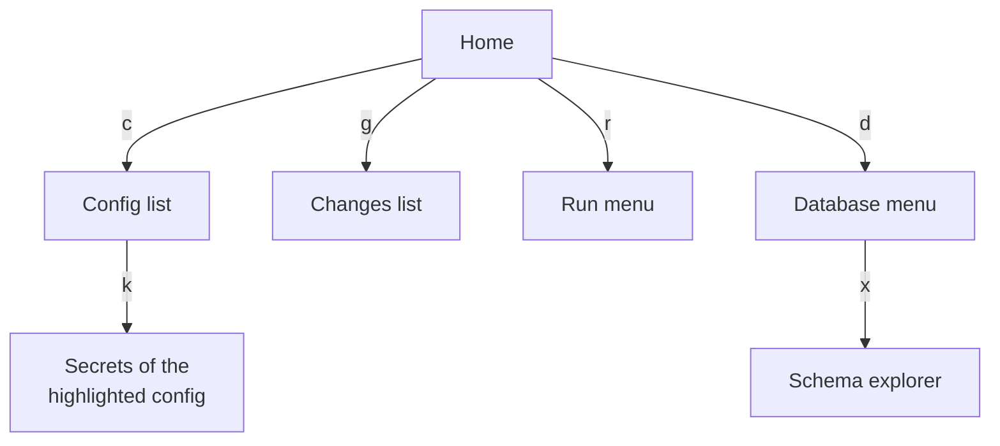
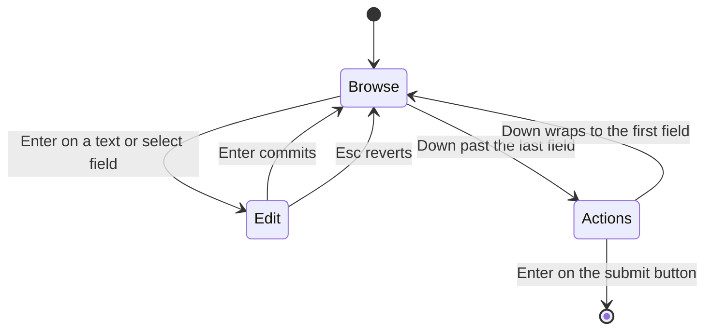

# Terminal UI


Run builds, apply changes, and explore the database from the keyboard.

```bash
noorm ui
```


`noorm ui` takes no flags and opens on Home. Every other `noorm` command is a non-interactive CLI, and bare `noorm` prints the command list; see the [CLI reference](/headless).


## How do I get around?


Home opens four working screens with one key. Secrets hang off a config, and the schema explorer off the database menu:




| Key on Home | Opens |
|-------------|-------|
| `r` | Run menu |
| `c` | Config list |
| `g` | Changes list |
| `d` | Database menu |
| `+` | More: Settings, Vault, Identity, Lock |
| `s`, `v`, `i`, `l` | Settings, Vault, Identity, Lock, without going through More |
| `u` | Update |
| `1` | Run build |
| `2` | Fast-forward changes |
| `3` | Lock status |
| `q` | Quit |

| Task | Keys |
|------|------|
| Switch config | `c`, `↓` to the config, `Enter` |
| Fast-forward all changes | `g`, `f` |
| Run the build | `r`, `b` |
| Validate a config | `c`, `+`, `v` |


## Which keys work on every screen?


| Key | Action |
|-----|--------|
| `Esc` | Go back, or cancel the operation in flight |
| `Ctrl+C` | Quit |
| `?` | Help overlay. Any key closes it |
| `Shift+L` | Toggle the log viewer |
| `Shift+Q` | Open the SQL terminal |
| `D` | Toggle dry-run mode. The status bar shows `DRY` |
| `F` | Toggle force mode. The status bar shows `FORCE` |

`D` applies to the run screens, `change ff`, and the database wipe, teardown, and transfer screens. `F` applies to the run screens and `change ff`.

While a text field takes input (a form field in edit mode, a search box, the SQL editor), every key above except `Ctrl+C` types its character instead. `?`, `D`, and `F` also stand down inside dialogs.


### Lists


| Key | Action |
|-----|--------|
| `↑` `↓` | Move the cursor. Wraps at both ends, except on the changes list |
| `Enter` | Select |
| `Esc` | Back |
| `1`-`9` | Select by number, on lists that show numbers: Settings and the explorer |
| `Space` | Toggle an item, on multi-select lists. `Enter` then submits |

A list fits the window, so a taller terminal shows more rows. It keeps its cursor when you open an item and come back.


### Forms


A form has two modes. `Enter` switches between them, so submitting is a place you navigate to:



| Mode | Key | Effect |
|------|-----|--------|
| Browse | `↑` `↓`, `Tab`, `Shift+Tab` | Move between fields, wrapping through the action row |
| Browse | `Enter` | Open the field for editing |
| Browse | `Esc` | Cancel the form |
| Edit | `Enter` | Commit and return to browse |
| Edit | `Esc` | Restore the value the field held when edit opened |
| Edit | `Tab`, `Shift+Tab` | Commit and move to the next or previous field |
| Actions | `←` `→`, `Enter` | Pick a button and activate it |

A checkbox toggles in place on `Enter` or `Space`. A select expands on `Enter`, moves with `↑` `↓`, and takes the highlighted option on a second `Enter`. A red `*` marks a required field. Submitting with one empty puts the cursor on it, with the error beside the value.


### Mouse


On by default, in lists and result grids:

| Action | Effect |
|--------|--------|
| Click a row | Move the cursor to it |
| Double-click a row | Same as `Enter` on that row |
| Wheel | Move the cursor one row, or scroll a document |

A click acts on whatever already has focus. Clicking an unfocused list does nothing.

::: tip
Mouse tracking takes click-drag text selection away from the terminal. Hold Option in macOS Terminal and iTerm2, or Shift in most others. To turn the mouse off, set `ui.mouse` in `.noorm/settings.yml`; `?` prints the same hint.

```yaml
# .noorm/settings.yml
ui:
    mouse: false
```
:::


## What does Esc do while the database is busy?


A screen waiting on the database says so and names the key:

```
Testing connection...  [Esc] Cancel
```

That covers testing a config (add and edit), the force-release lock check, and the SQL terminal connecting or running a query. `Esc` returns the screen to a usable state and saves nothing. The client always stops waiting. Whether the server stops depends on the dialect:

| Dialect | Effect on the server |
|---------|----------------------|
| PostgreSQL | `pg_cancel_backend` asks it to stop the statement |
| MySQL | `KILL QUERY` stops the statement |
| SQL Server, SQLite | Nothing. The statement finishes. The message reads `Stopped waiting. The query may still be running on the server.` |

A connect that answers after you cancelled is closed, not adopted. A connection attempt also ends on its own after 15 seconds. Raise `connection.connectTimeoutMs` for a link that is slow but working. [The SQL terminal guide](/guide/database/terminal) has the full table.


### Long-Running Files


A file that runs past 10 seconds gets a status block under its name, refreshed every 10 seconds. It appears on the run screens (Build, Exec, Dir, File) and the change screens (Run, Revert, Fast Forward, Next, Rewind):

```
Current:  06_items.sql
Running for 17m05s  pid 4412
CREATE INDEX on items · building index: loading tuples · 4210/9800 (42%)  2 parallel workers
Waiting on pid 4411 (CREATE INDEX items_embedding ..., 17m04s) · Lock: transactionid
```

| Line | Appears when |
|------|--------------|
| `Running for …  pid …` | Always. SQLite shows elapsed time only |
| Operation progress | The server reports it: index builds, `VACUUM`, `CLUSTER`, `COPY`, `ANALYZE` on PostgreSQL; `percent_complete` on SQL Server; stage counters on MySQL |
| `Waiting on pid …` | The file waits on another session's lock |

On Run Build and Run Exec, press `Esc` once for a warning and again within 2 seconds to cancel. No further file starts. PostgreSQL and MySQL cancel the running statement. SQL Server and SQLite let it finish, and the screen says `Stopping after the current file finishes.` Leaving the screen does not cancel the run.


## What does each screen do?


### Config List


A config shows `●` when active and `○` when not, with `[user:<role> agent:<role|off>]` when its access differs from the default (`admin` for you, `viewer` for the agent) and `[test]` on a test config.

| Key | Action |
|-----|--------|
| `Enter` | Make the highlighted config active. On the config that is already active, open its edit form |
| `a` | Add |
| `e` | Edit |
| `d` | Delete |
| `c` | Copy |
| `k` | Secrets of the highlighted config |
| `+` | More: `x` export, `i` import, `v` validate |

Adding a config is interactive only. `noorm config add` points here, and `noorm config import <file.json>` is the headless route.


`User Role` covers a human on the CLI, TUI, or SDK. `Agent Role` covers an AI agent over MCP and the CLI. They are independent. [Configs](/guide/environments/configs#access-roles) lists what each role permits.


### Changes List


| Symbol | Meaning |
|--------|---------|
| `✓` | Applied |
| `○` | Pending |
| `✗` | Failed |
| `↩` | Reverted |
| `!` | Orphaned: recorded in the database, folder gone from disk |

| Key | Action |
|-----|--------|
| `Enter` | Run a pending, failed, or reverted change. Revert an applied one |
| `a` | Add |
| `e` | Edit. Not for an orphaned change |
| `d` | Delete |
| `r` | Run. Pending, failed, or reverted only |
| `v` | Revert. Applied only |
| `n` | Next: apply the next N pending changes, one by default |
| `f` | Fast-forward all pending changes |
| `w` | Rewind |
| `h` | History |

With no changes, the list reads `No changes found. Press [a] to create one.`


History lists what ran, when, and under which identity. `Enter` shows the files, and `e` shows the full error of a failed change.


### Run Menu


`b` or `1` Build, `e` or `2` Exec, `f` or `3` File, `d` or `4` Dir, `i` or `5` Inspect.

A file that already ran with the same content opens **File Previously Run** and asks `Run this file again?`. A directory with such files opens **Files Previously Run**.


### Database Menu


| Key | Action | Needs a connection |
|-----|--------|--------------------|
| `c` | Create the database. Shows a toast if it is already initialized | No |
| `d` | Destroy | No |
| `x` | Explore | Yes |
| `w` | Wipe: truncate | Yes |
| `t` | Teardown | Yes |
| `r` | Transfer | Yes |

The SQL terminal is not on this menu. Open it with `Shift+Q`.


### Schema Explorer


Each category opens from the overview by its letter or its number. A category with no objects does nothing.

| Category | Keys |
|----------|------|
| Tables | `t`, `1` |
| Views | `v`, `2` |
| Procedures | `p`, `3` |
| Functions | `f`, `4` |
| Types | `y`, `5` |
| Indexes | `i`, `6` |
| Foreign Keys | `k`, `7` |


`Enter` on an object opens its detail. Indexes and foreign keys have none.


A detail longer than the window scrolls. The footer lists only the keys the screen answers to.

| Key | Action |
|-----|--------|
| `↑` `↓` | Scroll one line |
| `Ctrl+U`, `Ctrl+D` | Half a page |
| `PageUp`, `PageDown` | A full page. On macOS the footer shows `fn ↑↓` |
| `Home`, `End` | Top, bottom |
| `v` | Full text: the same rows with nothing truncated |
| `r` | Read rows. Tables only |


### Reading Rows


`r` on a table detail reads its rows without leaving the explorer for the SQL terminal.


The peek reads both ends of the table, so the last rows by primary key are as reachable as the first:


| Key | Action |
|-----|--------|
| `↑` `↓` | Move the cursor within a set |
| `Tab` | Swap between the first set and the last |
| `Enter` | Open the highlighted row as a document |
| `/` | Filter. `Tab` cycles the column, `Enter` applies, `Esc` clears |
| `s` | Sort. `←` `→` pick the column, `a` ascending, `d` descending |
| `c` | Clear filter and sort |
| `Esc` | Close the peek |

| Condition | Result |
|-----------|--------|
| The role lacks `sql:read` | Refused. Reading rows needs `sql:read`, not the `explore` permission the other explorer screens use |
| The table has no primary key | Only the first rows appear: `No primary key, so there is no last set — rows are in storage order.` |
| Both ends meet | One table, headed `All N rows` |

The grid fits as many whole columns as the terminal holds and marks the rest `… N more columns`. `Enter` on a row shows them all:


| Key | Action |
|-----|--------|
| `←` `→` | Previous row, next row, in the order the table showed |
| `↑` `↓` | Scroll a document taller than the window |
| `f` | Swap YAML and JSON. The choice holds for the session |
| `Esc` | Back to the peek, on the row you were reading |


### SQL Terminal


`Shift+Q` opens the SQL terminal against the active config from any screen.


| Key | Action |
|-----|--------|
| `Enter` | Run the query |
| `Shift+Enter` | New line |
| `Shift+Tab` | Toggle edit mode, where `Enter` inserts a new line |
| `↑` `↓` | Walk query history, when the box is empty or already browsing |
| `h` | Open the history list, when the box is empty |
| `Tab` | Switch between the query and the results, once there are rows |
| `Esc` | In results: back to the query. With text in the box: clear it. Empty: go back. While a query runs: cancel it |

In the results grid, `/`, `s`, and `c` filter, sort, and clear as in the row peek, and `Enter` opens a row as a document. A result wider than the terminal keeps whole columns and marks the remainder `… N more columns`.

The history list takes `↑` `↓`, `Enter` to view a result, `r` to re-run a query, and `c` to clear.


### Log Viewer


`Shift+L` toggles an overlay that tails events as they happen, newest first.


| Key | Action |
|-----|--------|
| `/` | Search. `Enter` leaves search, `Esc` clears it |
| `g`, `G` | Newest, oldest |
| `↑` `↓`, `PageUp`, `PageDown` | Move |
| `Space` | Pause or resume the tail |
| `r` | Refresh |
| `Enter` | Open one entry in full. `Esc` returns to the list |
| `Shift+L`, `Esc` | Close |


### More


`+` from Home opens Settings (`s`), Vault (`v`), Identity (`i`), and Lock (`l`). Each also has its direct key on Home.


### Settings


Seven groups: Build, Paths, Stages, Rules, Strict, Logging, Secrets. `Enter` or a number opens one, and edits write to `.noorm/settings.yml`. `i` creates that file when the project has none. See [SQL file organization](/guide/sql-files/organization) and [Configs](/guide/environments/configs).


### Identity


`e` edit, `x` export your public key, `r` regenerate, `u` known users. The identity lives in `~/.noorm/` and names who ran each change in the [history](/guide/changes/history). The CLI equivalent is [`noorm identity`](/cli/identity).


### Vault


The vault holds team-shared encrypted secrets in the database. It starts uninitialized: `i` creates it. After that, `a` adds a secret, `Enter` edits the highlighted one, and `p` propagates access to teammates. See [Vault](/guide/environments/vault).


### Secrets


`k` on the config list opens the highlighted config's secrets: `a` add, `e` or `Enter` edit, `d` delete. See [Secrets](/guide/environments/secrets).


### Lock


noorm locks the database around writes, so two people building one environment do not interleave. On the lock menu, `s` or `1` shows status, `a` or `2` acquires, `r` or `3` releases, and `f` or `4` force-breaks a stale lock. The status screen also has `x` to extend. See [Locking](/dev/lock).


### Update


`u` from Home checks GitHub releases for a newer noorm. `i` installs it, `r` checks again, and `Esc` goes back.

A binary install reports its download as `42.0 / 73.0 MB (57%)` with a progress bar. Without a `Content-Length` it shows `9.0 MB received` and no bar. A stalled download resumes from the bytes on disk and shows `download stalled — no data for 30s — resuming (attempt N/5)...`. An npm install runs the package manager and shows none of this.


## Next


- [CLI reference](/headless): the non-interactive surface
- [The SQL terminal guide](/guide/database/terminal): history, result browsing, per-dialect cancel
- [Execution](/guide/sql-files/execution): what the run screens do with each file
- [Configs](/guide/environments/configs): access roles
