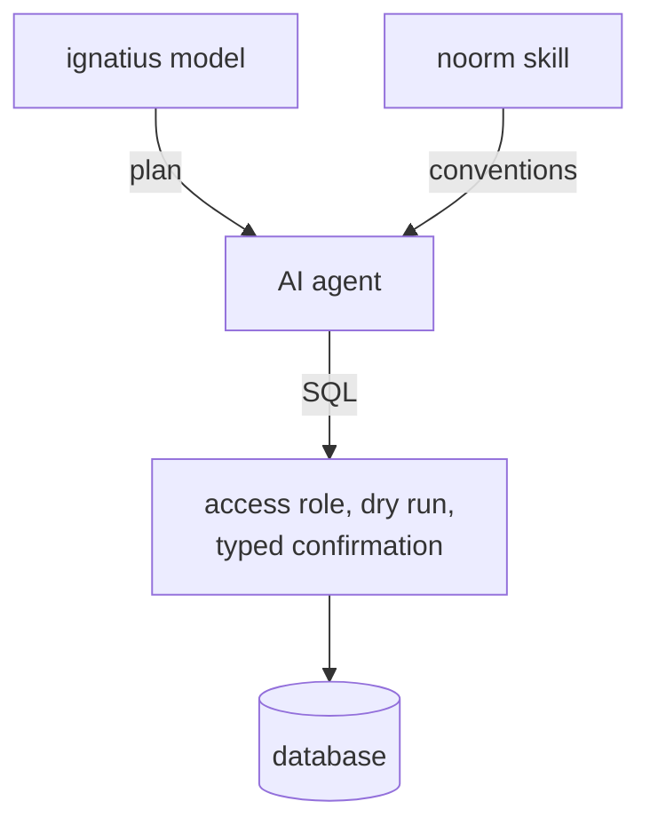

# Why noorm

I stopped using ORMs and needed something to run the SQL. Every other part of noorm answers a question I hit after that.

## Which questions grew the tool?

Each row is a question I hit.

| Question | What it became |
|---|---|
| How do I run SQL? | [A folder of files](/getting-started/concepts), run in path order |
| How do I undo one? | [Forward and revert](/guide/changes/forward-revert) pairs |
| How do I test against it? | A real database behind a [`requireTest`](/reference/sdk) guard |
| How do I write painful DDL and seed data? | [Templates](/guide/sql-files/templates) that render SQL from YAML, and [transfer](/guide/database/transfer) |
| Where does connection configuration live? | [Configs](/guide/environments/configs) you export to a teammate |
| How do I onboard someone onto four environments? | [Stages](/guide/environments/stages) with required secrets |
| Where do team secrets live? | A [vault](/guide/environments/vault) table inside the database |
| What ran, who ran it, and why did it break? | [History](/guide/changes/history) with the operator and the error |
| How do I re-run objects meant to be re-run? | `.txt` [manifests](/guide/changes/overview) that run `db/sql/` files |

## Why is the interface split in two?

noorm is the fifth attempt. I replaced each of the first three because I needed something more robust, one a new teammate could use without a manual. Then I moved to citty and @clack/prompts, and tried Ink.

| Library, in the order I used it | What it is | In noorm today |
|---|---|---|
| minimist | argument parser | no |
| cmd-ts | type-driven argument parser | no |
| oclif | CLI framework | no |
| citty | CLI builder | the commands in `src/cli/` |
| @clack/prompts | interactive prompts | `noorm init`, `noorm change add` |
| Ink | React for the terminal | the TUI in `src/tui/` |

Running commands means remembering commands. A screen that shows configs, pending changes, and schema while you decide beats typing a verb and hoping the flags are right.

`noorm ui` opens the [TUI](/tui). The other commands take flags, so they run in scripts and CI ([CLI reference](/headless)).

## Why templates?

Templates let seed data be written and iterated on, and let YAML become DDL that is miserable to write by hand. SQL Server scheduled jobs are the clearest case: a schedule written semantically renders into the DDL that creates the job. A YAML list of who gets what is readable and diffable, and the `GRANT` statements it renders into are not.

## Why does history record the operator and the error?

Every applied change records its status, when it ran, who ran it, and the error message when it failed. A failure you fixed and re-ran can surface days later. The recorded error shows which run to trace back to, and the operator puts a name on a pattern of failures.

`changelog.md` in the change folder holds the reason for the change, next to the SQL it justifies. A `.txt` manifest lists the views, functions, and stored procedures a change re-runs, so fixing a stored procedure is a tracked change.

## How do teams share environments?

A config exports from the TUI encrypted to the recipient's public key, without `user` and `password`, so the recipient supplies their own. [Configs](/guide/environments/configs#how-do-i-share-a-config-with-a-teammate) covers both export paths.

A template that reads an unset secret fails with `Secret "KEY" not found (searched: config-local, global-local, vault)`. The vault keeps team secrets encrypted in the database (`noorm.vault` on PostgreSQL and SQL Server, `__noorm_vault__` on MySQL and SQLite) at the lowest precedence, so a local value wins.

## What changed when LLMs arrived?

Writing SQL stopped being the slow part. Reviewing SQL that an agent wrote quickly, confidently, and sometimes wrongly became the slow part. Three additions act before the agent writes, while it writes, and before its SQL runs.

- **ignatius model**: the cheapest moment to catch a bad schema is before it exists, which became a separate tool, [ignatius](/modeling/).
- **noorm skill**: the [agent skill](/getting-started/installation#install-the-agent-skill-optional) teaches an agent this project's conventions.
- **access role, dry run, typed confirmation**: per-channel [access roles](/guide/environments/configs#access-roles), `--dry-run`, and a typed confirmation on destructive operations.

## Next

- [Installation](/getting-started/installation)
- [Concepts](/getting-started/concepts)
- [Information modeling](/modeling/)
