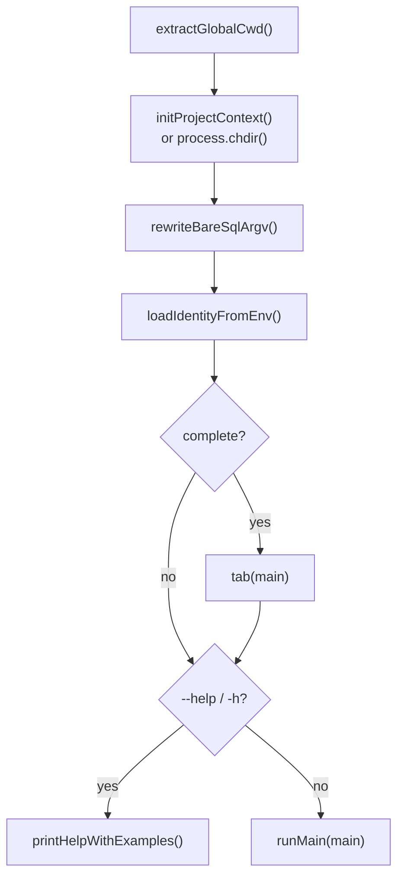
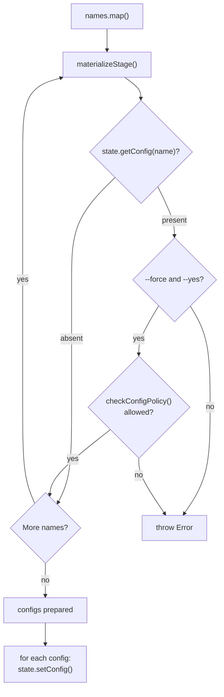
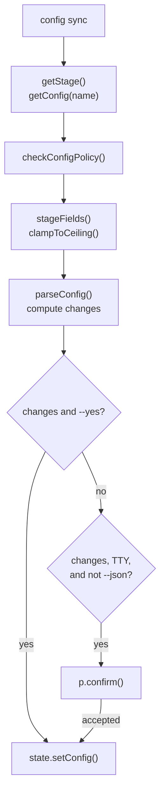
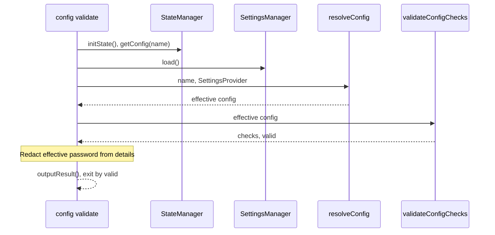
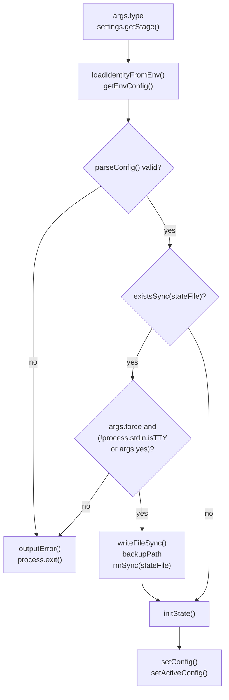
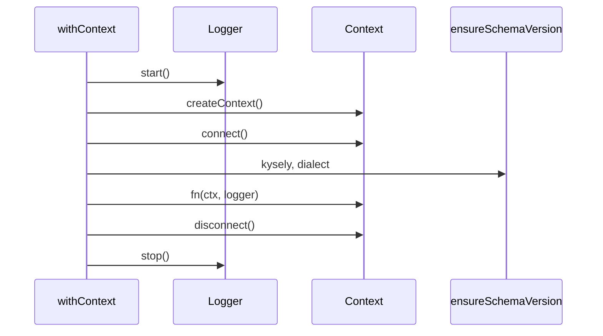
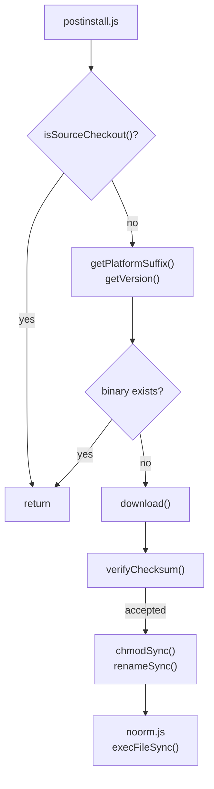

# cli

## What it does

The `noorm` CLI exposes database operations to scripts and terminals without starting the TUI. It also creates stored configurations from project stages, previews stage updates, and bootstraps ephemeral CI state. Use `noorm ui` to launch the interactive application instead.

Stage creation needs settings and an identity private key, not a live database. These invocations select a stage, create password-free configurations in bulk, and preview synchronization:

```sh
noorm config create --stage development --name workstation --json
noorm config create --all --json
noorm config sync --stage development --name workstation --json
```

[`src/cli/index.ts`](../../src/cli/index.ts) supplies dispatch and help; [`packages/cli`](../../packages/cli) publishes the `@noormdev/cli` binary launcher. Commands declare their own flags rather than inheriting a universal root flag set.

## How it works

### Dispatch and help

`entry()` applies the working directory and identity overrides before help or command execution; completion registration only runs for a completion request.



The root lazily imports `change`, `ci`, `config`, `db`, `dev`, `identity`, `info`, `init`, `lock`, `mcp`, `run`, `secret`, `settings`, `sql`, `ui`, `update`, `vault`, and `version`. The `complete` stub avoids resolving the command tree during ordinary startup. `resolveCommand()` builds the help breadcrumb, and commands attach an [`examples`](../../examples) property for the appended [`EXAMPLES`](../../EXAMPLES) block. Bare SQL matching `SQL_VERBS` becomes a `sql query` invocation; named SQL subcommands remain unchanged.

CLI-owned command surfaces include:

- `config`: `add`, `cp`, `create`, `edit`, `export`, `import`, `list`, `rm`, `sync`, `use`, `validate`.
- `ci`: `identity`, `init`, `secrets`.
- `settings`: `init`, `build`, `edit`, `secret`.
- `lock`: `acquire`, `force`, `release`, `status`.
- `dev`: `test-helpers`, `test-workers`.

### Stage creation

`config create` prepares and checks the selected configurations before its write loop, so a collision or authorization failure prevents earlier candidates from being saved.



`--all` excludes `--stage`, `--name`, connection overrides, and `--password`. It uses each stage name as its stored name and ignores environment configuration entirely. The command neither connects nor prompts in either mode.

Single-stage creation uses `--name` or the stage name as the final write target. `NOORM_NAME` cannot redirect that target, its collision check, or its authorization check. Connection flags override environment connection values, which override stage defaults. Non-connection environment fields do not replace stage type, `isTest`, or access. The core-state domain owns environment spelling and runtime resolution.

`materializeStage()` removes inherited passwords, including passwords from stage defaults and the environment. Only the explicit single-stage `--password` persists a password. Bulk replacement also discards an existing stored password because it writes a newly materialized config rather than merging the old record. Stage type, `isTest`, and access remain part of materialization; protected-stage restrictions remain enforced by core-policy.

Existing targets are not skipped. A collision without both `--force` and `--yes` fails with `overwriting requires --force and --yes`; supplying both still requires `config:write` authorization against the existing target. Preparation completes before persistence, but the later write loop is not a transactional batch.

### Stage synchronization

`config sync` computes a field diff before confirmation and writes only when a nonempty diff is confirmed.



The target defaults to the source stage name; `--name` selects a different stored config. A missing stage or target, denied authorization, or a different stage dialect fails before saving. The command does not connect to a database.

Only explicitly supplied stage fields participate: type, `isTest`, access, and supported connection defaults. Sync preserves the stored password, identity, name, and schema-supported fields absent from the stage. Access can tighten but cannot widen existing access, including for protected stages. The core-policy domain owns the ceiling rules.

Plain output prints the preview before asking `Apply these changes?`, with a negative default. Non-TTY or JSON execution without `--yes` returns a preview without prompting or saving. JSON includes `stage`, `name`, `changes`, and `applied`; an empty diff returns `applied: false` even with `--yes`. Neither inherited nor existing passwords enter the diff.

### Effective validation

`config validate` requires a stored target but probes its resolved configuration, not the raw stored connection.



The command returns `success: valid`, `config`, `valid`, and `checks`. Failed validation exits `1`; a missing target or failed settings/config resolution exits `2`. Password redaction uses the effective connection password. Resolution precedence belongs to core-state.

### CI bootstrap

`ci init` resolves type, stage, identity, and connection inputs, then constructs and parses the full effective config before backing up or removing existing state or calling `initState()`. Rejected configuration leaves the existing encrypted state intact.



The stored type is `--type`, otherwise the selected stage's default type, otherwise `remote`. `--type` accepts `local` or `remote`; an unknown stage fails even if `--type` is present. `--stage` inherits type only, not stage connection, test status, or access. `--test` explicitly sets `isTest`; the default remains false so CI bootstrap does not automatically satisfy the SDK's `requireTest` guard.

The name comes from `--name`, otherwise `NOORM_CI_CONFIG_NAME`, otherwise `ci`. Replacement backs up the encrypted state with owner-only permissions; a backup failure prevents removal. `--force` suffices off a TTY, while a terminal also requires `--yes` because replacement removes the project's configs and config-scoped secrets.

### Connected command lifecycle and output

`withContext()` connects and checks the schema before calling a command, then disconnects and stops its logger.



`withVaultContext()` additionally loads the private key and identity metadata and registers the identity. `createCliLogger()` reads project logging settings; disabling file logging does not disable command output.

`outputResult()` writes results to stdout. JSON passes through `toJsonEnvelope()`: objects retain explicit `success`, otherwise derive it from `status`, and non-object payloads receive a `data` wrapper. `outputError()` emits `{ success: false, error }` on stdout in JSON mode and diagnostics on stderr in text mode.

### Binary installation

Postinstall promotes a downloaded binary only after checksum verification succeeds or the caller explicitly permits an unavailable checksum.



[`packages/cli/package.json`](../../packages/cli/package.json) maps `noorm` to `noorm.js` and requires Node `>=22.13`. The shim forwards argv, environment, inherited stdio, and the child exit status. Postinstall selects the OS/architecture asset, including Linux musl variants, from the package-version release. Source checkout detection uses the workspace root package name, not directory shape alone.

## Where it lives

| Path | Role |
|---|---|
| [`src/cli/index.ts`](../../src/cli/index.ts) | Lazy root registration, cwd handling, SQL shorthand, completion, and help examples. |
| [`src/cli/_utils.ts`](../../src/cli/_utils.ts), [`src/cli/_exit.ts`](../../src/cli/_exit.ts) | Shared flags, logger/context lifecycle, output envelopes, and exit status mapping. |
| [`src/cli/config/index.ts`](../../src/cli/config/index.ts), [`src/cli/config/create.ts`](../../src/cli/config/create.ts) | Config command surface and headless stage materialization. |
| [`src/cli/config/sync.ts`](../../src/cli/config/sync.ts), [`src/cli/config/validate.ts`](../../src/cli/config/validate.ts) | Preview/apply stage defaults and probe effective configs. |
| [`src/cli/ci`](../../src/cli/ci) | CI identity provisioning, ephemeral bootstrap, and batch-loading config-scoped secrets from dotenv files. |
| [`src/cli/settings`](../../src/cli/settings), [`src/cli/lock`](../../src/cli/lock), [`src/cli/dev`](../../src/cli/dev) | Settings commands, distributed lock commands, and internal diagnostics. |
| [`src/cli/init.ts`](../../src/cli/init.ts), [`src/cli/ui.ts`](../../src/cli/ui.ts) | Project bootstrap and lazy interactive application startup. |
| [`src/cli/info.ts`](../../src/cli/info.ts), [`src/cli/version.ts`](../../src/cli/version.ts), [`src/cli/update.ts`](../../src/cli/update.ts) | Project/database status, installation diagnostics without a DB connection, and binary updates. |
| [`packages/cli/package.json`](../../packages/cli/package.json), [`packages/cli/noorm.js`](../../packages/cli/noorm.js), [`packages/cli/scripts/postinstall.js`](../../packages/cli/scripts/postinstall.js) | Published launcher metadata, process forwarding, and verified binary installation. |
| [`skills/noorm/SKILL.md`](../../skills/noorm/SKILL.md), [`skills/noorm/references`](../../skills/noorm/references) | Agent routing to CLI, SDK, configuration, schema-file, and template guidance. |
| [`tests/cli/config/stage-commands.test.ts`](../../tests/cli/config/stage-commands.test.ts) | Subprocess contracts for creation targets, credentials, collision preflight, authorization, and sync. |
| [`tests/cli/ci/init.test.ts`](../../tests/cli/ci/init.test.ts) | CI bootstrap and replacement contracts, including byte-for-byte preservation of encrypted state and stored configs when forced replacement fails full config validation. |
| [`tests/cli/citty-help.test.ts`](../../tests/cli/citty-help.test.ts), [`tests/cli/global-flags.test.ts`](../../tests/cli/global-flags.test.ts), [`tests/cli/lazy-startup.test.ts`](../../tests/cli/lazy-startup.test.ts) | Help breadcrumbs, root flag placement, and headless import boundaries. |
| [`tests/cli/exit-codes.test.ts`](../../tests/cli/exit-codes.test.ts), [`tests/cli/json-envelope.test.ts`](../../tests/cli/json-envelope.test.ts), [`tests/cli/cli-logger-settings.test.ts`](../../tests/cli/cli-logger-settings.test.ts) | Exit/output agreement and logger configuration contracts. |
| [`tests/cli/init.test.ts`](../../tests/cli/init.test.ts), [`tests/cli/env-bootstrap.test.ts`](../../tests/cli/env-bootstrap.test.ts), [`tests/cli/postinstall-source-checkout.test.ts`](../../tests/cli/postinstall-source-checkout.test.ts) | Bootstrap gates, environment identity startup, and installation checkout detection. |

## Constraints

- Only `-c`/`--cwd` has custom root-level meaning. Put command flags after the command that consumes them; misplaced root flags fail rather than being forwarded. Built-in help/version flags pass through. After dispatch, `-c` can mean `--config` instead.
- Shared flags are definitions, not implicit support. A command must declare a flag to consume it; assuming every command accepts `--dry-run`, `--force`, or `--json` changes the invocation contract.
- `config create` requires an identity private key. Bulk mode forbids overrides and passwords; a collision or policy failure aborts preparation without saving candidates. `--force --yes` cannot bypass authorization or human-confirmation requirements imposed by policy.
- `config sync` authorizes before preview and does not accept dialect conversion. A preview is not an applied change: automation must pass `--yes` and inspect `applied`.
- Create and sync use the parsed `args.yes` directly. The helper's `NOORM_YES` support does not substitute for the explicit confirmation flag on these commands.
- `ci init` completes full `parseConfig()` validation before backup, removal, or state initialization. Invalid configuration exits with usage status `2` without replacing existing state, even with `--force --yes`. Replacement requires a successful backup before removal.
- `noorm init --yes` requires a complete existing identity. Without yes mode, non-TTY initialization fails. `--here` uses the original invocation directory instead of the discovered parent project; `--force` is required to reinitialize an existing project.
- [`src/cli/ui.ts`](../../src/cli/ui.ts) dynamically imports Ink, React, and the TUI app and suppresses logger streams during rendering. Static UI imports into the headless startup graph would violate the boundary covered by [`tests/cli/lazy-startup.test.ts`](../../tests/cli/lazy-startup.test.ts).
- Exit status `0` means success, `1` failure, `2` usage failure, and `3` partial completion. A partial result can leave mixed state; blindly retrying it is not equivalent to retrying a rejected invocation. Unknown operation statuses map to failure.
- A confirmed binary checksum mismatch is fatal. `NOORM_INSECURE` permits unavailable checksums or missing asset entries, not a known bad hash; bypassing that distinction would install a binary verification rejected.

## Coupling

- **core-state** owns settings, stage materialization primitives, encrypted storage, environment spelling, and effective config resolution. CLI create, sync, validation, and CI initialization consume those contracts; runtime resolution details belong in [`docs/wiki/core-state.md`](core-state.md).
- **core-policy** owns channel detection, `config:write` authorization, human-confirmation restrictions, and protected-stage access ceilings. CLI confirmation flags do not replace those decisions; see [`docs/wiki/core-policy.md`](core-policy.md).
- **sdk** supplies `createContext()` and owns `requireTest`. Stage `isTest` and explicit CI `--test` supply the metadata that guard consumes; see [`docs/wiki/sdk.md`](sdk.md).
- **core-identity** supplies environment identity loading, private keys, registration, vault operations, and distributed lock behavior. The CLI owns startup wiring and the `ci`/`lock` command surfaces, not those mechanisms.
- **core-change**, **core-db**, **core-runner**, and **mcp-rpc** own the operation semantics behind their command groups. `mcp serve` enters the MCP server through CLI dispatch.
- **tui** owns the application loaded by `noorm ui`; TUI tests also reside under [`tests/cli`](../../tests/cli), so that directory is not exclusively headless CLI coverage.
- **infra** builds and publishes the binary assets that postinstall consumes. Package version, release tag, asset naming, and checksums must agree with [`packages/cli/scripts/postinstall.js`](../../packages/cli/scripts/postinstall.js).
- [`skills/noorm/SKILL.md`](../../skills/noorm/SKILL.md) routes agent-driven command use to [`skills/noorm/references/cli.md`](../../skills/noorm/references/cli.md) and stage configuration to [`skills/noorm/references/config.md`](../../skills/noorm/references/config.md). Flag placement and config-command contracts must stay aligned with those references.
