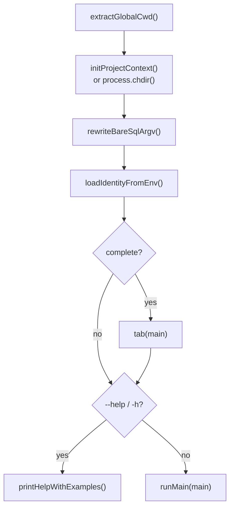
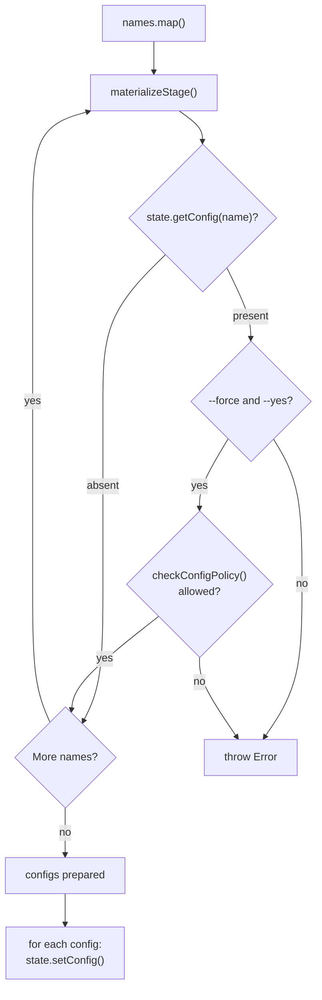
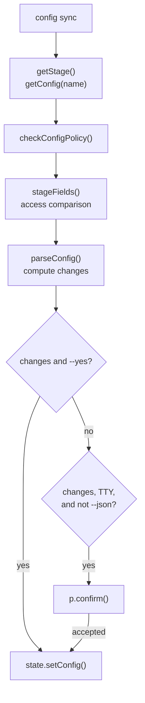
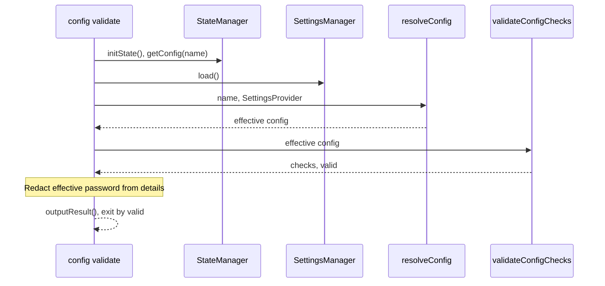
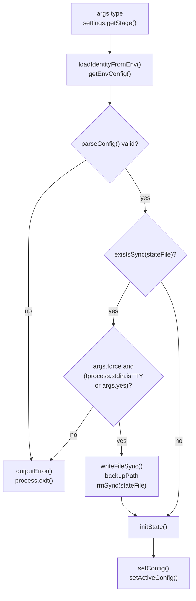
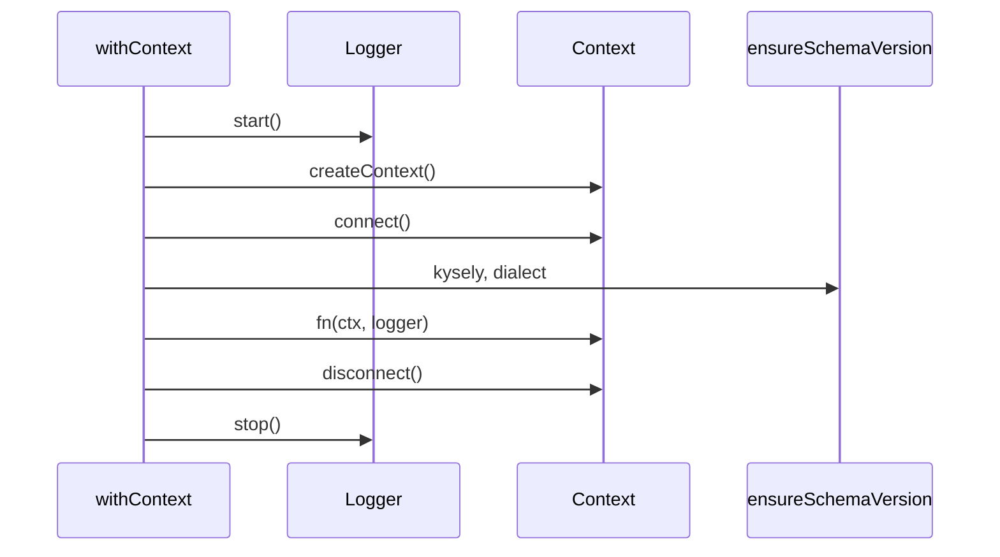
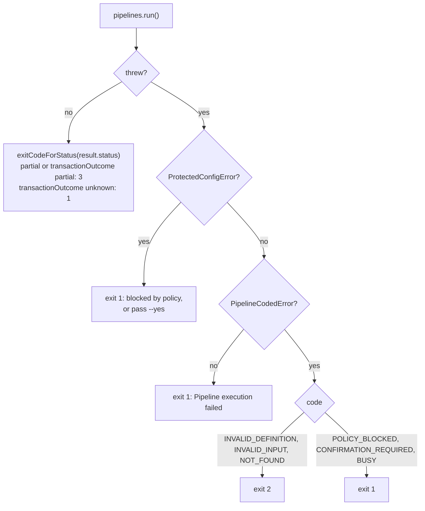
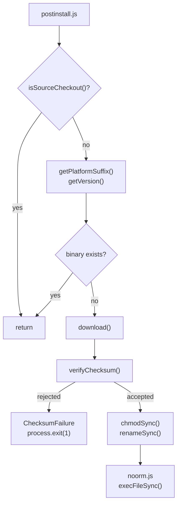

# cli

## What it does

This domain turns `noorm` argv into command execution without the TUI: root dispatch and help, the headless `config`, `ci`, `settings`, `lock`, and `update` commands, the JSON and exit-status output contract every command shares, and the `@noormdev/cli` launcher that downloads and verifies the compiled binary. Without it, scripts and CI have no way to create configurations, bootstrap encrypted state, or read a stable success/exit signal. `noorm ui` launches the interactive application.

The name covers more than [`src/cli`](../../src/cli). [`skills/noorm`](../../skills/noorm) is the agent skill that teaches harnesses to drive these commands, and [`tests/cli`](../../tests/cli) also holds TUI tests (the `components`, `hooks`, and `screens` subdirectories belong to the tui domain). Command groups for `change`, `run`, `db`, `identity`, `secret`, `vault`, `sql`, `mcp`, and `pipeline` live under [`src/cli`](../../src/cli) but belong to other domains; `pipeline` is covered below only for how the CLI shell maps its results to exit codes and input.

Stage creation needs settings and an identity private key, not a live database. These invocations select a stage, create password-free configurations in bulk, and preview synchronization:

```sh
noorm config create --stage development --name workstation --json
noorm config create --all --json
noorm config sync --stage development --name workstation --json
```

[`src/cli/index.ts`](../../src/cli/index.ts) supplies dispatch and help; [`packages/cli`](../../packages/cli) publishes the `@noormdev/cli` binary launcher. Commands declare their own flags rather than inheriting a universal root flag set.

## How it works

### Dispatch and help

`entry()` applies the working directory and identity overrides before help or command execution; completion registration only runs for a completion request.



The root lazily imports `change`, `ci`, `config`, `db`, `dev`, `identity`, `info`, `init`, `lock`, `mcp`, `pipeline`, `run`, `secret`, `settings`, `sql`, `ui`, `update`, `vault`, and `version`. The `complete` stub avoids resolving the command tree during ordinary startup. `resolveCommand()` builds the help breadcrumb, and commands attach an [`examples`](../../examples) property for the appended [`EXAMPLES`](../../EXAMPLES) block. Bare SQL matching `SQL_VERBS` becomes a `sql query` invocation; named SQL subcommands remain unchanged.

Commands attach `examples: string[]` to the `defineCommand()` result; this is the help interceptor's property, not a Citty-native field. Environment identity startup installs `setKeyOverride()` and `setIdentityOverride()` so downstream key and metadata reads can use `NOORM_IDENTITY_PRIVATE_KEY`, `NOORM_IDENTITY_NAME`, and `NOORM_IDENTITY_EMAIL` without identity files. Unset overrides leave disk lookup available.

| Entrypoint | Subcommands | Operational behavior |
|---|---|---|
| `config` | `add`, `cp`, `create`, `edit`, `export`, `import`, `list`, `repair-access`, `rm`, `sync`, `use`, `validate` | Stored-config operations; gates, creation, sync, and validation are described below. `add` and `edit` are stubs in [`src/cli/config/add.ts`](../../src/cli/config/add.ts) and [`src/cli/config/edit.ts`](../../src/cli/config/edit.ts) that exit `1` and point to `noorm ui` or `config import`. |
| `ci` | `identity` (`new`, `enroll`), `init`, `secrets` | CI identity provisioning, ephemeral state bootstrap, and config-scoped secrets from dotenv files. |
| `settings` | `init`, `build`, `edit`, `secret` | Project settings commands. |
| `lock` | `acquire`, `force`, `release`, `status` | Distributed lock commands. |
| `pipeline` | `run`, `history`, `show` | SQL pipeline shell; see Pipeline commands. |
| `dev` | `test-helpers`, `test-workers` | Internal helper and worker diagnostics rather than database-domain operations. |
| `info` | none | Reports CLI/schema/state/settings versions, active connection, identity registration timestamps, detected agent harness, and database object counts. The counts come from `fetchOverview()` behind a gate built from the active config's access and the resolved channel; if settings fail to load, the overview is skipped rather than read unchecked. Individual lookup failures do not discard the rest of the report. |
| `version` | none | Reports Node, platform, architecture, identity key paths/existence, and project/config discovery without connecting to a database. |
| `init` | none | Prompts for missing identity name/email through `@clack/prompts`, then calls `performProjectInit()`. Existing-identity, TTY, reinitialization, and working-directory rules appear under Constraints. |
| `ui` | none | Dynamically loads the Ink application and discards logger console/diagnostic writes during rendering. |
| `update` | none | Checks GitHub Releases and replaces the binary. TTY progress updates in place; redirected output uses plain status lines. The checksum escape hatch does not permit a confirmed mismatch. After success, `offerSkill()` ([`src/cli/update.ts`](../../src/cli/update.ts)) prompts on a TTY to install or update the noorm agent skill through `npx` or `gh`, and prints the commands otherwise. It is skipped under `--json` and never changes the exit code. |

### Config access gates

Config commands resolve a record's access through `withConfigPolicy()` so project roles from `settings.yml` apply. `cp`, `export`, `import` (existing target), `rm`, `repair-access`, `sync`, `use`, `create` (collision only), and `list` (`--json` only) bind it; `validate` calls neither `withConfigPolicy()` nor `checkConfigPolicy()`; `resolveConfig()` applies the same policy context, and a failure there exits `2`. `cp`, `export`, `import`, `rm`, `repair-access`, `create`, and `sync` then call `checkConfigPolicy()`; `use` and `list` bind the policy but do not check it. Every binding command except `list` exits `2` on a `withConfigPolicy` error; `list` drops the error and returns the summary without `effectivePermissions`.

| Command | Gate |
|---|---|
| `config cp` | User channel only; `config:write` on the source; a confirmation cell needs `--yes`; `stateManager.copyConfig()` receives the settings provider and rejects a protected-stage source copied to an unprotected name with `ProtectedStageEscapeError`, whose message is printed as is and exits `1`. |
| `config export` | `secret:read`; a confirmation cell needs `--yes`. |
| `config import` | Validates `access` roles against project roles; `config:write` against an existing target; creating a new config needs the user channel. |
| `config use` | Requires the config to exist and to resolve under policy before `setActiveConfig()`, then syncs identity with the database. |
| `config list` | Drops configs where `isVisibleToChannel(c.access, channel)` is false, so an agent never sees an `access.agent: false` config. User channel also reports `accessErrors` for configs whose stored access cannot be read; `--json` adds `effectivePermissions` per channel. |
| `config rm` | A config with unreadable or invalid access takes a recovery path: user channel and `--yes` required, then `config:rm` is checked against the recovery candidate. |
| `config repair-access` | User channel and `--yes`; replaces `access` through `repairConfigAccess()` after validating `--user` and `--agent` (or `false`) against project roles. |

`ci identity enroll` checks `vault:propagate` first ([`src/cli/ci/identity/enroll.ts`](../../src/cli/ci/identity/enroll.ts)), then `vault:read` (with `--yes` for a confirmation cell), wraps propagation in `withPolicyConfirmation()`, and accepts an existing row only when its stored public key matches the presented one. When the target has no `encrypted_vault_key`, `--yes` is also required for propagation; that check runs after the identity row insert, so a run without `--yes` leaves a registered row with no vault access.

### Stage creation

`config create` prepares and checks the selected configurations before its write loop, so a collision or authorization failure prevents earlier candidates from being saved.



`--all` excludes `--stage`, `--name`, connection overrides, and `--password`. It uses each stage name as its stored name and ignores environment configuration entirely. The command neither connects nor prompts in either mode.

Single-stage creation uses `--name` or the stage name as the final write target. Creation is user-channel only, and access roles on created configs are validated against project roles; a protected stage cannot use an alias. `NOORM_NAME` cannot redirect that target, its collision check, or its authorization check. Connection flags override environment connection values, which override stage defaults. Non-connection environment fields do not replace stage type, `isTest`, or access. The core-state domain owns environment spelling and runtime resolution.

`materializeStage()` removes inherited passwords, including passwords from stage defaults and the environment. Only the explicit single-stage `--password` persists a password. Every `--force --yes` overwrite writes a fresh `materializeStage()` result with no password unless `--password` is given, so an existing stored password is discarded rather than merged. Stage type, `isTest`, and access remain part of materialization; protected-stage restrictions remain enforced by core-policy.

Existing targets are not skipped. A collision without both `--force` and `--yes` fails with `overwriting requires --force and --yes`; supplying both still requires `config:write` authorization against the existing target. Preparation completes before persistence, but the later write loop is not a transactional batch.

### Stage synchronization

`config sync` computes a field diff before confirmation and writes only when a nonempty diff is confirmed.



The target defaults to the source stage name; `--name` selects a different stored config only for unprotected stages. A missing stage or target, denied authorization, or a different stage dialect fails before saving. The command does not connect to a database.

Only explicitly supplied stage fields participate: type, `isTest`, access, and supported connection defaults. Sync preserves the stored password, identity, name, and schema-supported fields absent from the stage. Access can tighten but cannot widen existing access, including for protected stages. A custom-role candidate is adopted per channel only if no permission becomes more permissive; incomparable assignments keep the current role. An existing agent role of `false` is kept unless the stage's agent role is also `false`. The core-policy domain owns the ceiling rules.

Plain output prints the preview before asking `Apply these changes?`, with a negative default. A preview without `--yes` returns `applied: false` for non-TTY or JSON execution, without prompting or saving. JSON includes `stage`, `name`, `changes`, and `applied`; an empty diff returns `applied: false` even with `--yes`. Neither inherited nor existing passwords enter the diff.

### Effective validation

`config validate` requires a stored target but probes its resolved configuration, not the raw stored connection.



The command returns `success: valid`, `config`, `valid`, and `checks`. Failed validation exits `1`, as does a state that fails to load; a missing target or failed settings/config resolution exits `2`. Password redaction uses the effective connection password. Resolution precedence belongs to core-state.

### CI bootstrap

`ci init` resolves type, stage, identity, and connection inputs, then constructs and parses the full effective config before backing up or removing existing state or calling `initState()`. Rejected configuration leaves the existing encrypted state intact.



The stored type is `--type`, otherwise the selected stage's default type, otherwise `remote`. `--type` accepts `local` or `remote`; an unknown stage fails even if `--type` is present. `--stage` inherits type only, not stage connection, test status, or access. `--test` explicitly sets `isTest`; the default remains false so CI bootstrap does not automatically satisfy the SDK's `requireTest` guard.

The name comes from `--name`, otherwise `NOORM_CI_CONFIG_NAME`, otherwise `ci`. Replacement backs up the encrypted state with owner-only permissions; a backup failure prevents removal. `--force` suffices off a TTY, while a terminal also requires `--yes` because replacement removes the project's configs and config-scoped secrets.

### Connected command lifecycle and output

`withContext()` connects and checks the schema before calling a command, then disconnects and stops its logger.



`withVaultContext()` additionally loads the private key and identity metadata and registers the identity. `createCliLogger()` reads project logging settings; disabling file logging does not disable command output.

Both context helpers return `[result, null]` or `[null, Error]`. They pass `isYesMode(args)` and `resolveChannel()` into `createContext()`, so environment confirmation and detected agent channels reach SDK guards. `handleVaultResult()` converts vault result/error tuples into JSON or text output and an exit code. Logger settings include `file`, `level`, `maxSize`, and `maxFiles`.

`sharedArgs` defines opt-in `--config`/`-c`, `--json`, `--force`/`-f`, `--dry-run`, and `--yes`/`-y`; each command chooses which definitions to spread into its own argument schema.

`outputResult()` writes results to stdout. JSON passes through `toJsonEnvelope()`: objects retain explicit `success`, otherwise derive it from `status`, and non-object payloads receive a `data` wrapper. `outputError()` emits `{ success: false, error }` on stdout in JSON mode and diagnostics on stderr in text mode.

JSON results remain objects with a boolean `success`, including list results under named keys such as `configs`, `changes`, or `tables`. The exit-code and JSON-envelope subprocess tests pin agreement between `success` and the process status; arrays passed to the shared helper receive the `data` wrapper rather than remaining bare top-level arrays.

### Pipeline commands

`noorm pipeline run <slug>` runs a SQL pipeline, `history <slug>` lists its runs, and `show <id>` prints one run with its steps. Each command is a thin shell over `ctx.noorm.pipelines`; the SDK surface and error codes are in [`docs/wiki/sdk.md`](sdk.md), and execution semantics belong to core-runner.

`entry()` routes `pipeline` argv through its own branch before the general dispatch. The branch wraps help and `runCommand` in `attempt()`. A throw (for example from loading a manifest to generate input flags) prints `definitionFailureMessage()` and sets `EXIT.USAGE`.



`pipelineFailure()` in [`src/cli/pipeline/_common.ts`](../../src/cli/pipeline/_common.ts) derives the exit code and message from the error's `code`. The CLI no longer matches message text, so a reworded error cannot change an exit code. Messages are fixed strings; a definition failure appends the rule name, for example `Invalid pipeline definition (yaml)`. Stored errors, step file paths, skip reasons, and the `active_key` can carry SQL, input, or absolute paths. `history` and `show` strip them with `safeRun()` and `safeStep()`; `pipeline run` strips its result inline in [`src/cli/pipeline/run.ts`](../../src/cli/pipeline/run.ts).

Interrupts: the first `SIGINT` aborts the run through the `AbortController` passed as `signal`; a second one exits `130` without waiting. `interruptHandler()` implements this.

#### Input parsing

[`src/cli/pipeline/input.ts`](../../src/cli/pipeline/input.ts) builds one `--<flag>` per declared input from the definition, plus `--input '<json object>'`. Generated flags are strings; `parsePipelineInputText` converts them to the declared type. `resolvePipelineCliInput()` resolves in a fixed order so invalid values never prompt:

1. Parse `--input` as JSON. It must be a plain object whose keys are all declared inputs.
2. Overlay per-input flags, which win over `--input` keys, then validate each supplied value.
3. Compute missing required inputs that have no default.
4. If any are missing, prompt only when stdin and stdout are TTYs, `CI` is unset, `--json` and yes mode are off, and the channel is `user`. Otherwise throw `PipelineMissingInputError`.

| Failure | Class | Exit and message |
|---|---|---|
| Bad JSON, undeclared key, invalid value, wrong flag | `Error` | `2`, `Invalid or cancelled pipeline input or invocation` |
| Missing required inputs, no prompt possible | `PipelineMissingInputError` | `2`, `Missing required pipeline inputs: <names>`; names only, never values |
| Prompt cancelled | `PipelineInputCancelledError` | `2`, generic message; no SQL has run |

`history` validates `--limit` with `parseHistoryLimit` (1 to 100); `show` validates its run-ID positional with `parseRunId`. Both parsers are shared with the SDK and TUI. Invalid values exit `2`; an unknown run exits `1` with `Pipeline run not found`.

Input values reach SQL only through `$.quote`, which is dialect-specific in pipelines, and `$.escape` is rejected with a definition failure (exit `2`); see Input quoting in [`docs/wiki/sdk.md`](sdk.md).

### Binary installation

Postinstall promotes a downloaded binary only after checksum verification succeeds or the caller explicitly permits an unavailable checksum.



[`packages/cli/package.json`](../../packages/cli/package.json) maps `noorm` to `noorm.js` and requires Node `>=22.13`. The shim forwards argv, environment, inherited stdio, and the child exit status. Postinstall selects the OS/architecture asset, including Linux musl variants, from the package-version release. The shim `noorm.js` runs later, at invocation. A failed download (including a missing release asset) does not fail `npm install`: `main().catch` warns and exits `0`, and `noorm.js` later exits `1` with `noorm binary not found`. Only `ChecksumFailure` exits `1` at install time, for a confirmed mismatch or for an unreachable `checksums.txt` or missing entry without `NOORM_INSECURE`.

The release URL is `https://github.com/noormdev/noorm/releases/download/@noormdev/cli@<version>/noorm-<suffix>`, with SHA-256 hashes in `checksums.txt`. The launcher resolves `bin/noorm`, or `bin/noorm.exe` on Windows. Downloaded binaries and locally compiled `noorm-<suffix>` assets live in the gitignored `packages/cli/bin` directory.

Source-checkout detection reads the root package two directories above [`packages/cli`](../../packages/cli) and skips only when its name is `@noormdev/main`; an unrelated monorepo with the same directory layout still installs its binary.

## Where it lives

| Path | Role |
|---|---|
| [`src/cli/index.ts`](../../src/cli/index.ts) | Lazy root registration, cwd handling, SQL shorthand, completion, and help examples. |
| [`src/cli/_utils.ts`](../../src/cli/_utils.ts), [`src/cli/_exit.ts`](../../src/cli/_exit.ts) | Shared flags, logger/context lifecycle, output envelopes, and exit status mapping. |
| [`src/cli/config/index.ts`](../../src/cli/config/index.ts), [`src/cli/config/create.ts`](../../src/cli/config/create.ts) | Config command surface and headless stage materialization. |
| [`src/cli/config/cp.ts`](../../src/cli/config/cp.ts), [`src/cli/config/export.ts`](../../src/cli/config/export.ts), [`src/cli/config/import.ts`](../../src/cli/config/import.ts), [`src/cli/config/list.ts`](../../src/cli/config/list.ts), [`src/cli/config/rm.ts`](../../src/cli/config/rm.ts), [`src/cli/config/use.ts`](../../src/cli/config/use.ts), [`src/cli/config/repair-access.ts`](../../src/cli/config/repair-access.ts) | Policy-gated stored-config operations and access repair. |
| [`src/cli/config/sync.ts`](../../src/cli/config/sync.ts), [`src/cli/config/validate.ts`](../../src/cli/config/validate.ts) | Preview/apply stage defaults and probe effective configs. |
| [`src/cli/ci`](../../src/cli/ci) | CI identity provisioning, ephemeral bootstrap, and batch-loading config-scoped secrets from dotenv files. |
| [`src/cli/settings`](../../src/cli/settings), [`src/cli/lock`](../../src/cli/lock), [`src/cli/dev`](../../src/cli/dev) | Settings commands, distributed lock commands, and internal diagnostics. |
| [`src/cli/pipeline`](../../src/cli/pipeline) | `pipeline run`, `history`, `show`; `_common.ts` maps error codes to exit codes and `input.ts` resolves flags, JSON, and prompts. |
| [`src/cli/init.ts`](../../src/cli/init.ts), [`src/cli/ui.ts`](../../src/cli/ui.ts) | Project bootstrap and lazy interactive application startup. |
| [`src/cli/info.ts`](../../src/cli/info.ts), [`src/cli/version.ts`](../../src/cli/version.ts), [`src/cli/update.ts`](../../src/cli/update.ts) | Project/database status, installation diagnostics without a DB connection, and binary updates. |
| [`tsup.cli.config.ts`](../../tsup.cli.config.ts), [`tsup.markdown-plugin.ts`](../../tsup.markdown-plugin.ts) | Bundles [`src/cli/index.ts`](../../src/cli/index.ts) into `packages/cli/dist`; `markdownText` inlines `.md` imports as strings (shared with [`tsup.prompts.config.ts`](../../tsup.prompts.config.ts)). |
| [`packages/cli/package.json`](../../packages/cli/package.json), [`packages/cli/noorm.js`](../../packages/cli/noorm.js), [`packages/cli/scripts/postinstall.js`](../../packages/cli/scripts/postinstall.js) | Published launcher metadata, process forwarding, and verified binary installation. |
| [`skills/noorm/SKILL.md`](../../skills/noorm/SKILL.md), [`skills/noorm/references`](../../skills/noorm/references) | Agent routing to CLI, SDK, configuration, schema-file (`schema-files.md`), and template guidance. |
| [`tests/cli/config`](../../tests/cli/config) | Per-command config contracts, including `stage-commands.test.ts` below. |
| [`tests/cli/update.test.ts`](../../tests/cli/update.test.ts) | Update contract: `updateStatus`, `downloadProgressRenderer`, and `update --json`. |
| [`tests/cli/ci/identity-enroll.test.ts`](../../tests/cli/ci/identity-enroll.test.ts), [`tests/cli/ci/identity-enroll-hijack.test.ts`](../../tests/cli/ci/identity-enroll-hijack.test.ts) | Enrollment contracts, including refusal on a public-key mismatch. |
| [`tests/cli/config/stage-commands.test.ts`](../../tests/cli/config/stage-commands.test.ts) | Subprocess contracts for creation targets, credentials, collision preflight, authorization, and sync. |
| [`tests/cli/ci/init.test.ts`](../../tests/cli/ci/init.test.ts) | CI bootstrap and replacement contracts, including byte-for-byte preservation of encrypted state and stored configs when forced replacement fails full config validation. |
| [`tests/cli/citty-help.test.ts`](../../tests/cli/citty-help.test.ts), [`tests/cli/global-flags.test.ts`](../../tests/cli/global-flags.test.ts), [`tests/cli/lazy-startup.test.ts`](../../tests/cli/lazy-startup.test.ts) | Help breadcrumbs, root flag placement, and headless import boundaries. |
| [`tests/cli/exit-codes.test.ts`](../../tests/cli/exit-codes.test.ts), [`tests/cli/json-envelope.test.ts`](../../tests/cli/json-envelope.test.ts), [`tests/cli/cli-logger-settings.test.ts`](../../tests/cli/cli-logger-settings.test.ts) | Exit/output agreement and logger configuration contracts. |
| [`tests/cli/init.test.ts`](../../tests/cli/init.test.ts), [`tests/cli/env-bootstrap.test.ts`](../../tests/cli/env-bootstrap.test.ts), [`tests/cli/postinstall-source-checkout.test.ts`](../../tests/cli/postinstall-source-checkout.test.ts) | Bootstrap gates, environment identity startup, and installation checkout detection. |

### Test navigation

| Path | Contract |
|---|---|
| [`tests/cli/citty-args.ts`](../../tests/cli/citty-args.ts) | `assertArgsDef()` narrows resolved argument definitions for Citty's real `parseArgs()`. |
| [`tests/cli/citty-help.test.ts`](../../tests/cli/citty-help.test.ts) | `USAGE`, `COMMANDS`, and appended [`EXAMPLES`](../../EXAMPLES); nested help breadcrumbs are not doubled. |
| [`tests/cli/exit-codes.test.ts`](../../tests/cli/exit-codes.test.ts), [`tests/cli/json-envelope.test.ts`](../../tests/cli/json-envelope.test.ts) | Mixed `run dir` outcomes exit `3`, all-fail outcomes exit `1`, and missing/empty targets exit `2`; JSON success agrees with exit status. These subprocess tests use `dist/cli/index.js`. |
| [`tests/cli/yes-flag.test.ts`](../../tests/cli/yes-flag.test.ts), [`tests/cli/insecure-flag.test.ts`](../../tests/cli/insecure-flag.test.ts) | Flag/environment truth parsing and non-TTY refusal behavior. |
| [`tests/cli/agent-channel-escalation.test.ts`](../../tests/cli/agent-channel-escalation.test.ts), [`tests/cli/change-edit.test.ts`](../../tests/cli/change-edit.test.ts), [`tests/cli/change-prompts.test.ts`](../../tests/cli/change-prompts.test.ts), [`tests/cli/settings-edit.test.ts`](../../tests/cli/settings-edit.test.ts), [`tests/cli/settings-secret.test.ts`](../../tests/cli/settings-secret.test.ts), [`tests/cli/sql-repl.test.ts`](../../tests/cli/sql-repl.test.ts) | Channel-sensitive dispatch, prompts, and TTY gates; core pages own the underlying operations. |
| [`tests/cli/app.test.tsx`](../../tests/cli/app.test.tsx), [`tests/cli/app-context.test.tsx`](../../tests/cli/app-context.test.tsx), [`tests/cli/router.test.tsx`](../../tests/cli/router.test.tsx), [`tests/cli/screens.test.tsx`](../../tests/cli/screens.test.tsx), [`tests/cli/keyboard.test.tsx`](../../tests/cli/keyboard.test.tsx), [`tests/cli/mouse.test.tsx`](../../tests/cli/mouse.test.tsx), [`tests/cli/focus.test.tsx`](../../tests/cli/focus.test.tsx), [`tests/cli/types.test.ts`](../../tests/cli/types.test.ts), [`tests/cli/debug-pid.test.tsx`](../../tests/cli/debug-pid.test.tsx) | TUI application, routing, screen registry, keyboard, mouse, focus, route types, and diagnostics despite their top-level CLI test location. |
| [`tests/cli/config-validation.test.ts`](../../tests/cli/config-validation.test.ts), [`tests/cli/settings-validation.test.ts`](../../tests/cli/settings-validation.test.ts) | TUI validators in [`src/tui/utils`](../../src/tui/utils) plus core access-role validation, not headless config dispatch. |
| [`tests/cli/screens/protected-config-escape.test.tsx`](../../tests/cli/screens/protected-config-escape.test.tsx) | TUI copy and rename refuse to move a protected-stage config to an unprotected name; copy and add refuse to overwrite a malformed-access config; a user role that denies every permission can still be edited in Settings and config edit. Runs in its own CI process (see below). |
| [`tests/cli/VaultScreen.test.tsx`](../../tests/cli/VaultScreen.test.tsx) | TUI propagation confirmation; its top-level placement avoids a vault-hook mock loading before the real vault. Moving it into `tests/cli/screens/vault` changes that ordering. |

`protected-config-escape.test.tsx` and the logger-settings test each run in their own CI process, split out in [`.github/workflows/ci.yml`](../../.github/workflows/ci.yml) (see [`docs/wiki/infra.md`](infra.md)). `protected-config-escape.test.tsx` needs the real `StateManager`, which init-screen tests replace through a `state/manager.js` mock that Bun never restores. The logger-settings test needs the real `SettingsManager`: re-registering a module in Bun's process-global mock registry does not restore it, and the leaked class makes `createCliLogger()` see empty settings instead of `settings.yml`. The workflow documents differing macOS/Linux load order, so a locally passing combined suite does not establish CI isolation.

### Reference navigation

| Path | Use |
|---|---|
| [`docs/cli/flags.md`](../cli/flags.md), [`docs/cli/help.md`](../cli/help.md) | Root flag placement, the `-c` overload, help discovery, and why `noorm help <sub>` is not a command. |
| [`docs/cli/init.md`](../cli/init.md), [`docs/cli/run.md`](../cli/run.md), [`docs/cli/secret.md`](../cli/secret.md), [`docs/cli/identity.md`](../cli/identity.md), [`docs/cli/sql.md`](../cli/sql.md), [`docs/cli/sql-repl.md`](../cli/sql-repl.md), [`docs/cli/settings-edit.md`](../cli/settings-edit.md), [`docs/cli/settings-secret.md`](../cli/settings-secret.md) | Per-command references. |
| [`docs/headless.md`](../headless.md), [`docs/dev/headless.md`](../dev/headless.md) | Public headless reference and contributor notes for CLI, CI, and MCP use. |
| [`packages/cli/README.md`](../../packages/cli/README.md), [`packages/cli/CHANGELOG.md`](../../packages/cli/CHANGELOG.md), [`packages/cli/LICENSE`](../../packages/cli/LICENSE) | Published package usage, release history, and license. |
| [`skills/noorm/references/cli.md`](../../skills/noorm/references/cli.md), [`skills/noorm/references/sdk.md`](../../skills/noorm/references/sdk.md), [`skills/noorm/references/config.md`](../../skills/noorm/references/config.md), [`skills/noorm/references/templates.md`](../../skills/noorm/references/templates.md) | Agent-facing usage, global flags/environment, CI examples, SDK patterns, and templates. |

## Constraints

- Only `-c`/`--cwd` has custom root-level meaning. Put command flags after the command that consumes them; any other flag before the subcommand exits `2` with `Unrecognized flag '<flag>' before the subcommand`. Built-in help/version flags pass through. After dispatch, `-c` can mean `--config` instead.
- Shared flags are definitions, not implicit support. Citty does not validate undeclared flags; a flag takes effect only if the command code reads that key. An undeclared `--dry-run` sets `dry-run`, which nothing reads, so the operation runs for real.
- `config create` requires an identity private key. Bulk mode forbids overrides and passwords; a collision or policy failure aborts preparation without saving candidates. Without an identity private key it throws `An identity private key is required to save configs` and exits `2`. `--force --yes` cannot bypass authorization imposed by policy.
- `config sync` authorizes before preview and does not accept dialect conversion. A preview is not an applied change: without `--yes`, a non-TTY or `--json` run returns `applied: false` and saves nothing, so automation must pass `--yes` and inspect `applied`.
- Create, sync, and `config repair-access` read `args.yes` directly and ignore `NOORM_YES`. A CI job setting only `NOORM_YES=1` gets an unapplied preview from `sync`, a collision error from `create`, and a refusal from `repair-access`.
- `ci init` completes full `parseConfig()` validation before backup, removal, or state initialization. Invalid configuration exits with usage status `2` without replacing existing state, even with `--force --yes`. Replacement requires a successful backup before removal.
- `noorm init --yes` requires a complete existing identity, checking both key files and identity metadata; the default files are `~/.noorm/identity.key`, `identity.pub`, and `identity.json`. Without yes mode, non-TTY initialization fails. `--here` uses the original invocation directory instead of the discovered parent project; `--force` is required to reinitialize an existing project.
- `sql repl`, `settings edit`, and `settings secret` still require a TTY when `--yes` or `NOORM_YES` is set. Their refusal then includes a redirect hint rather than entering an interactive prompt. `sql repl` also dynamically loads Ink and React.
- `isYesMode()` and `isInsecureMode()` treat a nonempty environment value as true except `0` and case-insensitive `false`. An explicit true flag wins over a false environment value. Postinstall copies only `isInsecureMode` and mirrors `parseChecksums` from [`src/core/update/checksum.ts`](../../src/core/update/checksum.ts) ([`packages/cli/scripts/postinstall.js`](../../packages/cli/scripts/postinstall.js)), not `isYesMode`, because it runs before TypeScript sources are built. If the `isInsecureMode` copies drift, `NOORM_INSECURE` behaves differently at `npm install` than at `noorm update`.
- [`src/cli/ui.ts`](../../src/cli/ui.ts) dynamically imports Ink, React, and the TUI app and suppresses logger streams during rendering. Static UI imports into the headless startup graph would violate the boundary covered by [`tests/cli/lazy-startup.test.ts`](../../tests/cli/lazy-startup.test.ts).
- Exit status `0` means success, `1` failure, `2` usage failure, and `3` partial completion. A partial result can leave mixed state; blindly retrying it is not equivalent to retrying a rejected invocation. Unknown operation statuses map to failure. `pipeline run` exits `3` only for confirmed partial work; an unknown transaction outcome exits `1`.
- A confirmed binary checksum mismatch is fatal. `NOORM_INSECURE` permits unavailable checksums or missing asset entries, not a known bad hash; bypassing that distinction would install a binary verification rejected.
- Compiled workers must use `resolveWorker()` from [`src/core/worker-bridge/paths.ts`](../../src/core/worker-bridge/paths.ts). Bun strips [`src/`](../../src) and rewrites `.ts` to `.js` in embedded entry paths; hardcoded development paths do not address those workers.

## Coupling

- **core-state** owns settings, stage materialization primitives, encrypted storage, environment spelling, and effective config resolution. CLI create, sync, validation, and CI initialization consume those contracts; runtime resolution details belong in [`docs/wiki/core-state.md`](core-state.md).
- **core-policy** owns channel detection, `config:write` authorization, human-confirmation restrictions, and protected-stage access ceilings. CLI confirmation flags do not replace those decisions; see [`docs/wiki/core-policy.md`](core-policy.md).
- **sdk** supplies `createContext()` and owns `requireTest`. Stage `isTest` and explicit CI `--test` supply the metadata that guard consumes; see [`docs/wiki/sdk.md`](sdk.md).
- **core-identity** supplies environment identity loading, private keys, registration, and vault operations. The CLI owns startup wiring and the `ci` command surface, not those mechanisms. The `lock` commands run through `withContext()`; the lock implementation in [`src/core/lock`](../../src/core/lock) is named by no domain's paths.
- **core-change**, **core-db**, **core-runner**, and **mcp-rpc** own the operation semantics behind their command groups. `mcp serve` enters the MCP server through CLI dispatch.
- [`src/cli/mcp/serve.ts`](../../src/cli/mcp/serve.ts) calls `startServer()` in [`src/mcp/index.ts`](../../src/mcp/index.ts), which constructs `createMcpServer()` from [`src/mcp/server.ts`](../../src/mcp/server.ts). That stdio server lifecycle belongs to mcp-rpc.
- [`src/core/update`](../../src/core/update) has no owning domain: [`src/cli/update.ts`](../../src/cli/update.ts) calls `installUpdate()` and subscribes to `update:progress` events from it.
- **worker-bridge** owns compiled-worker path resolution (`resolveWorker()`); see [`docs/wiki/worker-bridge.md`](worker-bridge.md).
- **tui** owns the application loaded by `noorm ui`; TUI tests also reside under [`tests/cli`](../../tests/cli), so that directory is not exclusively headless CLI coverage.
- **infra** builds and publishes the binary assets that postinstall consumes, and owns the VitePress CLI references (`docs/cli/*`, [`docs/headless.md`](../headless.md), [`docs/dev/headless.md`](../dev/headless.md)). Package version, release tag, asset naming, and checksums must agree with [`packages/cli/scripts/postinstall.js`](../../packages/cli/scripts/postinstall.js).
- CLI and SDK releases use the same Changesets fixed version group. The release workflows and postinstall must agree on `@noormdev/cli@<version>`, not merely on the binary filename.
- [`skills/noorm/SKILL.md`](../../skills/noorm/SKILL.md) routes agent-driven command use to [`skills/noorm/references/cli.md`](../../skills/noorm/references/cli.md) and stage configuration to [`skills/noorm/references/config.md`](../../skills/noorm/references/config.md). Flag placement and config-command contracts must stay aligned with those references.
