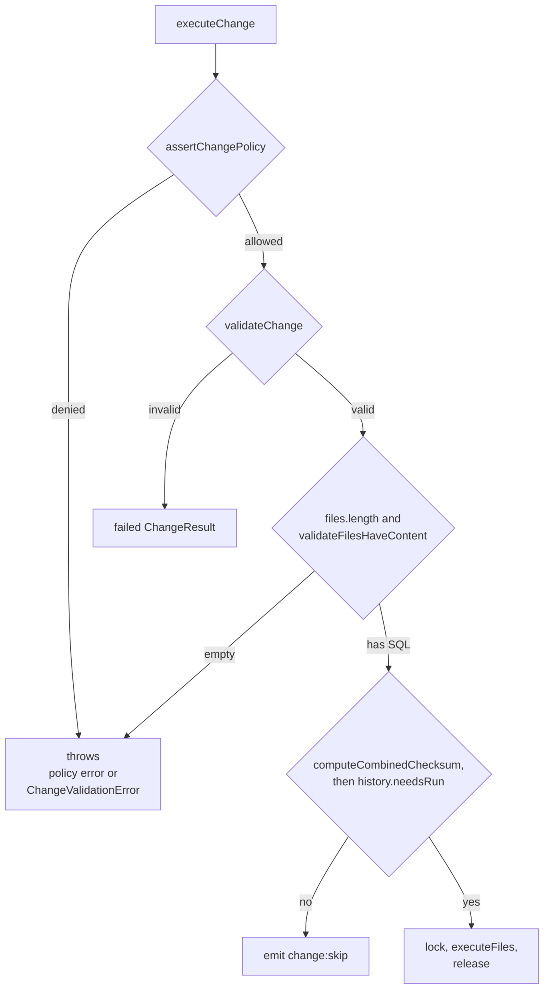
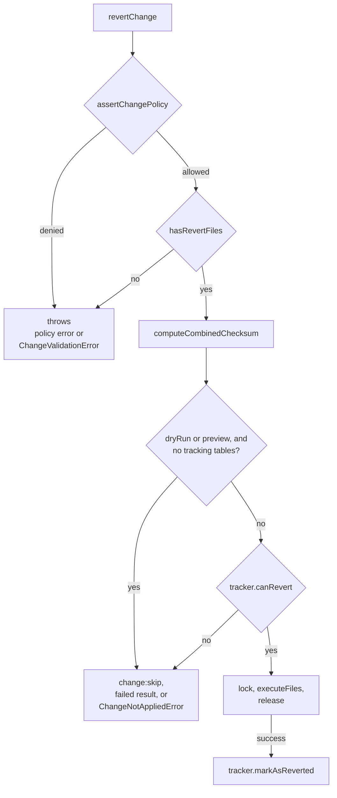
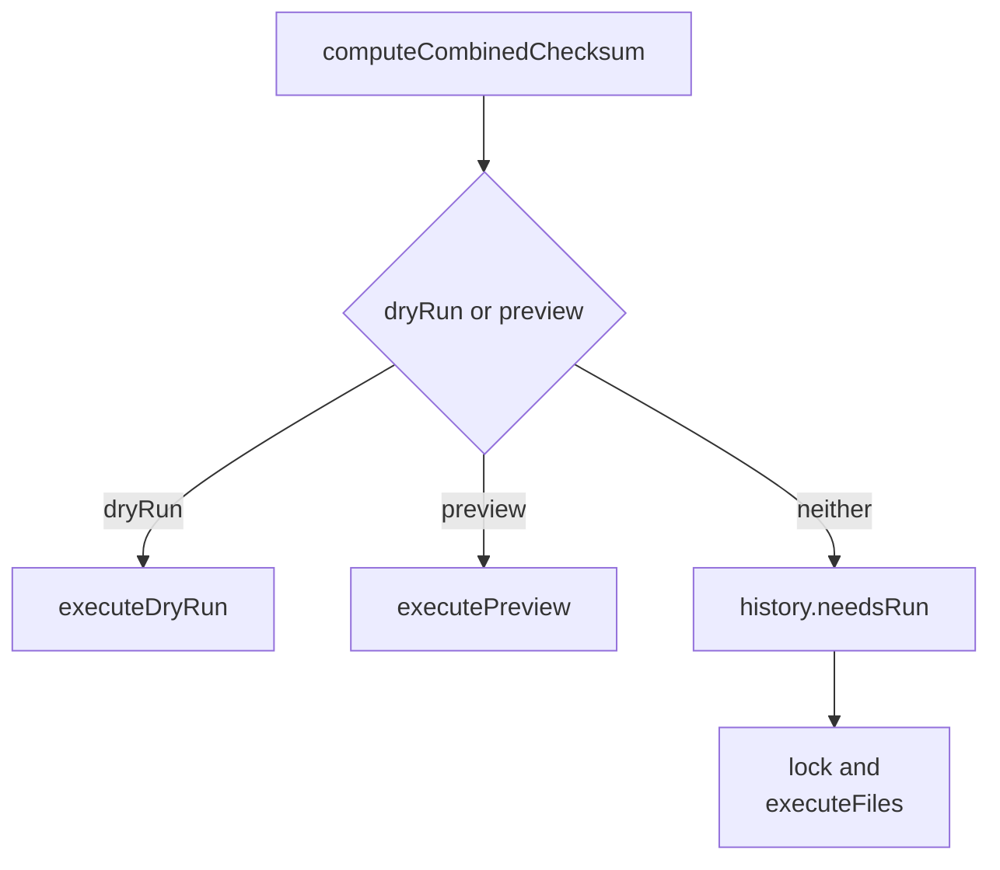
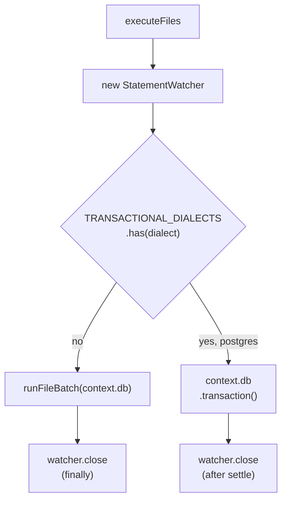
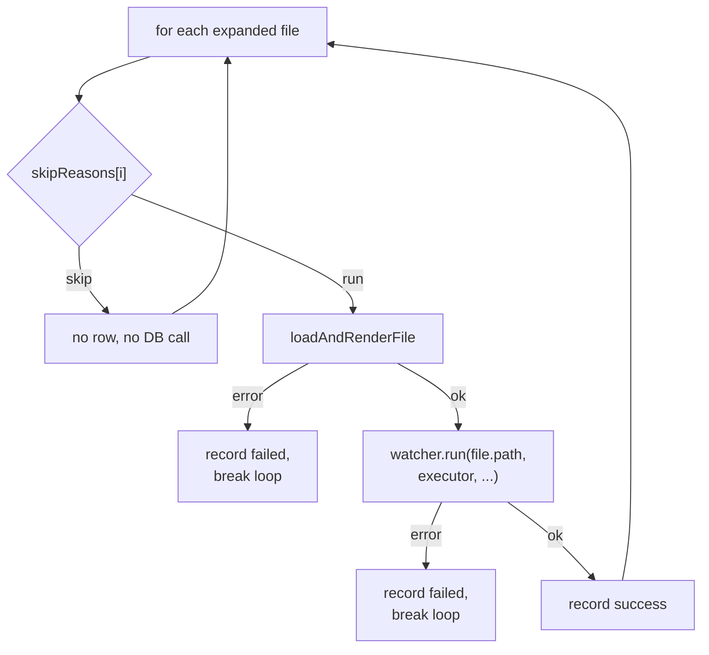
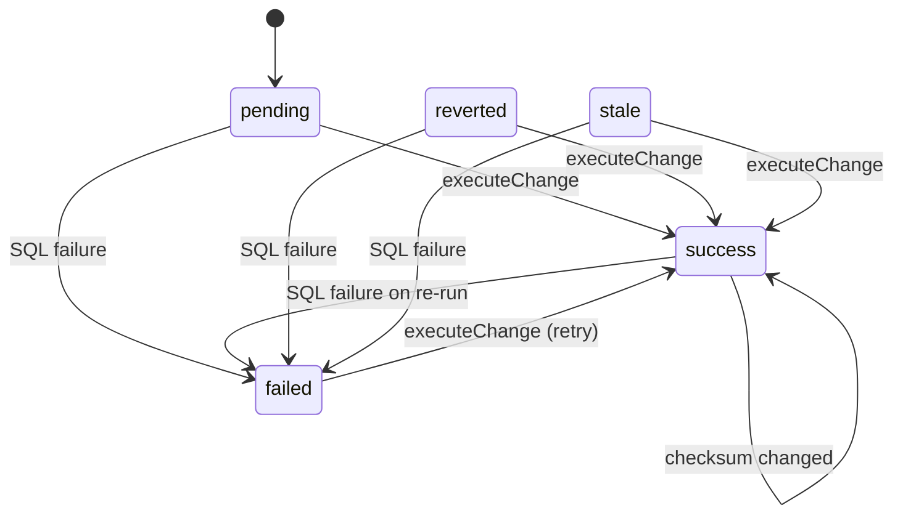
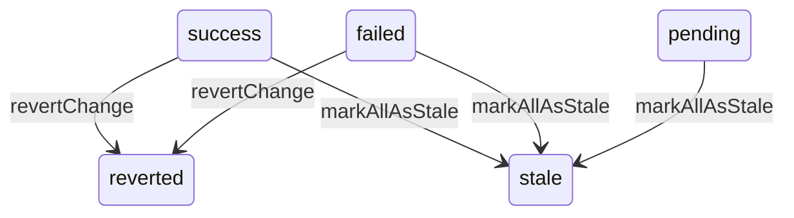

# core-change

## What it does

Changes are versioned, forward/revert SQL migrations tracked by checksum, so a change (or a single file inside it) that already ran with an unchanged checksum is skipped rather than re-executed. That makes `noorm change ff` safe to run repeatedly without re-applying finished work, and lets a database recover from a partial failure without an operator manually diagnosing what already happened.

The domain name `core-change` covers more than [`src/core/change`](../../src/core/change): it also owns [`src/cli/change`](../../src/cli/change), the `noorm change` command group. `change add` scaffolds a change folder (and its files) on disk, `change edit` opens the folder in `$EDITOR`, `change rm` deletes it, `change list`, `change history`, and `change history-detail` show status and execution records, and `change revert` and `change rewind` apply revert files.

## How it works

`executeChange` and `revertChange` ([`src/core/change/executor.ts`](../../src/core/change/executor.ts)) are the entry points every caller (CLI, TUI, SDK, RPC) funnels through.

### Shared by both directions

Inside an MCP approval scope (`withApprovedContent` in [`src/core/shared/approved-content.ts`](../../src/core/shared/approved-content.ts)), `assertApprovedChange` throws `Change plan changed since approval: <name>` when the change's file plan differs from the approved one, and `validateFilesHaveContent` and `loadAndRenderFile` read the approved SQL snapshot (`approvedSql`) instead of the disk file or template. `ChangeManager.next`/`ff` call `assertApprovedPending` on the pending list the same way. Outside a scope these helpers are no-ops.

A change directory holds a `change/` and/or `revert/` folder (`parseChange` throws only when both are empty, `parser.ts:115`), an optional `changelog.md`, and SQL or `.txt` manifest files. `.sql.tmpl` templates are rendered by `loadAndRenderFile` before execution. Execution state lives in the tracking tables from `getNoormTables(dialect)` ([`src/core/shared/tables.ts`](../../src/core/shared/tables.ts)): `change` and `executions` in the `noorm` schema on Postgres and MSSQL, `__noorm_change__` and `__noorm_executions__` on MySQL and SQLite.

### Forward run gates

`executeChange` passes the policy gate, structure validation, the content gate, and the checksum gate before a lock is taken. A `validateChange` failure or a `computeFileChecksums` error returns a failed `ChangeResult`; the policy, `assertApprovedChange`, empty-folder, and empty-content failures throw, as does a failed lock acquire.

### Revert gates

`revertChange` has a different gate pair: the `hasRevertFiles` throw, then `tracker.canRevert`, which checks recorded status rather than checksum. It runs no `validateChange` and no content gate. Dry runs and previews reach the gate too, but when `tablesExist` finds no tracking tables they skip the `canRevert` query and treat the change as `not applied` (`executor.ts`), so the result is the not-applied outcome instead of a tracking-table error. After a successful run it calls `tracker.markAsReverted`.

### Dry-run and preview bypass the forward run gate

Policy, `validateChange`, content, and checksum gates still run first. `history.needsRun` runs only when neither `opts.dryRun` nor `opts.preview` is set (`executor.ts:177` in `executeChange`), so both modes render every file's SQL on a forward run regardless of whether the change already ran. `revertChange` has no such bypass: its gate is described under Revert gates.

### File execution and the statement watcher

`executeFiles` picks a path by dialect: non-transactional dialects run `runFileBatch` directly against `context.db`; Postgres (`TRANSACTIONAL_DIALECTS` in `executor.ts`) wraps the same batch in `context.db.transaction()` so a failed change leaves neither DDL nor history rows behind, surfacing the failure only through the returned `ChangeResult` (unwrapped from a thrown `ChangeRollback` sentinel).

`executeFiles` creates one `StatementWatcher` per call and passes it into `runFileBatch`; each file's SQL runs through `watcher.run(file.path, executor, (conn) => executeSqlBody({ db: conn, dialect: context.dialect }, sqlContent))`. `executeSqlBody` ([`src/core/runner/mssql-batches.ts`](../../src/core/runner/mssql-batches.ts)) returns a failed statement as a message instead of throwing, and `runFileBatch` treats a returned message the same as a thrown error. The watcher is closed in a `finally` on the non-transactional path and explicitly after the transaction settles on Postgres.

Inside the transaction, `batchResult.status !== 'success'` is the rollback trigger.

### Per-file skip on retry

`runFileBatch` first calls `findSkippedFiles` once, before `createOperation` (`executor.ts:587`), and the loop reads its `skipReasons[i]`. `findSkippedFiles` runs `ChangeHistory.latestFileExecutions(name, direction)` (a boundary SELECT plus one history SELECT) and the pure `decideNeedsRunFile`. Under `force` it skips `latestFileExecutions` entirely, so the boundary and history SELECTs apply only to unforced runs. A file whose checksum already succeeded skips even when the overall change checksum changed because a sibling file needed fixing. A path repeated through `.txt` manifests runs once; later positions skip as 'already applied'. Skipped files get no pending row and no DB call, and the operation row is still written when every file skips:

### Change lifecycle

A change's `OperationStatus` moves between `pending`, `success`, `failed`, `reverted`, and `stale`, computed by `ChangeManager`/`ChangeHistory` from the tracking-table rows. `isPendingChange` ([`src/core/change/types.ts`](../../src/core/change/types.ts)) treats `pending`, `reverted`, and `stale` as "needs a forward run" for `ff`/`next`, plus a `failed` item that is also `isNew` (a folder that never ran and could not be parsed); `ff` and `next` stop at that item. It is false for orphaned items. An ordinary `failed` change re-applies only through an explicit run, via `needsRun`'s own `failed` branch.

Forward runs move a change into `success` or `failed`:

### Revert and teardown transitions

Revert and teardown move recorded changes into `reverted` or `stale`; under force, `canRevert` accepts any recorded status (`tracker.ts:157-161`):

`ChangeTracker.markAllAsStale` (`tracker.ts:245`) flips `success`, `failed`, and `pending` rows to `stale` on teardown, not only `success` rows, and touches only rows with `direction = 'change'` for the current `config_name` (`tracker.ts:244-246`). `revertChange` marks the original as `reverted` through `markAsReverted` only when the revert itself succeeds. `canRevert` allows `success` and `failed` records (`tracker.ts:171-172`), rejects `pending`, `reverted`, and `stale`, and under `force` allows any recorded status (`tracker.ts:157-161`), so a `failed` change can be reverted and the revert's own success is what moves the record to `reverted`.

`orphaned` is not a status: it is a boolean on `ChangeListItem`, set when a change has DB rows but no folder on disk. Because of the Postgres rollback above, a failed run there leaves the stored status at its prior value.

## Where it lives

| Path | Responsibility |
|------|-----------------|
| [`src/core/change/executor.ts`](../../src/core/change/executor.ts) | `executeChange`/`revertChange` entry points; policy gate; per-dialect transactional dispatch; `StatementWatcher` wiring; dry-run and preview modes |
| [`src/core/change/manager.ts`](../../src/core/change/manager.ts) | `ChangeManager`, public API combining parser, history, and executor (`list`, `run`, `next`, `ff`, `revert`, `rewind`) |
| [`src/core/change/parser.ts`](../../src/core/change/parser.ts) | `parseChange`/`discoverChanges`, scans a change folder, validates structure, resolves `.txt` manifests, parses sequence/date prefixes |
| [`src/core/change/scaffold.ts`](../../src/core/change/scaffold.ts) | Creates/deletes/renames/reorders change files and folders on disk |
| [`src/core/change/tracker.ts`](../../src/core/change/tracker.ts) | `ChangeTracker` (extends `Tracker`), `canRevert`, `markAsReverted`, `markAllAsStale` |
| [`src/core/change/history.ts`](../../src/core/change/history.ts) | `ChangeHistory`, `needsRun`, `latestFileExecutions`, operation/file record CRUD, `hydrateDate` UTC normalization |
| [`src/core/change/types.ts`](../../src/core/change/types.ts) | `Change`, `ChangeContext`, `ChangeOptions`, `ChangeResult`, error classes, `isPendingChange` |
| [`src/core/change/index.ts`](../../src/core/change/index.ts) | Barrel the SDK imports ([`src/sdk/namespaces/changes.ts`](../../src/sdk/namespaces/changes.ts)); re-exports `DEFAULT_CHANGE_OPTIONS`/`DEFAULT_BATCH_OPTIONS` |
| [`src/core/change/validation.ts`](../../src/core/change/validation.ts) | `validateChangeContent`/`SQL_TEMPLATE`, used only by TUI pre-flight checks, not by the executor's own content gate |
| [`src/cli/change/index.ts`](../../src/cli/change/index.ts) | `change` command group registration (`add`, `edit`, `rm`, `run`, `next`, `ff`, `revert`, `rewind`, `list`, `history`, `history-detail`) |
| [`src/cli/change/_prompt.ts`](../../src/cli/change/_prompt.ts) | Shared interactive change-name picker helper used across the CLI commands, not a command itself |
| `tests/core/change/*.test.ts` | Executor, manager, tracker, history, parser, scaffold, and type-contract tests, plus `executor-retry.test.ts` for per-file skip-on-retry and `prefetch-gate.test.ts` (a skipped file leaves no row and triggers no per-file query) |
| [`tests/core/change/fixtures/`](../../tests/core/change/fixtures) | Change folders and manifests the tests parse |

## Constraints

- Only Postgres (`TRANSACTIONAL_DIALECTS` in `executor.ts`) wraps a change's file execution in a database transaction. MySQL's DDL implicitly commits, MSSQL's GO-batch execution is unverified under a wrapping transaction, and SQLite is excluded so per-file partial success (used by unit tests) keeps working. On MySQL, MSSQL, and SQLite, a change failing partway leaves earlier files' DDL applied and their history rows persisted, since nothing rolls either back.
- `executor.ts`'s pre-execution content gate (`hasExecutableSql`, preceded by the `files.length === 0` throw) checks for any non-blank, non-`--`-comment line; it does not call `validateChangeContent` from `validation.ts`, which is a stale check still used only by the TUI's `ChangeFFScreen`/`ChangeRunScreen`. A stub worded to pass `validateChangeContent` can still fail the executor's own gate, so TUI pre-flight and `noorm change run` can disagree about whether a change is runnable.
- `createChange` always scaffolds a stub file into both `change/` and `revert/` (`scaffold.ts:160-169`). An empty `change/`+`revert/` pair fails `parseChange`'s validation (`parser.ts:115`), and without the stub the caller sees that misreported as "change not found" instead of "needs editing".
- Change directory names follow `YYYY-MM-DD-<slugified-description>`; a name without a date prefix parses with `date: null`, and `scanChanges` sorts folders by raw name (`a.name.localeCompare(b.name)`, `parser.ts:279`), and `ff`/`next` take their order from the same sort in `ChangeManager.#scan` (`manager.ts:216`), so an undated `add-users` runs after every dated change in `ff`/`next`, whenever it was written. Files inside are ordered by `filename.localeCompare` (`parser.ts:524`), not by parsed sequence number, so an unpadded sequence prefix (`2_foo.sql` before `10_bar.sql`) sorts and runs out of numeric order.
- `ChangeHistory.latestFileExecutions` bounds its lookback at the most recent opposite-direction operation, so a prior success only licenses a per-file skip while no revert/re-apply has happened since. It also retires a prior success once the parent operation's own status is `reverted` or `stale`; without both conditions, every apply -> revert -> apply cycle silently no-ops its files instead of re-running them.
- `RESET_MARKER = '__reset__'` is a reserved change name written by `ChangeHistory.recordReset` for teardown audit rows. A user change named `__reset__` collides with it: `ChangeManager.#scan` still lists the folder, but `getAllStatuses` drops that name (`history.ts:350`), so the item always shows `status: 'pending'` and `isNew: true`. `ff`/`next` re-select it every time, but `history.needsRun` skips it after first success while the checksum matches.
- `history.ts`'s `hydrateDate` normalizes `executed_at` to UTC for Postgres/MySQL (reinterpreted field-by-field) and SQLite (text with `Z` appended); MSSQL is left unmodified on purpose, because its driver's behavior was never measured. On a host whose local zone isn't UTC, MSSQL's `executed_at` can render in the TUI's relative-time display shifted by the host's UTC offset.
- `ff`, `next`, the SDK `pending()`, and the picker in `change run` (`src/cli/change/run.ts:52`) share `isPendingChange`, as do [`src/tui/utils/change-loader.ts`](../../src/tui/utils/change-loader.ts), [`src/tui/screens/home.tsx`](../../src/tui/screens/home.tsx), and [`src/mcp/prepared.ts`](../../src/mcp/prepared.ts). A surface with its own copy of the check drifts, and `ff` then reports success while work is still outstanding.
- `DEFAULT_OPTIONS`/`DEFAULT_BATCH` in `executor.ts`/`manager.ts` duplicate `DEFAULT_CHANGE_OPTIONS`/`DEFAULT_BATCH_OPTIONS` from `types.ts` rather than importing them, so a default changed in `types.ts` does not reach `executeChange`/`ChangeManager`.
- Change runs get `file:progress` reports but no server-side cancel: `executeFiles` passes no `signal` into `new StatementWatcher(...)` (`executor.ts:480`), so a running change cannot be aborted mid-file the way a runner-driven run with a signal can.

## Coupling

- **core-runner** ([`src/core/runner/`](../../src/core/runner)): `executeFiles` runs every file's SQL through a `StatementWatcher`; the watcher's lifecycle, dialect probes, and cancel semantics belong there ([`src/core/runner/statement-watcher.ts`](../../src/core/runner/statement-watcher.ts)). `executeSqlBody` from [`src/core/runner/mssql-batches.ts`](../../src/core/runner/mssql-batches.ts) executes each file body, so a change in how it reports failures changes what `runFileBatch` records. `computeChecksum`/`computeCombinedChecksum` come from [`src/core/runner/checksum.ts`](../../src/core/runner/checksum.ts); checksum algorithm changes propagate here. `ChangeTracker` extends `Tracker` from [`src/core/runner/tracker.ts`](../../src/core/runner/tracker.ts), so base tracker changes affect revert/stale logic. `processFile`/`isTemplate` from [`src/core/template/`](../../src/core/template) render templated SQL files before execution.
- **core-policy** ([`src/core/policy/`](../../src/core/policy)): `executeChange`/`revertChange` call `assertPolicy`, gated on `change:run`/`change:revert`; [`src/cli/change/rm.ts`](../../src/cli/change/rm.ts) gates `change:rm` separately: it loads settings, builds the config with `withConfigPolicy(config, new SettingsProvider(settingsManager))`, then calls `checkConfigPolicy`, so settings load failures exit before the policy check. Policy-matrix changes in [`src/core/policy/matrix.ts`](../../src/core/policy/matrix.ts) affect which roles can run/revert/rm changes.
- [`src/core/lock`](../../src/core/lock) (no wiki domain owns it) ([`src/core/lock/`](../../src/core/lock)): `executeChange`/`revertChange` take and release the operation lock through `getLockManager()`. The executor applies no `lock:acquire` check of its own; that permission gates the SDK `lock` namespace ([`src/sdk/namespaces/lock.ts`](../../src/sdk/namespaces/lock.ts)) and the TUI lock screens. The executor never calls `LockManager.status`; lock status reads belong to the SDK and TUI pages.
- **core-identity**: `formatIdentity` from [`src/core/identity/resolver.ts`](../../src/core/identity/resolver.ts) names the lock holder.
- [`src/core/shared`](../../src/core/shared) (no wiki domain owns it), approval scope ([`src/core/shared/approved-content.ts`](../../src/core/shared/approved-content.ts)): the approval-scope helpers called from `executor.ts` and `manager.ts` live there; the server that establishes the scope belongs to mcp-rpc.
- **core-state** ([`src/core/observer.ts`](../../src/core/observer.ts)): emits `change:*` events (`change:start`, `change:file`, `change:complete`, `change:skip`, `change:created`, `file:dry-run`) through the shared observer.
- **core-db**: writes the change and executions tracking tables named by `getNoormTables(dialect)`; `ChangeTracker.markAllAsStale` is called from [`src/core/teardown/operations.ts`](../../src/core/teardown/operations.ts) after a teardown.
- **tui**: the `useChangeProgress` hook ([`src/tui/hooks/useChangeProgress.ts`](../../src/tui/hooks/useChangeProgress.ts)) subscribes to the watcher's `file:progress` event, consumed by the `Change*Screen` components under [`src/tui/screens/change/`](../../src/tui/screens/change). Those screens import `ChangeHistory`, `scanChanges`, and `validateChangeContent` directly for read-only status and pre-flight checks.
- **sdk**: [`src/sdk/namespaces/changes.ts`](../../src/sdk/namespaces/changes.ts) wraps `ChangeManager` and the scaffold functions for the programmatic SDK.
- **mcp-rpc**: [`src/rpc/commands/changes.ts`](../../src/rpc/commands/changes.ts) exposes change operations as MCP/RPC commands through the same SDK surface.
- **cli**: registers the `change` group from [`src/cli/change/index.ts`](../../src/cli/change/index.ts). The [`skills/noorm`](../../skills/noorm) skill ([`skills/noorm/SKILL.md`](../../skills/noorm/SKILL.md), [`skills/noorm/references/cli.md`](../../skills/noorm/references/cli.md)) documents and drives `noorm change`.
