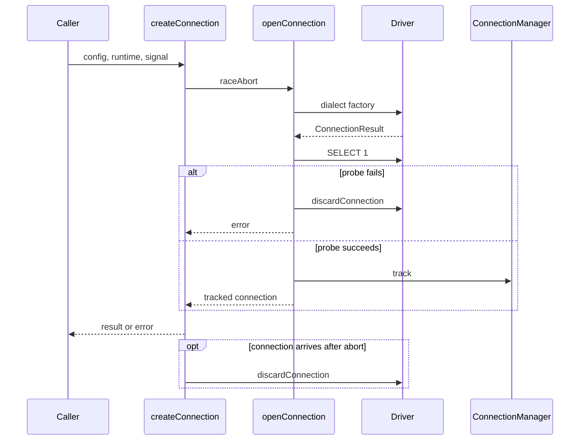
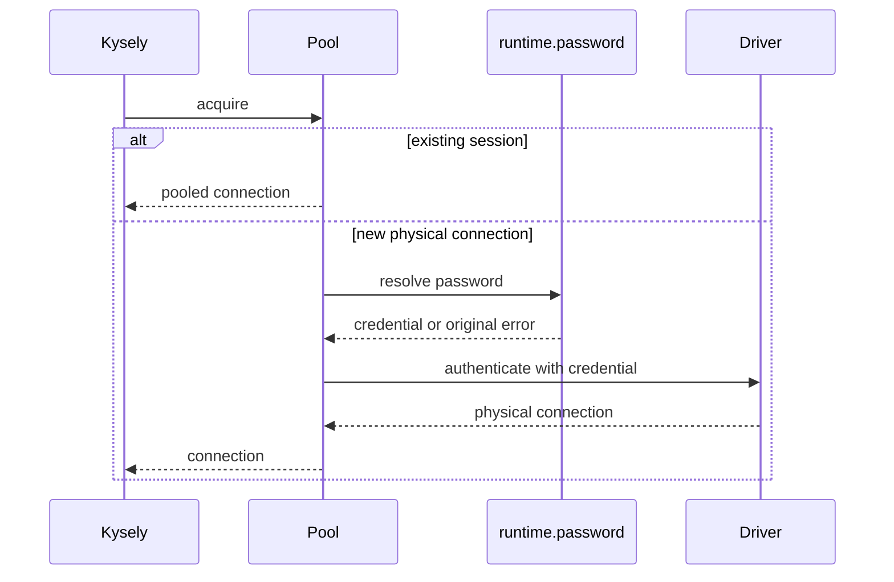
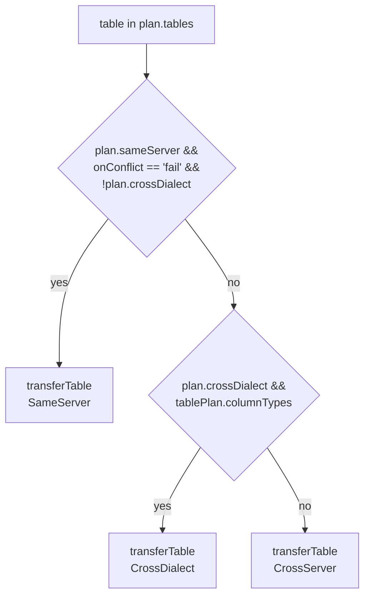
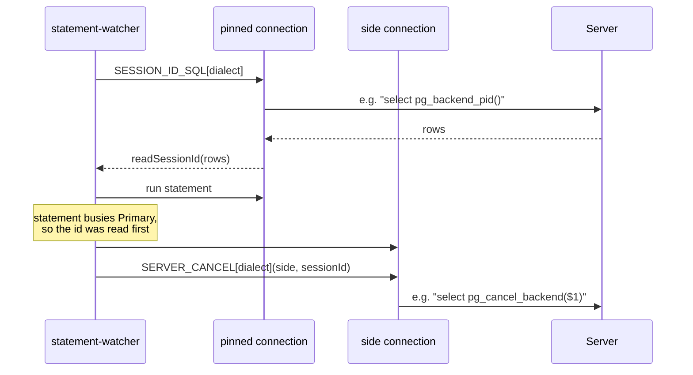

# core-db

## What it does

This domain gives database commands the connections and dialect operations needed to create databases, inspect schemas, remove objects, and transfer rows. Reach for it when changing `noorm db` behavior or the connection lifecycle shared by the CLI, SDK, workers, and TUI.

[`src/core/connection/`](../../src/core/connection) opens and tracks Kysely connections. [`src/core/db/`](../../src/core/db), [`src/core/explore/`](../../src/core/explore), [`src/core/teardown/`](../../src/core/teardown), and [`src/core/transfer/`](../../src/core/transfer) dispatch database operations by dialect. Connections support PostgreSQL, MySQL, MSSQL, and SQLite; transfer excludes SQLite (`TRANSFER_SUPPORTED_DIALECTS` in [`src/core/transfer/dialects/index.ts`](../../src/core/transfer/dialects/index.ts)).

Operational modules keep dialect contracts separate from implementations: [`src/core/db/types.ts`](../../src/core/db/types.ts) defines `DialectDbOperations`, [`src/core/explore/types.ts`](../../src/core/explore/types.ts) defines `DialectExploreOperations`, [`src/core/teardown/types.ts`](../../src/core/teardown/types.ts) defines `TeardownDialectOperations`, and [`src/core/transfer/dialects/types.ts`](../../src/core/transfer/dialects/types.ts) defines `TransferDialectOperations`. Each module's `dialects/index.ts` entrypoint selects the implementation. Transfer has no SQLite dialect module.

## How it works

### Opening a connection

`createConnection` in [`src/core/connection/factory.ts`](../../src/core/connection/factory.ts) lazy-loads the driver, probes with `SELECT 1`, and tracks successful connections for shutdown. Static credentials use selective retries and explained connection errors. Supplying `RuntimeConnectionOptions.password` disables factory retries and error rewriting for the whole connection attempt.

The liveness probe also catches a socket that opens successfully and then becomes silent, a failure that the driver's connect timeout no longer covers.

The factory probes before tracking, and aborts reclaim connections that arrive after the caller stops waiting.

Without a dynamic password, `shouldRetry` excludes authentication, configuration, missing-driver, missing-database, and abort failures. It retries errors containing `ECONNREFUSED`, `ETIMEDOUT`, `too many connections`, or `connection reset`. `explainConnectionError` in [`src/core/connection/errors.ts`](../../src/core/connection/errors.ts) maps static driver failures into diagnostics. The missing-database wording also controls `testConnection`'s server-only fallback.

With a dynamic password, a callback or driver failure reaches the caller unchanged, including the original error object. `connection:error` instead receives `Runtime credential connection failed`, without the original message or server fields. The factory does not distinguish provider failures from driver failures on this path. Query failures after opening propagate through the query caller.

### Refreshing credentials for physical connections

`RuntimeConnectionOptions` in [`src/core/connection/types.ts`](../../src/core/connection/types.ts) carries runtime-only callbacks, separate from `ConnectionConfig`. The password callback takes precedence over the configured password. Existing pooled sessions retain their credentials; checking them out again does not refresh them.

Each network dialect evaluates credentials when creating a physical connection, not when reusing a pooled session.

| Dialect | Credential integration | Pool behavior |
|---|---|---|
| PostgreSQL | Passes `runtime.password` unchanged as the native `pg.Pool` password callback | `pg` invokes the callback for new clients. |
| MySQL | Awaits the callback in a Tarn `create` function before calling `mysql2.createConnection` | The dynamic path adapts Tarn to Kysely's `MysqlPool`; the static path retains `mysql2.createPool`. |
| MSSQL | Awaits the callback in `MssqlDialect`'s async `connectionFactory` before constructing a tedious connection | Tarn uses `propagateCreateError: true`; dynamic failures bypass MSSQL login-error explanation. |
| SQLite | Rejects a password callback before opening | Throws `Dynamic passwords are not supported for SQLite` without invoking the callback. |

### Reporting idle connection failures

PostgreSQL installs a `pg.Pool` error listener that emits `connection:error` with `phase: 'idle'` and `PostgreSQL idle pool connection failed`. It does not forward the driver's message or error object.

MySQL's dynamic pool records established, checked-out, and failed connections separately. Only an established connection that is not checked out emits `MySQL idle pool connection failed` with `phase: 'idle'`. Handshake failures and failures on checked-out connections are not idle events. Failed connections fail validation, so later acquisition creates a replacement and resolves credentials again. This handler belongs to the dynamic Tarn path, not the static mysql2 pool.

### TLS identity and connection controls

The adapters map controls explicitly; a field in `ConnectionConfig` is not a promise that every dialect implements it.

| Control | Implemented behavior |
|---|---|
| `connectTimeoutMs` | PostgreSQL, MySQL, and MSSQL use `connectTimeoutFor`; invalid or non-positive values fall back to `15_000` ms. The factory probe adds `2_000` ms of grace. |
| PostgreSQL `pool.idleTimeoutMillis` | Forwards to `pg.Pool`; zero disables the idle timeout. |
| PostgreSQL `statementTimeoutMs`, `queryTimeoutMs` | Forward to `statement_timeout` and `query_timeout`; zero disables the corresponding timeout. |
| PostgreSQL `applicationName`, `keepAlive` | Forward to `application_name` and `keepAlive`. |
| PostgreSQL `tlsServerName` | Verifies the configured certificate identity even when the dial host differs. It supplies SNI for an IP dial host; `pg` uses the dial host as SNI for DNS dial hosts. |
| PostgreSQL `runtime.checkServerIdentity` | Calls the supplied verifier with `tlsServerName ?? host` and the certificate. Identity options require explicit SSL and reject `rejectUnauthorized: false`. |
| MSSQL `tlsServerName` | Uses `resolveTlsServerName` as tedious's certificate hostname. A supplied name cannot be an IP literal. A validating IP connection requires a hostname override; an unverified IP connection uses `UNVERIFIED_TLS_SERVER_NAME`. Encryption stays enabled. |
| MySQL TLS | Maps a truthy `ssl` to `{}`; it does not forward certificate fields, `tlsServerName`, or `runtime.checkServerIdentity`. |
| MSSQL runtime verifier | The adapter does not consume `runtime.checkServerIdentity`; its TLS identity control is `tlsServerName`. |

[`tests/integration/connection/postgres-runtime-options.test.ts`](../../tests/integration/connection/postgres-runtime-options.test.ts) covers credential refresh, original provider errors, sanitized events, and PostgreSQL session controls. [`tests/integration/connection/mysql-runtime-options.test.ts`](../../tests/integration/connection/mysql-runtime-options.test.ts) covers replacement after an idle failure and distinguishes active-query failures. [`tests/integration/connection/mysql-packed-sdk.test.ts`](../../tests/integration/connection/mysql-packed-sdk.test.ts) covers dynamic credentials from an installed SDK under Node.

### Choosing a transfer strategy per table

`executeTransfer` in [`src/core/transfer/executor.ts`](../../src/core/transfer/executor.ts) prefers same-server `INSERT ... SELECT` when `onConflict` is `'fail'` and dialects match. Otherwise it uses cross-dialect conversion when `columnTypes` are available, or the cross-server batch path.

`transferTableSameServer` builds one direct `INSERT ... SELECT` statement. `transferTableCrossDialect` streams rows through `DtStreamer`, paged by `createKeysetPager`, converting column types along the way. `transferTableCrossServer` pages the same way but calls `insertBatch` against the destination, no type conversion involved.

`isSameServer` ([`src/core/transfer/same-server.ts`](../../src/core/transfer/same-server.ts)) rules PostgreSQL out unconditionally: without `dblink`/`postgres_fdw` it has no way to read a second database, and a same-database same-server statement would degenerate into `INSERT INTO t SELECT ... FROM t`. MySQL and MSSQL qualify when host and port both match after `normalizeHost` folds `127.0.0.1`/`::1`/`localhost.localdomain` into `localhost`. SQLite never qualifies; it has no server.

### Dropping a schema in dependency order

`teardownSchema` ([`src/core/teardown/operations.ts`](../../src/core/teardown/operations.ts)) drops objects in a fixed order because MSSQL schema-bound objects (`WITH SCHEMABINDING`) hold locks on the tables they reference, and a CHECK constraint referencing a scalar UDF blocks dropping that function while the table still exists (MSSQL error 3729):

1. Drop FK constraints.
2. Drop MSSQL CHECK constraints (`dropCheckConstraints`, mssql only), gated on `!keepFunctions` (`src/core/teardown/operations.ts:413`) since the CHECK-on-a-UDF dependency is exactly what step 4 needs cleared.
3. Drop procedures, unless `keepProcedures`.
4. Drop functions, unless `keepFunctions`.
5. Drop views, unless `keepViews`.
6. Drop tables.
7. Drop types, unless `keepTypes`. On MSSQL this step is skipped entirely when `keepFunctions` or `keepProcedures` is set (`src/core/teardown/operations.ts:504-507`), because the function → TVP → domain-type dependency chain can't be broken safely without `CASCADE`.

Outside dry runs, `truncateData` attempts FK re-enablement after the disable/truncate phase, even if that phase fails (`src/core/teardown/operations.ts:285-289`). It attempts the remaining enable statements after an enable failure; restoration can still fail. If both phases fail, it throws the disable/truncate error. If only re-enablement fails, it throws the enable error. `tests/core/teardown/operations.test.ts:602-645` covers enable failures and error precedence.

### Pinning a session to cancel a statement from outside it

[`src/core/connection/session.ts`](../../src/core/connection/session.ts) holds `SESSION_ID_SQL` and `SERVER_CANCEL`. The core-runner and core-identity domains consume these helpers for statement cancellation.

The caller reads the pinned session's identity before issuing work, then sends cancellation through a different connection.

`readSessionId` returns `undefined` for anything that is not a positive integer. That check is what keeps the mysql path safe: `SERVER_CANCEL.mysql` builds `kill query <sessionId>` with `sql.raw`, because `KILL` cannot be prepared, and the id it interpolates has already been forced through this guard. `SESSION_ID_SQL` has an entry for every dialect except sqlite; sqlite is in-process and single-connection, so a second connection has no session to observe. `SERVER_CANCEL` additionally omits `mssql`: tedious exposes `request.cancel()`, but Kysely's `MssqlDialect` never hands out the `Request` object, and `KILL` would end the whole session rather than one statement. `hasServerSideCancel(dialect)` is what a caller checks before wording the outcome as "cancelled" versus "stopped waiting."

## Where it lives

| Path | Role |
|------|------|
| [`src/core/connection/factory.ts`](../../src/core/connection/factory.ts) | `createConnection`, `testConnection`, `discardConnection` — retry/backoff, liveness probe, abort handling |
| [`src/core/connection/types.ts`](../../src/core/connection/types.ts) | `ConnectionConfig` controls and runtime-only `RuntimeConnectionOptions` callbacks |
| [`src/core/connection/manager.ts`](../../src/core/connection/manager.ts) | `ConnectionManager` singleton (`getConnectionManager`) — cached and tracked connections, `WorkerBridge` instances, closes everything on `app:shutdown` |
| [`src/core/connection/session.ts`](../../src/core/connection/session.ts) | `SESSION_ID_SQL`, `SERVER_CANCEL`, `readSessionId`, `hasServerSideCancel` — per-dialect session-id read and server-side cancel |
| [`src/core/connection/errors.ts`](../../src/core/connection/errors.ts) | `explainConnectionError`, `explainMssqlLoginFailure` — per-dialect error code tables, `DatabaseConnectionError` |
| [`src/core/connection/defaults.ts`](../../src/core/connection/defaults.ts) | `DEFAULT_PORTS`, `PortSchema` shared with `core/config` and `core/settings` |
| `src/core/connection/dialects/*.ts` | Physical connection factories, runtime credentials, TLS mapping, idle-error handling, and MSSQL tedious login diagnostics; `mssql-limit-plugin.ts` rewrites `LimitNode` to `TopNode` before Kysely's MSSQL compiler generates SQL |
| [`src/core/db/operations.ts`](../../src/core/db/operations.ts) | `checkDbStatus`, `createDb`, `destroyDb` |
| [`src/core/db/policy.ts`](../../src/core/db/policy.ts) | `assertDbPolicy` — shared destructive-lifecycle gate for `core/db` and `core/teardown` |
| [`src/core/db/dual.ts`](../../src/core/db/dual.ts) | `withDualConnection` — generic two-connection lifecycle used by `transfer` and vault-copy |
| `src/core/db/dialects/*.ts` | Per-dialect `databaseExists`/`createDatabase`/`dropDatabase`/`getSystemDatabase` |
| [`src/core/explore/operations.ts`](../../src/core/explore/operations.ts) | `fetchOverview`, `fetchList`, `fetchDetail`, `fetchRowPeek` |
| [`src/core/explore/peek.ts`](../../src/core/explore/peek.ts) | `peekQuery`, `readPeekRows`, `MAX_PEEK_ROWS` — row-window query builder and cap used by `fetchRowPeek` |
| `src/core/explore/dialects/*.ts` | Per-dialect catalog queries (`information_schema`/`pg_catalog`, `INFORMATION_SCHEMA`, `sys.*`) |
| [`src/core/teardown/operations.ts`](../../src/core/teardown/operations.ts) | `truncateData`, `teardownSchema`, `previewTeardown`, `isNoormTable` |
| `src/core/teardown/dialects/*.ts` | Per-dialect DDL generation; only `mssql.ts` implements `dropCheckConstraints` |
| [`src/core/transfer/planner.ts`](../../src/core/transfer/planner.ts) | `planTransfer` — table metadata, FK dependency graph, topological sort, destination schema probe |
| [`src/core/transfer/executor.ts`](../../src/core/transfer/executor.ts) | `executeTransfer`, `transferTableSameServer`, `transferTableCrossDialect`, `transferTableCrossServer` |
| [`src/core/transfer/same-server.ts`](../../src/core/transfer/same-server.ts) | `isSameServer`, `getDefaultPort` |
| [`src/core/transfer/events.ts`](../../src/core/transfer/events.ts) | `TransferEvents` observer contract |
| `src/core/transfer/dialects/*.ts` | Per-dialect FK toggle, identity-insert toggle, sequence reset, conflict-aware INSERT (no sqlite module) |
| `src/cli/db/*.ts` | `noorm db <create\|drop\|explore\|reset\|teardown\|transfer\|truncate>` Citty subcommands; `create.ts`/`drop.ts` call `checkDbStatus`/`createDb`/`destroyDb` directly, bypassing the SDK layer |
| `tests/core/{connection,db,explore,teardown,transfer}/`, [`tests/integration/`](../../tests/integration) | Unit coverage per module plus cross-database integration runs |
| [`tests/integration/connection/postgres-runtime-options.test.ts`](../../tests/integration/connection/postgres-runtime-options.test.ts), [`tests/integration/connection/mysql-runtime-options.test.ts`](../../tests/integration/connection/mysql-runtime-options.test.ts), [`tests/integration/connection/mysql-packed-sdk.test.ts`](../../tests/integration/connection/mysql-packed-sdk.test.ts) | Runtime credential, pool-error, session-control, and installed-consumer coverage |

## Constraints

| Constraint | What breaks if ignored |
|---|---|
| Runtime password callbacks refresh only new physical sessions | Reusing a pooled session does not reauthenticate it or invoke the provider again. |
| A dynamic password disables factory retries and diagnostic rewriting for that connection attempt | Applying static retry or error-mapping assumptions loses provider error identity or repeats credential issuance. Caller errors can contain secrets; the sanitized observer event is not the original diagnostic. |
| PostgreSQL identity hooks require SSL with certificate verification | Omitting SSL or setting `rejectUnauthorized: false` makes connection creation reject before use. |
| Runtime TLS verification hooks are PostgreSQL-specific in the adapters | Assuming MySQL or MSSQL consumes `checkServerIdentity` leaves the custom verification unenforced. |
| MySQL idle reporting depends on established and checkout state | Classifying every socket error as idle mislabels handshake or active-query failures; failed dynamic connections must not return to service. |
| `PostgreSQL` is never same-server ([`src/core/transfer/same-server.ts`](../../src/core/transfer/same-server.ts)) | Treating it as same-server would run `INSERT INTO t SELECT ... FROM t`, copying the destination into itself instead of transferring data |
| `readSessionId` requires a positive integer | Skipping the guard would let a driver's unexpected result flow straight into the mysql `kill query <id>` raw SQL |
| Session SQL and cancellation map entries are optional | An absent `SESSION_ID_SQL[dialect]` (sqlite) or `SERVER_CANCEL[dialect]` (sqlite, mssql) returns `undefined`; indexing itself does not throw. Callers must guard before executing missing SQL or invoking a missing cancel function. The watcher guards both lookups (`src/core/runner/statement-watcher.ts:176-180`, `src/core/runner/statement-watcher.ts:226-229`). |
| Static `explainConnectionError` diagnostics reserve "does not exist" for a missing database | The TUI create prompt and `testConnection`'s server-only fallback key off that phrase. Dynamic-password failures bypass this diagnostic contract. |
| `truncateData` attempts FK re-enablement after a disable/truncate failure and continues after enable failures | An enable attempt can fail, leaving enforcement off. The disable/truncate error takes precedence when both phases fail; an enable-only failure is thrown (`src/core/teardown/operations.ts:285-289`). |
| `teardownSchema` drops FKs, then MSSQL CHECK constraints, then procedures/functions/views, before tables | Dropping tables first fails on MSSQL schema-bound objects, and a CHECK constraint on a scalar UDF blocks dropping that function while its table exists |
| `__noorm_*` prefix matching alone does not exclude noorm's tracking tables on postgres/mssql | On postgres and mssql, noorm's tracking tables live in a `noorm` schema without the `__noorm_` prefix. A prefix-only filter lists them in explore and makes transfer's `listUserTables` ([`src/core/transfer/planner.ts`](../../src/core/transfer/planner.ts)) copy them into the destination; `EXCLUDED_SCHEMAS` (explore) and the `!== 'noorm'` schema filter (transfer) keep them out |
| `policy` is optional on `core/db` and `core/teardown` options ([`src/core/db/types.ts`](../../src/core/db/types.ts), [`src/core/teardown/types.ts`](../../src/core/teardown/types.ts)) | Without it, `assertDbPolicy` returns without enforcing policy (`src/core/db/policy.ts:67`); callers that omit it (the SDK `db` namespace, the TUI `Db*Screen` components) gate with `checkConfigPolicy` themselves instead. `core/transfer` has no such gap: its options take `channel?` and every entry point always gates via `assertPolicy(options.channel ?? 'user', ...)` |

## Coupling

- **core-runner**: [`src/core/runner/statement-watcher.ts`](../../src/core/runner/statement-watcher.ts) imports `SESSION_ID_SQL`, `SERVER_CANCEL`, and `readSessionId` from [`src/core/connection/session.ts`](../../src/core/connection/session.ts) to pin a connection, read its session id, and cancel a running statement's file from a side connection; [`src/core/runner/statement-probes.ts`](../../src/core/runner/statement-probes.ts) polls through its own `STATEMENT_PROBES` table and does not reference `session.ts`.
- **core-identity**: [`src/core/sql-terminal/executor.ts`](../../src/core/sql-terminal/executor.ts) imports the same `session.ts` exports (plus `hasServerSideCancel`) to cancel a query the SQL terminal is running; [`src/core/vault/copy.ts`](../../src/core/vault/copy.ts) calls `withDualConnection` ([`src/core/db/dual.ts`](../../src/core/db/dual.ts)) to hold source and destination connections open for a vault copy.
- **core-policy**: `assertDbPolicy` ([`src/core/db/policy.ts`](../../src/core/db/policy.ts)), `checkConfigPolicy` ([`src/cli/db/create.ts`](../../src/cli/db/create.ts), [`src/cli/db/drop.ts`](../../src/cli/db/drop.ts)), and `assertPolicy` ([`src/core/transfer/index.ts`](../../src/core/transfer/index.ts)) resolve against `Permission` values (`db:create`, `db:reset`, `db:destroy`, `db:truncate`, `db:teardown`, `transfer:plan`) and the role matrix in [`src/core/policy/matrix.ts`](../../src/core/policy/matrix.ts) and [`src/core/policy/types.ts`](../../src/core/policy/types.ts); [`src/core/explore/operations.ts`](../../src/core/explore/operations.ts) calls `assertPolicy` to gate `fetchRowPeek` on `sql:read`.
- **core-state**: [`src/core/db/operations.ts`](../../src/core/db/operations.ts) and [`src/core/db/dual.ts`](../../src/core/db/dual.ts) call `bootstrapSchema`/`tablesExist`/`ensureSchemaVersion` from [`src/core/version/`](../../src/core/version); [`src/core/connection/manager.ts`](../../src/core/connection/manager.ts) subscribes to `app:shutdown` from [`src/core/observer.ts`](../../src/core/observer.ts); [`src/core/config/types.ts`](../../src/core/config/types.ts) imports `ConnectionConfig` from [`src/core/connection/types.ts`](../../src/core/connection/types.ts), which owns the connection config type.
- **core-change**: [`src/core/teardown/operations.ts`](../../src/core/teardown/operations.ts) imports `ChangeHistory`/`ChangeTracker` from [`src/core/change/`](../../src/core/change) to mark changes stale and record a reset event.
- **sdk**: [`src/core/transfer/planner.ts`](../../src/core/transfer/planner.ts) and `executor.ts` depend on `buildDtSchema`, `DtStreamer`, `createKeysetPager`, `queryDatabaseVersion` from [`src/core/dt/`](../../src/core/dt) for cross-dialect type conversion and streaming; [`src/sdk/namespaces/db.ts`](../../src/sdk/namespaces/db.ts), `dt.ts`, `transfer.ts` wrap `core/explore`, `core/teardown`, `core/transfer`, `core/dt` directly, and `core/db` is reached only transitively, through `transfer/index.ts`'s use of `db/dual.ts`.
- **worker-bridge**: [`src/core/connection/manager.ts`](../../src/core/connection/manager.ts) tracks `WorkerBridge<ConnectionEvents>` instances so they shut down alongside regular connections; [`src/workers/connection.ts`](../../src/workers/connection.ts) imports `core/connection` to own the Kysely instance off the main thread.
- **tui**: [`src/tui/providers/ConnectionProvider.tsx`](../../src/tui/providers/ConnectionProvider.tsx) holds the connection lifecycle at runtime; [`src/tui/hooks/useConnection.ts`](../../src/tui/hooks/useConnection.ts) and `useVaultConnection.ts` import `core/connection` types only, delegating to the provider. [`src/tui/utils/connection.ts`](../../src/tui/utils/connection.ts), `run-context.ts`, `config-validation.ts`, `change-loader.ts` import `core/connection` directly.
- **mcp-rpc**: [`src/rpc/commands/explore.ts`](../../src/rpc/commands/explore.ts) calls into `core/explore` directly.
- **sdk and infra**: [`docs/wiki/sdk.md`](sdk.md) owns the public SDK connection surface; [`docs/wiki/infra.md`](infra.md) owns package construction. See those pages for the SDK's bundled Tarn dependency rather than treating this adapter's dynamic import as a consumer installation requirement.
