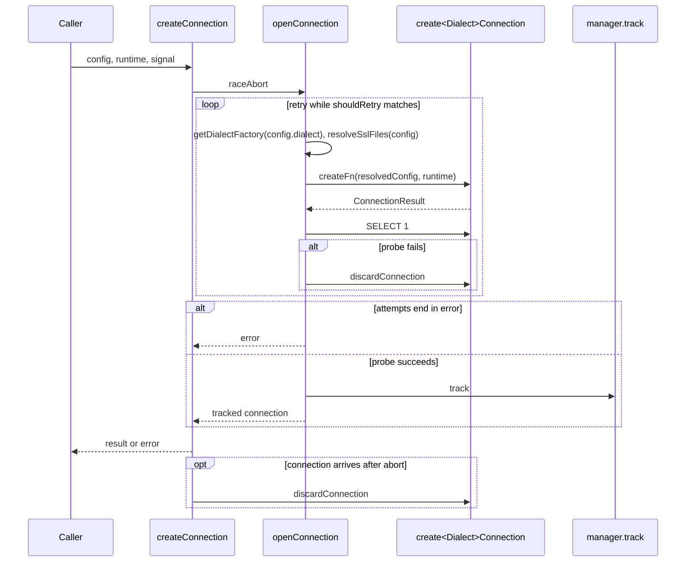
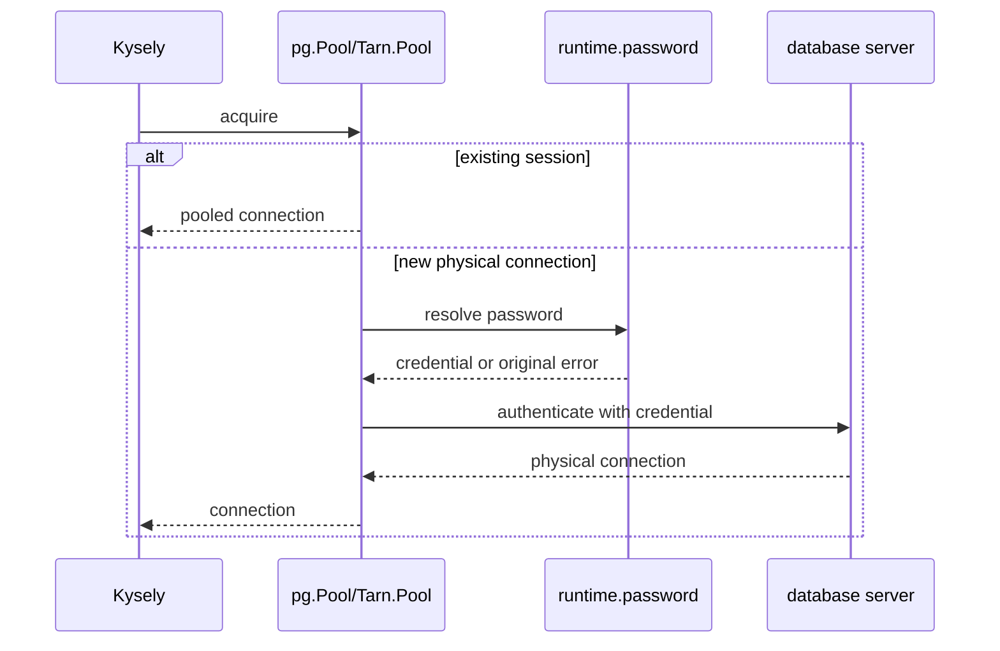
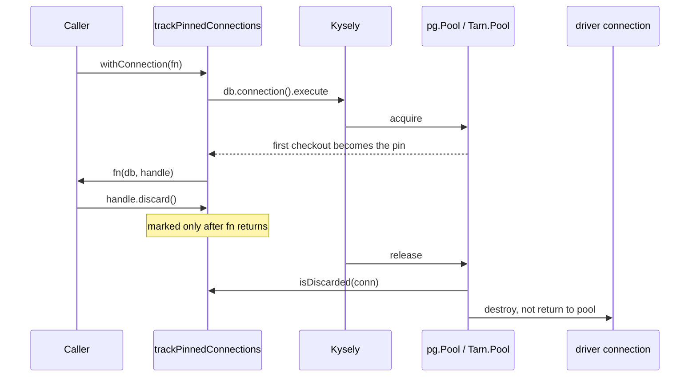
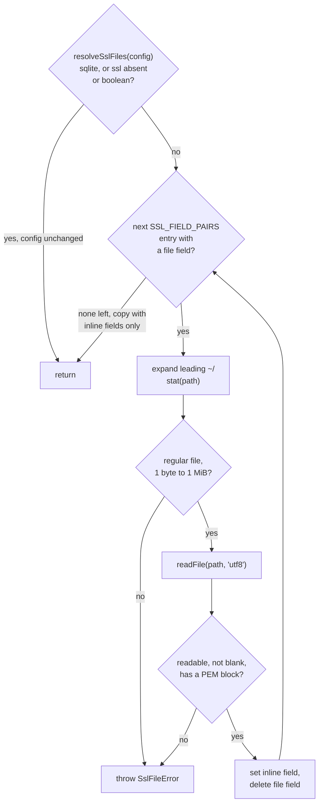
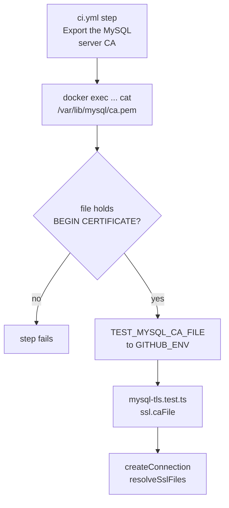
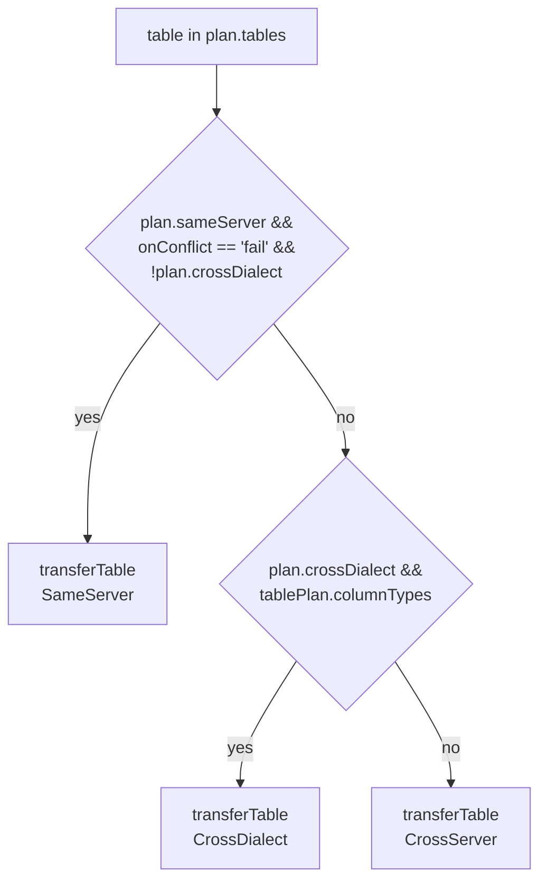
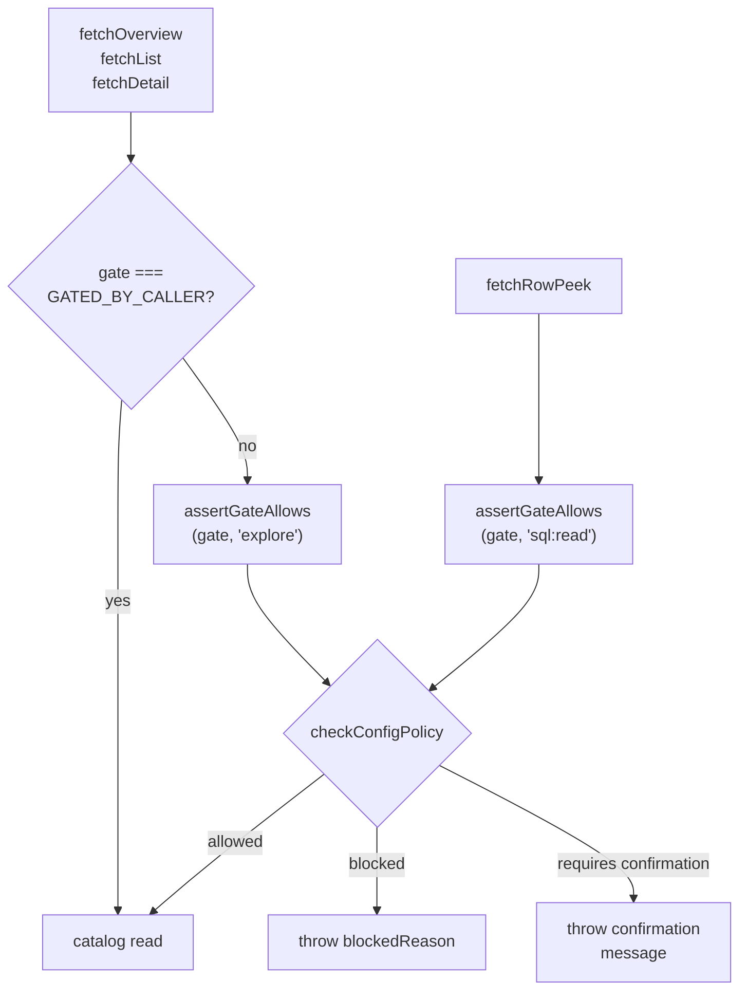
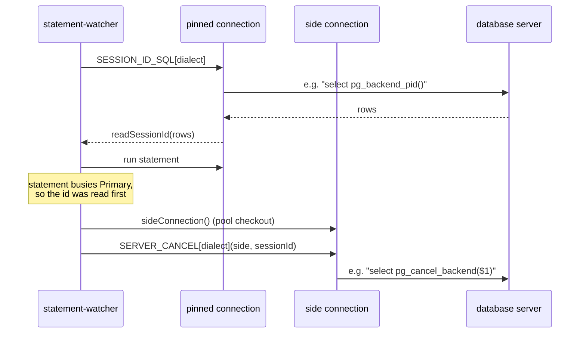

# core-db

## What it does

This domain gives database commands the connections and dialect operations needed to create databases, inspect schemas, remove objects, and transfer rows. Reach for it when changing `noorm db` behavior or the connection lifecycle shared by the CLI, SDK, workers, and TUI.

The name `core-db` covers more than [`src/core/db/`](../../src/core/db). [`src/core/connection/`](../../src/core/connection) opens and tracks Kysely connections. [`src/core/db/`](../../src/core/db), [`src/core/explore/`](../../src/core/explore), [`src/core/teardown/`](../../src/core/teardown), and [`src/core/transfer/`](../../src/core/transfer) dispatch database operations by dialect. [`src/cli/db/`](../../src/cli/db) holds the `noorm db` subcommands that drive them. Connections support PostgreSQL, MySQL, MSSQL, and SQLite; transfer excludes SQLite (`TRANSFER_SUPPORTED_DIALECTS` in [`src/core/transfer/dialects/index.ts`](../../src/core/transfer/dialects/index.ts)).

## How it works

### Selecting a dialect implementation

Each operational module keeps its dialect contract separate from the implementations, and a `dialects/index.ts` entrypoint selects one.

| Module | Contract | Selector |
|---|---|---|
| [`src/core/db/`](../../src/core/db) | `DialectDbOperations` in [`src/core/db/types.ts`](../../src/core/db/types.ts) | `getDialectOperations` |
| [`src/core/explore/`](../../src/core/explore) | `DialectExploreOperations` in [`src/core/explore/types.ts`](../../src/core/explore/types.ts) | `getExploreOperations` |
| [`src/core/teardown/`](../../src/core/teardown) | `TeardownDialectOperations` in [`src/core/teardown/types.ts`](../../src/core/teardown/types.ts) | `getTeardownOperations` |
| [`src/core/transfer/`](../../src/core/transfer) | `TransferDialectOperations` in [`src/core/transfer/dialects/types.ts`](../../src/core/transfer/dialects/types.ts) | `getTransferOperations` (returns `null` for SQLite) |

### Opening a connection

`createConnection` in [`src/core/connection/factory.ts`](../../src/core/connection/factory.ts) lazy-loads the driver, probes with `SELECT 1`, and tracks successful connections for shutdown. Static credentials use selective retries and explained connection errors. Supplying `RuntimeConnectionOptions.password` disables factory retries for the whole connection attempt, and a failure thrown by the callback itself is neither reworded nor copied into events. `createConnection` throws `Driver options are not supported for SQLite` when `runtime.driver` is set on a SQLite config. The liveness probe also catches a socket that opens successfully and then becomes silent, a failure that the driver's connect timeout no longer covers. The factory probes before tracking, and aborts reclaim connections that arrive after the caller stops waiting. `retry` inside `openConnection` re-runs the dialect factory and probe while `shouldRetry` matches. Each attempt first passes the config through `resolveSslFiles`, so the dialect factory receives certificate text and never a path (see Reading certificate files).

Without a dynamic password, `shouldRetry` excludes abort failures and errors whose message contains `authentication`, `password`, `missing driver`, `login failed`, `failed to open`, `does not exist`, `unknown database`, or `access denied`. It never retries an `SslFileError`, because its message carries a path that could contain one of those words. It retries errors containing `ECONNREFUSED`, `ETIMEDOUT`, `too many connections`, or `connection reset`. `explainConnectionError` in [`src/core/connection/errors.ts`](../../src/core/connection/errors.ts) maps static driver failures into diagnostics and returns an `SslFileError` unchanged. The missing-database wording also controls `testConnection`'s server-only fallback, which `testConnection` skips when the failure was an `SslFileError`.

With a dynamic password, `trackCallbackFailure` in [`src/core/connection/factory.ts`](../../src/core/connection/factory.ts) wraps the callback and records what it throws. A failure that is the callback's own error reaches the caller unchanged, including the original error object, and `connection:error` receives `Runtime credential connection failed` without the original message or server fields. An `SslFileError` is the exception to the `Runtime credential connection failed` event wording: its message holds a field and a path but no credential, so the event carries that message as written. A driver failure on the same path still goes through `explainConnectionError`, but its event message is `Runtime credential connection failed` and carries no `serverCode` or `serverMessage`. `guardPasswordCallback` in [`src/core/connection/login.ts`](../../src/core/connection/login.ts) turns a non-object rejection into `PasswordCallbackRejection` so drivers do not read it as a successful login; the factory rethrows its `cause`. Query failures after opening propagate through the query caller.

### Refreshing credentials for physical connections

`RuntimeConnectionOptions` in [`src/core/connection/types.ts`](../../src/core/connection/types.ts) carries runtime-only callbacks, separate from `ConnectionConfig`. The password callback takes precedence over the configured password.

Each network dialect evaluates credentials when creating a physical connection, not when reusing a pooled session; checkout of an existing session never refreshes them.

| Dialect | Credential integration | Pool behavior |
|---|---|---|
| PostgreSQL | Passes `runtime.password`, wrapped by `guardPasswordCallback`, as the native `pg.Pool` password callback | `pg` invokes the callback for new clients. |
| MySQL | Awaits the callback (or the static password) in a Tarn `create` function before calling `mysql2.createConnection` | Tarn adapts to Kysely's `MysqlPool` for static and dynamic passwords alike, because mysql2's own pool creates connections synchronously and has no `min`. |
| MSSQL | Awaits the callback in `MssqlDialect`'s async `connectionFactory` before constructing a tedious connection | Tarn uses `propagateCreateError: true`; a callback failure leaves no server login errors, so `explainMssqlLoginFailure` returns it unchanged. |
| SQLite | Rejects a password callback before opening | Throws `Dynamic passwords are not supported for SQLite` without invoking the callback. |

### Reporting idle and login failures

`trackPoolLogins` in [`src/core/connection/login.ts`](../../src/core/connection/login.ts) reports logins a pool makes after its first. Once one login has opened, a later failed login emits `connection:error` with `phase: 'login'` and `PostgreSQL pool login failed`, `MySQL pool login failed`, or `MSSQL pool login failed`. The first connect reports through its caller instead.

PostgreSQL installs a `pg.Pool` error listener that emits `connection:error` with `phase: 'idle'` and `PostgreSQL idle pool connection failed`. It does not forward the driver's message or error object.

Each PostgreSQL client retains an error listener after checkout. Pool acquire/release events track checkout state; checked-out failures emit `phase: 'checked-out'` with `PostgreSQL checked-out connection failed`. A failed client is reported once, including during disposal. The pool constructs clients with `ConnectionClient`, which destroys the stream and ends a client whose `connect` fails, because pg-pool drops failed clients without closing password-auth sockets. A pinned session or transaction remains failed rather than silently reconnecting; pool release removes the dead client before reuse.

MySQL's dynamic pool records established, checked-out, and failed connections separately. Only an established connection that is not checked out emits `MySQL idle pool connection failed` with `phase: 'idle'`. Handshake failures and failures on checked-out connections are not idle events. Failed connections fail validation, so later acquisition creates a replacement and resolves credentials again. The handler belongs to the Tarn pool, which both static and dynamic MySQL passwords use.

### Pool options and driver passthrough

[`src/core/connection/options.ts`](../../src/core/connection/options.ts) is the single rule source for the config schema and the adapters. `connectionOptionProblems` lists options the dialect cannot honor, and each adapter calls `assertConnectionOptions` because a config can reach it without passing the schema.

| Option | PostgreSQL | MySQL and MSSQL | SQLite |
|---|---|---|---|
| `pool.min`, `pool.max`, `pool.idleTimeoutMs` | yes | yes (idle must be positive) | `min`, `max`, and the deprecated `idleTimeoutMillis` |
| `pool.maxLifetimeMs`, `pool.maxUses`, `pool.allowExitOnIdle` | yes (`pgPoolOptions`; lifetime converts to seconds) | rejected | rejected |
| `pool.acquireTimeoutMs`, `pool.createTimeoutMs`, `pool.reapIntervalMs` | rejected | yes (`tarnPoolOptions`) | rejected |

`tarnPoolOptions` defaults the acquire and create timeouts to the larger of `30_000` ms and `connectTimeoutMs` plus `5_000` ms, so the driver's own timeout error is the one reported. `connectionOptionProblems` rejects `pool.min` above `pool.max` on pooled dialects only, not SQLite. An unknown key whose lowercase form matches a known one gets a message naming the camelCase spelling, since an all-caps environment variable segment is lowercased.

`RuntimeConnectionOptions.driver` merges extra options into the `pg` Pool config, the mysql2 connection options, or the tedious `options` block. `driverOptionsFor` copies only own enumerable keys and throws `driver.<key> is not allowed on <dialect>` for keys that select the target, credentials, or TLS (`host`, `port`, `database`, `user`, `password`, `connectionString`, `ssl`, `__proto__`, plus per-dialect keys such as `socketPath`, `flags`, `server`, `authentication`, `encrypt`). In all three adapters `driver` precedes the keys noorm owns, so the owned keys win. PostgreSQL (`buildPostgresPoolOptions`) merges flat config fields, then typed `pool` (`pgPoolOptions`), then `driver`, then owned keys. MySQL (`buildMysqlOptions`) puts the flat keepalive fields first, then `driver`, then owned keys in the connection options, and builds the Tarn `pool` separately with `tarnPoolOptions`. MSSQL (`buildTediousOptions`) spreads `driver` first inside the tedious `options` block, ahead of the owned keys.

### Closing a pinned connection instead of releasing it

`ConnectionResult.withConnection` runs a callback on one pooled connection and hands it a `PinnedConnection` whose `discard()` closes that connection when the callback ends. It is absent on SQLite. `trackPinnedConnections` in [`src/core/connection/pinned.ts`](../../src/core/connection/pinned.ts) links each call to its driver connection through `AsyncLocalStorage`, because Kysely does not say which connection it pinned and always releases it.

`withConnection` marks the discard in a `finally` after the callback, so a handle kept past its callback cannot close someone else's connection. Each dialect closes the connection differently: PostgreSQL calls `release(true)` and destroys the stream; MySQL marks the connection failed and calls `closeMysqlConnection` with no goodbye; MSSQL's `Pool` subclass of Tarn destroys the resource on release.

### TLS identity and connection controls

The adapters map controls explicitly; a field in `ConnectionConfig` is not a promise that every dialect implements it. Certificate fields reach each adapter as inline PEM text; the file forms are read earlier, as described in Reading certificate files.

| Control | Implemented behavior |
|---|---|
| `connectTimeoutMs` | PostgreSQL, MySQL, and MSSQL use `connectTimeoutFor`; invalid or non-positive values fall back to `15_000` ms. The factory probe adds `2_000` ms of grace. |
| `pool.idleTimeoutMs` | Forwards to the pool's idle timeout; zero disables it on PostgreSQL, while MySQL and MSSQL require a positive value. `pool.idleTimeoutMillis` is a deprecated alias; setting both to different values is an error. |
| PostgreSQL `statementTimeoutMs`, `queryTimeoutMs` | Forward to `statement_timeout` and `query_timeout`; zero disables the corresponding timeout. |
| PostgreSQL `applicationName` | Forwards to `application_name`. |
| `keepAlive`, `keepAliveInitialDelayMs` | PostgreSQL and MySQL. The delay forwards to `keepAliveInitialDelayMillis` (pg) or `keepAliveInitialDelay` (mysql2) and implies keepalive unless `keepAlive` is `false`. MSSQL and SQLite reject the delay. |
| PostgreSQL `tlsServerName` | Verifies the configured certificate identity even when the dial host differs. It supplies SNI for an IP dial host; `pg` uses the dial host as SNI for DNS dial hosts. |
| PostgreSQL `runtime.checkServerIdentity` | Calls the supplied verifier with `tlsServerName ?? host` and the certificate. Identity options require explicit SSL and reject `rejectUnauthorized: false`. |
| MSSQL `ssl` | Encryption is always on. The certificate is validated (`trustServerCertificate: false`) when `ssl` is `true` or an object whose `rejectUnauthorized` is not `false`; otherwise it is trusted. `ca`, `cert`, and `key` go to tedious as `cryptoCredentialsDetails`. |
| MSSQL `tlsServerName` | Uses `resolveTlsServerName` as tedious's certificate hostname. A supplied name cannot be an IP literal. A validating IP connection requires a hostname override; an unverified IP connection uses `UNVERIFIED_TLS_SERVER_NAME`. |
| MySQL `ssl` and `tlsServerName` | `resolveMysqlSsl` maps a truthy `ssl` to `{ ca, cert, key, rejectUnauthorized }` for the fields that are set. With `tlsServerName` it adds `verifyIdentity: true`, passes the name to mysql2 as `host`, and supplies a `stream` (`dialMysqlStream`) that dials the real host with no-delay and keepalive applied. The name cannot be an IP literal, and it requires `ssl` enabled explicitly with verification on. |
| MySQL runtime verifier | The adapter does not consume `runtime.checkServerIdentity`. |
| MSSQL runtime verifier | The adapter does not consume `runtime.checkServerIdentity`; its TLS identity control is `tlsServerName`. |

### Reading certificate files

`ConnectionConfig.ssl` takes each certificate field in two forms. `SSL_FIELD_PAIRS` in [`src/core/connection/types.ts`](../../src/core/connection/types.ts) lists them as `[inline, file]`: `ca` and `caFile`, `cert` and `certFile`, `key` and `keyFile`. An inline field holds PEM text; a file field holds a path. `rejectUnauthorized` has no file form. `SSL_FIELD_PAIRS` drives these rules: [`src/core/config/schema.ts`](../../src/core/config/schema.ts) rejects a pair with both forms set in one layer, [`src/core/config/ssl-combine.ts`](../../src/core/config/ssl-combine.ts) lets a higher layer's form replace a lower layer's, and [`src/core/settings/schema.ts`](../../src/core/settings/schema.ts) rejects inline fields in stage defaults and names the file form.

`resolveSslFiles` in [`src/core/connection/ssl-files.ts`](../../src/core/connection/ssl-files.ts) turns every file field into its inline field. It runs inside `openConnection`, on every connect attempt and immediately before the dialect factory, so a rotated certificate takes effect on the next connection without a config change. It returns a copy and never mutates its input, so the stored config, and anything that redacts or exports it, keeps the paths.

A file is refused on `stat` before it is read and on its content after, so no unchecked bytes reach a dialect factory:

`resolveSslFiles` resolves a relative path from the process working directory, and a leading `~/` from the home directory. A path anchored beforehand by `anchorSslFiles` in [`src/core/config/anchor.ts`](../../src/core/config/anchor.ts), which joins relative file paths to the project root and is called from [`src/sdk/context.ts`](../../src/sdk/context.ts) and [`src/sdk/guards.ts`](../../src/sdk/guards.ts), arrives absolute. Anchoring belongs to core-state ([`docs/wiki/core-state.md`](core-state.md)). The reads are async so a path that blocks, such as a FIFO, cannot freeze the event loop past an abort.

`SslFileError` carries `field` (for example `ssl.caFile`), the expanded `path`, and a `code`. It never carries file content, because a `keyFile` may point at any file the process can read and the message reaches events and agent-channel output.

| `code` | Cause |
|---|---|
| a system code such as `ENOENT` or `EACCES`, or `UNKNOWN` | `stat` or `readFile` failed |
| `EINVAL` | The path is not a regular file |
| `EMPTY` | Zero bytes, or only whitespace |
| `EFBIG` | Larger than 1 MiB |
| `ENOTPEM` | No `-----BEGIN ` line |

[`src/core/connection/index.ts`](../../src/core/connection/index.ts) exports `SslFileError` and `isSslFileErrorMessage`. The factory does not retry the error, and `testConnection` does not treat it as a missing database. `isSslFileErrorMessage` recognizes the error from its message text alone, for callers that hold only a string; [`src/tui/screens/home.tsx`](../../src/tui/screens/home.tsx) and [`src/tui/components/status/ConnectionStatus.tsx`](../../src/tui/components/status/ConnectionStatus.tsx) use it so a certificate-file failure is not classified as a missing database (`isDatabaseMissingError`, `isDatabaseNotFoundError`). Its pattern must change together with `messageFor` in [`src/core/connection/ssl-files.ts`](../../src/core/connection/ssl-files.ts).

Each adapter consumes the resolved text differently:

| Dialect | Resolved `ca`, `cert`, `key` | Notes |
|---|---|---|
| PostgreSQL | Passed through as the `pg` `ssl` object (`resolveSsl`) | `tlsServerName` and `runtime.checkServerIdentity` spread the same object and add `servername` and `checkServerIdentity`. |
| MySQL | Copied into the mysql2 `ssl` object with `rejectUnauthorized` | `tlsServerName` also sets `verifyIdentity`, `host`, and `stream`. |
| MSSQL | Passed as tedious `cryptoCredentialsDetails` | `rejectUnauthorized: false` turns validation off; encryption stays on. |
| SQLite | Not applicable | `resolveSslFiles` returns the config unchanged and no file is read. |

On a certificate rejection, `explainConnectionError` words the failure by cause. A hostname mismatch (`ERR_TLS_CERT_ALTNAME_INVALID`) lists the certificate's altnames, truncated at 300 characters, and suggests `tlsServerName`. Any other certificate code suggests `ssl.caFile` or `NODE_EXTRA_CA_CERTS`, and otherwise `ssl.rejectUnauthorized: false`; on PostgreSQL and MySQL with a `tlsServerName` set, the hint adds that the name must be removed because it requires validation. mysql2 replaces the TLS error code with `HANDSHAKE_SSL_ERROR`, so for MySQL `MYSQL_CERTIFICATE_REASONS` recovers the code from the message text. `wrongCaseSslKeyMessage` in [`src/core/connection/options.ts`](../../src/core/connection/options.ts) names the camelCase spelling for an `ssl` key written in the wrong case.

### Proving certificate files against live servers

The integration tests below complete a real TLS handshake through `createConnection`, so the file-to-PEM path and the rejection wording are checked against actual driver errors, not mocks.

| File | Runs when | What it proves |
|---|---|---|
| [`tests/integration/connection/mysql-tls.test.ts`](../../tests/integration/connection/mysql-tls.test.ts) | `TEST_MYSQL_CA_FILE` is set and the MySQL container answers | `ssl.caFile` connects encrypted (`SHOW STATUS LIKE 'Ssl_cipher'` is non-empty). A `tlsServerName` the certificate is not issued for fails with the hostname hint. The certificate's common name, read from that error, connects. `ssl: true` with no CA fails with `SELF_SIGNED_CERT_IN_CHAIN` and the `ssl.caFile` hint. |
| [`tests/integration/connection/mssql-tls.test.ts`](../../tests/integration/connection/mssql-tls.test.ts) | The MSSQL container answers | `rejectUnauthorized: false` connects with `encrypt_option` `TRUE` in `sys.dm_exec_connections`. `ssl: true` fails with `DEPTH_ZERO_SELF_SIGNED_CERT` and the `ssl.caFile` hint. |

The MySQL file is also what pins the mysql2 message wordings that `MYSQL_CERTIFICATE_REASONS` matches. The MSSQL container keeps its generated certificate in memory, so there is no CA file to point at, and `ssl.caFile` and `tlsServerName` for MSSQL are covered by unit tests only.

The MySQL test needs the container's public CA in a file, and CI exports it before the integration step:

Only the public CA leaves the container; its private keys stay inside. Without the variable the file's `describe` is skipped. Run steps and the local command are in the Live TLS Tests section of [`docs/dev/ci.md`](../dev/ci.md); [`docs/wiki/infra.md`](infra.md) owns the workflow.

### Gating a transfer

`transferData` and `getTransferPlan` in [`src/core/transfer/index.ts`](../../src/core/transfer/index.ts) gate on the destination config before opening any connection: `transferData` asserts `db:reset` and `getTransferPlan` asserts `transfer:plan`, on `options.channel ?? 'user'`. An `isTest` destination passes for an agent whose role would deny it, but the agent's role must resolve (`roleResolves` in [`src/core/policy/check.ts`](../../src/core/policy/check.ts): a built-in role or one defined in the policy context) before the `isTest` allowance applies; with an unresolved role the ordinary role cell decides. Neither entry point passes `tracking` to `withDualConnection`, so a transfer never creates or migrates tracking tables on the destination.

### Choosing a transfer strategy per table

`executeTransfer` in [`src/core/transfer/executor.ts`](../../src/core/transfer/executor.ts) prefers same-server `INSERT ... SELECT` when `onConflict` is `'fail'` and dialects match. Otherwise it uses cross-dialect conversion when `columnTypes` are available, or the cross-server batch path.

`transferTableSameServer` builds one direct `INSERT ... SELECT` statement. `transferTableCrossDialect` streams rows through `DtStreamer`, paged by `createKeysetPager`, converting column types along the way. `transferTableCrossServer` pages the same way but calls `insertBatch` against the destination, no type conversion involved.

`isSameServer` ([`src/core/transfer/same-server.ts`](../../src/core/transfer/same-server.ts)) rules PostgreSQL out unconditionally: without `dblink`/`postgres_fdw` it has no way to read a second database, and a same-database same-server statement would degenerate into `INSERT INTO t SELECT ... FROM t`. MySQL and MSSQL qualify when host and port both match after `normalizeHost` folds `127.0.0.1`/`::1`/`localhost.localdomain` into `localhost`. SQLite never qualifies; it has no server.

### Gating explore reads

`fetchOverview`, `fetchList`, and `fetchDetail` take a required `gate` in [`src/core/explore/operations.ts`](../../src/core/explore/operations.ts), so a caller cannot read the catalog without naming a policy decision. `fetchRowPeek` takes an `ExploreGate` as its own argument.

The gate is an `ExploreGate` (`configName`, `access`, `channel`). `userGate(config)` builds one for the person at the keyboard (`channel: 'user'`). `GATED_BY_CALLER` is for the object inventories inside `truncateData` and `teardownSchema` (and `DbTruncateScreen`), where the operation's own `db:truncate` or `db:teardown` check governs the read instead of `explore`. A `confirm` cell throws rather than prompting, since core has no prompt. `noorm db explore` and its subcommands and the MCP resources route through `ctx.noorm.db[gatedExplore]`.

### Dropping a schema in dependency order

`teardownSchema` ([`src/core/teardown/operations.ts`](../../src/core/teardown/operations.ts)) drops objects in a fixed order because MSSQL schema-bound objects (`WITH SCHEMABINDING`) hold locks on the tables they reference, and a CHECK constraint referencing a scalar UDF blocks dropping that function while the table still exists (MSSQL error 3729):

1. Drop FK constraints.
2. Drop MSSQL CHECK constraints (`dropCheckConstraints`, mssql only), gated on `!keepFunctions` since the CHECK-on-a-UDF dependency is exactly what step 4 needs cleared.
3. Drop procedures, unless `keepProcedures`.
4. Drop functions, unless `keepFunctions`.
5. Drop views, unless `keepViews`.
6. Drop tables.
7. Drop types, unless `keepTypes`. On MSSQL this step is skipped entirely when `keepFunctions` or `keepProcedures` is set (`skipTypesDueToKeptRoutines`), because the function → TVP → domain-type dependency chain can't be broken safely without `CASCADE`.

Outside dry runs, `truncateData` runs the FK re-enable phase even when the disable/truncate phase fails, and `executeStatements` keeps attempting the remaining enable statements after one fails. The disable/truncate error takes precedence over the enable error:

| Disable/truncate failed? | Enable failed? | Thrown |
|---|---|---|
| no | no | nothing |
| yes | no | disable/truncate error |
| yes | yes | disable/truncate error |
| no | yes | enable error |

### Pinning a session to cancel a statement from outside it

[`src/core/connection/session.ts`](../../src/core/connection/session.ts) holds `SESSION_ID_SQL` and `SERVER_CANCEL`. The core-runner and core-identity domains consume these helpers for statement cancellation.

The caller reads the pinned session's identity before issuing work, then sends cancellation through a different connection.

`readSessionId` returns `undefined` for anything that is not a positive integer. That check is what keeps the mysql path safe: `SERVER_CANCEL.mysql` builds `kill query <sessionId>` with `sql.raw`, because `KILL` cannot be prepared, and the id it interpolates has already been forced through this guard. `SESSION_ID_SQL` has an entry for every dialect except sqlite; sqlite is in-process and single-connection, so a second connection has no session to observe. `SERVER_CANCEL` additionally omits `mssql`: tedious exposes `request.cancel()`, but Kysely's `MssqlDialect` never hands out the `Request` object, and `KILL` would end the whole session rather than one statement. `hasServerSideCancel(dialect)` is what a caller checks before wording the outcome as "cancelled" versus "stopped waiting."

## Where it lives

| Path | Role |
|------|------|
| [`src/core/connection/factory.ts`](../../src/core/connection/factory.ts) | `createConnection`, `testConnection`, `discardConnection` — retry/backoff, liveness probe, abort handling |
| [`src/core/connection/types.ts`](../../src/core/connection/types.ts) | `ConnectionConfig` controls (including the `ssl` inline and file fields and `SSL_FIELD_PAIRS`) and runtime-only `RuntimeConnectionOptions` callbacks |
| [`src/core/connection/manager.ts`](../../src/core/connection/manager.ts) | `ConnectionManager` singleton (`getConnectionManager`) — cached and tracked connections, `WorkerBridge` instances, `closeAll`; the lifecycle manager's `releasing` phase calls it, and the `app:shutdown` listener only sets the shutting-down flag |
| [`src/core/connection/session.ts`](../../src/core/connection/session.ts) | `SESSION_ID_SQL`, `SERVER_CANCEL`, `readSessionId`, `hasServerSideCancel` — per-dialect session-id read and server-side cancel |
| [`src/core/connection/errors.ts`](../../src/core/connection/errors.ts) | `explainConnectionError`, `explainMssqlLoginFailure` — per-dialect error code tables, `DatabaseConnectionError`, certificate-rejection hints |
| [`src/core/connection/ssl-files.ts`](../../src/core/connection/ssl-files.ts) | `resolveSslFiles`, `SslFileError` — reads `caFile`, `certFile`, `keyFile` into `ca`, `cert`, `key` before each dialect factory call |
| [`src/core/connection/options.ts`](../../src/core/connection/options.ts) | `connectionOptionProblems`, `assertConnectionOptions`, `pgPoolOptions`, `tarnPoolOptions`, `driverOptionsFor`, `ipTlsServerNameMessage`, `wrongCaseSslKeyMessage` — per-dialect pool, keepalive, and driver-option rules plus shared TLS wording |
| [`src/core/connection/pinned.ts`](../../src/core/connection/pinned.ts) | `trackPinnedConnections` — `withConnection` and `discard()` support for pooled dialects |
| [`src/core/connection/login.ts`](../../src/core/connection/login.ts) | `guardPasswordCallback`, `PasswordCallbackRejection`, `trackPoolLogins` |
| [`src/core/connection/defaults.ts`](../../src/core/connection/defaults.ts) | `DEFAULT_PORTS`, `PortSchema` shared with `core/config` and `core/settings` |
| `src/core/connection/dialects/*.ts` | Physical connection factories, runtime credentials, TLS mapping (PostgreSQL `resolveSsl`, MySQL `resolveMysqlSsl`, MSSQL `cryptoCredentialsFor`), idle-error handling, and MSSQL tedious login diagnostics; `mssql-limit-plugin.ts` rewrites `LimitNode` to `TopNode` before Kysely's MSSQL compiler generates SQL |
| [`src/core/db/operations.ts`](../../src/core/db/operations.ts) | `checkDbStatus`, `createDb`, `destroyDb` |
| [`src/core/db/policy.ts`](../../src/core/db/policy.ts) | `assertDbPolicy` — shared destructive-lifecycle gate for `core/db` and `core/teardown` |
| [`src/core/db/dual.ts`](../../src/core/db/dual.ts) | `withDualConnection` — generic two-connection lifecycle used by `transfer` and vault-copy; the `tracking` option makes it call `prepareTrackingSchema` on the destination, and omitting it leaves the destination's tracking tables untouched |
| `src/core/db/dialects/*.ts` | Per-dialect `databaseExists`/`createDatabase`/`dropDatabase`/`getSystemDatabase` |
| [`src/core/explore/operations.ts`](../../src/core/explore/operations.ts) | `fetchOverview`, `fetchList`, `fetchDetail`, `fetchRowPeek`, `userGate`, `GATED_BY_CALLER`, `ExploreGate` |
| [`src/core/explore/peek.ts`](../../src/core/explore/peek.ts) | `peekQuery`, `readPeekRows`, `MAX_PEEK_ROWS` — row-window query builder and cap used by `fetchRowPeek` |
| `src/core/explore/dialects/*.ts` | Per-dialect catalog queries (`information_schema`/`pg_catalog`, `INFORMATION_SCHEMA`, `sys.*`) |
| [`src/core/teardown/operations.ts`](../../src/core/teardown/operations.ts) | `truncateData`, `teardownSchema`, `previewTeardown` (runs `teardownSchema` with `dryRun: true`, so the role check still applies but confirmation is skipped), `isNoormTable`; `truncateData` skips any table in the `noorm` schema and `teardownSchema` always adds `noorm` to its preserved schemas, which keeps the pipeline history tables |
| `src/core/teardown/dialects/*.ts` | Per-dialect DDL generation; only `mssql.ts` implements `dropCheckConstraints` |
| [`src/core/transfer/planner.ts`](../../src/core/transfer/planner.ts) | `planTransfer` — table metadata, FK dependency graph, topological sort, destination schema probe |
| [`src/core/transfer/executor.ts`](../../src/core/transfer/executor.ts) | `executeTransfer`, `transferTableSameServer`, `transferTableCrossDialect`, `transferTableCrossServer` |
| [`src/core/transfer/same-server.ts`](../../src/core/transfer/same-server.ts) | `isSameServer`, `getDefaultPort` |
| [`src/core/transfer/index.ts`](../../src/core/transfer/index.ts) | `transferData`, `getTransferPlan` — public entry points; both call `assertPolicy` |
| [`src/core/transfer/events.ts`](../../src/core/transfer/events.ts) | `TransferEvents` observer contract |
| `src/core/transfer/dialects/*.ts` | Per-dialect FK toggle, identity-insert toggle, sequence reset, conflict-aware INSERT (no sqlite module) |
| `src/cli/db/*.ts` | `noorm db <create\|drop\|explore\|reset\|teardown\|transfer\|truncate>` Citty subcommands; `create.ts`/`drop.ts` call `checkDbStatus`/`createDb`/`destroyDb` directly, bypassing the SDK layer |
| `tests/core/{connection,db,explore,teardown,transfer}/` (connection: `ssl-files.test.ts`, `ssl-files-home.test.ts` with its `fixtures/ssl-home-child.ts` subprocess, and `dialects/*.test.ts` for TLS mapping; explore: `gate.test.ts`, `dispatch.test.ts`, `peek.test.ts`), [`tests/integration/`](../../tests/integration) | Unit coverage per module plus cross-database integration runs. Under [`tests/integration/connection/`](../../tests/integration/connection): `postgres-runtime-options.test.ts` covers credential refresh, original provider errors, sanitized events, and PostgreSQL session controls; `mysql-runtime-options.test.ts` covers replacement after an idle failure and distinguishes active-query failures; `mysql-tls.test.ts` and `mssql-tls.test.ts` run live TLS handshakes (see Proving certificate files against live servers); `mysql-packed-sdk.test.ts` covers dynamic credentials from an installed SDK under Node. [`tests/core/teardown/operations.test.ts`](../../tests/core/teardown/operations.test.ts) covers FK re-enable failures and error precedence. |

## Constraints

| Constraint | What breaks if ignored |
|---|---|
| Runtime password callbacks refresh only new physical sessions | Code expecting a rotated or revoked credential to reach pooled sessions keeps running on the old credential until that physical connection is replaced. |
| A dynamic password disables factory retries, and the callback's own errors are not reworded | Retrying repeats credential issuance. Callback errors can contain secrets; the sanitized observer event is not the original diagnostic. Driver failures on the same path are still explained but emit no server fields. |
| PostgreSQL identity hooks require SSL with certificate verification | `createPostgresConnection` throws `PostgreSQL TLS identity options require ...` before any socket opens when SSL is not enabled explicitly or certificate verification is off. |
| `runtime.checkServerIdentity` is consumed only by PostgreSQL | Assuming MySQL or MSSQL consumes it leaves the custom verification unenforced. `tlsServerName` is the identity control on PostgreSQL, MySQL, and MSSQL. |
| MySQL `tlsServerName` requires explicit `ssl` with verification and a hostname | `buildMysqlOptions` throws `MySQL TLS identity options require ...` for a missing `ssl` or `rejectUnauthorized: false`, and `Invalid tlsServerName` for an IP literal. |
| Certificate files are read on every connect attempt, only from regular PEM files up to 1 MiB | A missing, blank, oversized, or non-PEM file throws `SslFileError` before any socket opens and is not retried. |
| The MySQL live TLS test is skipped without `TEST_MYSQL_CA_FILE` | A local run that omits the CA export reports the MySQL handshake coverage as skipped, not passed. The MSSQL file needs only its container. |
| Dialect factories expect resolved `ssl` | A caller that invokes a dialect factory directly instead of `createConnection` leaves `caFile`, `certFile`, and `keyFile` unread, so the adapters do not load the certificate. |
| MySQL idle reporting depends on established and checkout state | Classifying every socket error as idle mislabels handshake or active-query failures; a failed connection that passes `validate` is handed to the next query. |
| `PostgreSQL` is never same-server ([`src/core/transfer/same-server.ts`](../../src/core/transfer/same-server.ts)) | Treating it as same-server would, when both configs name the same database, run `INSERT INTO t SELECT ... FROM t`, copying the destination into itself instead of transferring data |
| `readSessionId` requires a positive integer | Skipping the guard would let a driver's unexpected result flow straight into the mysql `kill query <id>` raw SQL |
| Session SQL and cancellation map entries are optional: `SESSION_ID_SQL` lacks sqlite, `SERVER_CANCEL` lacks sqlite and mssql | Passing an undefined `SESSION_ID_SQL[dialect]` to `sql.raw(undefined)` sends the literal statement `undefined`, which the server rejects as a syntax error. Calling an undefined `SERVER_CANCEL[dialect]` throws `TypeError`. |
| Static `explainConnectionError` diagnostics reserve "does not exist" for a missing database | The TUI create prompt and `testConnection`'s server-only fallback key off that phrase. A callback's own failure bypasses this diagnostic contract. |
| `truncateData` re-enables FKs after a failed disable/truncate phase | An enable statement can still fail, leaving FK enforcement off. |
| `teardownSchema` drops FKs, then MSSQL CHECK constraints, then procedures/functions/views, before tables | Dropping tables first fails on MSSQL schema-bound objects, and a CHECK constraint on a scalar UDF blocks dropping that function while its table exists |
| `__noorm_*` prefix matching alone does not exclude noorm's tracking tables on postgres/mssql | On postgres and mssql, noorm's tracking tables live in a `noorm` schema without the `__noorm_` prefix. A prefix-only filter lists them in explore and makes transfer's `listUserTables` ([`src/core/transfer/planner.ts`](../../src/core/transfer/planner.ts)) copy them into the destination; `EXCLUDED_SCHEMAS` (explore) and the `!== 'noorm'` schema filter (transfer) keep them out |
| A pool or keepalive option the dialect cannot honor throws when the adapter builds | Passing `pool.maxUses` to MySQL, `pool.acquireTimeoutMs` to PostgreSQL, or `keepAliveInitialDelayMs` to MSSQL or SQLite fails instead of being ignored. The messages are `pool.<key> is not supported on <dialect>` and `keepAliveInitialDelayMs is not supported on <dialect>: <reason>`. |
| `driver` may not name the target, credentials, or TLS | `driverOptionsFor` throws `driver.<key> is not allowed on <dialect>`; the keys come from `ConnectionConfig`. SQLite accepts no `driver` options. |
| `discard()` takes effect only after the `withConnection` callback returns | A handle used later does nothing, so it cannot close a connection another caller has checked out. |
| `transferData` does not bootstrap the destination | A transfer copies user tables and never creates the destination's tracking tables. Code that needs them afterward, such as a later build or change run, must bootstrap the destination separately. |
| `gate` is required on explore reads | Omitting it is a type error; passing `GATED_BY_CALLER` outside an operation that runs its own `db:*` check leaves the read ungated. |
| `policy` is optional on `core/db` and `core/teardown` options ([`src/core/db/types.ts`](../../src/core/db/types.ts), [`src/core/teardown/types.ts`](../../src/core/teardown/types.ts)) | Without it, `assertDbPolicy` returns without enforcing policy (its `if (!policy) return` guard in [`src/core/db/policy.ts`](../../src/core/db/policy.ts)); callers that omit it (the SDK `db` namespace, the TUI `DbCreateScreen`, `DbDestroyScreen`, `DbTeardownScreen`, `DbTruncateScreen`) gate with `checkConfigPolicy` themselves instead. `core/transfer` has no such gap: its options take `channel?` and every entry point always gates via `assertPolicy(options.channel ?? 'user', ...)` |

## Coupling

- **core-runner**: [`src/core/runner/statement-watcher.ts`](../../src/core/runner/statement-watcher.ts) imports `SESSION_ID_SQL`, `SERVER_CANCEL`, and `readSessionId` from [`src/core/connection/session.ts`](../../src/core/connection/session.ts) to pin a connection, read its session id, and cancel a running statement's file from a side connection; [`src/core/runner/statement-probes.ts`](../../src/core/runner/statement-probes.ts) polls through its own `STATEMENT_PROBES` table and does not reference `session.ts`.
- **core-identity**: [`src/core/identity/sync.ts`](../../src/core/identity/sync.ts) calls `createConnection` for identity sync; [`src/core/sql-terminal/executor.ts`](../../src/core/sql-terminal/executor.ts) imports the same `session.ts` exports (plus `hasServerSideCancel`) to cancel a query the SQL terminal is running; [`src/core/vault/copy.ts`](../../src/core/vault/copy.ts) calls `withDualConnection` ([`src/core/db/dual.ts`](../../src/core/db/dual.ts)) with `tracking: { channel, dryRun }` to hold source and destination connections open for a vault copy.
- **core-policy**: `assertDbPolicy` ([`src/core/db/policy.ts`](../../src/core/db/policy.ts)), `checkConfigPolicy` ([`src/cli/db/create.ts`](../../src/cli/db/create.ts), [`src/cli/db/drop.ts`](../../src/cli/db/drop.ts)), and `assertPolicy` ([`src/core/transfer/index.ts`](../../src/core/transfer/index.ts)) resolve against `Permission` values (`db:create`, `db:reset`, `db:destroy`, `db:truncate`, `db:teardown`, `transfer:plan`; transfer gating is described in Gating a transfer, and a trusted `isTest` config allows the `db:*` lifecycle permissions outright) and the role matrix in [`src/core/policy/matrix.ts`](../../src/core/policy/matrix.ts) and [`src/core/policy/types.ts`](../../src/core/policy/types.ts); [`src/core/explore/operations.ts`](../../src/core/explore/operations.ts) takes a required `gate` in `fetchOverview`/`fetchList`/`fetchDetail` (checks `explore`, skipped for `GATED_BY_CALLER`; see Gating explore reads) and `fetchRowPeek` (checks `sql:read`), and throws when the cell is blocked or requires confirmation; [`src/cli/db/transfer.ts`](../../src/cli/db/transfer.ts) loads settings and wraps the destination config with `withConfigPolicy` before transferring.
- **core-state**: [`src/core/lifecycle/manager.ts`](../../src/core/lifecycle/manager.ts) calls `getConnectionManager`; [`src/core/db/operations.ts`](../../src/core/db/operations.ts) and [`src/core/db/dual.ts`](../../src/core/db/dual.ts) call `bootstrapSchema`/`tablesExist` and `prepareTrackingSchema` (in `tracking.ts`) from [`src/core/version/`](../../src/core/version); [`src/core/connection/manager.ts`](../../src/core/connection/manager.ts) subscribes to `app:shutdown` from [`src/core/observer.ts`](../../src/core/observer.ts) only to mark itself shutting down, while the lifecycle manager's releasing phase calls `closeAll`; [`src/core/config/types.ts`](../../src/core/config/types.ts) imports `ConnectionConfig` from [`src/core/connection/types.ts`](../../src/core/connection/types.ts), which owns the connection config type.
- **core-state**: [`src/core/config/schema.ts`](../../src/core/config/schema.ts), [`src/core/config/ssl-combine.ts`](../../src/core/config/ssl-combine.ts), and [`src/core/settings/schema.ts`](../../src/core/settings/schema.ts) import `SSL_FIELD_PAIRS` from [`src/core/connection/types.ts`](../../src/core/connection/types.ts). [`src/core/config/schema.ts`](../../src/core/config/schema.ts) rejects a field given in both forms; [`src/core/config/ssl-combine.ts`](../../src/core/config/ssl-combine.ts) lets a higher layer's form replace a lower layer's; `stageSslError` in [`src/core/settings/schema.ts`](../../src/core/settings/schema.ts) rejects inline fields in stage defaults and names the file form (`defaults.ssl.<key> is not allowed in stage defaults; use <fileForm>`).
- **core-change**: [`src/core/teardown/operations.ts`](../../src/core/teardown/operations.ts) imports `ChangeHistory`/`ChangeTracker` from [`src/core/change/`](../../src/core/change) to mark changes stale and record a reset event.
- **sdk**: [`src/core/transfer/planner.ts`](../../src/core/transfer/planner.ts) and `executor.ts` depend on `buildDtSchema`, `DtStreamer`, `createKeysetPager`, `queryDatabaseVersion` from [`src/core/dt/`](../../src/core/dt) for cross-dialect type conversion and streaming; [`src/sdk/namespaces/db.ts`](../../src/sdk/namespaces/db.ts), `dt.ts`, `transfer.ts` wrap `core/explore`, `core/teardown`, `core/transfer`, `core/dt` directly, and `core/db` is reached only transitively, through `transfer/index.ts`'s use of `db/dual.ts`. [`src/sdk/context.ts`](../../src/sdk/context.ts) calls `createConnection`. [`tsup.sdk.config.ts`](../../tsup.sdk.config.ts) bundles Tarn into the SDK, so Tarn is not a consumer peer dependency. [`docs/wiki/sdk.md`](sdk.md) owns the public SDK connection surface and [`docs/wiki/infra.md`](infra.md) owns package construction.
- **worker-bridge**: [`src/core/connection/manager.ts`](../../src/core/connection/manager.ts) tracks `WorkerBridge<ConnectionEvents>` instances so they shut down alongside regular connections; [`src/workers/connection.ts`](../../src/workers/connection.ts) imports `core/connection` to own the Kysely instance off the main thread.
- **tui**: [`src/tui/providers/ConnectionProvider.tsx`](../../src/tui/providers/ConnectionProvider.tsx) holds the connection lifecycle at runtime; [`src/tui/hooks/useConnection.ts`](../../src/tui/hooks/useConnection.ts) and `useVaultConnection.ts` import `core/connection` types only, delegating to the provider. The list is non-exhaustive: [`src/tui/utils/connection.ts`](../../src/tui/utils/connection.ts), `run-context.ts`, `config-validation.ts`, `change-loader.ts` import `core/connection` directly, and `DbCreateScreen` and `DbDestroyScreen` call `core/db`, `DbTeardownScreen` and `DbTruncateScreen` call `core/teardown`, while `DbTransferScreen`, `SqlTerminalScreen`, `explore/ExploreDetailScreen`, and the change, config, and lock screens call `createConnection` or `testConnection`.
- **cli**: [`src/cli/info.ts`](../../src/cli/info.ts) calls `createConnection` and `fetchOverview`; [`src/cli/ci/init.ts`](../../src/cli/ci/init.ts) imports the `ConnectionConfig` type. [`skills/noorm/references/cli.md`](../../skills/noorm/references/cli.md) documents `noorm db`.
- **mcp-rpc**: [`src/rpc/commands/explore.ts`](../../src/rpc/commands/explore.ts) and [`src/mcp/resources.ts`](../../src/mcp/resources.ts) call `fetchOverview`, `fetchList`, and `fetchDetail` through `ctx.noorm.db[gatedExplore]`, so the `explore` gate applies.
