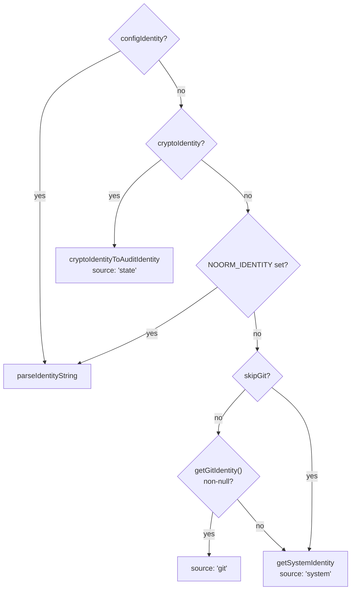
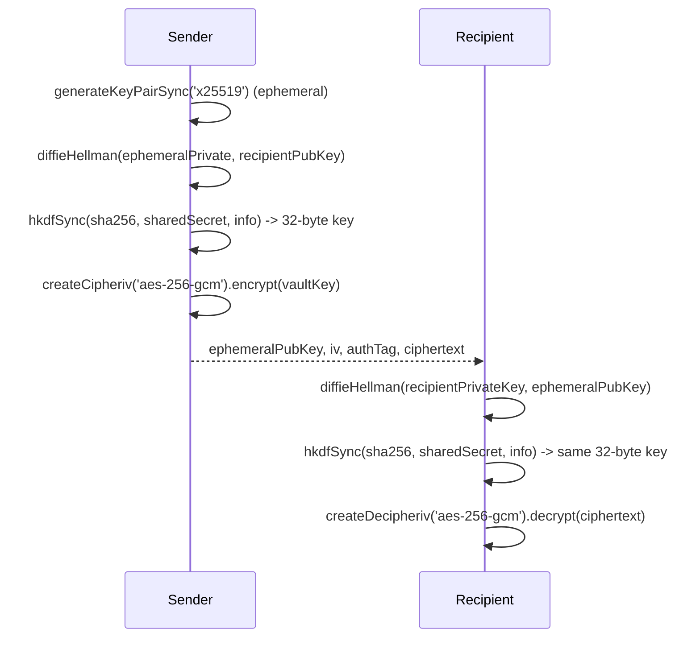
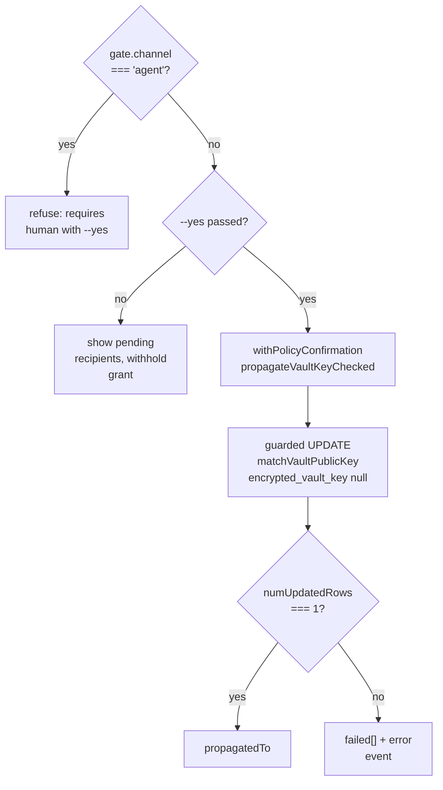
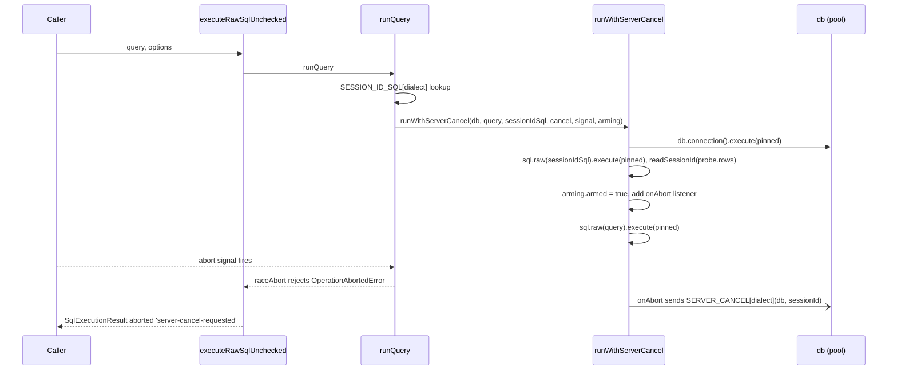
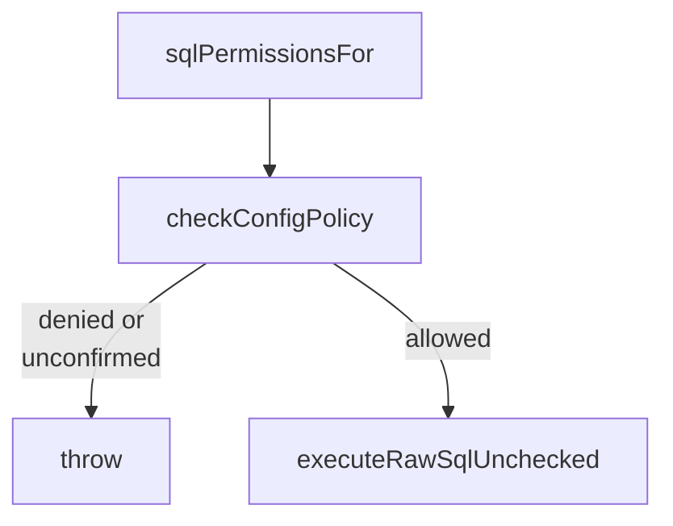
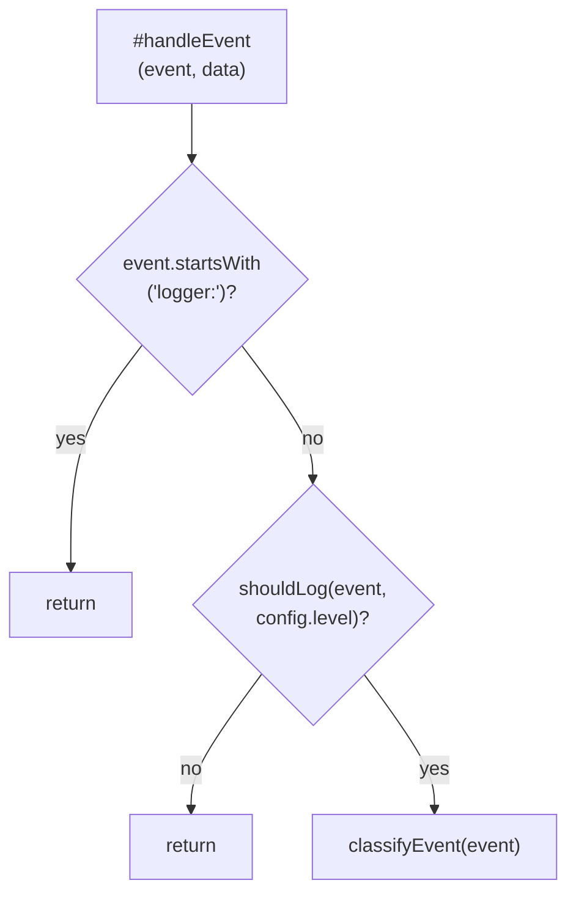
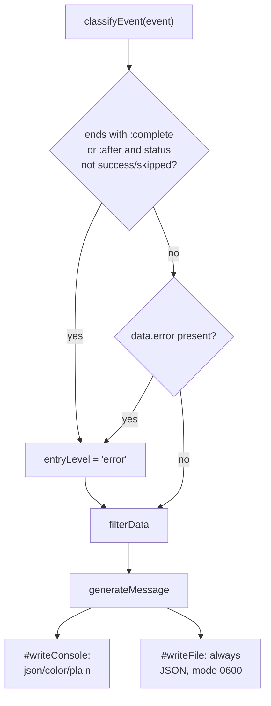

# core-identity

## What it does

Every write to the database needs an answer to "who did this", and every shared secret needs an answer to "who can read this". This domain answers both: [`src/core/identity/`](../../src/core/identity) resolves an audit identity (`executed_by` on rows) through a priority chain and, separately, holds the X25519 keypair used as the crypto identity for team-shared config. [`src/core/vault/`](../../src/core/vault) uses that same keypair to seal a database-wide secret so only registered users can unwrap it. [`src/core/logger/`](../../src/core/logger) records what every other domain did as redacted JSON-Lines. [`src/core/sql-terminal/`](../../src/core/sql-terminal) runs ad-hoc SQL through the same policy gate as every other write path.

The submodules share little code ([`src/core/vault/key.ts`](../../src/core/vault/key.ts) and [`src/core/identity/crypto.ts`](../../src/core/identity/crypto.ts) each implement their own `deriveSharedSecret`/`deriveEncryptionKey` pair, and the logger has its own event-handling path), but they group under one page because they all handle sensitive or audit data. Only [`src/core/identity/`](../../src/core/identity) matches the page name; vault, logger and SQL-terminal also live here. The `noorm identity`, `noorm secret`, `noorm vault`, and `noorm sql` command groups sit over identity, vault, and SQL-terminal. [`src/core/logger/`](../../src/core/logger) backs no command group.

## How it works

### Audit identity resolution takes the first source present, in priority order

`resolveIdentity` ([`src/core/identity/resolver.ts`](../../src/core/identity/resolver.ts)) picks the name/email written to `executed_by`. `CryptoIdentity` ([`src/core/identity/types.ts`](../../src/core/identity/types.ts)) holds a public key and an `identityHash`; the matching private key loads separately, through `loadPrivateKey` ([`src/core/identity/storage.ts`](../../src/core/identity/storage.ts)). [`src/core/identity/factory.ts`](../../src/core/identity/factory.ts) creates a `CryptoIdentity`, `storage.ts` loads one from disk, and the object enters the resolution chain as one possible input, `cryptoIdentity`. It is also what [`src/core/vault/`](../../src/core/vault) and config-sharing encryption use instead of the audit identity.

Each node is a check in `resolveIdentity`; the first hit returns, and the `source` field on the result records which one won.

`parseIdentityString` runs with `source: 'config'` on the config branch and `source: 'env'` on the `NOORM_IDENTITY` branch.

### Vault key sealing repeats one ephemeral-ECDH pattern per recipient

[`src/core/vault/key.ts`](../../src/core/vault/key.ts)'s `encryptVaultKey` and [`src/core/identity/crypto.ts`](../../src/core/identity/crypto.ts)'s `encryptForRecipient` each implement this independently, with a distinct HKDF `info` string per use (`'noorm-vault-key'` vs `'noorm-config-share'`).

Secret values are encrypted once under the shared vault key (`encryptSecret`); only the vault key itself is sealed per recipient with the pattern above.

### Vault propagation grants only the recipients the operator reviewed

`propagateVaultKey` accepts `reviewedRecipients`, the identity and public-key snapshot the operator approved. Each grant is a guarded `UPDATE` inside `attempt()` that matches the public key byte-for-byte (`matchVaultPublicKey`) and only rows whose `encrypted_vault_key` is still null. A row the `UPDATE` does not touch makes the callback throw "Recipient changed or is no longer awaiting vault access; review again"; `attempt()` catches it, so the error lands in `result.failed[].error`, `observer.emit('error', { source: 'vault:propagate' })` fires, and `propagateVaultKey` returns normally. `propagateVaultKeyTo` captures the recipient once and routes through the same path.

### SQL cancellation pins one connection, sends the kill from a second

`executeRawSqlUnchecked` ([`src/core/sql-terminal/executor.ts`](../../src/core/sql-terminal/executor.ts)) calls `runQuery`. `runQuery` wraps the pinned-connection path in `raceAbort` ([`src/core/shared/abort.ts`](../../src/core/shared/abort.ts)), and when a dialect supports a server-side cancel, `runWithServerCancel` pins one Kysely connection so the cancel lands on the right backend, using `SESSION_ID_SQL`/`SERVER_CANCEL`/`readSessionId` imported from [`src/core/connection/session.ts`](../../src/core/connection/session.ts). On abort, `raceAbort` rejects with `OperationAbortedError`; `executeRawSqlUnchecked` catches it and turns it into a `SqlExecutionResult` with `aborted: 'server-cancel-requested'` or `aborted: 'stopped-waiting'` rather than letting it propagate.

If `readSessionId` finds no usable id, or the dialect has no entry in `SERVER_CANCEL` (sqlite, mssql), `arming.armed` stays false and the result reports `aborted: 'stopped-waiting'` instead: the abort only stopped the client from waiting. `abortMessageFor` picks the wording for the UI from `hasServerSideCancel(dialect)` alone (a static per-dialect capability check); only `executeRawSqlUnchecked` checks `arming.armed`, the per-call fact of whether a cancel was sent.

### The policy gate runs before any SQL executes

`executeRawSql` expands the statement into permissions with `sqlPermissionsFor`, checks each with `checkConfigPolicy`, and throws on a denial or an unconfirmed permission before delegating to `executeRawSqlUnchecked`.

A caller therefore sees a thrown error only before execution starts, never once it is running. [`src/cli/sql/query.ts`](../../src/cli/sql/query.ts) runs the same checks itself, requires `--yes` when a permission needs confirmation, and wraps `executeRawSql` in `withPolicyConfirmation` so the core check sees the consent.

### The logger skips its own events, then filters by event name

`Logger#handleEvent` ([`src/core/logger/logger.ts`](../../src/core/logger/logger.ts)) subscribes to every event (`observer.queue(/./)`) but returns immediately on anything prefixed `logger:`, so the logger never logs itself into a loop.

### Level overrides run after the gate, then redaction and output

A passing event gets its level from `classifyEvent`, then the `:complete`/`:after` status override and the `data.error` override can set `entryLevel = 'error'` before `#writeConsole` and `#writeFile` run.

`generateMessage` ([`src/core/logger/formatter.ts`](../../src/core/logger/formatter.ts)) has a template per known event, for example `'vault:propagated'` or `'vault:initialized'`; an event with no template falls back to a generic `key=value` join.

## Where it lives

| Path | Covers |
|------|--------|
| [`src/core/identity/factory.ts`](../../src/core/identity/factory.ts), `index.ts`, `types.ts`, `resolver.ts`, `crypto.ts`, `hash.ts`, `env.ts`, `provenance.ts`, `sync.ts`, `storage.ts` | keypair generation, `getIdentityForConfig` (`index.ts`), `CryptoIdentity` and related types (`types.ts`), audit-identity resolution chain, config-sharing/state encryption, `identityHash`, CI env bootstrap, provenance/harness lookup, `identities` table sync, private/public key file I/O |
| [`src/core/vault/key.ts`](../../src/core/vault/key.ts), `storage.ts`, `policy.ts`, `propagate.ts`, `resolve.ts`, `copy.ts` | vault key generation/sealing, secret CRUD, `*Checked` policy wrappers (`storage.ts`, `propagate.ts`: `propagateVaultKeyChecked`, `propagateVaultKeyToChecked`), `checkVaultPolicy`/`assertVaultPolicy`/`VaultPolicyGate` (`policy.ts`), propagation to pending users (`propagate.ts`), secret resolution/merge, cross-config copy |
| [`src/core/logger/logger.ts`](../../src/core/logger/logger.ts), `classifier.ts`, `formatter.ts`, `redact.ts`, `rotation.ts`, `queue.ts`, `reader.ts`, `init.ts` | the `Logger` class, event-name-to-level classification, message templates, field redaction, size/count rotation, ordered file writes, JSON-Lines reader, startup wiring against `Settings` |
| [`src/core/sql-terminal/executor.ts`](../../src/core/sql-terminal/executor.ts), `history.ts` | `executeRawSql`/`executeRawSqlUnchecked`, abort/server-cancel handling, per-config plain JSON history plus gzipped result files |
| [`src/cli/identity/`](../../src/cli/identity), [`src/cli/secret/`](../../src/cli/secret), [`src/cli/vault/`](../../src/cli/vault), [`src/cli/sql/`](../../src/cli/sql) | `noorm identity`, `noorm secret`, `noorm vault`, `noorm sql` command groups; [`src/cli/secret/`](../../src/cli/secret) reads and writes config-scoped secrets through core-state's `StateManager` rather than through [`src/core/vault/`](../../src/core/vault) |
| [`tests/core/identity/`](../../tests/core/identity), [`tests/core/vault/`](../../tests/core/vault), [`tests/core/logger/`](../../tests/core/logger), [`tests/core/sql-terminal/`](../../tests/core/sql-terminal) | unit coverage, including dedicated edge-case files (`key-file-corruption.test.ts`, `storage-key-permission-guard.test.ts`, `idempotent-init.test.ts`, `policy-gate.test.ts`, `redact-coverage.test.ts`, `rotation-reopen.test.ts`, `executor-abort.test.ts`) |

## Constraints

- Raw vault primitives (`getVaultKey`, `setVaultSecret`, `deleteVaultSecret`, `listVaultSecretKeys`, `propagateVaultKey`, `propagateVaultKeyTo`, `initializeVault`) are ungated. A raw call with no gate lets a `viewer` role write the vault.
- Each surface supplies its own gate. The CLI uses the `*Checked` wrappers, the SDK gates through its own `#gate` method ([`src/sdk/namespaces/vault.ts`](../../src/sdk/namespaces/vault.ts)), and the TUI vault screens call `checkConfigPolicy('user', activeConfig, ...)` before their raw calls (`VaultSetScreen` and `VaultRemoveScreen` check `vault:read` and `vault:write`, `VaultInitScreen` checks `vault:write`, `VaultScreen.tsx` checks `vault:read`, `vault:write`, and `vault:propagate`). A new surface that skips its gate bypasses policy entirely.
- The checked wrappers also refuse unconfirmed access (`assertVaultPolicy` throws when `requiresConfirmation`), so CLI commands wrap each call in `withPolicyConfirmation` after collecting `--yes`. A call without that wrapper throws instead of prompting.
- `executeRawSqlUnchecked` is the SQL-terminal equivalent of a raw primitive, excluded from [`src/core/sql-terminal/index.ts`](../../src/core/sql-terminal/index.ts)'s barrel export so it is never one autocomplete away from a production call site. Importing it directly skips `checkConfigPolicy`.
- Calling `propagateVaultKey` without `reviewedRecipients` or `targets` grants every pending identity, including ones the operator never saw, and the grant is irrevocable.
- `noorm vault propagate` withholds the grant until a human passes `--yes` for the current recipient list, even when policy allows propagation; on the `agent` channel it refuses with "Recipient review requires a human to run vault propagate with --yes.". Without that gate an agent could grant irrevocable access with no human review.
- `copyVaultSecrets` ([`src/core/vault/copy.ts`](../../src/core/vault/copy.ts)) takes a `channel`, asserts `vault:read` on the destination when its vault exists, and throws "No vault access on destination config" when the caller holds no grant there. `noorm vault cp` wraps it in `withPolicyConfirmation` for `vault:read` on the source and `vault:write` on the destination.
- A propagated vault key cannot be revoked (`PendingVaultUser` docstring in [`src/core/vault/types.ts`](../../src/core/vault/types.ts)): once sealed to a recipient's public key, that user keeps decrypting every secret, and no key-rotation path exists. [`src/cli/vault/propagate.ts`](../../src/cli/vault/propagate.ts) shows the operator the identity being granted before sealing.
- `isValidKeyHex` ([`src/core/identity/storage.ts`](../../src/core/identity/storage.ts)) requires 88 (SPKI public) or 96 (PKCS8 private) hex characters. A key that fails validation is a hard error at every write/derive site that reads it: `loadPrivateKey` throws, `setKeyOverride` throws, `deriveStateKey` throws. `loadIdentityFromEnv` is the exception: it returns `null` on an invalid key rather than throwing, since CI bootstrap treats a bad env key as "no override" rather than a fatal error.
- Key file permissions: `~/.noorm/identity.key` is written 0600, `identity.pub` 0644. `loadPrivateKey` throws "Insecure permissions on private key file" when the file's group/other bits are set, which blocks every identity-needing command until the file is `chmod 600`'d. `validateKeyPermissions` checks `mode & 0o077 === 0` and always returns `true` on `win32`, since Windows `stat` doesn't reliably report POSIX modes.
- CI identity bootstrap reads `NOORM_IDENTITY_PRIVATE_KEY`/`NOORM_IDENTITY_NAME`/`NOORM_IDENTITY_EMAIL` once via `loadIdentityFromEnv`, then installs the result through in-memory `setKeyOverride`/`setIdentityOverride` so the rest of the process skips disk reads. `getIdentityForConfig` ([`src/core/identity/index.ts`](../../src/core/identity/index.ts)) returns an audit `Identity` from `resolveIdentity({ configIdentity, cryptoIdentity: getIdentityOverride() })`, so a config identity outranks the override; `loadExistingIdentity` ([`src/core/identity/factory.ts`](../../src/core/identity/factory.ts)) returns `{ ...override }` when one is set. `computeIdentityHash` hashes `email + name + publicKey` (with `os: 'env'`) for this case instead of the hostname, so every CI runner sharing the same private key resolves to the same identity. Hashing `os.hostname()` ([`src/core/identity/env.ts`](../../src/core/identity/env.ts)) would register each runner as a new identity with no vault grant.
- `withAgentProvenance` ([`src/core/identity/provenance.ts`](../../src/core/identity/provenance.ts)) appends " (via <harness>)" to the audit identity when an agent harness is detected; `insertOperationRecord` ([`src/core/shared/operation-id.ts`](../../src/core/shared/operation-id.ts)) calls it when `detectAgentHarness` returns non-null, so `executed_by` records the harness alongside the human or system identity. An insert that bypasses `insertOperationRecord` loses the agent marker from `executed_by`.
- SQL history is a plain JSON file per config (`SqlHistoryManager`); result rows are gzip-compressed separately. Both are written 0600 (files) / 0700 (dirs) via `HISTORY_FILE_MODE`/`HISTORY_DIR_MODE`, the same permission discipline as `state.enc`. Dropping those modes makes result rows readable by other local users. `noorm sql query` (headless/CI) never writes history; only `sql repl` and the TUI SQL terminal do.
- `noorm sql repl` requires a TTY. [`src/cli/sql/repl.ts`](../../src/cli/sql/repl.ts) exits `EXIT.USAGE` in both rejected cases, so a CI script that calls `sql repl` fails fast instead of hanging. With `--yes`/`NOORM_YES` it prints a pointer to `noorm sql query`; without a TTY it prints "noorm sql repl requires an interactive terminal."
- Log event classification ([`src/core/logger/classifier.ts`](../../src/core/logger/classifier.ts)) is regex-pattern-based on event-name prefix/suffix, not a registry: a new event namespace defaults to `debug` level unless a suffix pattern or an `INFO_PATTERNS` prefix matches it. At the default level those events are dropped. `shouldLog` filters on the event name before the `data.error` override, so a debug-classified event that carries an error (for example `sql-terminal:execute:after`) never reaches info output.
- Vault has no local-disk history file; vault secrets live in DB rows only, unlike SQL history and local secrets (`state.enc`), so a lost vault key cannot be recovered from a local cache.

## Coupling

- **core-policy**: [`src/core/vault/policy.ts`](../../src/core/vault/policy.ts) and [`src/core/sql-terminal/executor.ts`](../../src/core/sql-terminal/executor.ts) gate every operation through `checkConfigPolicy`/`sqlPermissionsFor` from [`src/core/policy/`](../../src/core/policy); [`src/core/identity/provenance.ts`](../../src/core/identity/provenance.ts) reads `AgentHarness` from [`src/core/policy/harness.ts`](../../src/core/policy/harness.ts).
    - `resolveChannel` ([`src/core/policy/channel.ts`](../../src/core/policy/channel.ts), re-exported from [`src/core/policy/index.ts`](../../src/core/policy/index.ts)) resolves the acting channel. Callers in this domain's commands are every command in [`src/cli/vault/`](../../src/cli/vault) (including `cp.ts`), [`src/cli/sql/query.ts`](../../src/cli/sql/query.ts), and [`src/cli/secret/_policy.ts`](../../src/cli/secret/_policy.ts).
    - `resolveSecretPolicy` in `_policy.ts` loads settings and applies `withConfigPolicy` before checking; `noorm secret list` requires `--yes` when `secret:read` needs confirmation, and `noorm vault cp` applies the same settings-derived policy to both configs.
- **core-db**: [`src/core/connection/session.ts`](../../src/core/connection/session.ts) supplies `SESSION_ID_SQL`, `SERVER_CANCEL`, `hasServerSideCancel`, and `readSessionId`, which [`src/core/sql-terminal/executor.ts`](../../src/core/sql-terminal/executor.ts) imports to pin a connection and cancel a running statement from a second one. [`src/core/identity/sync.ts`](../../src/core/identity/sync.ts) and [`src/core/vault/copy.ts`](../../src/core/vault/copy.ts) open connections via `createConnection`/`withDualConnection`.
- **shared tables**: vault and identity storage use the `NoormDatabase`/`noormDb`/`getNoormTables` helpers from [`src/core/shared/tables.ts`](../../src/core/shared/tables.ts), a shared module owned by core-state.
- **core-state**: [`src/core/vault/resolve.ts`](../../src/core/vault/resolve.ts) takes a `StateManager` for local-secret resolution; [`src/core/logger/init.ts`](../../src/core/logger/init.ts) waits on `settings:loaded`; [`src/core/identity/sync.ts`](../../src/core/identity/sync.ts) calls `tablesExist`/`ensureSchemaVersion` from [`src/core/version/`](../../src/core/version). `StateManager`'s own encryption key is derived from the identity private key (`deriveStateKey`), so `core-state` cannot decrypt state until this domain has an identity available. [`src/core/logger/logger.ts`](../../src/core/logger/logger.ts) subscribes to every event through `observer.queue(/./)` ([`src/core/observer.ts`](../../src/core/observer.ts)); [`src/core/config/types.ts`](../../src/core/config/types.ts) imports `LogLevel` from [`src/core/logger/types.ts`](../../src/core/logger/types.ts).
- **sdk**: [`src/sdk/namespaces/vault.ts`](../../src/sdk/namespaces/vault.ts) imports `core/vault` directly and gates each call behind its own `#gate` method; [`src/sdk/index.ts`](../../src/sdk/index.ts) calls `loadIdentityFromEnv`, `setKeyOverride`, `setIdentityOverride`, and `getIdentityForConfig`, and re-exports the `Identity` type and the vault types. `VaultAccessError` is defined in the SDK, not this domain.
- **mcp-rpc**: [`src/rpc/commands/query.ts`](../../src/rpc/commands/query.ts) calls `executeRawSql` directly, sharing the same `SqlPolicyGate` contract used by `noorm sql query` and the TUI SQL terminal.
- **tui**: [`src/tui/screens/identity/`](../../src/tui/screens/identity), [`src/tui/screens/vault/`](../../src/tui/screens/vault), [`src/tui/screens/db/SqlTerminalScreen.tsx`](../../src/tui/screens/db/SqlTerminalScreen.tsx), and [`src/tui/components/overlays/LogViewerOverlay.tsx`](../../src/tui/components/overlays/LogViewerOverlay.tsx) import these core modules directly. The vault screens call `checkConfigPolicy` themselves (see Constraints); `SqlTerminalScreen.tsx` goes through `executeRawSql`.
- **cli**: shared plumbing (`withContext`/`withVaultContext`, `outputResult`/`outputError`, `sharedArgs`, `isYesMode`, exit codes) lives in [`src/cli/_utils.ts`](../../src/cli/_utils.ts) and [`src/cli/_exit.ts`](../../src/cli/_exit.ts), owned by the `cli` domain. CI bootstrap callers of `loadIdentityFromEnv`/`setKeyOverride`/`setIdentityOverride` are [`src/cli/index.ts`](../../src/cli/index.ts) and [`src/cli/ci/init.ts`](../../src/cli/ci/init.ts).
- **skills/noorm**: [`skills/noorm/references/cli.md`](../../skills/noorm/references/cli.md) documents the `noorm identity`, `vault`, and `sql` (including `repl`, `history`, and `clear`) commands for agents; it has no `noorm secret` section. Command changes here change that file.
