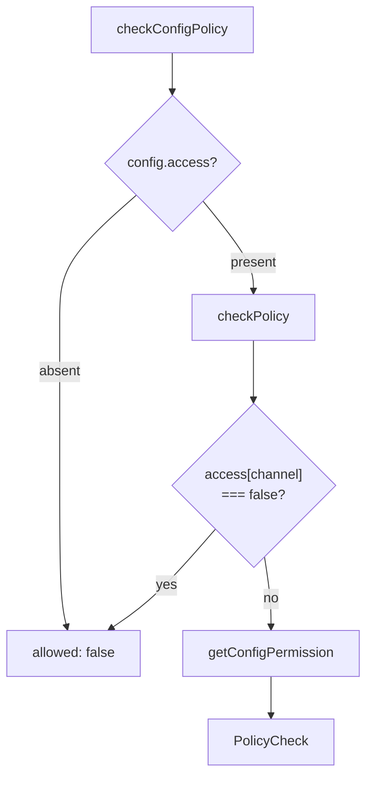
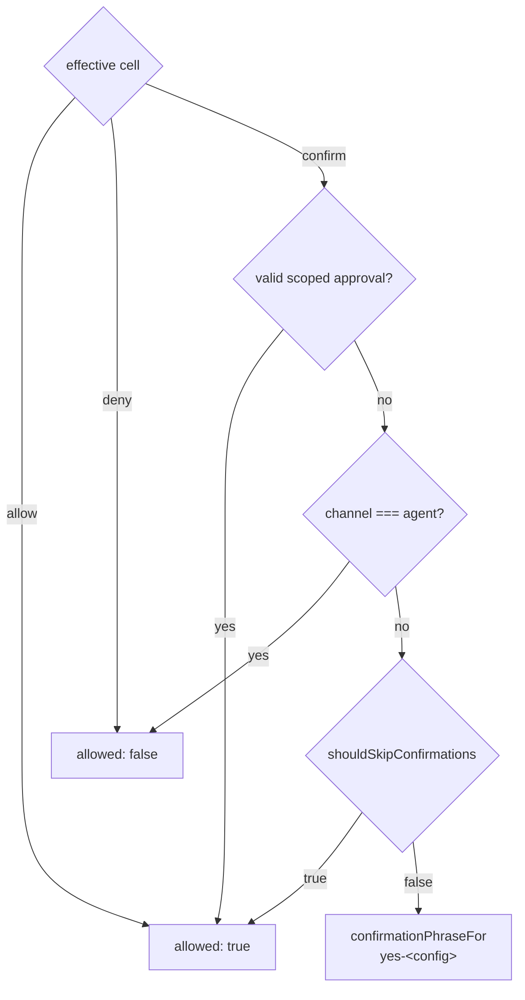
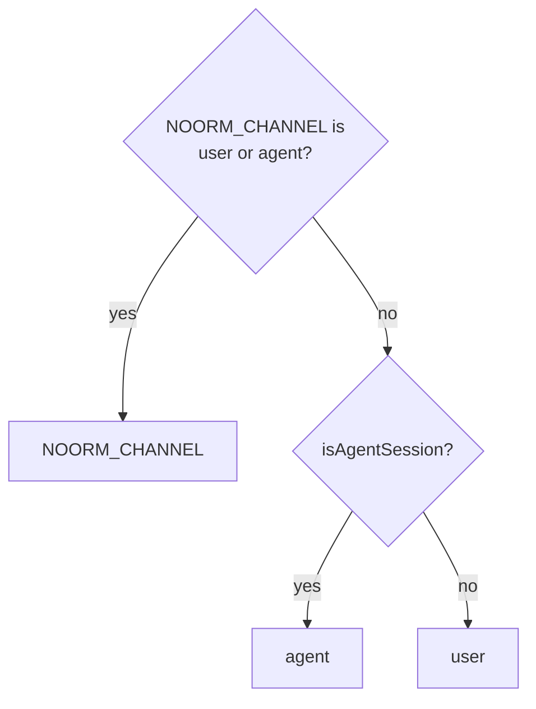
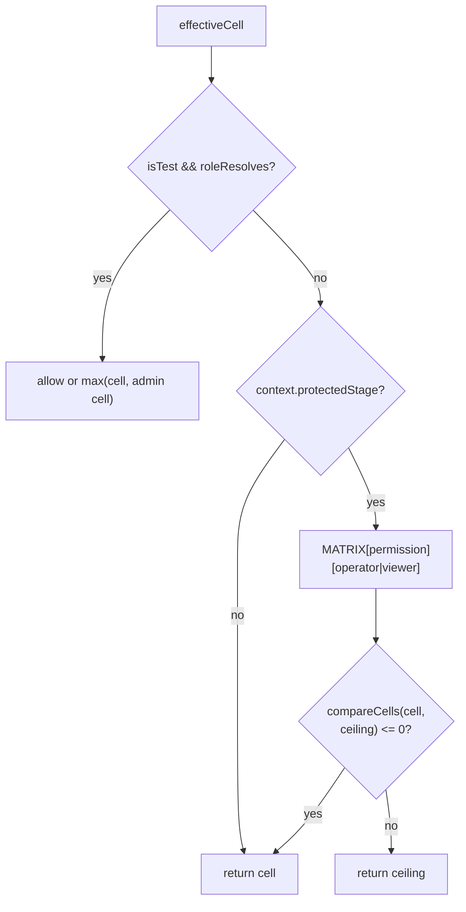
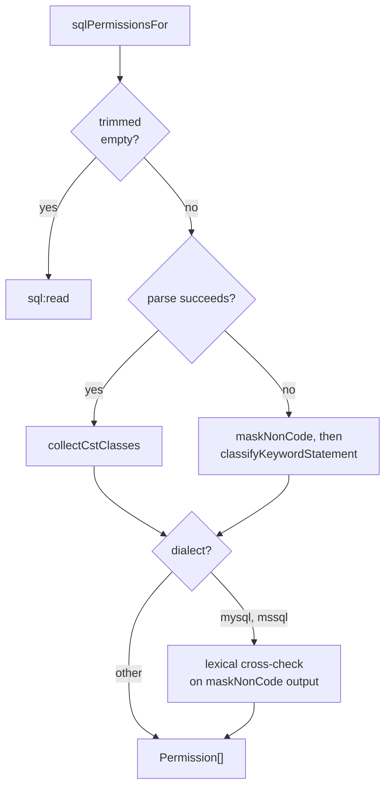

# core-policy

## What it does

An agent refused a permission over MCP could see `noorm` on the PATH, shell out, and get the human's role, because the CLI once hardcoded the `user` channel. A default of agent `admin` made the permission matrix decorative for every stock config. This domain closes both: it resolves the channel from provenance ([`src/core/policy/channel.ts`](../../src/core/policy/channel.ts), [`src/core/policy/harness.ts`](../../src/core/policy/harness.ts)) and defaults the agent to `viewer` ([`src/core/policy/legacy-access.ts`](../../src/core/policy/legacy-access.ts)). It is the single access-control layer for config-scoped actions across CLI, TUI, SDK, and MCP.

Configs assign roles per channel, and effective cells resolve to `allow`/`confirm`/`deny` per action. For raw SQL, `sqlPermissionsFor` and `classifyStatements` pick the `sql:*` permission a statement batch needs.

Policy checks require project-bound context attached during configuration resolution; missing context fails closed. These controls guard noorm operations and are not a process sandbox or a substitute for database permissions.

Overview of a config check: missing access and an invisible channel deny before the matrix is consulted.

## How it works

### Permission cells

Roles belong to a config's `ConfigAccess`, not to an identity. `Channel` identifies who is driving (`user` or `agent`), independently of transport. `MATRIX` supplies immutable built-in cells and protected-stage ceilings, `BUILTIN_ROLES` and `isBuiltinRole` name the roles that resolve without project settings, and `compareCells` ranks cells `deny < confirm < allow`; project policy can override cells or define inherited roles through `PolicyContext.roles`. `effectiveCell` returns `deny` for an inheritance cycle, an invalid cell value, an unknown role, and a custom role with no parent and no explicit cell. The built-in cells below apply where no project override sets the cell.

| Permission | Viewer | Operator | Admin |
|---|---|---|---|
| `explore`, `sql:read`, `debug:read` | allow | allow | allow |
| `sql:write`, `vault:read`, `secret:read`, `transfer:plan` | deny | allow | allow |
| `sql:ddl` | deny | deny | allow |
| `change:run`, `change:ff`, `change:revert` | deny | confirm | allow |
| `run:build`, `run:file`, `run:dir` | deny | confirm | allow |
| `pipeline:run` | deny | confirm | allow |
| `db:create`, `db:reset` | deny | confirm | allow |
| `vault:write`, `secret:write` | deny | confirm | allow |
| `change:rm`, `config:rm`, `config:write` | deny | confirm | confirm |
| `lock:acquire` | deny | allow | allow |
| `db:truncate`, `vault:propagate`, `lock:force` | deny | confirm | confirm |
| `db:destroy`, `db:teardown`, `debug:write` | deny | deny | confirm |

The `user` channel always reads `USER_ALWAYS_ALLOWED` (`explore`, `sql:read`) as `allow`, whatever the role or settings override says. Those reads are gated on the `agent` channel only.

### Confirmation resolution

A `confirm` cell allows a human to proceed with `yes-<config>`, but ordinarily denies an agent before consulting `NOORM_YES`; a `deny` cell cannot be approved. `withPolicyConfirmation` is the only path that passes `confirm` for an agent. It records approval in an `AsyncLocalStorage` store, keyed by permission and by `getPolicyFingerprint`, a hash of the config name, assigned roles, protected-stage flag, `targetIdentity`, and every effective cell on both channels; a changed policy invalidates the grant.

A scoped approval is checked before the channel, so a grant passes `confirm` for an agent and skips the user prompt.

The MCP approval flow that calls `withPolicyConfirmation` belongs to [`docs/wiki/mcp-rpc.md`](mcp-rpc.md).

`checkConfigPolicy` returns the full `PolicyCheck`. Callers that present or require confirmation consume the full check.

### Channel provenance

`resolveChannel` accepts an exact `NOORM_CHANNEL` override before checking harness markers; invalid overrides fall through to detection.

`detectAgentHarness` returns the first harness with a nonempty marker in `AGENT_HARNESSES`: Claude Code, Codex, Cursor, Gemini CLI, or generic `AI_AGENT`/`NOORM_AGENT`. `TERM_PROGRAM`, `CI`, and TTY state are not detection inputs.

### Protected-stage ceilings and access defaults

On a protected stage (`context.protectedStage` set) that is not a trusted `isTest` config, `getConfigPermission` caps the effective cell by the original built-in operator cell for users or viewer cell for agents. The stricter of `deny`, `confirm`, and `allow` wins. The assigned role name and `agent: false` visibility remain unchanged. Project overrides and custom roles cannot relax the ceiling. The one exception is a trusted `isTest` config (`PolicyContext.isTest`), which `getConfigPermission` resolves before it reaches the protected-stage branch. A resolvable role there reads at least the admin cell for each permission, past the ceiling. `TEST_DB_LIFECYCLE` (`db:create`, `db:reset`, `db:truncate`, `db:teardown`, `db:destroy`) reads `allow`. An unknown role still denies.

The ceiling is the built-in operator or viewer cell, so a project override never ranks above it on a protected stage.

`resolveLegacyAccess` preserves explicit `access`. Otherwise, legacy `protected: true` maps to `GUARDED_ACCESS` (`{ user: 'operator', agent: 'viewer' }`); false or absent maps to `DEFAULT_ACCESS` (`{ user: 'admin', agent: 'viewer' }`). An unrestricted legacy flag does not grant agent admin. Config resolution, stage application, and persistence belong to [`docs/wiki/core-state.md`](core-state.md).

`guarded` returns true when `access.user !== 'admin'`, when the bound `PolicyContext` marks a protected stage, or when any user-channel effective cell ranks below the built-in admin cell; without a bound context it reads only the user role. `formatAccessTag` returns `user:<role> agent:<role|off>`, or `null` for `DEFAULT_ACCESS`. An explicit agent-admin grant remains visible even when the user role is admin.

### Tracking-table write gate

`RECORDS_TO_TRACKING` in [`src/core/policy/matrix.ts`](../../src/core/policy/matrix.ts) maps every `Permission` to whether its operations record to the tracking tables; the `Record<Permission, boolean>` type means a new permission cannot go unclassified. `TRACKED_WRITES` lists the permissions marked true. `mayWriteTracking(channel, config)` is true when `checkConfigPolicy` allows any of them; a `confirm` cell counts where the channel can confirm (the user channel, or an agent holding a human approval). A caller that may not write must never create or migrate tracking tables. `prepareTrackingSchema` ([`src/core/version/tracking.ts`](../../src/core/version/tracking.ts)) owns the gate and belongs to [`docs/wiki/core-state.md`](core-state.md); callers also sit in core-runner, core-db, core-identity, cli, tui, and sdk. The permission table is [`src/core/policy/matrix.ts`](../../src/core/policy/matrix.ts).

### Raw-SQL classification

`classifyStatements` reduces the `Permission[]` from `sqlPermissionsFor` to the highest impact, ordered `read < write < ddl`. `sqlPermissionsFor` tries `sql-parser-cst` first and uses keyword analysis when parsing fails.

The CST path is not the whole answer for MySQL and MSSQL: each runs a lexical cross-check on `maskNonCode` output whatever the parse outcome. MySQL expands executable comments before trimming.

`SELECT`, `SHOW`, and `DESCRIBE` normally classify as `read`; `INSERT`, `UPDATE`, `DELETE`, and `MERGE` classify as `write`. `EXPLAIN` inherits the wrapped statement's impact. Data-modifying CTEs upgrade an outer read, and `SELECT INTO` variants classify as `ddl`. Unknown statement forms, schema operations, `SET`, `EXEC`, and `CALL` classify as `ddl`; empty or comment-only input is `read`.

Callers that gate each `sql:*` permission a batch needs use `sqlPermissionsFor` directly. `DESTRUCTIVE_FUNCTIONS` upgrades known side-effecting or server-filesystem calls to at least `write`, including `pg_terminate_backend`, `lo_import`, `setval`, and `pg_read_file`. A smaller privileged set, including `dblink`, `openquery`, `openrowset`, `opendatasource`, and `set_config`, upgrades to `ddl`. Both are denylists, not proof that an arbitrary function is read-only.

On MSSQL the fallback and lexical cross-check share `MSSQL_PRIVILEGED_STATEMENTS`, a catalog of statement roots (`EXEC`, `DECLARE`, `BEGIN`, `SET`, `RECEIVE`, and others). Roots that also appear in ordinary expressions or DML carry a suffix pattern, so `UPDATE` matches only as `UPDATE STATISTICS`, `END` only as `END CONVERSATION`, and `RECEIVE` only with a column list, `*`, or a variable, not `RECEIVE FROM` or `RECEIVE AS`. This is a lexical guardrail, not a T-SQL parser.

## Where it lives

| Path | Role |
|---|---|
| [`src/core/policy/types.ts`](../../src/core/policy/types.ts) | `BuiltinRole` (`viewer`/`operator`/`admin`), `Role` (string), `RoleDefinition`, `PolicyContext`, `Channel` (`user`/`agent`), `ConfigAccess` (`{ user: Role; agent: Role \| false }`), `Permission`, `PolicyTarget`, `PolicyCell`, and `PolicyCheck`. |
| [`src/core/policy/matrix.ts`](../../src/core/policy/matrix.ts) | `MATRIX`, permission cells for each role and the immutable protected-stage ceilings, plus `BUILTIN_ROLES`, `isBuiltinRole`, `compareCells`, `USER_ALWAYS_ALLOWED`, `RECORDS_TO_TRACKING`, and `TEST_DB_LIFECYCLE`. |
| [`src/core/policy/check.ts`](../../src/core/policy/check.ts) | `checkPolicy`, `checkConfigPolicy`, `assertPolicy`, `getConfigPermission`, `getPolicyFingerprint`, `withPolicyConfirmation`, `attachPolicyContext`, `getPolicyContext`, `policyTargetIdentity`, `TRACKED_WRITES`, `mayWriteTracking`, `isVisibleToChannel`, `confirmationPhraseFor`, `guarded`, and `formatAccessTag`. |
| [`src/core/policy/channel.ts`](../../src/core/policy/channel.ts), [`src/core/policy/harness.ts`](../../src/core/policy/harness.ts) | `resolveChannel`, `AGENT_HARNESSES`, `detectAgentHarness`, and `isAgentSession`. |
| [`src/core/policy/legacy-access.ts`](../../src/core/policy/legacy-access.ts) | `DEFAULT_ACCESS`, `GUARDED_ACCESS`, and `resolveLegacyAccess`. |
| [`src/core/policy/classify.ts`](../../src/core/policy/classify.ts) | `sqlPermissionsFor`, `classifyStatements`, CST and keyword classifiers, and destructive-function detection. |
| [`src/core/policy/index.ts`](../../src/core/policy/index.ts) | Public policy exports, including `UnknownAccessRoleError` from [`src/core/policy/errors.ts`](../../src/core/policy/errors.ts). |
| [`tests/core/policy/check.test.ts`](../../tests/core/policy/check.test.ts) | Independently authored `EXPECTED_MATRIX` and `PERMISSIONS` fixtures, confirmation, fail-closed checks, and display behavior. The fixtures exercise explore, SQL, change/run, `pipeline:run`, database create/reset/destroy, and config removal; they do not enumerate the vault/secret, transfer, lock, debug, config-write, truncate, or teardown permissions. |
| [`tests/core/policy/configurable-roles.test.ts`](../../tests/core/policy/configurable-roles.test.ts) | Raw, detached, and cloned access denial, overridden and inherited roles, ceilings (including `pipeline:run` capped like `run:dir`), fingerprints bound to project and connection, and `withPolicyConfirmation` scoping. |
| [`tests/core/policy/istest-lifecycle.test.ts`](../../tests/core/policy/istest-lifecycle.test.ts), [`tests/core/policy/tracked-writes.test.ts`](../../tests/core/policy/tracked-writes.test.ts) | `isTest` relaxation past the ceiling and the tracking-write gate. |
| [`tests/core/policy/channel.test.ts`](../../tests/core/policy/channel.test.ts), [`tests/core/policy/agent-escalation.test.ts`](../../tests/core/policy/agent-escalation.test.ts) | Provenance precedence and matching agent authorization across transport routes. |
| [`tests/core/policy/default-access.test.ts`](../../tests/core/policy/default-access.test.ts), [`tests/core/policy/visibility.test.ts`](../../tests/core/policy/visibility.test.ts) | Defaults through `parseConfig`/`migrateState`, explicit grants, and fail-closed visibility. |
| [`tests/core/policy/classify.test.ts`](../../tests/core/policy/classify.test.ts), [`tests/core/policy/classify-corpus.test.ts`](../../tests/core/policy/classify-corpus.test.ts) | CST/fallback classification and an adversarial SQL corpus, including assertions that inputs exercise the intended parser path. |

## Constraints

- Missing `access` denies authorization on either channel. `isVisibleToChannel` always returns true for `user`, even without access, so treating visibility as authorization lets a config with no access through.
- `agent: false` hides a config rather than assigning a role. Visibility filtering happens upstream; `checkPolicy` still denies if the hidden channel reaches it, but a caller that skips upstream `isVisibleToChannel` filtering lists a hidden config to the agent.
- `NOORM_YES` can skip user confirmation, but cannot override `deny` or an agent's `confirm` cell. Treating `NOORM_YES` as agent consent would be wrong: agent `confirm` cells pass only through `withPolicyConfirmation`.
- Built-in `config:write` requires confirmation even for admin. Whoever edits project role definitions can widen what a role allows.
- `resolveChannel` ([`src/core/policy/channel.ts`](../../src/core/policy/channel.ts)) accepts `NOORM_CHANNEL=user` before harness detection, so an agent shelling out with it gets the human role. Only the MCP entrypoint, which passes the literal `agent`, is immune.
- Environment provenance is evadable and does not authenticate a caller. Treating harness detection as a security boundary promises protection that environment variables cannot provide.
- `assertPolicy` enforces denial only. Using it as a confirmation gate lets an allowed user action proceed without consuming `requiresConfirmation`.
- The ceiling caps the effective cell and leaves the role name unchanged. Replacing the role with the ceiling makes `formatAccessTag`, `guarded`, and `blockedReason` report the wrong role.
- `guarded` and `formatAccessTag` are display helpers, not authorization gates. They cannot distinguish the permissions or confirmation requirements of a requested action, so gating on them skips the per-permission cell.
- An unlisted side-effecting function can remain `read`. Treating the SQL classifier as a database-grant boundary permits effects outside its denylist.
- Classification covers nested impact and dialect quoting. Checking only an outer `SELECT` or `EXPLAIN` misclassifies writes, and splitting raw quoted text hides later statements.

## Coupling

- [`docs/wiki/core-state.md`](core-state.md) owns config schemas, stage resolution and materialization, settings rules, state access validation (including rejection of invalid permissions and inheritance cycles in settings, [`src/core/settings/schema.ts`](../../src/core/settings/schema.ts)), and migration. Those callers share `ConfigAccess` and `resolveLegacyAccess`; policy checks enforce stage ceilings.
- [`docs/wiki/cli.md`](cli.md) owns command routing and channel resolution at entrypoints. Policy consumers there include [`src/cli/config/repair-access.ts`](../../src/cli/config/repair-access.ts), [`src/cli/config/list.ts`](../../src/cli/config/list.ts), [`src/cli/ci/identity/enroll.ts`](../../src/cli/ci/identity/enroll.ts) (`resolveChannel`, `withPolicyConfirmation`), and [`src/cli/run/_render-secrets.ts`](../../src/cli/run/_render-secrets.ts). [`docs/wiki/tui.md`](tui.md) owns confirmation dialogs and access display, including [`src/tui/screens/db/SqlTerminalScreen.tsx`](../../src/tui/screens/db/SqlTerminalScreen.tsx), which calls `sqlPermissionsFor` and `withPolicyConfirmation`.
- [`docs/wiki/core-change.md`](core-change.md) and [`docs/wiki/core-runner.md`](core-runner.md) consume command permissions through `assertPolicy`. `executeRawSql` in core-identity uses `sqlPermissionsFor` + `checkConfigPolicy`, not `assertPolicy`.
- Named SQL pipelines gate on `pipeline:run`, separate from `run:dir`, so a role can run pipelines without arbitrary directory runs and the reverse. `preparePipeline` ([`src/core/pipeline/prepare.ts`](../../src/core/pipeline/prepare.ts)) calls `checkConfigPolicy` and throws `PIPELINE_POLICY_BLOCKED` on deny or `PIPELINE_CONFIRMATION_REQUIRED` on `confirm` without `yes`; the SDK pipelines namespace and `PipelineRunScreen` check the same permission. Pipeline history reads gate on `explore`. Pipeline behavior belongs to the runner and SDK pages.
- [`docs/wiki/core-db.md`](core-db.md) owns database lifecycle and transfer gates that consume policy results. [`docs/wiki/core-identity.md`](core-identity.md) owns vault, secret, and SQL-terminal callers.
- [`docs/wiki/sdk.md`](sdk.md) and [`docs/wiki/mcp-rpc.md`](mcp-rpc.md) own their transport/context guards. MCP reloads project state and policy per request and mediates human approval in [`src/mcp/approval.ts`](../../src/mcp/approval.ts); both belong to mcp-rpc.
- The skill reference [`skills/noorm/references/config.md`](../../skills/noorm/references/config.md), the specs [`docs/spec/config-access-roles.md`](../spec/config-access-roles.md), and the guides [`docs/guide/environments/configs.md`](../guide/environments/configs.md) and [`docs/guide/environments/stages.md`](../guide/environments/stages.md) document the access contract. These pages restate `MATRIX` and `DEFAULT_ACCESS`, so a matrix edit that skips them leaves the docs out of date.
- Known stale: [`docs/design/config-access-roles.md`](../design/config-access-roles.md) (lines 15-26 and 35) names the transport channel `mcp` and a hard-coded, non-extensible matrix. Source uses the provenance channel `agent` and project-overridable roles via `PolicyContext.roles`.
