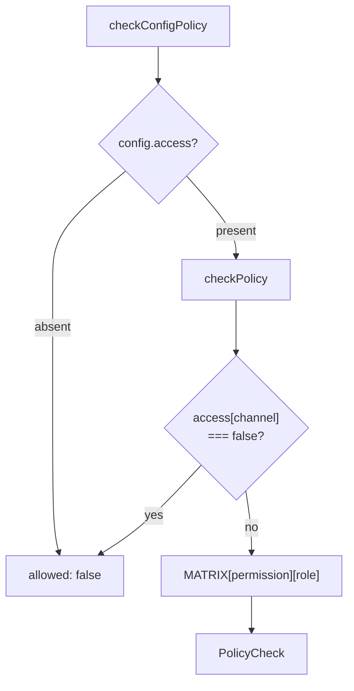
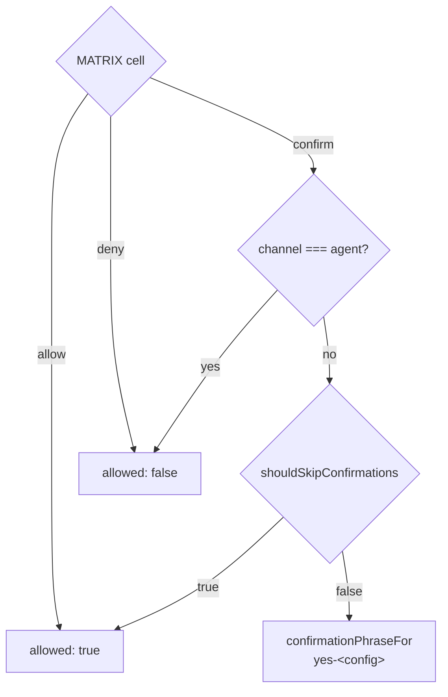
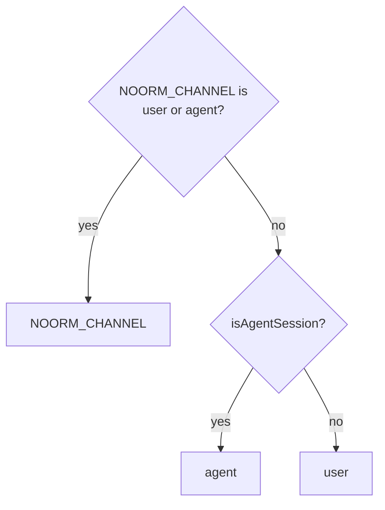
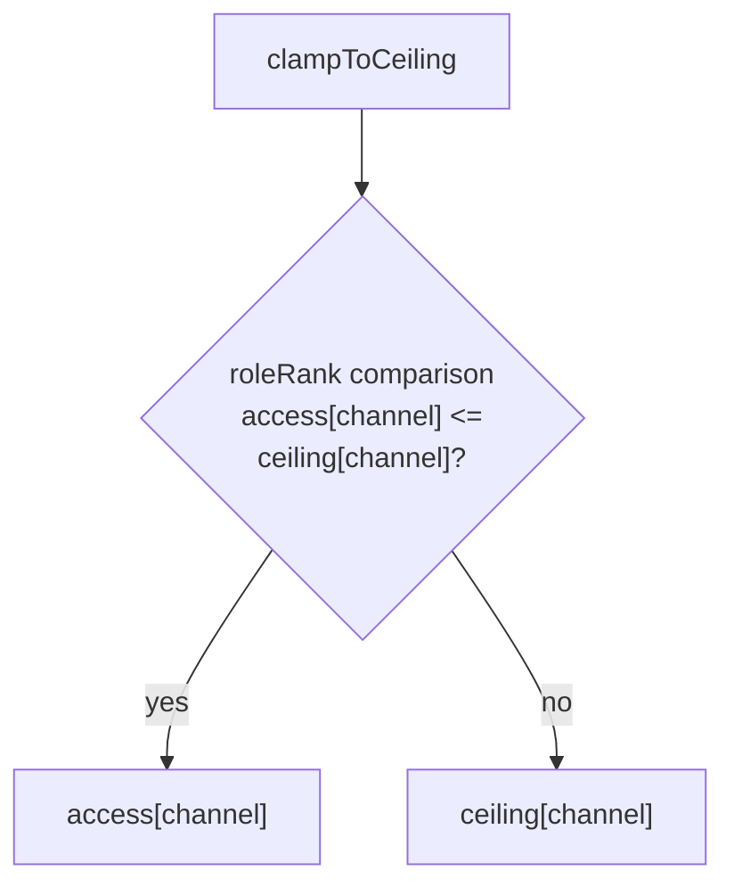
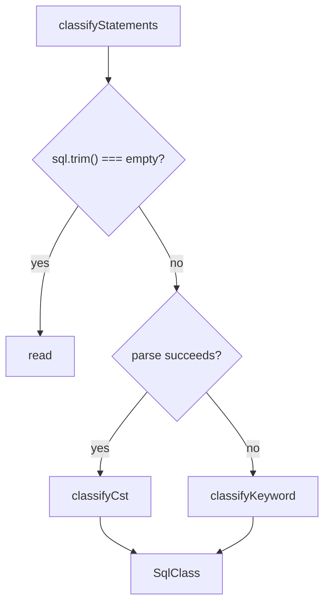

# core-policy

## What it does

`core-policy` gives config-scoped actions a shared authorization contract across CLI, TUI, SDK, and MCP callers. Use it when deciding whether an action may proceed, whether a human must confirm it, or which permission raw SQL requires.

Roles belong to a config's `ConfigAccess`, not to an identity. `Channel` identifies who is driving (`user` or `agent`), independently of transport. `MATRIX` maps the selected role and permission to `allow`, `confirm`, or `deny`.

`checkConfigPolicy` rejects missing access, and `checkPolicy` rejects an invisible channel before consulting the matrix.

## How it works

### Permission cells

`MATRIX` is hard-coded, not user-extensible. The cells below apply before channel resolution.

| Permission | Viewer | Operator | Admin |
|---|---|---|---|
| `explore`, `sql:read`, `debug:read` | allow | allow | allow |
| `sql:write`, `vault:read`, `secret:read`, `transfer:plan` | deny | allow | allow |
| `sql:ddl` | deny | deny | allow |
| `change:run`, `change:ff`, `change:revert` | deny | confirm | allow |
| `run:build`, `run:file`, `run:dir` | deny | confirm | allow |
| `db:create`, `db:reset` | deny | confirm | allow |
| `vault:write`, `secret:write` | deny | confirm | allow |
| `change:rm`, `config:rm`, `config:write` | deny | confirm | confirm |
| `db:truncate`, `vault:propagate`, `lock:force` | deny | confirm | confirm |
| `db:destroy`, `db:teardown`, `debug:write` | deny | deny | confirm |

### Confirmation resolution

A `confirm` cell allows a human to proceed with `yes-<config>`, but denies an agent before consulting `NOORM_YES`.

`checkConfigPolicy` returns the full `PolicyCheck`. `assertPolicy` throws when `allowed` is false; it does not prompt or enforce a positive `requiresConfirmation` result. Callers that present or require confirmation consume the full check.

### Channel provenance

`resolveChannel` accepts an exact `NOORM_CHANNEL` override before checking harness markers; invalid overrides fall through to detection.

`detectAgentHarness` returns the first harness with a nonempty marker in `AGENT_HARNESSES`: Claude Code, Codex, Cursor, Gemini CLI, or generic `AI_AGENT`/`NOORM_AGENT`. `TERM_PROGRAM`, `CI`, and TTY state are not detection inputs. The MCP entrypoint supplies `agent` directly rather than calling `resolveChannel`.

### Role ceilings and access defaults

`clampToCeiling` caps each channel independently, preserving stricter input access. `roleRank` orders `false < viewer < operator < admin`; `false` is valid only for the agent channel. `PROTECTED_STAGE_CEILING` is `{ user: 'operator', agent: 'viewer' }`.

For each channel, `clampToCeiling` returns the existing role unless it exceeds that channel's ceiling.

`resolveLegacyAccess` preserves explicit `access`. Otherwise, legacy `protected: true` maps to `GUARDED_ACCESS` (`{ user: 'operator', agent: 'viewer' }`); false or absent maps to `DEFAULT_ACCESS` (`{ user: 'admin', agent: 'viewer' }`). An unrestricted legacy flag does not grant agent admin. Config resolution, stage application, and persistence belong to [`docs/wiki/core-state.md`](core-state.md).

`guarded` reads only `access.user !== 'admin'` for display and rule matching. `formatAccessTag` returns `user:<role> agent:<role|off>`, or `null` for `DEFAULT_ACCESS`. An explicit agent-admin grant remains visible even when the user role is admin.

### Raw-SQL classification

`classifyStatements` tries `sql-parser-cst` first and uses keyword analysis when parsing fails. Both paths select the highest impact, ordered `read < write < ddl`.

The CST path traverses nested statement nodes, including CTE bodies and statements wrapped by `EXPLAIN`. The fallback masks literals, quoted identifiers, and comments by dialect before splitting statements and classifying keywords. MSSQL uses the PostgreSQL grammar as a best effort, so dialect-specific syntax can reach the fallback.

`SELECT`, `SHOW`, and `DESCRIBE` normally classify as `read`; `INSERT`, `UPDATE`, `DELETE`, and `MERGE` classify as `write`. `EXPLAIN` inherits the wrapped statement's impact. Data-modifying CTEs upgrade an outer read, and `SELECT INTO` variants classify as `ddl`. Unknown statement forms, schema operations, `SET`, `EXEC`, and `CALL` classify as `ddl`; empty or comment-only input is `read`.

`DESTRUCTIVE_FUNCTIONS` upgrades known side-effecting or server-filesystem calls to at least `write`, including `pg_terminate_backend`, `lo_import`, `setval`, and `pg_read_file`. It is a denylist, not proof that an arbitrary function is read-only.

## Where it lives

| Path | Role |
|---|---|
| [`src/core/policy/types.ts`](../../src/core/policy/types.ts) | `Role` (`viewer`/`operator`/`admin`), `Channel` (`user`/`agent`), `ConfigAccess` (`{ user: Role; agent: Role \| false }`), `Permission`, `PolicyTarget`, `PolicyCell`, and `PolicyCheck`. |
| [`src/core/policy/matrix.ts`](../../src/core/policy/matrix.ts) | `MATRIX`, permission cells for each role. |
| [`src/core/policy/check.ts`](../../src/core/policy/check.ts) | `checkPolicy`, `checkConfigPolicy`, `assertPolicy`, `isVisibleToChannel`, `confirmationPhraseFor`, `guarded`, and `formatAccessTag`. |
| [`src/core/policy/channel.ts`](../../src/core/policy/channel.ts), [`src/core/policy/harness.ts`](../../src/core/policy/harness.ts) | `resolveChannel`, `AGENT_HARNESSES`, `detectAgentHarness`, and `isAgentSession`. |
| [`src/core/policy/ceiling.ts`](../../src/core/policy/ceiling.ts) | Per-channel clamping and the protected-stage ceiling. |
| [`src/core/policy/legacy-access.ts`](../../src/core/policy/legacy-access.ts) | Default access pairs and legacy-input resolution contract. |
| [`src/core/policy/classify.ts`](../../src/core/policy/classify.ts) | CST and keyword classifiers with destructive-function detection. |
| [`src/core/policy/index.ts`](../../src/core/policy/index.ts) | Public policy exports. |
| [`tests/core/policy/check.test.ts`](../../tests/core/policy/check.test.ts) | Independently authored `EXPECTED_MATRIX` and `PERMISSIONS` fixtures, confirmation, fail-closed checks, and display behavior. The fixtures exercise explore, SQL, change/run, database create/reset/destroy, and config removal; they do not enumerate the newer vault/secret, transfer, lock, debug, config-write, truncate, or teardown permissions. |
| [`tests/core/policy/channel.test.ts`](../../tests/core/policy/channel.test.ts), [`tests/core/policy/agent-escalation.test.ts`](../../tests/core/policy/agent-escalation.test.ts) | Provenance precedence and matching agent authorization across transport routes. |
| [`tests/core/policy/default-access.test.ts`](../../tests/core/policy/default-access.test.ts), [`tests/core/policy/visibility.test.ts`](../../tests/core/policy/visibility.test.ts) | Defaults through `parseConfig`/`migrateState`, explicit grants, and fail-closed visibility. |
| [`tests/core/policy/classify.test.ts`](../../tests/core/policy/classify.test.ts), [`tests/core/policy/classify-corpus.test.ts`](../../tests/core/policy/classify-corpus.test.ts) | CST/fallback classification and an adversarial SQL corpus, including assertions that inputs exercise the intended parser path. |
| [`docs/design/config-access-roles.md`](../design/config-access-roles.md) | Role-model rationale; implementation files define the current channel and default-access contract. |
| [`docs/spec/config-access-roles.md`](../spec/config-access-roles.md) | Role-model implementation contract, permission matrix, SQL classification, enforcement, and migration. |
| [`docs/dev/config.md`](../dev/config.md), [`docs/dev/config-sharing.md`](../dev/config-sharing.md) | Developer config/access and sharing contracts. |
| [`docs/guide/environments/configs.md`](../guide/environments/configs.md), [`docs/guide/environments/stages.md`](../guide/environments/stages.md) | User-facing config and stage access guidance. |
| [`skills/noorm/references/config.md`](../../skills/noorm/references/config.md) | Config-access skill reference. |

### Enforcement and data-resolution entrypoints

| Callers | Policy integration |
|---|---|
| [`src/core/change/executor.ts`](../../src/core/change/executor.ts), [`src/core/runner/runner.ts`](../../src/core/runner/runner.ts) | `assertPolicy` for change run/fast-forward/revert and build/file/directory execution. |
| [`src/core/db/policy.ts`](../../src/core/db/policy.ts), [`src/core/transfer/index.ts`](../../src/core/transfer/index.ts) | `assertDbPolicy` for database lifecycle; transfer `assertPolicy` for destination `db:reset` and `transfer:plan`. |
| [`src/core/vault/policy.ts`](../../src/core/vault/policy.ts), [`src/core/sql-terminal/executor.ts`](../../src/core/sql-terminal/executor.ts) | `checkVaultPolicy`/`assertVaultPolicy`; raw SQL uses `classifyStatements` to select a permission before `assertPolicy`. |
| `src/core/config/{schema,types,resolver}.ts`, [`src/core/state/access.ts`](../../src/core/state/access.ts), [`src/core/settings/rules.ts`](../../src/core/settings/rules.ts) | `ConfigAccess`, `resolveLegacyAccess`, ceiling helpers, and `guarded` for data resolution and rule matching, not enforcement. |
| [`src/mcp/server.ts`](../../src/mcp/server.ts), [`src/rpc/types.ts`](../../src/rpc/types.ts) | Dispatch checks `checkConfigPolicy` for non-`open` commands; `RpcCommand.permission` is `Permission \| 'open'`. |
| [`src/sdk/guards.ts`](../../src/sdk/guards.ts), [`src/sdk/index.ts`](../../src/sdk/index.ts), [`src/sdk/types.ts`](../../src/sdk/types.ts) | SDK checks raise `ProtectedConfigError`; the public API re-exports `Channel`, `ConfigAccess`, and `Role`, and context options carry `channel`. |
| [`src/cli/_utils.ts`](../../src/cli/_utils.ts), [`src/cli/change/rm.ts`](../../src/cli/change/rm.ts), `src/cli/config/*.ts`, `src/cli/db/{create,drop}.ts`, `src/cli/run/{inspect,preview}.ts`, [`src/cli/secret/_policy.ts`](../../src/cli/secret/_policy.ts), [`src/cli/sql/query.ts`](../../src/cli/sql/query.ts), `src/cli/vault/*.ts` | Resolve channel provenance and consume config checks, assertions, or vault policy gates. |
| `src/tui/screens/change/Change{FF,Run,Revert,Remove,Rewind,Next}Screen.tsx`, [`src/tui/screens/config/ConfigRemoveScreen.tsx`](../../src/tui/screens/config/ConfigRemoveScreen.tsx), `src/tui/screens/db/Db{Create,Destroy,Teardown,Transfer,Truncate}Screen.tsx`, [`src/tui/screens/run/RunBuildScreen.tsx`](../../src/tui/screens/run/RunBuildScreen.tsx), [`src/tui/screens/vault/VaultScreen.tsx`](../../src/tui/screens/vault/VaultScreen.tsx) | `checkConfigPolicy` results determine destructive-action availability and confirmation props. |
| [`src/tui/components/dialogs/SmartConfirm.tsx`](../../src/tui/components/dialogs/SmartConfirm.tsx), [`src/tui/screens/lock/LockForceScreen.tsx`](../../src/tui/screens/lock/LockForceScreen.tsx) | `confirmationPhraseFor` supplies typed-dialog phrases. |
| [`src/tui/screens/config/ConfigAddScreen.tsx`](../../src/tui/screens/config/ConfigAddScreen.tsx), [`src/tui/app-context.tsx`](../../src/tui/app-context.tsx), [`src/tui/utils/config-validation.ts`](../../src/tui/utils/config-validation.ts) | Config creation uses `DEFAULT_ACCESS`/`GUARDED_ACCESS`; stage seeding uses `materializeStage`; display validation reads `guarded`. |

## Constraints

- Missing `access` denies authorization on either channel. Treating visibility as authorization would bypass this: `isVisibleToChannel` always returns true for `user`, even without access.
- `agent: false` hides a config rather than assigning a role. Visibility filtering belongs upstream; `checkPolicy` still denies if the hidden channel reaches it.
- `NOORM_YES` can skip user confirmation, but cannot override `deny` or an agent's `confirm` cell. Applying it before channel resolution would reopen destructive actions to agents.
- `config:write` requires confirmation even for admin. Replacing that cell with `allow` would let an agent-admin config authorize its own access changes.
- `assertPolicy` enforces denial only. Using it as a confirmation gate would let an allowed user action proceed without consuming `requiresConfirmation`.
- Ceilings must retain already-stricter roles and agent invisibility. Replacing access with the ceiling directly would loosen a viewer config or expose a hidden one.
- `guarded` and `formatAccessTag` are display helpers, not authorization gates. They cannot distinguish the permissions or confirmation requirements of a requested action.
- Environment provenance is evadable and does not authenticate a caller. Treating harness detection as a security boundary would promise protection that environment variables cannot provide.
- An unlisted side-effecting function can remain `read`. Treating the SQL classifier as a database-grant boundary would permit effects outside its denylist.
- CST and fallback classification must preserve nested impact and dialect quoting. Checking only an outer `SELECT` or `EXPLAIN` can misclassify writes, while splitting raw quoted text can hide later statements.

## Coupling

- [`docs/wiki/core-state.md`](core-state.md) owns config schemas, stage resolution and materialization, settings rules, state access validation, and migration. Those callers share `ConfigAccess`, `resolveLegacyAccess`, and the ceiling helpers rather than defining their own role ordering or default pairs.
- [`docs/wiki/cli.md`](cli.md) owns command routing, channel resolution at entrypoints, and the create/sync workflows that consume stage access and policy checks. [`docs/wiki/tui.md`](tui.md) owns confirmation dialogs and access display.
- [`docs/wiki/core-change.md`](core-change.md) and [`docs/wiki/core-runner.md`](core-runner.md) consume command permissions through `assertPolicy`; raw-SQL classification is a separate permission-selection surface.
- [`docs/wiki/core-db.md`](core-db.md) owns database lifecycle and transfer gates that consume policy results. [`docs/wiki/core-identity.md`](core-identity.md) owns vault, secret, and SQL-terminal callers.
- [`docs/wiki/sdk.md`](sdk.md) and [`docs/wiki/mcp-rpc.md`](mcp-rpc.md) own their transport/context guards. Their channel and confirmation handling must agree with the policy contract rather than reinterpret matrix cells.
