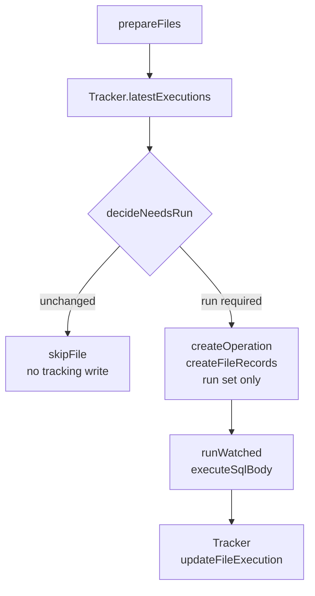
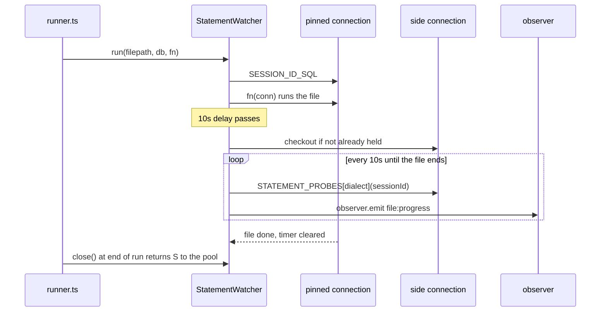
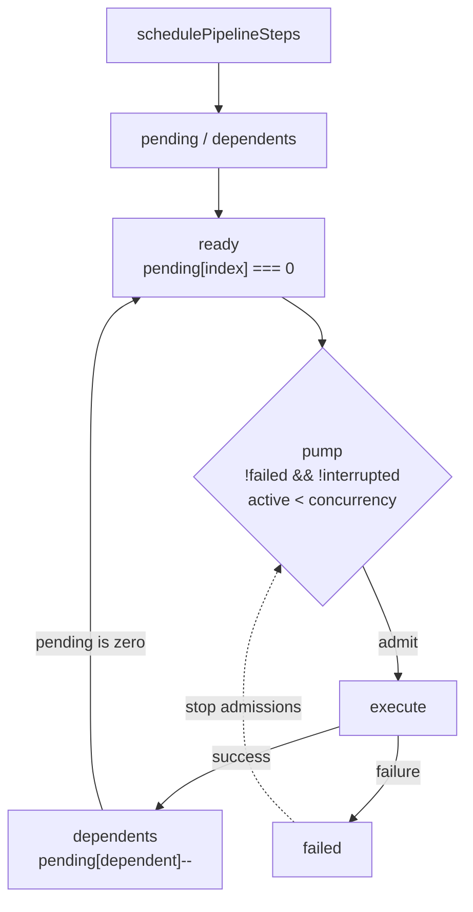
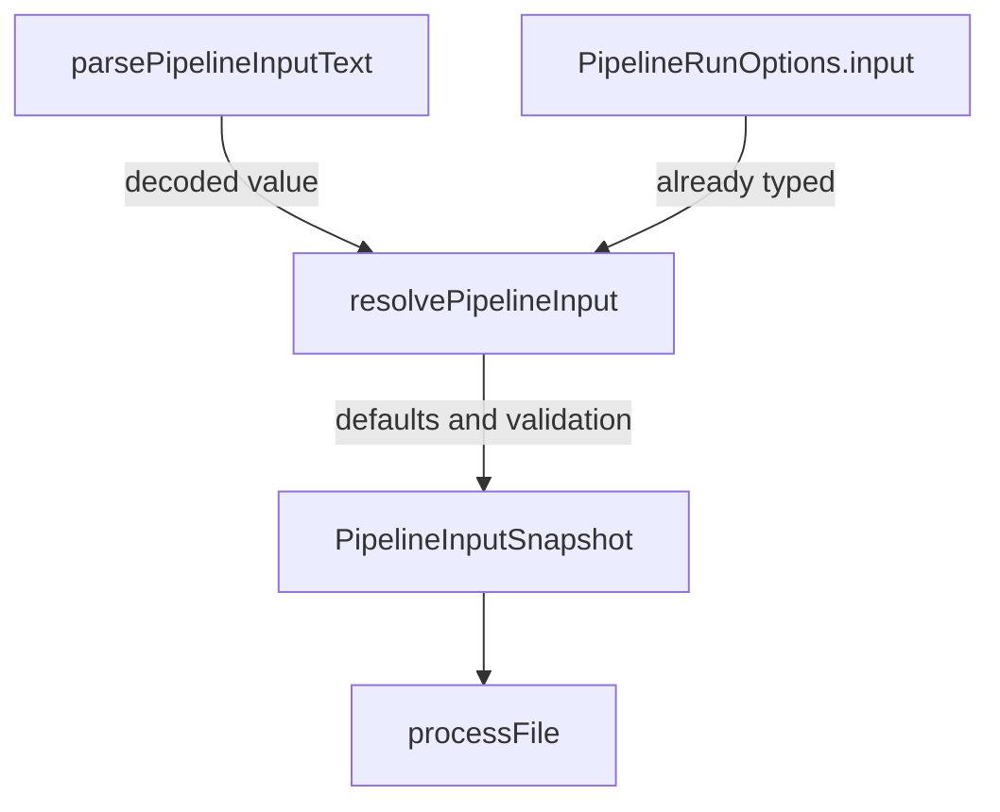
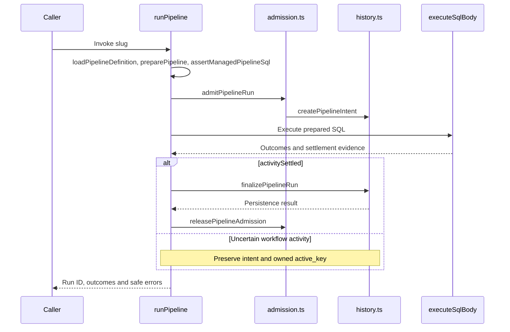
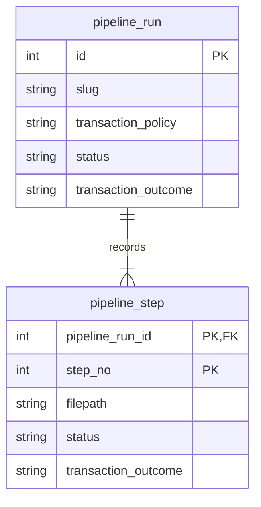
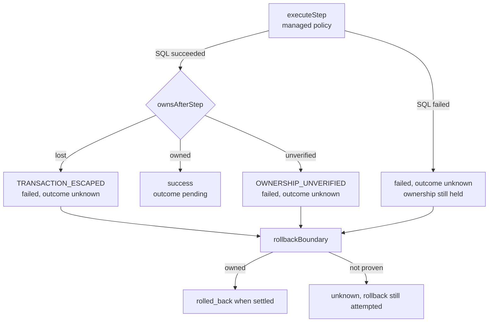
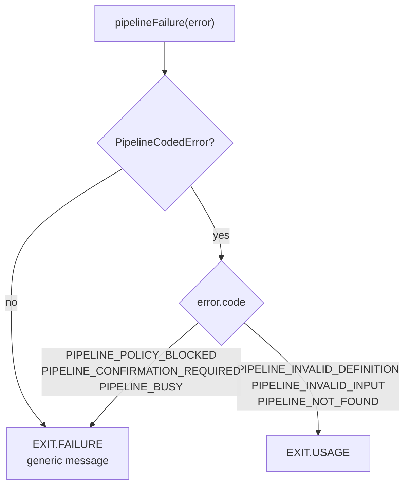

# core-runner

## What it does

Runs `.sql` and `.sql.tmpl` files against a Kysely connection with checksum-based change detection, so a build command run twice only re-executes what changed. `runBuild`, `runFile`, `runDir`, `runFiles`, `preview`, and `checkFilesStatus` in [`src/core/runner/runner.ts`](../../src/core/runner/runner.ts) are the policy-gated entrypoints. It also renders `.sql.tmpl` files through an Eta-based template engine before execution, and watches every file's SQL for how long it runs, so a slow `CREATE INDEX` and a file stuck behind another session's lock read differently to the caller instead of both looking like "still running."

Named SQL pipelines execute repeatable business workflows against one resolved database. `runPipeline` uses the same template and SQL-body primitives as the runner, but each admitted invocation starts fresh and has independent history.

## How it works

### Execution and change detection

`executeFiles` renders and hashes every file once, reads prior outcomes in one query, and decides the whole batch in memory. Only files that need a run touch the database again.

`prepareFiles` ([`src/core/runner/runner.ts`](../../src/core/runner/runner.ts)) loads and renders each file once and hashes the rendered content, because comparing raw `.sql.tmpl` bytes would re-execute every template on every build. The rendered SQL is kept and run as-is later. `Tracker.latestExecutions` ([`src/core/runner/tracker.ts`](../../src/core/runner/tracker.ts)) fetches the latest outcome per file in one query, and the pure `decideNeedsRun` (applied by `applyRunGate`) compares it to the new checksum. A legacy `skipped` row with `skip_reason: 'unchanged'` still counts as a prior outcome; any other `skipped` row (a cascade skip after an earlier failure, or a cancelled run) and any `pending` row re-runs with `reason: 'new'`.

Skipped files write no rows. If every file skips, no operation row is written and `changeId` is `undefined`. Otherwise `createOperation` and `createFileRecords` cover the run set only, and `executeSingleFileWithUpdate(context, entry, tracker, operationId, watcher)` walks it sequentially. `runFile` routes through `executeFiles`, and `checkFilesStatus` uses the same batched lookup.

### Long-running statement detection

`StatementWatcher` ([`src/core/runner/statement-watcher.ts`](../../src/core/runner/statement-watcher.ts)) pins one file's SQL to one connection, reads that connection's session id, and reports back only if the file is still running past a fixed delay.

`run()` uses the executor as is when it is already a transaction (a postgres change), otherwise pins a fresh connection with `.connection()` so the session id read up front is the session the SQL runs on. The side connection is checked out on first need and held until `close()`. If the checkout arrives after the file that asked for it has finished, the watcher returns it and resets `#side`, and the next slow file checks out again. `close()` (called once per run, in a `finally`) releases whatever side connection is held back to the pool.

`STATEMENT_PROBES` ([`src/core/runner/statement-probes.ts`](../../src/core/runner/statement-probes.ts)) supplies the per-dialect status query: postgres reads `pg_stat_activity`/`pg_blocking_pids()`/`pg_stat_progress_*`, mssql reads `sys.dm_exec_requests`, mysql reads `information_schema.processlist` plus the `sys` lock-wait views and `performance_schema.events_stages_current`. sqlite has no probe (in-process, single connection, nothing outside it to ask), so its `file:progress` events carry elapsed time only. Each piece of a probe (activity, blockers, progress) is attempted independently: a missing view or privilege drops that piece, not the whole report.

### Cancellation

Aborting `RunContext.signal` sends the dialect's `SERVER_CANCEL` from the side connection, which is checked out on demand if no report has claimed it yet. Nothing is sent when the dialect has no `SERVER_CANCEL` entry (mssql, sqlite) or the session id is null.

| Dialect | On abort |
|---------|----------|
| postgres | `pg_cancel_backend(pid)` from the side connection; the file fails, implicit transaction rolls back |
| mysql | `KILL QUERY id` from the side connection |
| mssql | Runs to completion; Kysely's `MssqlDialect` never exposes tedious's `Request`, and `KILL` would end the session, not the request |
| sqlite | Runs to completion; in-process, single connection, no second session to cancel from |

`SERVER_CANCEL` and `SESSION_ID_SQL` live in [`src/core/connection/session.ts`](../../src/core/connection/session.ts), a core-db artifact shared with the SQL terminal's cancel path. `readSessionId` only accepts a positive integer, which is what keeps the mysql `KILL QUERY ${id}` interpolation (not preparable) safe from an unexpected driver value. The runner stops starting new files on abort, marks the rest skipped, and returns `error: 'Run cancelled'`; a file whose SQL was never sent throws `OperationAbortedError` and is treated as not-started rather than failed.

### Pipeline definition and scheduling

`loadPipelineDefinition` loads a folder's `pipeline.yml`. A manifest without `needs` is linear; if any step declares `needs`, every step declares it and the steps form a validated dependency graph. `schedulePipelineSteps` starts eligible steps in declaration order within the effective concurrency cap. A failure stops new admissions and allows started work to settle.

In the design's example, `stage-api` precedes both cleaning steps, and `aggregate` waits for both to finish.

`schedulePipelineSteps` admits ready steps within the cap and unlocks their dependents only after success.

`transaction` defaults to `step`; `pipeline` uses one transaction and serial execution, while `none` adds no workflow transaction. Graph steps under `step` or `none` can run concurrently. The default concurrency is 4, bounded by the configured pool maximum or 10 when unspecified; linear execution, `pipeline` transactions, and SQLite use a cap of 1.

### Pipeline input boundaries

`parsePipelineInputText` in [`src/core/pipeline/input.ts`](../../src/core/pipeline/input.ts) decodes CLI and terminal text before the typed invocation boundary. String inputs retain literal text, including whitespace and empty strings. Other types use JSON decoding; boolean controls may supply a boolean directly. Numeric text must match JSON number syntax without surrounding whitespace, leading `+`, leading zeroes, or hexadecimal notation. Numbers must be finite, and integer declarations require safe integers. Validation rejects mismatched types and values outside declared choices without including supplied values in errors. Every input failure (`validatePipelineInputValue`, `parsePipelineInputText`, `resolvePipelineInput`) throws `PipelineCodedError` with code `PIPELINE_INVALID_INPUT`, so callers classify it by code, not by message text.

Text decoding does not change the typed invocation contract: `resolvePipelineInput` validates supplied values without coercion before template rendering.

`resolvePipelineInput` applies defaults and returns a detached, deeply frozen JSON snapshot. Required means present, so an empty string, false, or zero remains supplied; an absent optional input without a default stays absent. The reserved `$.input` overrides adjacent `input.*` data and inherited helpers throughout steps and includes. Missing properties throw at any structured depth; membership checks still distinguish an absent optional input. Missing-required diagnostics name declared inputs only, while preparation replaces arbitrary template or helper exceptions with a step-number error.

### Pipeline invocation and history

Callers build a `PipelineContext` with `buildPipelineContext` ([`src/core/pipeline/context.ts`](../../src/core/pipeline/context.ts)), which runs `ensureSchemaVersion` first so the pipeline history tables exist before any pipeline call, checks `signal.throwIfAborted()`, and only then calls `buildRunContext` to resolve the vault key and secrets. The SDK `pipelines` namespace and the TUI pipeline hook build their context this way. Only the TUI passes its abort signal, so only a TUI abort during migration rejects before any secret is read; an SDK abort reaches the executor and records an interrupted run.

`runPipeline` then runs in phases: load the definition, prepare, preflight the SQL, admit, execute, release the owned connection, and finalize. It first rejects a caller-owned transaction (`context.db.isTransaction`). `preparePipeline` checks `run:dir` policy, validates declared inputs, and renders each SQL body once with `$.input`; `assertManagedPipelineSql` then preflights each rendered body. A dry run returns the prepared metadata without admitting a run or executing workflow SQL.

Pipeline `$.quote` selects target-specific string literals through `PIPELINE_QUOTES` in [`src/core/template/context.ts`](../../src/core/template/context.ts), so a literal never depends on a session mode:

| Dialect | `$.quote` string literal |
|---------|--------------------------|
| postgres | `U&'...'` with every code point written as a `\XXXX` or `\+XXXXXX` escape (`postgresPipelineQuote`); with `standard_conforming_strings` off it fails with `0A000` instead of injecting |
| mysql | UTF-8 hex literal, independent of backslash SQL modes |
| mssql | `N'...'` Unicode literal that keeps a backslash before a line break from acting as a line continuation |
| sqlite | the generic `sqlQuote` |

`$.escape` is `pipelineEscape` in a pipeline render and throws `PipelineEscapeError`, because no content encoding inside an author-written literal is correct under both MySQL backslash modes. `preparePipeline` maps that error to an `escape-unavailable` definition error and every other render failure to `step-prepare` with a class-name-only cause. Includes inherit the target dialect. Generic runner rendering keeps `sqlEscape` and `sqlQuote`.

Admission records the run and intended steps atomically before workflow SQL. The executor buffers outcomes until workflow activity settles; only settled activity permits finalization and release of an owned guard.

### Pipeline history identity

Pipeline history owns its run and step records independently of runner change history. A step's declaration position is its identity within the run, while its manifest `id` is its label.

The tables come from schema migration v3 ([`src/core/version/schema/migrations/v3.ts`](../../src/core/version/schema/migrations/v3.ts)), applied by `ensureSchemaVersion` through `buildPipelineContext`. `up` checks for each table and index before creating it (`ensureRunTable`, `ensureStepTable`), so a v3 attempt that stopped partway can be retried; the `active_key` unique index and, on MySQL and MSSQL, the step `name_key` index are checked after a retry too.

Run and step status are separate from transaction outcome. A successful step can belong to a rolled-back or uncertain transaction. A skipped pipeline step was not started; its checksum is provenance, not a skip decision. Optional `singleRun` admission guards the exact config and slug while activity is active; it does not provide business idempotency.

Protected admission hashes the exact JSON pair `[configName, slug]` with SHA-256 into `active_key`. `createPipelineIntent` inserts that key, the pending run, and its intended steps in one transaction. A collision on the admission index becomes `PipelineBusyError` (a `PipelineCodedError` with code `PIPELINE_BUSY`) and rolls back admission; unrelated constraint errors retain their original failure classification. Unprotected invocations use a null key and can overlap.

`getPipelineRun`, `listPipelineHistory`, finalization, and guard release enforce exact config identity with native byte comparisons. History also compares the slug exactly before applying its limit. Run IDs and the history limit (1 to 100, default 20) are checked by `isRunId` and `isHistoryLimit` in [`src/core/pipeline/parse.ts`](../../src/core/pipeline/parse.ts), which `parseRunId` and `parseHistoryLimit` share so the CLI and TUI accept the same text. `exactIdentifier` uses PostgreSQL UTF-8 bytes, MySQL binary casts, SQLite BLOB casts, and SQL Server binary conversion of `nvarchar` plus a length check. Case-folding and trailing-space padding in a database collation do not merge these identities.

Pipeline execution reuses `executeSqlBody` and template preparation, not the runner's checksum gate or `Tracker`. It does not write pipeline invocations to change or execution history.

### Pipeline failure boundaries

| Policy | Boundary | Failure effect |
|--------|----------|----------------|
| `pipeline` | One transaction for the workflow | Transactional work rolls back when rollback is confirmed. |
| `step` | A transaction per step | Confirmed earlier commits remain; a failing step rolls back when confirmed. |
| `none` | No noorm-managed workflow transaction | Effects of a failed step can be unknown. |

Managed policies reject recognized transaction control and implicit commits during preflight with a `transaction-control` definition error; the guard is not a general SQL parser. It masks comments and literals per dialect (`LEXER_RULES`), and for MySQL scans three backslash readings (default, `ANSI_QUOTES`, `NO_BACKSLASH_ESCAPES`) because a step can change `sql_mode`. `pipeline` and linear `none` retain one pinned workflow session. Graph `none` pins a session per executing step; `step` does not promise session reuse across steps. Dependencies therefore do not transfer temporary tables, variables, or session settings between graph branches.

Workflow pools are invocation-owned and separate from application and history connections, except that in-memory SQLite uses its existing handle. The executor bounds the owned pool by effective concurrency and destroys it after started work settles. SQLite uses an empty-transaction probe after uncertain rollback acknowledgement to establish reusability, not the earlier outcome; an unprovably settled in-memory handle is disposed.

### Transaction ownership after managed steps

The preflight is fail-closed but is not proof, so the executor verifies at runtime that the managed transaction is still the one it opened. `openBoundary` begins the transaction and `markOwnership` records an identity: the MSSQL transaction id; on PostgreSQL, `pg_current_xact_id()` plus a `SAVEPOINT` named by a per-run nonce; on MySQL and SQLite, that savepoint alone. After each managed step `ownsAfterStep` re-checks it, and `rollbackBoundary` re-checks it with `ownsBeforeRollback`, which tolerates a doomed or aborted transaction that is still noorm's.

A `lost` proof means the step ended or replaced the transaction. An `unverified` proof means the probe itself failed, which proves nothing, so it also marks activity as not settled and the guard stays owned, unless a SQLite settlement probe proves the session idle. Neither case is recorded as committed. `rolled_back` is recorded only when ownership was proven and the rollback settled.

Execution status, transaction outcome, and activity settlement carry different facts:

| Condition | Core result and history effect | Guard effect |
|-----------|--------------------------------|--------------|
| Commit acknowledgement is lost, but activity settles | Outcome remains `unknown`; the executor can persist that uncertainty. | The matching owner can release the guard. |
| Workflow or transaction activity remains uncertain | The executor does not flush terminal outcomes; intent can remain pending despite attempted SQL. Closing the owned pool does not establish settlement by itself. | The guard remains owned. |
| SQL under `none` succeeds with recognized author-managed transaction control | Core status can be `success` with outcome `unknown`; successful execution does not prove committed effects. | Release still depends on settlement. |
| Required audit or guard-release bookkeeping fails after successful SQL | Core status becomes `failed`; confirmed transaction outcomes remain unchanged. Primary and secondary errors remain separate. | An audit failure does not prevent a release attempt when activity settled. |

### Pipeline error classes and exit codes

[`src/core/pipeline/errors.ts`](../../src/core/pipeline/errors.ts) defines `PipelineCodedError`, whose `code` decides the failure class. The code is internal: it is never printed and the SDK does not export it. `PipelineDefinitionError` adds a fixed `rule` identifier (`PipelineDefinitionRule`) that never carries a value. `classOnlyCause` keeps only an error's class name for a `cause`, because the original text can hold input, secrets, or paths. The CLI maps the code, not the message, to an exit code in `pipelineFailure` ([`src/cli/pipeline/_common.ts`](../../src/cli/pipeline/_common.ts)).

`ProtectedConfigError` also maps to `EXIT.FAILURE`. `PIPELINE_NOT_FOUND` comes from `loadPipelineDefinition` when the slug's folder is missing; a missing pipelines root or manifest is `PIPELINE_INVALID_DEFINITION` (`missing-directory`, `missing-file`).

## Where it lives

| Path | Role |
|------|------|
| [`src/core/pipeline/definition.ts`](../../src/core/pipeline/definition.ts) | Loads and validates pipeline manifests, step dependencies, and contained SQL paths. |
| [`src/core/pipeline/errors.ts`](../../src/core/pipeline/errors.ts) | `PipelineCodedError` and its codes, `PipelineDefinitionError` with `PipelineDefinitionRule`, `invalidDefinition`, `invalidInput`, `pipelineNotFound`, `classOnlyCause`. |
| [`src/core/pipeline/parse.ts`](../../src/core/pipeline/parse.ts) | Typed-text parsers and predicates shared by CLI, TUI, and history: `parseRunId`, `parseHistoryLimit`, `isRunId`, `isHistoryLimit`, `isPipelineSlug`. |
| [`src/core/pipeline/context.ts`](../../src/core/pipeline/context.ts) | `buildPipelineContext`: migrates tracking tables, checks abort, then builds the run context and pipeline-only fields. |
| [`src/core/version/schema/migrations/v3.ts`](../../src/core/version/schema/migrations/v3.ts) | Schema v3: retryable creation of the pipeline run and step tables and their unique indexes. |
| [`src/core/pipeline/input.ts`](../../src/core/pipeline/input.ts) | Shared CLI/TUI text decoding with `parsePipelineInputText`, typed validation, defaults, choices, and frozen invocation snapshots. |
| [`src/core/pipeline/prepare.ts`](../../src/core/pipeline/prepare.ts) | Authorizes and renders steps before admission, with checksums for provenance. |
| [`src/core/pipeline/scheduler.ts`](../../src/core/pipeline/scheduler.ts) | Computes effective concurrency and schedules dependency-ready steps. |
| [`src/core/pipeline/executor.ts`](../../src/core/pipeline/executor.ts) | Runs prepared steps within transaction boundaries, verifies transaction ownership, and settles outcomes. `runPipeline` orchestrates the phases. |
| [`src/core/pipeline/admission.ts`](../../src/core/pipeline/admission.ts) | Admits runs and manages the optional single-run guard. |
| [`src/core/pipeline/history.ts`](../../src/core/pipeline/history.ts) | Persists and queries independent pipeline run and step history. |
| [`src/core/pipeline/sql-guard.ts`](../../src/core/pipeline/sql-guard.ts) | Checks managed transaction SQL for recognized transaction control and implicit commits, with per-dialect comment and literal masking. |
| [`src/core/pipeline/types.ts`](../../src/core/pipeline/types.ts) | Defines pipeline definitions, prepared steps, invocation options, and results. |
| [`src/core/pipeline/exact-identifier.ts`](../../src/core/pipeline/exact-identifier.ts) | Native exact identifier comparisons for history filtering and ownership checks. |
| [`src/core/pipeline/sql-literal.ts`](../../src/core/pipeline/sql-literal.ts) | Pipeline `$.quote` literals for postgres, mysql, and mssql, plus `PipelineEscapeError` and `pipelineEscape` for `$.escape`. |
| [`src/cli/pipeline/_common.ts`](../../src/cli/pipeline/_common.ts) | `pipelineFailure` maps a `PipelineCodedError` code to an exit code and safe message. |
| [`docs/design/sql-pipelines.md`](../design/sql-pipelines.md) | Pipeline execution, transaction, and history design. |
| [`tests/core/pipeline/`](../../tests/core/pipeline), [`tests/integration/pipeline/`](../../tests/integration/pipeline) | Pipeline unit and integration coverage. |
| [`docs/guide/pipeline-recovery.md`](../guide/pipeline-recovery.md) | Administrator reconciliation SQL for an abandoned guard after independently established settlement. |
| [`src/core/runner/runner.ts`](../../src/core/runner/runner.ts) | `runBuild`/`runFile`/`runDir`/`runFiles`/`preview`/`checkFilesStatus`/`discoverFiles`/`executeFiles`; all except `discoverFiles`/`executeFiles` are gated. `createWatcher` builds one `StatementWatcher` per run and routes every file's SQL through `runWatched`. |
| [`src/core/runner/statement-watcher.ts`](../../src/core/runner/statement-watcher.ts) | `StatementWatcher` class: pins a file's connection, reads its session id, times the 10s delay and 10s report interval via `#report`/`#poll`, checks out and holds the side connection via `#sideConnection`, sends the cancel on abort via `#cancel`. |
| [`src/core/runner/statement-probes.ts`](../../src/core/runner/statement-probes.ts) | `STATEMENT_PROBES` (postgres/mssql/mysql `StatementProbe` functions) and the `StatementStatus`/`BlockingSession`/`OperationProgress` shapes a probe returns. |
| [`src/core/runner/tracker.ts`](../../src/core/runner/tracker.ts) | `Tracker` class: `latestExecutions`, `needsRunByName`, `createOperation`, `createFileRecords`, `updateFileExecution`, `finalizeOperation`, `skipRemainingFiles`, `priorSuccessfulExecutions`. |
| [`src/core/runner/checksum.ts`](../../src/core/runner/checksum.ts) | `computeChecksum`, `computeChecksumFromContent`, `computeCombinedChecksum` (SHA-256). |
| [`src/core/runner/mssql-batches.ts`](../../src/core/runner/mssql-batches.ts) | `executeSqlBody` (dialect dispatch: mssql splits on line-only `GO`, sqlite splits on statement boundaries, postgres/mysql execute the body whole), `splitMssqlBatches`. |
| [`src/core/runner/sqlite-statements.ts`](../../src/core/runner/sqlite-statements.ts) | `splitSqliteStatements`, a boundary scanner (not a SQL parser) tracking string/identifier quoting, comments, and `BEGIN`/`CASE`…`END` trigger bodies. |
| [`src/core/runner/types.ts`](../../src/core/runner/types.ts) | `RunOptions`, `RunContext` (including `signal?: AbortSignal`), `FileResult`, `BatchResult`, `NeedsRunResult`, `FileInput`, `ExecuteFilesOptions`, `FilesStatusResult`, `DEFAULT_RUN_OPTIONS`. |
| [`src/core/runner/context.ts`](../../src/core/runner/context.ts) | `buildRunContext`: resolves the vault key and both secret tiers into a `user`-channel `RunContext`. |
| [`src/core/runner/index.ts`](../../src/core/runner/index.ts) | Public export surface for the domain, including `buildRunContext`. |
| [`src/core/template/engine.ts`](../../src/core/template/engine.ts) | `processFile`, `processFiles`, `renderTemplate`, `isTemplate`; owns the configured `Eta` instance (custom `` tags, `$` varName, `autoEscape: false`) and the `-- ` directive-line stripping convention. |
| [`src/core/template/context.ts`](../../src/core/template/context.ts) | `buildContext` assembles the `$` template context, selecting pipeline `quote`/`escape` when `pipelineDialect` is set; `MissingSecretError` and the `$.secrets` proxy that throws on an unresolved key. |
| [`src/core/template/helpers.ts`](../../src/core/template/helpers.ts) | `findHelperFiles`/`loadHelpers` walk from a template's directory up to `projectRoot`, merging `$helpers.{ts,js,mjs}` files root-to-leaf. |
| [`src/core/template/loaders/`](../../src/core/template/loaders) | Per-extension data loaders: `json5.ts`, `yaml.ts`, `csv.ts`, `js.ts` (dynamic import, `Bun.build()` bundling for compiled binaries), `sql.ts`, `dt.ts` (`.dt`/`.dtz`). `loaders/index.ts` registers extensions and marks `.js`/`.mjs`/`.ts` as `isExecutableExtension`. |
| [`src/core/template/utils.ts`](../../src/core/template/utils.ts) | `toContextKey`, `sqlEscape`, `sqlQuote` (throws `UndefinedSqlValueError` on `undefined`), `isWithinRoot` (segment-aware path containment), `generateUuid`, `isoNow`. |
| [`src/core/template/types.ts`](../../src/core/template/types.ts) | `TemplateContext`, `BuiltInHelpers`, `RenderOptions`, `ProcessResult`, `Loader`/`LoaderRegistry`, `DATA_EXTENSIONS`, `TEMPLATE_EXTENSION` (`.tmpl`), `HELPER_FILENAME` (`$helpers`), `HELPER_EXTENSIONS`. |
| [`src/cli/run/index.ts`](../../src/cli/run/index.ts) | Registers the `run` command group: `build`, `dir`, `exec`, `file`, `files`, `inspect`, `preview`. |
| [`src/cli/run/build.ts`](../../src/cli/run/build.ts) | `run build`; runs `ctx.noorm.run.build`, reports `unmatchedInclude`/`unmatchedExclude` warnings and dry-run output. |
| [`src/cli/run/dir.ts`](../../src/cli/run/dir.ts) | `run dir <path>`; `EXIT.USAGE` when zero SQL files are found. |
| [`src/cli/run/exec.ts`](../../src/cli/run/exec.ts) | `run exec <path>`; a directory delegates to `discoverFiles`, a glob expands via `Bun.Glob` or Node's `fs/promises.glob`. |
| [`src/cli/run/file.ts`](../../src/cli/run/file.ts) | `run file <path>`; executes a single file via `ctx.noorm.run.file`. |
| [`src/cli/run/files.ts`](../../src/cli/run/files.ts) | `run files --paths <a,b,...>`; comma-separated file list via `ctx.noorm.run.files`. |
| [`src/cli/run/inspect.ts`](../../src/cli/run/inspect.ts) | `run inspect <path>`; builds the template `$` context without rendering, categorizes entries, reports helper load errors and secret counts. |
| [`src/cli/run/preview.ts`](../../src/cli/run/preview.ts) | `run preview <path>`; renders a `.sql.tmpl` and writes raw SQL to stdout or `--json`, without executing. |
| [`src/cli/run/_render-secrets.ts`](../../src/cli/run/_render-secrets.ts) | `resolveRenderSecrets` shared by `preview`/`inspect`: probes the vault tier with retry disabled so an offline render degrades to local-only secrets instead of hanging. |
| [`docs/dev/runner.md`](../dev/runner.md) | Runner design notes, including "Long-Running Statements". |
| [`docs/guide/sql-files/execution.md`](../guide/sql-files/execution.md) | End-user execution/change-detection and long-running-file guide. |
| [`tests/core/runner/`](../../tests/core/runner), [`tests/core/template/`](../../tests/core/template), [`tests/integration/runner/`](../../tests/integration/runner) | Unit and integration coverage, including the `StatementWatcher` tests. |

## Constraints

- Reading `latestExecutions` after `createFileRecords` makes every file read as "new" forever, since the batch's own `pending` rows would be the latest record. Read prior outcomes first.
- Comparing raw `.sql.tmpl` bytes instead of the rendered checksum re-executes every template on every build.
- Skipping `StatementWatcher.close()` leaks any side connection checked out during the run; it never returns to the pool.
- With `connection.pool.max: 1`, the side connection checkout waits `SIDE_CONNECTION_WAIT_MS` (5s) then the watcher gives it up for the rest of the run: reports carry elapsed time only, and cancel can only act between files.
- Behind a transaction-mode pooler (PgBouncer `pool_mode = transaction`, RDS Proxy, Supabase port 6543), the session-id read and the file's SQL can land on different backends, so a report or a cancel can target another client's session. Point noorm at the database directly, or at a session-mode pooler.
- `include()` and the `$helpers` directory walk enforce project-root containment via `isWithinRoot` (segment-aware, not `startsWith`), so a sibling directory like `<root>-evil` cannot be traversed into.
- `$.secrets` is a `Proxy` that throws `MissingSecretError` on an unresolved key instead of resolving to `undefined`; `sqlQuote(undefined)` throws `UndefinedSqlValueError` rather than stringifying to the literal text `undefined`.
- Data-file auto-loading in `buildContext` skips executable `.js`/`.mjs`/`.ts` side-cars unless the template source textually references the resulting context key. This gate does not make `preview`/`inspect`/`--dry-run` free of arbitrary code execution: inherited `$helpers` modules still load through `loadHelpers` and `loadJs`, even without a template reference.
- MSSQL batch splitting and SQLite statement splitting are line/boundary scanners, not SQL parsers: a `GO` alone on a line inside a string literal or `/* */` block splits the MSSQL batch there ([`src/core/runner/mssql-batches.ts`](../../src/core/runner/mssql-batches.ts)), so the file fails or runs a truncated statement. Postgres and mysql receive the full file body via `sql.raw(...)` with no splitting.
- Dry-run output writes rendered SQL, including every resolved secret in plaintext, to `<projectRoot>/tmp/`; files and created directories are owner-only (`0o600`/`0o700`), and `tmp/` is not gitignored by `noorm init`.
- Pipeline checksums record provenance, not applied state. Using the runner's checksum gate for pipelines would skip fresh business invocations and omit their independent history.
- Releasing `active_key` while workflow activity is uncertain admits overlapping protected work. `releasePipelineAdmission` requires settled activity and compares the run ID, key, and exact config; an unknown outcome alone does not prevent release.
- Inferring execution from pending history loses buffered work: pending steps can already have run, and a crash or uncertain activity can leave intent unfinalized. History contains no physical workflow session IDs and provides no TTL or automatic guard stealing.
- SQL Server recovery in [`docs/guide/pipeline-recovery.md`](../guide/pipeline-recovery.md) declares config and slug as `nvarchar` with `N'…'` literals in both batches on the same connection. Omitting the prefix can lose Unicode before assignment and prevent the intended owner from matching; differing declarations can target a different scope.
- Classifying pipeline failures by message text breaks when wording changes. Use `PipelineCodedError.code`; messages are fixed text meant for people.
- `$.escape` throws in pipeline templates. Write string values with `$.quote`; a hand-built `'......'` literal is not correct under every MySQL backslash mode.
- A managed step that ends or replaces the transaction (for example through control the guard did not recognize) fails with `TRANSACTION_ESCAPED` and an `unknown` outcome. noorm never reports such a step as committed.
- Calling pipeline core functions with a context that skipped `buildPipelineContext` can run against a database without the v3 history tables.
- Treating pipeline abort like runner statement cancellation overstates its guarantee. Pipeline signals stop future scheduling and let admitted callbacks settle; they do not cancel an in-flight statement.

## Coupling

- **cli and sdk**: Pipeline commands and `ctx.noorm.pipelines.run/history/getRun` consume the core pipeline functions. The CLI derives exit codes from `PipelineCodedError.code` in `pipelineFailure`; other CLI output belongs to [`docs/wiki/cli.md`](cli.md); core execution status `success` alone does not establish a caller-facing guarantee of known effects. SDK invocation values remain typed. Pipelines have no MCP entrypoint.
- **Pipeline templates**: `preparePipeline` passes validated input and the target dialect to `processFile` in [`src/core/template/engine.ts`](../../src/core/template/engine.ts). `buildContext` supplies reserved `$.input`, dialect-specific `$.quote`, and a throwing `$.escape` to steps and includes.

- **core-db**: `SESSION_ID_SQL`, `SERVER_CANCEL`, `readSessionId` in [`src/core/connection/session.ts`](../../src/core/connection/session.ts) are imported by the runner's `StatementWatcher`; `hasServerSideCancel` from the same file is used by [`src/tui/utils/run-context.ts`](../../src/tui/utils/run-context.ts) (`runCancelMessage`) and the SQL terminal ([`src/core/sql-terminal/executor.ts`](../../src/core/sql-terminal/executor.ts)).
- **core-change**: [`src/core/change/executor.ts`](../../src/core/change/executor.ts) builds its own `StatementWatcher` (one per change) rather than sharing the runner's, and defines a private, same-named `executeFiles` with an unrelated signature; it also imports `processFile`/`isTemplate` from [`src/core/template/`](../../src/core/template). It shares `computeChecksum`, `computeCombinedChecksum`, and the `Tracker` base class with the runner. The change watcher gets no `signal` (`src/core/change/executor.ts:477`): progress reporting only, no cancel.
- **core-policy**: `runBuild` gates on `run:build`; `runFile`, `preview`, and `checkFilesStatus` gate on `run:file`; `runDir` and `runFiles` gate on `run:dir`. `discoverFiles`/`executeFiles` do not gate.
- **core-state**: `file:progress` (and `build:start`/`build:complete`, `run:file`/`run:dir`/`run:files`, `file:before`/`file:after`/`file:skip`/`file:dry-run`, `template:*`, `error`) are typed on the shared observer at [`src/core/observer.ts`](../../src/core/observer.ts).
- **core-state**: Owns pipeline metadata table definitions, schema lifecycle, and settings types. `history.ts` and `admission.ts` consume those tables without projecting pipeline status into generic change or execution history. Schema v3 creates them; `buildPipelineContext` applies it through `ensureSchemaVersion`.
- **core-identity**: `formatIdentity` stamps `executedBy` on every tracked operation.
- **sdk**: [`src/sdk/namespaces/run.ts`](../../src/sdk/namespaces/run.ts) wraps `runBuild`, `runFile`, `runDir`, `runFiles`, `preview`, and `discoverFiles`; it passes no `signal`, so SDK runs cannot be cancelled.
- **tui**: `src/tui/screens/run/*.tsx` and [`src/tui/utils/run-context.ts`](../../src/tui/utils/run-context.ts) consume the same runner/template functions as the CLI and SDK, and are the only callers that set `RunContext.signal` (`RunBuildScreen.tsx:164`, `RunExecScreen.tsx:159`). `StatementProgress` renders `file:progress` reports across both the run screens and the change screens. The TUI calls `checkFilesStatus` directly.
- **tui pipelines**: Native pipeline screens call `runPipeline` and the independent history queries. [`docs/wiki/tui.md`](tui.md) owns review, input editing, confirmation, stop/result presentation, and retained caller-connection ownership. These screens consume the pipeline settlement contract above, not `StatementWatcher` progress or server-side cancellation.
- **mcp-rpc**: [`src/rpc/commands/run.ts`](../../src/rpc/commands/run.ts) calls `ctx.noorm.run.build`/`ctx.noorm.run.file`, so MCP runs pass no `signal` and cannot be cancelled.
