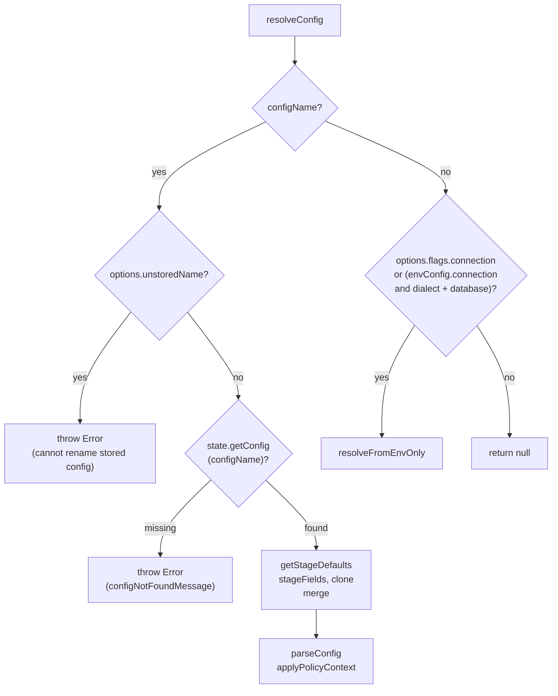
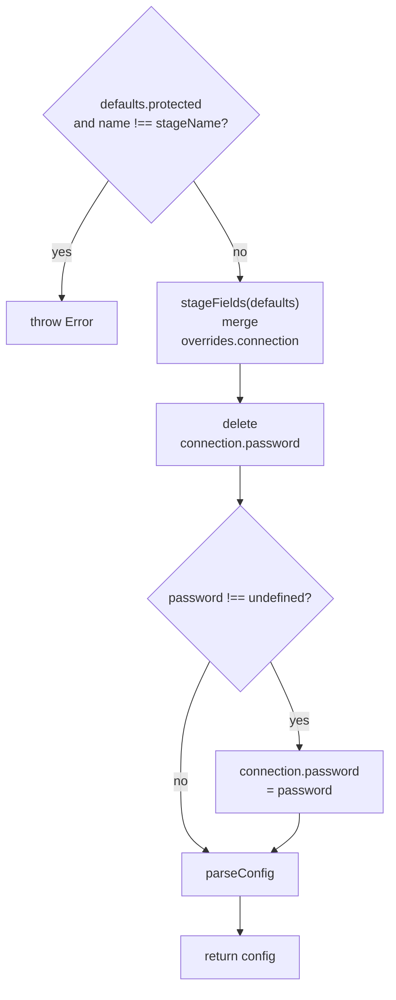
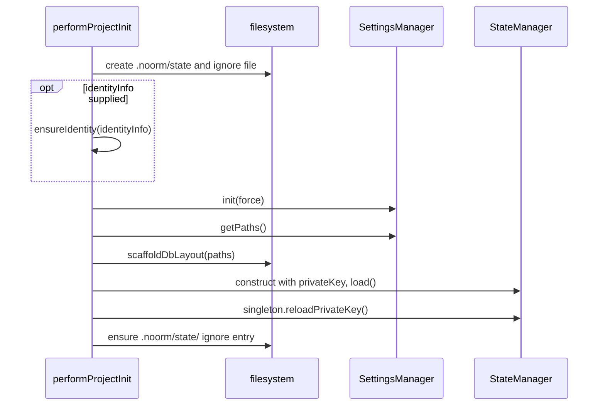
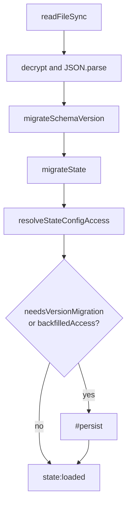
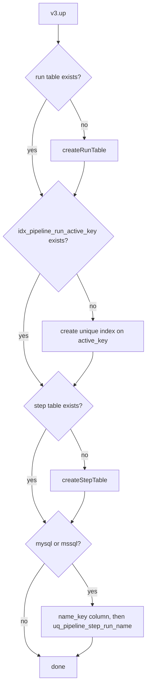
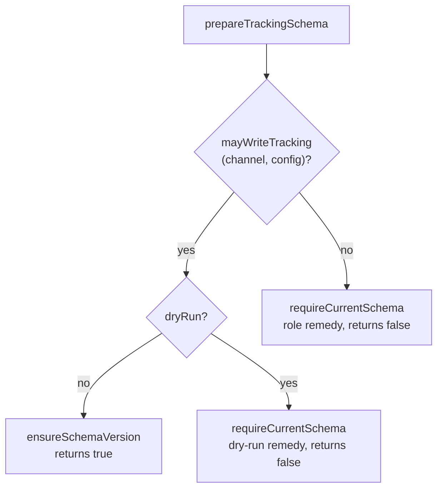
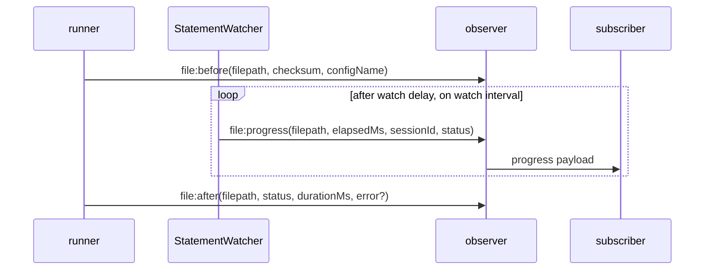

# core-state

## What it does

This domain gives commands a validated database configuration while keeping encrypted credentials separate from version-controlled project settings. Reach for it when changing how stored configs, environment variables, inline overrides, or stages select a database. It also owns project discovery and initialization, persisted-data migration, the rule for who may create or migrate a database's tracking tables, application shutdown coordination, and the shared typed event bus.

The name is broader than encrypted state: the domain also covers config resolution, settings, version migration, project discovery and initialization, `LifecycleManager`, and the observer. Its paths are `src/core/{state,settings,config,lifecycle,version,shared}`, `project.ts`, `project-init.ts`, `environment.ts`, and `observer.ts`.

[`.noorm/state/state.enc`](../../.noorm/state/state.enc) holds configs, secrets, and known users. `.noorm/settings.yml` holds shared stages, build rules, and project settings. `LifecycleManager` coordinates process resources without persisting its runtime state.

Config selection decides whether stored state participates before config values are merged.

## How it works

### Resolution separates selection from value precedence

`resolveConfig` in [`src/core/config/resolver.ts`](../../src/core/config/resolver.ts) selects a stored name from `options.name`, then `NOORM_CONFIG`, then `state.getActiveConfigName()` only when `options.flags.connection` is absent. `options.name: false` selects no stored config at all, so only the env-only and inline branches can run. Inline input alone does not inherit an active config's connection fields, access roles, or `isTest` flag. A selected name must exist in state; complete environment or inline connection values do not bypass a missing explicitly selected config.

| Resolution mode | Entry condition | Values from lowest to highest priority | Name behavior |
|---|---|---|---|
| Stored | A selected config name exists | `DEFAULTS`, mapped stage defaults, stored config, environment, `options.flags` | Selection uses the stored name. An env or flag `name` can rename the result, but throws when the new name belongs to another stored config. `options.unstoredName` throws here |
| Env-only | No selected name; environment has a connection and the stage/env/inline connection supplies dialect and database (`options.flags.connection` absent in the simple case) | `DEFAULTS`, mapped stage defaults, environment, flags | `options.unstoredName`, then `options.flags.name`, then `NOORM_NAME`, then `__env__`; the name is then fixed on the result. Throws when a stored config already has that name |
| Inline connection | No selected name; `options.flags.connection` exists | `DEFAULTS`, mapped stage defaults, environment, flags | Same order as env-only, with `__inline__` as the synthetic name |
| No usable input | No selected name and neither eligibility condition holds | No config is parsed | Returns `null` |

An inline connection enters validation even when incomplete. It does not need to satisfy the env-only eligibility gate first. `parseConfig` still requires the final dialect and database.

Stage lookup uses an explicit `options.stage` when supplied, otherwise a stage matching the config name. The no-selected-name eligibility probe looks up the stage by the inline name, then the environment name, then `__env__`. `resolveFromEnvOnly` repeats the lookup with `fallbackName`, which is `options.flags.name`, then the environment name, then `__inline__` when `options.flags.connection` is set and `__env__` otherwise, even when `options.unstoredName` supplies the returned name, so a caller-chosen name restricts and never selects stage defaults. A name that belongs to a stored config is refused in both the stored and env-only branches, because secrets, vault lookups, and tracking records are keyed by name. `stageFields(defaults, true)` maps flat stage connection fields into `connection` before the merge. Stage `type`, `isTest`, and `access` stay at the top level. The stage's `protected` value binds a per-permission ceiling for policy checks, not a replacement connection field or role assignment. See [`docs/wiki/core-policy.md`](core-policy.md) for role semantics.

When `options.settings` is supplied, `applyPolicyContext` calls `bindPolicyContext` with the roles from `settings.getRoles()`. `validateAccessRoles` throws `UnknownAccessRoleError` for a `user` or `agent` role that is neither built in nor a key of the project's roles, so role-name validity depends on project settings (`ConfigSchema` accepts any nonempty role string). `attachPolicyContext` then records the roles, whether the config is under a protected stage, and a `targetIdentity` from `policyTargetIdentity(projectRoot, connection)`. The protected flag is true when the config name or any stage name (lookup and merged, including the name `unstoredName` displaced) is a protected stage, so an environment or flag rename cannot drop the ceiling. The binding also carries `isTest` and a `testTargetIdentity` from `connectionTarget` (dialect, host, port, database, filename, no credentials). A stored config's `isTest` survives only while `sameTarget` shows the resolved connection still reaches the stored database, and env or flag overlays alone cannot grant it. `withConfigPolicy` applies the same binding to a stored config without environment overrides.

### Environment names express object paths

`getEnvConfig` in [`src/core/config/index.ts`](../../src/core/config/index.ts) uses native `makeNestedConfig` behavior: underscores create nesting, uppercase segments become lowercase, and camelCase segments preserve schema field names. `memoizeOpts: false` makes later reads observe environment changes. Password keys skip scalar conversion.

| Environment assignment | Parsed value |
|---|---|
| `NOORM_CONNECTION_DIALECT=postgres` | `connection.dialect: 'postgres'` |
| `NOORM_CONNECTION_PORT=5432` | `connection.port: 5432` |
| `NOORM_CONNECTION_connectTimeoutMs=3000` | `connection.connectTimeoutMs: 3000` |
| `NOORM_CONNECTION_POOL_idleTimeoutMillis=5000` | `connection.pool.idleTimeoutMillis: 5000` |
| `NOORM_CONNECTION_SSL_rejectUnauthorized=false` | `connection.ssl.rejectUnauthorized: false` |
| `NOORM_CONNECTION_SSL_caFile=/certs/ca.pem` | `connection.ssl.caFile: '/certs/ca.pem'`; `certFile` and `keyFile` follow the same pattern |
| `NOORM_isTest=true` | `isTest: true` |
| `NOORM_IS_TEST=true` | `is.test: true`, not `isTest` |
| `NOORM_CONNECTION_PASSWORD=12345` | `connection.password: '12345'` |

`NOORM_CONFIG` selects a stored config and is excluded from config values. `NOORM_NAME` supplies a config value instead. CLI control variables such as `NOORM_YES` and `NOORM_CHANNEL`, and the `NOORM_IDENTITY_` prefix, are filtered out. `NOORM_IDENTITY` itself can supply the config's identity string.

The accessor builds input; schema parsing validates it. `ConnectionSchema` accepts `postgres`, `mysql`, `sqlite`, or `mssql`, requires a nonempty database, and requires a host outside SQLite. It accepts boolean SSL or an SSL object with `rejectUnauthorized`, the inline PEM fields `ca`, `cert`, and `key`, and the file-path fields `caFile`, `certFile`, and `keyFile`. Each certificate field is given inline or by file, never both within one layer: a `superRefine` on the SSL union adds the issue `ssl.<inline> and ssl.<file> cannot both be set; use one` for each of the pairs in `SSL_FIELD_PAIRS` (`ca`/`caFile`, `cert`/`certFile`, `key`/`keyFile`). A file path may be absent but not blank (`sslFilePath` rejects whitespace-only strings with `ssl.<field> must not be empty`). Reading the files at connect time belongs to [`docs/wiki/core-db.md`](core-db.md). Runtime fields include `tlsServerName`, `connectTimeoutMs`, `statementTimeoutMs`, `queryTimeoutMs`, `applicationName`, and `keepAlive`. Connection timeout must be a positive integer; statement and query timeouts permit zero. `PoolSchema` is strict and lists every dialect's pool keys; `rejectUnsupportedOptions` (from `connectionOptionProblems` in [`src/core/connection/options.ts`](../../src/core/connection/options.ts)) rejects a pool key or `keepAliveInitialDelayMs` that the connection's dialect cannot honor, whether the config is stored, from the environment, or inline. `mergeLayer` treats `pool.idleTimeoutMs` and its alias `idleTimeoutMillis` as one setting, so a layer naming either replaces both from lower layers. `ConfigValidationError` carries the field path and Zod issues.

For server dialects, database names reject quotes, backticks, brackets, semicolons, and control characters because database creation and removal interpolate a quoted identifier. SQLite database paths are exempt. Config names accept letters, digits, hyphens, and underscores.

### SSL layers combine per field, not by deep merge

`mergeLayer` in [`src/core/config/resolver.ts`](../../src/core/config/resolver.ts) removes `ssl` from each layer's `connection` before the general `merge` and sets the result of `combineSsl` from [`src/core/config/ssl-combine.ts`](../../src/core/config/ssl-combine.ts) afterward. A deep merge would keep both `ca` and `caFile` after a higher layer switched forms, which the schema then rejects. Layers apply in the order of the resolution table above. [`src/cli/config/sync.ts`](../../src/cli/config/sync.ts) also calls `combineSsl(existing.connection.ssl, fields.connection?.ssl)` when it updates a stored config, with the stage's `ssl` as the higher layer; the sync workflow is in [`docs/wiki/cli.md`](cli.md).

In the resolver, each step calls `combineSsl(lower, higher)`, where `lower` is the `ssl` accumulated so far and `higher` is the incoming layer's:

| Higher layer's `ssl` | Result |
|---|---|
| `undefined` | The lower value, unchanged |
| `false` | `false` |
| `true` | The lower object without `rejectUnauthorized` when it has other fields; otherwise `true` |
| An object, lower is not an object | The higher object |
| An object, lower is an object | Lower fields minus `rejectUnauthorized`; for each pair where the higher object sets the inline or the file form, both forms are dropped from the lower fields; then the higher object's fields are spread over the rest |

`rejectUnauthorized` is never inherited from a lower layer, so a stored `false` cannot weaken the verification of a higher layer's `ssl`. A higher layer that sets `caFile` replaces a lower `ca`, and one that sets neither leaves the lower certificate fields in place.

The merge cannot see a conflict inside a single layer once a higher layer replaces one form, and the schema strips unknown keys. `assertSslLayer` therefore validates the environment layer and the `options.flags` layer before they merge, in both `resolveConfig` and `resolveFromEnvOnly`. It throws `ConfigValidationError` only for a key that matches a known key case-insensitively (`wrongCaseSslKeyMessage` in [`src/core/connection/options.ts`](../../src/core/connection/options.ts), for example `CAFILE`); any other misspelled key is still stripped silently from those two layers. It otherwise runs `validateConfigInput` on that layer's `ssl`, which applies the inline-or-file rule.

### Relative certificate paths are anchored to the project root by the SDK

`anchorSslFiles(connection, projectRoot)` in [`src/core/config/anchor.ts`](../../src/core/config/anchor.ts) joins each relative `caFile`, `certFile`, and `keyFile` to `projectRoot` and returns a copy. It leaves absolute paths, `~/` paths, empty paths, and boolean or absent `ssl` as written. It does not run inside `resolveConfig`. The SDK `Context` constructor in [`src/sdk/context.ts`](../../src/sdk/context.ts) and `bindSdkDestination` in [`src/sdk/guards.ts`](../../src/sdk/guards.ts) call it after policy binding, because the policy target identity hashes the path as written. Connect-time file reads resolve against the process working directory, which can differ from the SDK's `projectRoot`, so an unanchored relative path reads a different file or fails with the wrong base. Only these two SDK entry points anchor, because the SDK is the entry point whose `projectRoot` can differ from the process working directory. The CLI and TUI never anchor: [`src/cli/index.ts`](../../src/cli/index.ts) calls `initProjectContext()` at startup, which by default runs `process.chdir(projectRoot)` in [`src/core/project.ts`](../../src/core/project.ts), and with `-c/--cwd <path>` it runs `process.chdir(resolvedCwd)` instead. A relative path in a CLI or TUI connection therefore resolves from the project root, or from the `--cwd` directory.

### Stage materialization controls which passwords persist

`stageFields` and `materializeStage` in [`src/core/config/stage.ts`](../../src/core/config/stage.ts) distinguish runtime resolution from constructing a stored config. Stage defaults currently expose flat `dialect`, `host`, `port`, `database`, `user`, `password`, `ssl` (a boolean or an object of `rejectUnauthorized`, `caFile`, `certFile`, and `keyFile`), `type`, `access`, `isTest`, and `protected` in [`src/core/settings/schema.ts`](../../src/core/settings/schema.ts) and [`src/core/settings/types.ts`](../../src/core/settings/types.ts). The stage SSL object is a strict object, so inline `ca`, `cert`, and `key` fail validation with `defaults.ssl.<key> is not allowed in stage defaults; use <key>File`, because `settings.yml` is committed; any other unknown key fails with `defaults.ssl.<key> is not a recognized ssl option`. `stageFields` copies `ssl` into `connection.ssl` unchanged.

`materializeStage` removes passwords from stage and connection overrides, then accepts only its separate password argument. Stage access assignments stay unchanged; protected-stage ceilings apply at policy-check time. It throws `A protected stage must use its stage name as the config name` when the stage's `protected` is set and the requested name differs from the stage name.

The CLI stage-create caller passes environment connection values and explicit connection flags as overrides, but only `args.password` as the password argument. Stage or environment passwords therefore do not enter that stored config implicitly. The TUI's stage synchronization deliberately passes `stage.defaults.password` as the password argument before saving to state. Runtime `resolveConfig` instead calls `stageFields(defaults, true)`, so stage passwords participate below stored, environment, and inline values.

Materialization fixes the requested name and takes top-level behavior from stage defaults rather than copying an entire environment config. Its fallback host is `localhost`, and its fallback database is the stage name. Without an explicit stage type, the fallback type depends on whether the connection host is `localhost`.

### Protected-stage ceilings survive copy and rename

`StateManager.copyConfig` and `renameConfig` call `assertCanMoveProtectedConfig` from [`src/core/config/resolver.ts`](../../src/core/config/resolver.ts) before writing. It throws `ProtectedStageEscapeError` when the source name is a protected stage and the destination is not, because the ceiling follows the stage name and a copy to an unprotected name would shed it. `renameConfig` also runs `assertCanDeleteConfig` on the old name and moves secrets and the active flag in one persist.

### Settings retain a separate persisted document

`SettingsManager` keeps `#document` for YAML persistence and `#settings` for the environment-overlaid accessor view. Mutators update the document and refresh the resolved view; they do not save the environment overlay into `.noorm/settings.yml`. `setPaths` merges the supplied keys over the stored `paths` and emits `settings:paths-updated` with a clone of the merged result, so a caller that saves only `sql` and `changes` keeps a configured `pipelines` path. The resolved view fills `paths.pipelines` with `DEFAULT_PIPELINES_PATH` (`./<db dir>/pipelines`) when the document has none; that default is not written to the document. `allSettingsEnv()` constructs its accessor per call with `memoizeOpts: false`, excluding CLI metadata, identity variables, connection variables, and `NOORM_ACCESS*` keys. It also deletes `access` and each stage's `defaults.protected` from the overlay, and `#refreshResolved` merges the document's `access` back in without passing it through the deep merge, so access definitions and stage protection come only from the YAML.

`getSettingsManager(projectRoot)` caches one manager per resolved project root, so switching roots and returning keeps each project's loaded document; `resetSettingsManager()` clears them all.

`getAccessRoles` returns a `structuredClone` of the document's `access.roles`. `setAccessRole` and `removeAccessRole` edit that section; each validates a candidate document with `validateSettings` before any swap, and `#saveRoleDocument` restores the previous document and view when `#refreshResolved` or `save()` fails. Both reject an empty name and `__proto__`. `removeAccessRole` refuses to delete a custom role that another role `extends`, and for a built-in name it removes the stored override. `AccessSettingsSchema` rejects a built-in role that `extends`, an unknown `extends` target, an inheritance cycle, and permission names absent from `MATRIX`.

### Initialization establishes identity before state loading

`performProjectInit` is shared by CLI `noorm init` and the TUI `InitScreen`. It calls `ensureIdentity` before constructing `StateManager` when the caller supplies identity information: that creates missing keys, derives a missing public key, or writes metadata for existing keys, and creates nothing when all exist. With `identityInfo: null`, the caller must already have a global identity in `~/.noorm/`; initialization does not create one implicitly. `SettingsManager` does not require a private key. `SettingsManager.init(force)` writes `settings.yml` and throws when the file exists and `force` is false.

Initialization loads settings before scaffolding the default database layout.

`scaffoldDbLayout` creates `db/sql/`, `db/changes/`, and steering files beside them only for the default layout. Existing steering files and existing `.gitkeep` files remain untouched, and only newly written ones are reported as created. Init does not report `state.enc` as created, since the file stays absent until a later save. The root ignore update checks for the [`.noorm/state/`](../../.noorm/state) entry, not merely the `# noorm` header.

`getStateManager(projectRoot).reloadPrivateKey()` refreshes the manager for that root after initialization, including when it was constructed before identity existed. `getStateManager` caches one `StateManager` per resolved root in a map; an explicit root also becomes the active instance that a later call without arguments returns, and `resetStateManager` clears both. Loading an absent state file still leaves it in memory until a later save.

`findProjectRoot` resolves paths and searches upward for [`.noorm`](../../.noorm), stopping at home or the filesystem root. The home-level identity directory is not a project. `getOriginalCwd` preserves the startup directory independently of later project-root changes.

### State loading migrates and validates access

`StateManager.load()` creates an empty in-memory state when the file is absent. Existing encrypted state requires a private key.

Numeric schema migration precedes package-version migration and legacy access resolution.

`migrateState` retains unknown top-level fields and the numeric `schemaVersion`, so running an older binary does not discard fields added by a newer one. It removes legacy embedded `identity` because identity moved to `~/.noorm/` and the old field can contain private-key material that must not be persisted again. [`src/core/version/`](../../src/core/version) owns numeric migration engines for database schema, encrypted state, and settings. [`src/core/state/migrations.ts`](../../src/core/state/migrations.ts) owns the package-version stamp and state-field backfills.

`resolveStateConfigAccess` in [`src/core/state/access.ts`](../../src/core/state/access.ts) runs for each config even at the current migration version. Absent access maps through `resolveLegacyAccess`, honoring a truthy legacy `protected` value; a valid explicit value, including custom role names and `agent: false`, is preserved. Malformed explicit access remains in state rather than being replaced with a potentially permissive role, because project settings can override a built-in role's permissions. The v2 and v3 state migrations preserve such entries verbatim.

| Operation on a config with malformed access | Result |
|---|---|
| `getConfig`, `getActiveConfig`, `setActiveConfig` | Throw `ConfigAccessInvalidError` with the `getConfigAccessError` message |
| `listConfigs` | Omits it |
| `setConfig` | Rejects an invalid `access`; refuses to overwrite a stored malformed config (`Refusing to overwrite:`) |
| `listAccessErrors()`, `getConfigAccessError()` | Diagnose it without exposing raw values |
| `getConfigRecoveryCandidate` | Returns a shallow copy with the stored `access.user` and `agent: false` when that user is a nonblank string |
| `repairConfigAccess(name, access, roles?)` | Replaces the access, keeping other data and secrets; with `roles`, it also accepts a config whose access is well-formed but names an unknown role |
| Deleting the config | Also removes its secrets |

`listVisibleConfigs(projectRoot, channel)` in [`src/core/state/visible-configs.ts`](../../src/core/state/visible-configs.ts) constructs a fresh `StateManager`, loads it from disk, and filters `listConfigs()` through `isVisibleToChannel`. MCP resources and the RPC `config` commands call it, so they share one visibility rule.

`CURRENT_VERSIONS` in [`src/core/version/types.ts`](../../src/core/version/types.ts) sets database schema version `3`, state schema version `3`, and settings schema version `1`, independently of the package version.

### Schema v3 adds pipeline tracking tables and can be retried

Schema v3 ([`src/core/version/schema/migrations/v3.ts`](../../src/core/version/schema/migrations/v3.ts)) adds the pipeline run and step tracking tables. `v3.up` runs `ensureRunTable` and `ensureStepTable`. Each creates its table only when a catalog query (`tableExists`) finds it missing, then creates any missing index or column. A failed run therefore leaves a partial state that the next run completes instead of failing on "already exists".

Every existence check runs again after a retry, so a partial first run is completed. `indexExists` checks `idx_pipeline_run_active_key` and, on MySQL and SQL Server, `uq_pipeline_step_run_name`; `nameKeyExists` checks the generated `name_key` column before `addNameKey` adds it. Each check queries the dialect's catalog (`pg_indexes`, `sys.indexes`, `information_schema.statistics`, `sqlite_master`). The run index is unique on `active_key`; on SQL Server it is filtered to non-null values. `timestampType` is exported from `migrations/v1.ts` and shared with v3.

`migrateSchema` wraps each pending migration's failure in `MigrationError` and writes the version record only after all pending migrations succeed. When tables exist but no version record does, it starts from version 1, so every v2+ migration must be idempotent. [`tests/integration/version/schema-v3.test.ts`](../../tests/integration/version/schema-v3.test.ts) drops the run index, the step table, and `name_key` between runs on Postgres, MySQL, and SQL Server, then asserts the columns and both indexes exist; [`tests/core/version/schema.test.ts`](../../tests/core/version/schema.test.ts) covers SQLite.

### Tracking tables are created or migrated only by a role that may record to them

A caller that cannot record to the tracking tables must never create or migrate them, and a dry run must leave the database as it found it. Every surface decides through [`src/core/version/tracking.ts`](../../src/core/version/tracking.ts), so the rule lives in one place. Without it, a read-only role or a `--dry-run` against a fresh database would create `noorm.*` tables or migrate them under a role that policy never allowed to write.

`prepareTrackingSchema` takes a `TrackingCaller` (`channel`, `config` with its `access`, optional `dryRun`) and resolves to whether the caller may record. Only a caller that may record, outside a dry run, reaches `ensureSchemaVersion`; every other path only checks:

`mayWriteTracking` in [`src/core/policy/check.ts`](../../src/core/policy/check.ts) is true when `checkConfigPolicy` allows any permission in `TRACKED_WRITES`: the permissions whose `RECORDS_TO_TRACKING` flag in [`src/core/policy/matrix.ts`](../../src/core/policy/matrix.ts) is true (`change:*`, `run:*`, `pipeline:run`, `db:create`, `db:reset`, `db:teardown`, `vault:read`, `vault:write`, `vault:propagate`, `lock:acquire`, `lock:force`, and `debug:write`). `RECORDS_TO_TRACKING` is keyed by `Permission`, so a new permission cannot go unclassified. A `confirm` cell counts where the channel can confirm. Role semantics belong to [`docs/wiki/core-policy.md`](core-policy.md).

`requireCurrentSchema(db, dialect, remedy)` writes nothing. It throws `VersionMismatchError` when the tables are newer than this version, and throws an `Error` ending with `remedy` when the tables exist but need migration. It resolves to whether the tables exist, so a reader answers "nothing recorded" without a second probe. `readerRemedy(what)` builds the remedy for readers, which never migrate.

| Caller | Contract |
|---|---|
| CLI `prepareTracking` in [`src/cli/_utils.ts`](../../src/cli/_utils.ts) | `prepareTrackingSchema` with `resolveChannel()`, the context's config, and `dryRun` from the args |
| TUI `useConnection` | `prepareTrackingSchema` with channel `user` when `ensureSchema` is requested |
| SDK `ensureTracking` in [`src/sdk/state.ts`](../../src/sdk/state.ts) | `prepareTrackingSchema`; `dryRun` and `preview` both skip the write |
| SDK readers ([`src/sdk/namespaces/lock.ts`](../../src/sdk/namespaces/lock.ts), [`src/sdk/namespaces/changes.ts`](../../src/sdk/namespaces/changes.ts)), [`src/core/pipeline/history.ts`](../../src/core/pipeline/history.ts) | `requireCurrentSchema` with `readerRemedy`; no migration |
| `buildPipelineContext` in [`src/core/pipeline/context.ts`](../../src/core/pipeline/context.ts) | `prepareTrackingSchema`, then `input.signal?.throwIfAborted()`, so an abort during migration rejects before secrets are read |
| Identity sync in [`src/core/identity/sync.ts`](../../src/core/identity/sync.ts) | `prepareTrackingSchema`; a failure skips sync, and a caller that may not record syncs with a null identity so it reads known users without registering |
| Dual-database setup in [`src/core/db/dual.ts`](../../src/core/db/dual.ts) | When the caller passes `tracking`, `prepareTrackingSchema` on the destination connection with the destination config |

#### Catalog probes tell absence from failure

`locateVersionTable` in [`src/core/version/schema/index.ts`](../../src/core/version/schema/index.ts) asks the catalog (`sqlite_master`, `information_schema.tables`, `OBJECT_ID`) instead of selecting from the version table. A failed SELECT cannot distinguish a missing table from a dropped connection or a missing grant, and it lands in the server's error log. The probe finds the version table under its legacy `__noorm_version__` name or in the `noorm` schema. On Postgres it counts `information_schema.tables` rows filtered by `current_schemas(false)` or `table_schema = 'noorm'`; `to_regclass` is avoided because it raises for a login without `USAGE` on the `noorm` schema. A table this login cannot see reads as absent on every dialect, so `tablesExist` is true only for a visible table, while a probe that fails for another reason throws. `checkSchemaVersion` adds `tablesExist` to its status: a database noorm never touched and tracking tables without a version record both read as version 0, and only `tablesExist` separates them. The v3 migration's own `tableExists`, `indexExists`, and `nameKeyExists` probes follow the same rule.

### State files are reconciled, encrypted, and key-checked

State persistence uses a content fingerprint and `mergeState` for three-way reconciliation between the loaded baseline, local mutations, and concurrent disk changes. `acquireWriteLock` uses exclusive `wx` (`O_EXCL`) creation rather than `flock`, which can be ineffective on network mounts. It waits up to 5s and treats locks older than 30s as abandoned. `backupExisting` attempts a previous-generation `.bak` copy before each overwrite; `writeFileAtomicSync` flushes a sibling file before renaming it over the target. State writes use mode `0o600`, and backup permissions are set to the same mode.

Encryption uses AES-256-GCM with `deriveStateKey` from the identity private key. The 16-byte IV deliberately differs from the usual 12-byte GCM nonce. `EncryptedPayload.kdf` is optional for older payloads; an absent value denotes `hkdf-sha256`. State holds `configs`, config-scoped `secrets`, `globalSecrets`, `knownUsers`, `activeConfig`, `version`, and `schemaVersion`.

`isValidSecretKey` in [`src/core/state/manager.ts`](../../src/core/state/manager.ts) accepts `/^[A-Za-z][A-Za-z0-9_]*$/`; `setSecret` rejects keys outside that pattern. [`src/core/vault/storage.ts`](../../src/core/vault/storage.ts) declares the same pattern as `SECRET_KEY_PATTERN`; TUI validators and secret setters must retain the same accepted key format.

### Shutdown releases resources in phase order

`LifecycleManager` registers cleanup resources and runs shutdown phases in a fixed order.

1. `stopping`
2. `completing`
3. `releasing`
4. `flushing`

`shutdown(reason, exitCode)` defaults `exitCode` to the manager's current exit code, and a passed `0` is replaced by a nonzero current code, so an earlier failure is not masked. `LifecycleManager.#performShutdown` skips `exiting`; the caller owns exit handling, and resources registered for `exiting` do not run here. Signal and exception handlers live in [`src/core/lifecycle/handlers.ts`](../../src/core/lifecycle/handlers.ts). The default database cleanup calls `getConnectionManager().closeAll()`.

| Shutdown condition | Behavior |
|---|---|
| Resources share a phase | Run sequentially in ascending priority. |
| A resource cleanup fails | Emit `error` with `source: 'lifecycle'` and the resource name, set the exit code to `1` if it was `0`, then continue with subsequent resources. |
| A phase times out or fails | Emit `app:shutdown:phase` with `status: 'timeout'`, set the exit code to `1` if it was `0`, and continue to the next phase. |
| An uncaught exception or unhandled rejection reaches fatal handling | Emit `app:fatal`, remove process handlers, mark lifecycle state `failed`, and emit `app:exit` with code `1` without awaiting phased shutdown. |
| A second signal arrives while shutting down | Emit `app:fatal` with `Forced exit on second <signal>` and call `process.exit(128 + signal code)`. |

### Observer payloads describe runtime activity

[`src/core/observer.ts`](../../src/core/observer.ts) exports the shared `ObserverEngine<NoormEvents>` instance. `NoormEvents` combines imported settings, update, vault, transfer, and DT event interfaces with inline file, config, state, connection, application, and version events. Logger, teardown, and statement-probe types define individual payload fields. Changes to those payload types affect emitters and subscribers through this shared contract.

`connection:open` includes `configName` and `dialect`, plus optional `host`, `port`, and `database`, so subscribers can identify the resolved connection rather than infer it from the stored name. `connection:error` carries a user-facing `error`, optional server diagnostics, and optional `phase` of `'idle'`, `'checked-out'`, or `'login'` for pool failures after the first connect; it is absent for a failed connect. Config CRUD payloads carry names; `config:created` declares only `name`; `config:updated.fields` is `Object.keys` of the whole written config (`StateManager.setConfig`), not only changed fields; activation carries the previous name.

The event contract permits repeating progress signals between file execution boundaries.

The runner's `executeSingleFile` and `executeSingleFileWithUpdate` emit `file:before`/`file:after`; `StatementWatcher.#report` emits `file:progress`. The watcher reads the pinned connection's server session/process ID before execution. `sessionId` is null for SQLite or a failed session-ID read, and [`src/tui/components/status/StatementProgress.tsx`](../../src/tui/components/status/StatementProgress.tsx) displays it as `pid`. Subscribers can correlate repeated reports with that ID. The nullable `status` means a missing dialect probe or an unavailable server response, not a successful health check. Execution and probing details belong to [`docs/wiki/core-runner.md`](core-runner.md).

## Where it lives

| Path | Role |
|---|---|
| [`src/core/config/index.ts`](../../src/core/config/index.ts) | Live environment accessor and public config exports |
| [`src/core/config/resolver.ts`](../../src/core/config/resolver.ts) | `resolveConfig`, `bindPolicyContext`, `withConfigPolicy`, `validateAccessRoles`, `assertCanMoveProtectedConfig`, `ProtectedStageEscapeError`; config selection, source precedence, policy binding, completeness, and deletion constraints |
| [`src/core/config/ssl-combine.ts`](../../src/core/config/ssl-combine.ts) | `combineSsl`: per-field merge of two layers' `ssl`; called by the resolver and by [`src/cli/config/sync.ts`](../../src/cli/config/sync.ts) (see [`docs/wiki/cli.md`](cli.md)) |
| [`src/core/config/anchor.ts`](../../src/core/config/anchor.ts) | `anchorSslFiles`: joins relative certificate file paths to the project root |
| [`src/core/config/stage.ts`](../../src/core/config/stage.ts) | Flat stage mapping and password-controlled materialization |
| [`src/core/config/schema.ts`](../../src/core/config/schema.ts), [`src/core/config/types.ts`](../../src/core/config/types.ts) | `ConfigSchema`, `sslFilePath`, `withResolvedAccess`, `DANGEROUS_DB_NAME_CHARS`, `Config`, and `ConfigInput`; full and partial validation |
| [`src/core/config/validate.ts`](../../src/core/config/validate.ts) | `validateConfigChecks`: connection, name/database presence, then non-SQLite host checks, shared by [`src/cli/config/validate.ts`](../../src/cli/config/validate.ts) and `ConfigValidateScreen` |
| [`src/core/settings/manager.ts`](../../src/core/settings/manager.ts) | `SettingsManager`, YAML document, resolved settings view, settings mutations |
| [`src/core/settings/schema.ts`](../../src/core/settings/schema.ts), [`src/core/settings/types.ts`](../../src/core/settings/types.ts), [`src/core/settings/defaults.ts`](../../src/core/settings/defaults.ts) | Zod settings schema, `Stage`, `Rule`, `BuildConfig`, `DEFAULT_SETTINGS`, `SETTINGS_DIR_PATH`, and `createDefaultSettings` |
| [`src/core/settings/rules.ts`](../../src/core/settings/rules.ts), [`src/core/settings/events.ts`](../../src/core/settings/events.ts) | `evaluateRules`, `getEffectiveBuildPaths`, `isConfigGuarded`, and `SettingsEvents` |
| [`src/core/state/index.ts`](../../src/core/state/index.ts) | `getStateManager`, `initState`, `resetStateManager`, and state exports |
| [`src/core/state/visible-configs.ts`](../../src/core/state/visible-configs.ts) | `listVisibleConfigs`: channel-filtered config summaries read fresh from disk |
| [`src/core/state/manager.ts`](../../src/core/state/manager.ts) | `StateManager`, load/persist and config, secret, known-user operations |
| [`src/core/state/persistence.ts`](../../src/core/state/persistence.ts), [`src/core/state/merge.ts`](../../src/core/state/merge.ts) | `writeFileAtomicSync`, `acquireWriteLock`, `backupExisting`, fingerprinting, and `mergeState` |
| [`src/core/state/access.ts`](../../src/core/state/access.ts), [`src/core/state/migrations.ts`](../../src/core/state/migrations.ts) | `resolveStateConfigAccess`, semver `migrateState`, and `needsMigration` |
| [`src/core/state/encryption/crypto.ts`](../../src/core/state/encryption/crypto.ts), [`src/core/state/encryption/index.ts`](../../src/core/state/encryption/index.ts), [`src/core/state/types.ts`](../../src/core/state/types.ts), [`src/core/state/version.ts`](../../src/core/state/version.ts) | `encrypt`/`decrypt` and their barrel exports, `State`, `EncryptedPayload`, `createEmptyState`, and `getPackageVersion` (the build-time-injected CLI package version) |
| [`src/core/version/tracking.ts`](../../src/core/version/tracking.ts) | `prepareTrackingSchema`, `requireCurrentSchema`, `readerRemedy`, and `TrackingCaller`; the tracking-table preparation contract |
| [`src/core/version/types.ts`](../../src/core/version/types.ts), `src/core/version/{schema,state,settings}/` | `CURRENT_VERSIONS`, numeric migration interfaces and each engine's `MIGRATIONS` with `up`/`down` steps; `schema/` owns database tracking tables |
| [`src/core/shared/`](../../src/core/shared) | Cross-domain helpers: `getNoormTables`/`noormDb` in `tables.ts`, `dialect-quoting.ts`, `errors.ts`, `abort.ts`, `mask.ts`, `operation-id.ts`, and `approved-content.ts` (an `AsyncLocalStorage` scope that only the MCP approval server establishes, read by the runner and change executor through `approvedSql`) |
| [`src/core/project.ts`](../../src/core/project.ts), [`src/core/project-init.ts`](../../src/core/project-init.ts) | `findProjectRoot`, `getOriginalCwd`/`setOriginalCwd`, `performProjectInit`, and layout scaffolding |
| [`src/core/environment.ts`](../../src/core/environment.ts) | `isCi`, `isDev`, `isDebug`, `isEnvTruthy`, `shouldSkipConfirmations`, and `getEnvConfigName` |
| [`src/core/lifecycle/manager.ts`](../../src/core/lifecycle/manager.ts), [`src/core/lifecycle/handlers.ts`](../../src/core/lifecycle/handlers.ts), [`src/core/lifecycle/types.ts`](../../src/core/lifecycle/types.ts) | `LifecycleManager`, `registerSignalHandlers`/`registerExceptionHandlers`, `LifecycleConfig`, `ShutdownPhase`, and `AppMode` |
| [`src/core/observer.ts`](../../src/core/observer.ts) | Shared observer and event payload contract |
| [`.noorm/state/state.enc`](../../.noorm/state/state.enc), `.noorm/state/state.enc.bak`, `.noorm/state/state.enc.lock` | Encrypted state, previous-generation backup, write lock |
| `.noorm/settings.yml` | Version-controlled shared YAML, parsed and written with the `yaml` package |
| [`tests/core/config/env.test.ts`](../../tests/core/config/env.test.ts), [`tests/core/config/resolver.test.ts`](../../tests/core/config/resolver.test.ts), [`tests/core/config/stage-materialization.test.ts`](../../tests/core/config/stage-materialization.test.ts) | Environment, precedence, and stage materialization regression coverage |
| [`tests/core/config/anchor.test.ts`](../../tests/core/config/anchor.test.ts), [`tests/core/config/ssl-combine.test.ts`](../../tests/core/config/ssl-combine.test.ts), [`tests/core/config/schema-ssl-files.test.ts`](../../tests/core/config/schema-ssl-files.test.ts), [`tests/core/settings/schema.test.ts`](../../tests/core/settings/schema.test.ts) | SSL anchoring, layer combining, config and stage SSL schemas |
| [`tests/core/state/`](../../tests/core/state), [`tests/core/settings/`](../../tests/core/settings), [`tests/core/lifecycle/`](../../tests/core/lifecycle), [`tests/core/version/`](../../tests/core/version) | Persistence, settings, lifecycle, and migration coverage |

## Constraints

- A selected name requires stored state. Passing an unknown `options.name` or `NOORM_CONFIG` throws even when environment or inline connection values are complete; omit selection to use the env-only or inline branch.
- Underscores create nesting rather than camelCase words. `NOORM_IS_TEST` does not configure `isTest`; use `NOORM_isTest` or the resolved behavior differs from the intended schema field.
- Set a certificate field inline or by file within one layer, never both. Both fail with `ssl.<inline> and ssl.<file> cannot both be set; use one`. Stage defaults take only the file forms; inline PEM in `settings.yml` fails validation.
- A `Config` connected from SDK-side code without going through `Context` or `bindSdkDestination` keeps its relative `caFile`, `certFile`, and `keyFile` paths. `resolveSslFiles` then reads them from the process working directory, so the wrong file is read or the connection fails with `SslFileError`. CLI and TUI connections resolve from the directory the process changed into at startup.
- Environment parsing is not schema validation. A value returned by `getEnvConfig` can still fail `parseConfig`; callers cannot treat the accessor as proof that a connection is valid.
- Stage materialization and runtime resolution have different password rules. Passing a complete environment config to materialization does not preserve its password; only the separate password argument does.
- Keep ambient settings values out of `#document`. Saving the resolved accessor view instead would persist shell-provided settings into version-controlled YAML.
- `DEFAULTS` deliberately omits `access`. Injecting it before parsing would hide legacy `protected` input from the policy fallback and change resolved roles. Stage ceilings and role semantics belong to [`docs/wiki/core-policy.md`](core-policy.md).
- Copying or renaming a protected-stage config to an unprotected name throws `ProtectedStageEscapeError`; the new name must itself be a protected stage.
- Malformed explicit access is diagnosed rather than substituted. Replacing it with a built-in role could grant permissions the project had restricted.
- An absent state file remains absent after `StateManager.load()`. A caller requiring a durable file must perform a later mutation; initialization's reported path alone does not establish persistence.
- Numeric state migration must precede `migrateState`. Skipping it leaves v2-era configs with `access.mcp` and no `agent`; `resolveStateConfigAccess` rejects them as malformed, and `getConfig`, `getActiveConfig`, and `setActiveConfig` throw the repair-access diagnostic.
- State locks must be released on failure as well as success. A held lock blocks competing mutations until release or stale-lock handling.
- Bun's process-global `mock.module` registry never restores, so a module mock poisons every later file in the same process, including tests of this domain. CI therefore runs serial test processes ([`.github/workflows/ci.yml`](../../.github/workflows/ci.yml)): core, [`tests/utils`](../../tests/utils), and [`tests/sdk`](../../tests/sdk) without transfer; transfer isolated; CLI; CLI logger settings isolated; and integration. Config lookup passes `memoizeOpts: false` and re-reads `process.env`, so it is not the contamination source. Run a failing test file in isolation first.
- Do not call `ensureSchemaVersion` or `migrateSchema` from a surface that has a caller and config. Go through `prepareTrackingSchema`, or `requireCurrentSchema` for a read, or a read-only role and a dry run will create or migrate tables.
- A null `file:progress.status` provides no health signal. Subscribers that display it as success misrepresent an unavailable probe.
- `isEnvTruthy` does not trim input. It treats empty strings, `0`, and case-insensitive `false` as false. Substituting JavaScript string truthiness would accidentally bypass confirmations for `NOORM_YES=false` or enable debug logging for `NOORM_DEBUG=0`.

## Coupling

- [`docs/wiki/core-policy.md`](core-policy.md) owns access roles, channel visibility, guarded rules, and enforcement. This domain resolves policy data, binds stage context into `Config.access`, and validates persisted access; permission checks apply the stage ceilings. [`src/core/settings/rules.ts`](../../src/core/settings/rules.ts) resolves legacy `match.protected` through `isConfigGuarded`/policy `guarded`, so matching follows resolved access rather than a stored boolean.
- [`docs/wiki/core-identity.md`](core-identity.md) owns the private key used to encrypt state, `KnownUser`, and logger contracts. `StateManager` loads keys through [`src/core/identity/storage.ts`](../../src/core/identity/storage.ts); encryption uses `deriveStateKey` from [`src/core/identity/crypto.ts`](../../src/core/identity/crypto.ts) and `isValidKeyHex` from identity storage. Initialization creates identity before keyed state use.
- [`src/core/version/schema/index.ts`](../../src/core/version/schema/index.ts) calls identity's `waitForIdentityToLoad` after bootstrapping or migrating database tracking tables.
- [`docs/wiki/core-db.md`](core-db.md) owns connection types, port validation, connection testing, and database cleanup. Runtime config fields and observer connection payloads must stay compatible with those consumers.
- [`src/core/config/types.ts`](../../src/core/config/types.ts) imports `ConnectionConfig`/`Dialect` from connection types and `LogLevel` from logger types. Config validation calls `testConnection`; config and settings schemas share connection `PortSchema` and `SSL_FIELD_PAIRS`.
- [`docs/wiki/mcp-rpc.md`](mcp-rpc.md) consumes `listVisibleConfigs` in [`src/mcp/resources.ts`](../../src/mcp/resources.ts) and [`src/rpc/commands/config.ts`](../../src/rpc/commands/config.ts).
- [`docs/wiki/core-runner.md`](core-runner.md) owns file execution and statement probing. Its emitters and CLI/TUI subscribers share `NoormEvents` payloads.
- [`docs/wiki/cli.md`](cli.md) owns command selection and flags; `noorm config repair-access` drives `StateManager.repairConfigAccess`, and its stage-create path chooses explicit persisted passwords. [`docs/wiki/tui.md`](tui.md) owns stage synchronization; [`src/tui/app-context.tsx`](../../src/tui/app-context.tsx) passes stage passwords when synchronizing stage configs into encrypted state.
- [`docs/wiki/sdk.md`](sdk.md) owns SDK callers that supply inline connection overrides and the data-transfer event contracts aggregated by `NoormEvents`.
