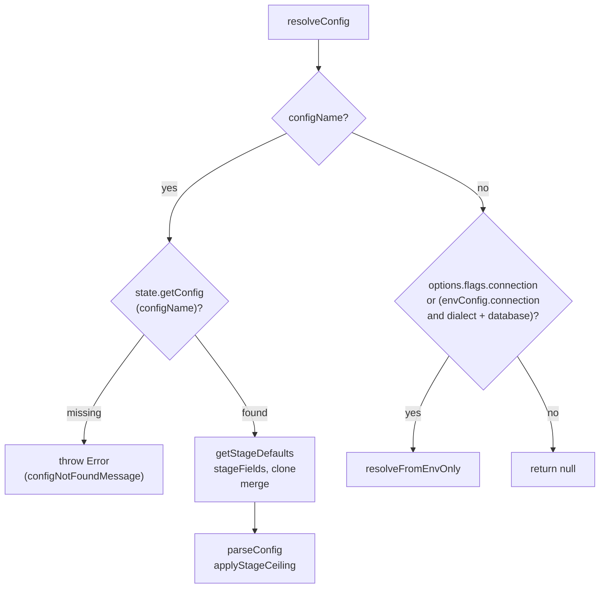
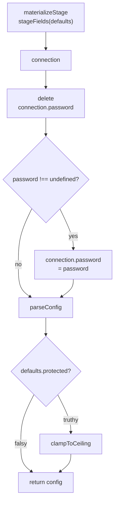
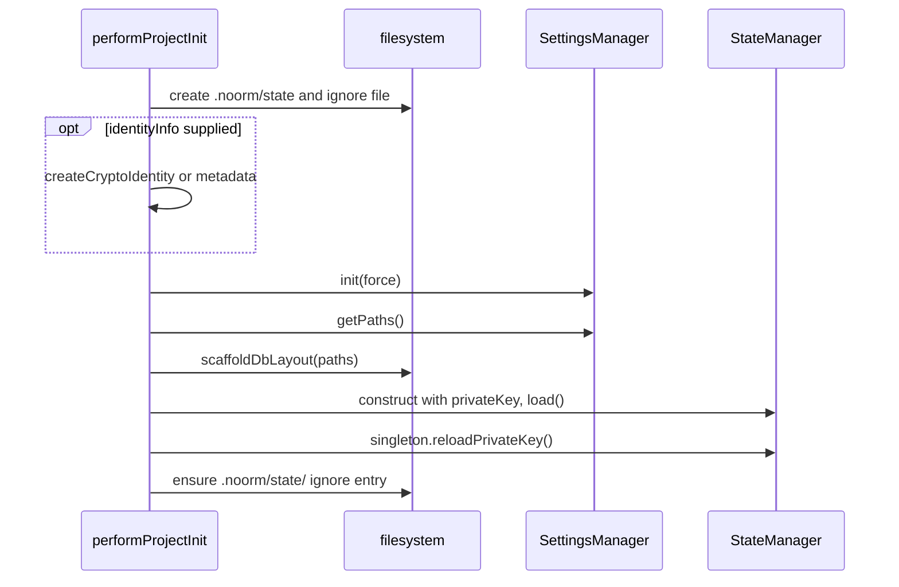
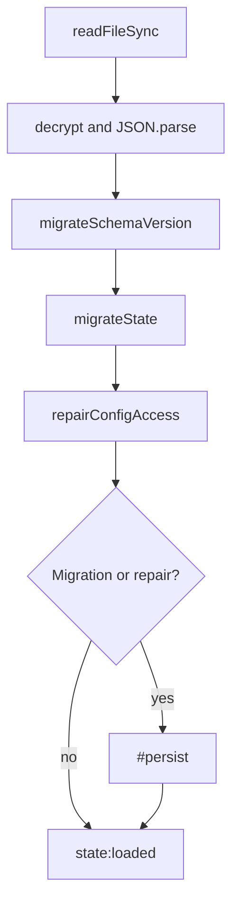
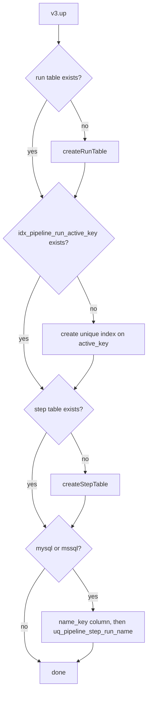
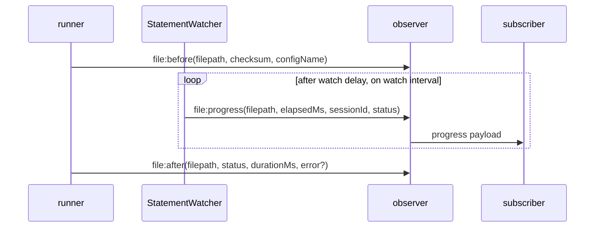

# core-state

## What it does

This domain gives commands a validated database configuration while keeping encrypted credentials separate from version-controlled project settings. Reach for it when changing how stored configs, environment variables, inline overrides, or stages select a database. It also owns project discovery and initialization, persisted-data migration, application shutdown coordination, and the shared typed event bus.

`.noorm/state/state.enc` holds configs, secrets, and known users. `.noorm/settings.yml` holds shared stages, build rules, and project settings. `LifecycleManager` coordinates process resources without persisting its runtime state.

Config selection decides whether stored state participates before config values are merged.

## How it works

### Resolution separates selection from value precedence

`resolveConfig` in [`src/core/config/resolver.ts`](../../src/core/config/resolver.ts) selects a stored name from `options.name`, then `NOORM_CONFIG`, then `state.getActiveConfigName()` only when `options.flags.connection` is absent. Inline input alone does not inherit an active config's connection fields, access roles, or `isTest` flag. A selected name must exist in state; complete environment or inline connection values do not bypass a missing explicitly selected config.

| Resolution mode | Entry condition | Values from lowest to highest priority | Name behavior |
|---|---|---|---|
| Stored | A selected config name exists | `DEFAULTS`, mapped stage defaults, stored config, environment, `options.flags` | Selection uses the stored name; merged input can override the resulting config's `name` |
| Env-only | No selected name; environment has a connection and the stage/env/inline connection supplies dialect and database | `DEFAULTS`, mapped stage defaults, environment, flags | `options.flags.name` overrides `NOORM_NAME` in the merge; absent both, `__env__` |
| Inline connection | No selected name; `options.flags.connection` exists | `DEFAULTS`, mapped stage defaults, environment, flags | Merged explicit name, otherwise `__inline__` |
| No usable input | No selected name and neither eligibility condition holds | No config is parsed | Returns `null` |

An inline connection enters validation even when incomplete. It does not need to satisfy the env-only eligibility gate first. `parseConfig` still requires the final dialect and database.

Stage lookup uses an explicit `options.stage` when supplied, otherwise a stage matching the config name. The no-selected-name eligibility probe uses the inline name, environment name, or `__env__`; the actual merge looks up the stage again using the environment name, inline name, or synthetic name. This environment-first lookup does not set the returned name: the later flags merge overrides `NOORM_NAME`. `stageFields(defaults, true)` maps flat stage connection fields into `connection` before the merge. Stage `type`, `isTest`, and `access` stay at the top level. The stage's `protected` value is an access ceiling applied after parsing, not a replacement connection field. See [`docs/wiki/core-policy.md`](core-policy.md) for role semantics.

### Environment names express object paths

`getEnvConfig` in [`src/core/config/index.ts`](../../src/core/config/index.ts) uses native `makeNestedConfig` behavior: underscores create nesting, uppercase segments become lowercase, and camelCase segments preserve schema field names. `memoizeOpts: false` makes later reads observe environment changes. Password keys skip scalar conversion.

| Environment assignment | Parsed value |
|---|---|
| `NOORM_CONNECTION_DIALECT=postgres` | `connection.dialect: 'postgres'` |
| `NOORM_CONNECTION_PORT=5432` | `connection.port: 5432` |
| `NOORM_CONNECTION_connectTimeoutMs=3000` | `connection.connectTimeoutMs: 3000` |
| `NOORM_CONNECTION_POOL_idleTimeoutMillis=5000` | `connection.pool.idleTimeoutMillis: 5000` |
| `NOORM_CONNECTION_SSL_rejectUnauthorized=false` | `connection.ssl.rejectUnauthorized: false` |
| `NOORM_isTest=true` | `isTest: true` |
| `NOORM_IS_TEST=true` | `is.test: true`, not `isTest` |
| `NOORM_CONNECTION_PASSWORD=12345` | `connection.password: '12345'` |

`NOORM_CONFIG` selects a stored config and is excluded from config values. `NOORM_NAME` supplies a config value instead. CLI control variables such as `NOORM_YES` and `NOORM_CHANNEL`, and the `NOORM_IDENTITY_` prefix, are filtered out. `NOORM_IDENTITY` itself can supply the config's identity string.

The accessor builds input; schema parsing validates it. `ConnectionSchema` accepts `postgres`, `mysql`, `sqlite`, or `mssql`, requires a nonempty database, and requires a host outside SQLite. It accepts boolean SSL or an SSL object with `rejectUnauthorized`, `ca`, `cert`, and `key`. Runtime fields include `tlsServerName`, `connectTimeoutMs`, `statementTimeoutMs`, `queryTimeoutMs`, `applicationName`, and `keepAlive`. Connection timeout must be a positive integer; statement and query timeouts permit zero. Pool fields validate their integer bounds. `ConfigValidationError` carries the field path and Zod issues.

For server dialects, database names reject quotes, backticks, brackets, semicolons, and control characters because database creation and removal interpolate a quoted identifier. SQLite database paths are exempt. Config names accept letters, digits, hyphens, and underscores.

### Stage materialization controls which passwords persist

`stageFields` and `materializeStage` in [`src/core/config/stage.ts`](../../src/core/config/stage.ts) distinguish runtime resolution from constructing a stored config. Stage defaults currently expose flat `dialect`, `host`, `port`, `database`, `user`, `password`, boolean `ssl`, `type`, `access`, `isTest`, and `protected` in [`src/core/settings/schema.ts`](../../src/core/settings/schema.ts) and [`src/core/settings/types.ts`](../../src/core/settings/types.ts).

`materializeStage` removes passwords from stage and connection overrides, then accepts only its separate password argument. It clamps access only when `defaults.protected` is truthy.

The CLI stage-create caller passes environment connection values and explicit connection flags as overrides, but only `args.password` as the password argument. Stage or environment passwords therefore do not enter that stored config implicitly. The TUI's stage synchronization deliberately passes `stage.defaults.password` as the password argument before saving to state. Runtime `resolveConfig` instead calls `stageFields(defaults, true)`, so stage passwords participate below stored, environment, and inline values.

Materialization fixes the requested name and takes top-level behavior from stage defaults rather than copying an entire environment config. Its fallback host is `localhost`, and its fallback database is the stage name. Without an explicit stage type, the fallback type depends on whether the connection host is `localhost`.

### Settings retain a separate persisted document

`SettingsManager` keeps `#document` for YAML persistence and `#settings` for the environment-overlaid accessor view. Mutators update the document and refresh the resolved view; they do not save the environment overlay into `.noorm/settings.yml`. `setPaths` merges the supplied keys over the stored `paths` and emits `settings:paths-updated` with a clone of the merged result, so a caller that saves only `sql` and `changes` keeps a configured `pipelines` path. The resolved view fills `paths.pipelines` with `DEFAULT_PIPELINES_PATH` (`./<db dir>/pipelines`) when the document has none; that default is not written to the document. `allSettingsEnv()` constructs its accessor per call with `memoizeOpts: false`, excluding CLI metadata, identity variables, and connection variables.

### Initialization establishes identity before state loading

`performProjectInit` is shared by CLI `noorm init` and the TUI `InitScreen`. It creates identity before constructing `StateManager` when the caller supplies identity information and keys do not exist. With `identityInfo: null`, the caller must already have a global identity in `~/.noorm/`; initialization does not create one implicitly. `SettingsManager` does not require a private key.

Initialization loads settings before scaffolding the default database layout.

`scaffoldDbLayout` creates `db/sql/`, `db/changes/`, and steering files beside them only for the default layout. Existing steering files remain untouched. The root ignore update checks for the `.noorm/state/` entry, not merely the `# noorm` header.

`getStateManager(projectRoot).reloadPrivateKey()` refreshes the process-wide singleton after initialization, including when it was constructed before identity existed. Loading an absent state file still leaves it in memory until a later save.

`findProjectRoot` resolves paths and searches upward for `.noorm`, stopping at home or the filesystem root. The home-level identity directory is not a project. `getOriginalCwd` preserves the startup directory independently of later project-root changes.

### State loading migrates before repairing access

`StateManager.load()` creates an empty in-memory state when the file is absent. Existing encrypted state requires a private key.

Numeric schema migration precedes package-version migration and access repair.

`migrateState` retains unknown top-level fields and the numeric `schemaVersion`, so running an older binary does not discard fields added by a newer one. It removes legacy embedded `identity` because identity moved to `~/.noorm/` and the old field can contain private-key material that must not be persisted again. [`src/core/version/`](../../src/core/version) owns numeric migration engines for database schema, encrypted state, and settings. [`src/core/state/migrations.ts`](../../src/core/state/migrations.ts) owns the package-version stamp and state-field backfills.

`repairConfigAccess` runs on each config even at the current migration version. A malformed access value can reach loading without passing through `parseConfig`; any repair is persisted.

| Raw access input | Repaired access |
|---|---|
| Record with an unrecognized or missing channel value | That channel becomes `viewer`; recognized channel roles remain unchanged. |
| `access.agent: false` | Remains invisible to agents. |
| Non-object access | `resolveLegacyAccess` supplies `DEFAULT_ACCESS`, or `GUARDED_ACCESS` when the legacy `protected` value is truthy. |

`CURRENT_VERSIONS` in [`src/core/version/types.ts`](../../src/core/version/types.ts) sets database schema version `3`, state schema version `3`, and settings schema version `1`, independently of the package version.

### Schema v3 adds pipeline tracking tables and can be retried

Schema v3 (`src/core/version/schema/migrations/v3.ts`) adds the pipeline run and step tracking tables. `v3.up` runs `ensureRunTable` and `ensureStepTable`. Each creates its table only when a catalog query (`tableExists`) finds it missing, then creates any missing index or column. A failed run therefore leaves a partial state that the next run completes instead of failing on "already exists".

Every existence check runs again after a retry, so a partial first run is completed. `indexExists` checks `idx_pipeline_run_active_key` and, on MySQL and SQL Server, `uq_pipeline_step_run_name`; `nameKeyExists` checks the generated `name_key` column before `addNameKey` adds it. Each check queries the dialect's catalog (`pg_indexes`, `sys.indexes`, `information_schema.statistics`, `sqlite_master`). The run index is unique on `active_key`; on SQL Server it is filtered to non-null values. `timestampType` is exported from `migrations/v1.ts` and shared with v3.

`migrateSchema` wraps each pending migration's failure in `MigrationError` and writes the version record only after all pending migrations succeed. When tables exist but no version record does, it starts from version 1, so every v2+ migration must be idempotent. `tests/integration/version/schema-v3.test.ts` drops the run index, the step table, and `name_key` between runs on Postgres, MySQL, and SQL Server, then asserts the columns and both indexes exist; `tests/core/version/schema.test.ts` covers SQLite.

`buildPipelineContext` in `src/core/pipeline/context.ts` calls `ensureSchemaVersion` before it builds the run context, so tracking tables reach the current version before any pipeline call reads or writes them. It then checks `input.signal?.throwIfAborted()`, so an abort during migration rejects before secrets are read.

State persistence uses a content fingerprint and `mergeState` for three-way reconciliation between the loaded baseline, local mutations, and concurrent disk changes. `acquireWriteLock` uses exclusive `wx` (`O_EXCL`) creation rather than `flock`, which can be ineffective on network mounts. It waits up to 5s and treats locks older than 30s as abandoned. `backupExisting` attempts a previous-generation `.bak` copy before each overwrite; `writeFileAtomicSync` flushes a sibling file before renaming it over the target. State writes use mode `0o600`, and backup permissions are set to the same mode.

Encryption uses AES-256-GCM with `deriveStateKey` from the identity private key. The 16-byte IV deliberately differs from the usual 12-byte GCM nonce. `EncryptedPayload.kdf` is optional for older payloads; an absent value denotes `hkdf-sha256`. State holds `configs`, config-scoped `secrets`, `globalSecrets`, `knownUsers`, `activeConfig`, `version`, and `schemaVersion`.

`isValidSecretKey` in [`src/core/state/manager.ts`](../../src/core/state/manager.ts) accepts `/^[A-Za-z][A-Za-z0-9_]*$/`; `setSecret` rejects keys outside that pattern. [`src/core/vault/storage.ts`](../../src/core/vault/storage.ts) declares the same pattern as `SECRET_KEY_PATTERN`; TUI validators and secret setters must retain the same accepted key format.

### Shutdown releases resources in phase order

`LifecycleManager` registers cleanup resources and runs shutdown phases in a fixed order.

1. `stopping`
2. `completing`
3. `releasing`
4. `flushing`

`LifecycleManager.#performShutdown` skips `exiting`; the caller owns exit handling, and resources registered for `exiting` do not run here. Signal and exception handlers live in [`src/core/lifecycle/handlers.ts`](../../src/core/lifecycle/handlers.ts). The default database cleanup calls `getConnectionManager().closeAll()`.

| Shutdown condition | Behavior |
|---|---|
| Resources share a phase | Run sequentially in ascending priority. |
| A resource cleanup fails | Emit `error` with `source: 'lifecycle'` and the resource name, then continue with subsequent resources. |
| A phase times out | Emit `app:shutdown:phase` with `status: 'timeout'` and continue to the next phase. |
| An uncaught exception or unhandled rejection reaches fatal handling | Remove process handlers, mark lifecycle state `failed`, and emit `app:exit` with code `1` without awaiting phased shutdown. |

### Observer payloads describe runtime activity

[`src/core/observer.ts`](../../src/core/observer.ts) exports the shared `ObserverEngine<NoormEvents>` instance. `NoormEvents` combines imported settings, update, vault, transfer, and DT event interfaces with inline file, config, state, connection, application, and version events. Logger, teardown, and statement-probe types define individual payload fields. Changes to those payload types affect emitters and subscribers through this shared contract.

`connection:open` includes `configName` and `dialect`, plus optional `host`, `port`, and `database`, so subscribers can identify the resolved connection rather than infer it from the stored name. `connection:error` carries a user-facing `error`, optional server diagnostics, and optional `phase: 'idle'` to distinguish idle pool failures. Config CRUD payloads carry names; updates also carry changed field names, and activation carries the previous name.

The event contract permits repeating progress signals between file execution boundaries.

The runner's `executeSingleFile` and `executeSingleFileWithUpdate` emit `file:before`/`file:after`; `StatementWatcher.#report` emits `file:progress`. The watcher reads the pinned connection's server session/process ID before execution. `sessionId` is null for SQLite or a failed session-ID read, and [`src/tui/components/status/StatementProgress.tsx`](../../src/tui/components/status/StatementProgress.tsx) displays it as `pid`. Subscribers can correlate repeated reports with that ID. The nullable `status` means a missing dialect probe or an unavailable server response, not a successful health check. Execution and probing details belong to [`docs/wiki/core-runner.md`](core-runner.md).

## Where it lives

| Path | Role |
|---|---|
| [`src/core/config/index.ts`](../../src/core/config/index.ts) | Live environment accessor and public config exports |
| [`src/core/config/resolver.ts`](../../src/core/config/resolver.ts) | `resolveConfig` and `applyStageCeiling`; config selection, source precedence, completeness, and deletion constraints |
| [`src/core/config/stage.ts`](../../src/core/config/stage.ts) | Flat stage mapping and password-controlled materialization |
| [`src/core/config/schema.ts`](../../src/core/config/schema.ts), [`src/core/config/types.ts`](../../src/core/config/types.ts) | `ConfigSchema`, `withResolvedAccess`, `DANGEROUS_DB_NAME_CHARS`, `Config`, and `ConfigInput`; full and partial validation |
| [`src/core/config/validate.ts`](../../src/core/config/validate.ts) | `validateConfigChecks`: connection, name/database presence, then non-SQLite host checks, shared by [`src/cli/config/validate.ts`](../../src/cli/config/validate.ts) and `ConfigValidateScreen` |
| [`src/core/settings/manager.ts`](../../src/core/settings/manager.ts) | `SettingsManager`, YAML document, resolved settings view, settings mutations |
| [`src/core/settings/schema.ts`](../../src/core/settings/schema.ts), [`src/core/settings/types.ts`](../../src/core/settings/types.ts), [`src/core/settings/defaults.ts`](../../src/core/settings/defaults.ts) | Zod settings schema, `Stage`, `Rule`, `BuildConfig`, `DEFAULT_SETTINGS`, `SETTINGS_DIR_PATH`, and `createDefaultSettings` |
| [`src/core/settings/rules.ts`](../../src/core/settings/rules.ts), [`src/core/settings/events.ts`](../../src/core/settings/events.ts) | `evaluateRules`, `getEffectiveBuildPaths`, `isConfigGuarded`, and `SettingsEvents` |
| [`src/core/state/manager.ts`](../../src/core/state/manager.ts) | `StateManager`, load/persist and config, secret, known-user operations |
| [`src/core/state/persistence.ts`](../../src/core/state/persistence.ts), [`src/core/state/merge.ts`](../../src/core/state/merge.ts) | `writeFileAtomicSync`, `acquireWriteLock`, `backupExisting`, fingerprinting, and `mergeState` |
| [`src/core/state/access.ts`](../../src/core/state/access.ts), [`src/core/state/migrations.ts`](../../src/core/state/migrations.ts) | `repairConfigAccess`, semver `migrateState`, and `needsMigration` |
| [`src/core/state/encryption/crypto.ts`](../../src/core/state/encryption/crypto.ts), [`src/core/state/encryption/index.ts`](../../src/core/state/encryption/index.ts), [`src/core/state/types.ts`](../../src/core/state/types.ts), [`src/core/state/version.ts`](../../src/core/state/version.ts) | `encrypt`/`decrypt` and their barrel exports, `State`, `EncryptedPayload`, `createEmptyState`, and `getPackageVersion` (the build-time-injected CLI package version) |
| [`src/core/version/types.ts`](../../src/core/version/types.ts), `src/core/version/{schema,state,settings}/` | `CURRENT_VERSIONS`, numeric migration interfaces and each engine's `MIGRATIONS` with `up`/`down` steps; `schema/` owns database tracking tables |
| [`src/core/project.ts`](../../src/core/project.ts), [`src/core/project-init.ts`](../../src/core/project-init.ts) | `findProjectRoot`, `getOriginalCwd`/`setOriginalCwd`, `performProjectInit`, and layout scaffolding |
| [`src/core/environment.ts`](../../src/core/environment.ts) | `isCi`, `isDev`, `isDebug`, `isEnvTruthy`, `shouldSkipConfirmations`, and `getEnvConfigName` |
| [`src/core/lifecycle/manager.ts`](../../src/core/lifecycle/manager.ts), [`src/core/lifecycle/handlers.ts`](../../src/core/lifecycle/handlers.ts), [`src/core/lifecycle/types.ts`](../../src/core/lifecycle/types.ts) | `LifecycleManager`, `registerSignalHandlers`/`registerExceptionHandlers`, `LifecycleConfig`, `ShutdownPhase`, and `AppMode` |
| [`src/core/observer.ts`](../../src/core/observer.ts) | Shared observer and event payload contract |
| `.noorm/state/state.enc`, `.noorm/state/state.enc.bak`, `.noorm/state/state.enc.lock` | Encrypted state, previous-generation backup, write lock |
| `.noorm/settings.yml` | Version-controlled shared YAML, parsed and written with the `yaml` package |
| [`tests/core/config/env.test.ts`](../../tests/core/config/env.test.ts), [`tests/core/config/resolver.test.ts`](../../tests/core/config/resolver.test.ts), [`tests/core/config/stage-materialization.test.ts`](../../tests/core/config/stage-materialization.test.ts) | Environment, precedence, and stage materialization regression coverage |
| [`tests/core/state/`](../../tests/core/state), [`tests/core/settings/`](../../tests/core/settings), [`tests/core/lifecycle/`](../../tests/core/lifecycle), [`tests/core/version/`](../../tests/core/version) | Persistence, settings, lifecycle, and migration coverage |

## Constraints

- A selected name requires stored state. Passing an unknown `options.name` or `NOORM_CONFIG` throws even when environment or inline connection values are complete; omit selection to use the env-only or inline branch.
- Underscores create nesting rather than camelCase words. `NOORM_IS_TEST` does not configure `isTest`; use `NOORM_isTest` or the resolved behavior differs from the intended schema field.
- Environment parsing is not schema validation. A value returned by `getEnvConfig` can still fail `parseConfig`; callers cannot treat the accessor as proof that a connection is valid.
- Stage materialization and runtime resolution have different password rules. Passing a complete environment config to materialization does not preserve its password; only the separate password argument does.
- Keep ambient settings values out of `#document`. Saving the resolved accessor view instead would persist shell-provided settings into version-controlled YAML.
- `DEFAULTS` deliberately omits `access`. Injecting it before parsing would hide legacy `protected` input from the policy fallback and change resolved roles. Stage ceilings and access repair semantics belong to [`docs/wiki/core-policy.md`](core-policy.md).
- An absent state file remains absent after `StateManager.load()`. A caller requiring a durable file must perform a later mutation; initialization's reported path alone does not establish persistence.
- Numeric state migration must precede `migrateState`. Reversing ownership of migration fields can lose schema-managed information during persistence.
- State locks must be released on failure as well as success. A held lock blocks competing mutations until release or stale-lock handling.
- A null `file:progress.status` provides no health signal. Subscribers that display it as success misrepresent an unavailable probe.
- `isEnvTruthy` does not trim input. It treats empty strings, `0`, and case-insensitive `false` as false. Substituting JavaScript string truthiness would accidentally bypass confirmations for `NOORM_YES=false` or enable debug logging for `NOORM_DEBUG=0`.

## Coupling

- [`docs/wiki/core-policy.md`](core-policy.md) owns access roles, channel visibility, guarded rules, and enforcement. This domain resolves policy data, repairs persisted access, and applies stage ceilings through policy helpers.
- [`docs/wiki/core-identity.md`](core-identity.md) owns the private key used to encrypt state, `KnownUser`, and logger contracts. `StateManager` loads keys through [`src/core/identity/storage.ts`](../../src/core/identity/storage.ts); encryption uses `deriveStateKey` from [`src/core/identity/crypto.ts`](../../src/core/identity/crypto.ts) and `isValidKeyHex` from identity storage. Initialization creates identity before keyed state use.
- [`src/core/version/schema/index.ts`](../../src/core/version/schema/index.ts) calls identity's `waitForIdentityToLoad` after bootstrapping or migrating database tracking tables.
- [`docs/wiki/core-db.md`](core-db.md) owns connection types, port validation, connection testing, and database cleanup. Runtime config fields and observer connection payloads must stay compatible with those consumers.
- [`src/core/config/types.ts`](../../src/core/config/types.ts) imports `ConnectionConfig`/`Dialect` from connection types and `LogLevel` from logger types. Config validation calls `testConnection`; config and settings schemas share connection `PortSchema`.
- [`src/core/settings/rules.ts`](../../src/core/settings/rules.ts) resolves legacy `match.protected` through `isConfigGuarded`/policy `guarded`, so matching follows resolved access rather than a stored boolean.
- [`docs/wiki/core-runner.md`](core-runner.md) owns file execution and statement probing. Its emitters and CLI/TUI subscribers share `NoormEvents` payloads.
- [`docs/wiki/cli.md`](cli.md) owns command selection and flags; its stage-create path chooses explicit persisted passwords. [`docs/wiki/tui.md`](tui.md) owns stage synchronization; [`src/tui/app-context.tsx`](../../src/tui/app-context.tsx) passes stage passwords when synchronizing stage configs into encrypted state.
- [`docs/wiki/sdk.md`](sdk.md) owns SDK callers that supply inline connection overrides and the data-transfer event contracts aggregated by `NoormEvents`.
