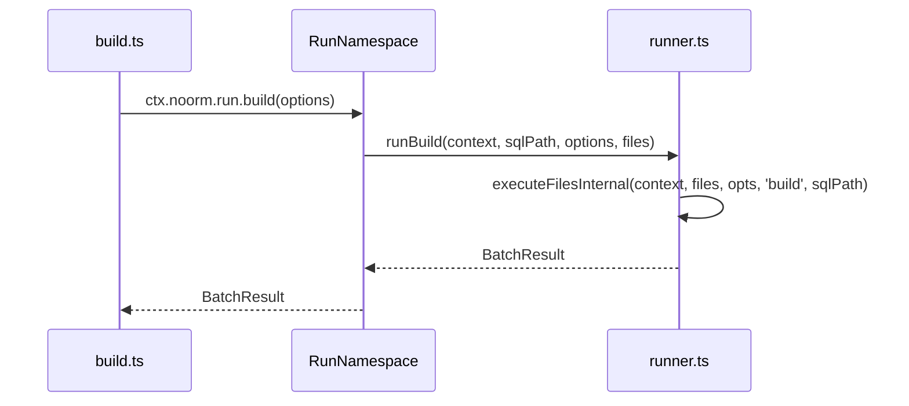

<wiki-type>repo</wiki-type>
<scan-sha>1e0c64d47a52c95931cc5dcb2eb8d84adc1202d3</scan-sha>
<wiki-schema>1</wiki-schema>

# Project signals

## What this repo is

noorm manages database schemas and versioned SQL changes across PostgreSQL, MySQL, MSSQL, and SQLite. The CLI and Ink/React TUI expose interactive and headless workflows; the SDK exposes programmatic database access and noorm operations.

The CLI's build command calls the SDK run namespace, which delegates SQL-file execution to the core runner.

Implementation lives in [`src/`](../../src); [`scripts/build.mjs`](../../scripts/build.mjs) creates the distributable packages, and [`scripts/build-binary.mjs`](../../scripts/build-binary.mjs) creates the standalone CLI. Domain pages describe the source rather than generated bundles.

## Domains

Domains follow functional workflows. Existing ownership separates configuration and persistence, live database operations, SQL execution, versioned changes, access policy, and the interfaces that consume them.

| Domain | Repo paths | What it does | Detail |
|--------|------------|--------------|--------|
| core-change | [`src/core/change`](../../src/core/change), [`src/cli/change`](../../src/cli/change), [`tests/core/change`](../../tests/core/change) | Versioned SQL changes, reverts, and execution history. | [`docs/wiki/core-change.md`](core-change.md) |
| core-runner | [`src/core/runner`](../../src/core/runner), [`src/core/pipeline`](../../src/core/pipeline), [`src/core/template`](../../src/core/template), [`src/cli/run`](../../src/cli/run), [`src/cli/pipeline`](../../src/cli/pipeline), [`tests/core/runner`](../../tests/core/runner), [`tests/core/pipeline`](../../tests/core/pipeline), [`tests/integration/pipeline`](../../tests/integration/pipeline), [`tests/core/template`](../../tests/core/template) | SQL-file execution, named SQL pipelines, checksum gating, templates, and statement progress/cancellation. | [`docs/wiki/core-runner.md`](core-runner.md) |
| core-db | [`src/core/db`](../../src/core/db), [`src/core/connection`](../../src/core/connection), [`src/core/explore`](../../src/core/explore), [`src/core/teardown`](../../src/core/teardown), [`src/core/transfer`](../../src/core/transfer), [`src/cli/db`](../../src/cli/db), [`tests/core/connection`](../../tests/core/connection), [`tests/core/db`](../../tests/core/db), [`tests/core/explore`](../../tests/core/explore), [`tests/core/teardown`](../../tests/core/teardown), [`tests/core/transfer`](../../tests/core/transfer), [`tests/integration`](../../tests/integration) | Database lifecycle, connections, exploration, teardown, and transfer. | [`docs/wiki/core-db.md`](core-db.md) |
| core-state | [`src/core/state`](../../src/core/state), [`src/core/settings`](../../src/core/settings), [`src/core/config`](../../src/core/config), [`src/core/lifecycle`](../../src/core/lifecycle), [`src/core/version`](../../src/core/version), [`src/core/project.ts`](../../src/core/project.ts), [`src/core/project-init.ts`](../../src/core/project-init.ts), [`src/core/environment.ts`](../../src/core/environment.ts), [`src/core/observer.ts`](../../src/core/observer.ts), [`tests/core/state`](../../tests/core/state), [`tests/core/settings`](../../tests/core/settings), [`tests/core/config`](../../tests/core/config), [`tests/core/lifecycle`](../../tests/core/lifecycle), [`tests/core/version`](../../tests/core/version) | Encrypted state, settings, config resolution, lifecycle, version migration, and observer events. | [`docs/wiki/core-state.md`](core-state.md) |
| core-identity | [`src/core/identity`](../../src/core/identity), [`src/core/vault`](../../src/core/vault), [`src/core/logger`](../../src/core/logger), [`src/core/sql-terminal`](../../src/core/sql-terminal), [`src/cli/identity`](../../src/cli/identity), [`src/cli/secret`](../../src/cli/secret), [`src/cli/vault`](../../src/cli/vault), [`src/cli/sql`](../../src/cli/sql), [`tests/core/identity`](../../tests/core/identity), [`tests/core/vault`](../../tests/core/vault), [`tests/core/logger`](../../tests/core/logger), [`tests/core/sql-terminal`](../../tests/core/sql-terminal) | Identity, vault secrets, structured logs, and SQL terminal history. | [`docs/wiki/core-identity.md`](core-identity.md) |
| core-policy | [`src/core/policy`](../../src/core/policy), [`tests/core/policy`](../../tests/core/policy) | Config roles, permission decisions, SQL classification, legacy access migration, and stage permission ceilings. | [`docs/wiki/core-policy.md`](core-policy.md) |
| sdk | [`src/sdk`](../../src/sdk), [`src/core/dt`](../../src/core/dt), [`packages/sdk`](../../packages/sdk), [`tests/sdk`](../../tests/sdk), [`tests/integration/sdk`](../../tests/integration/sdk) | Programmatic API (`createContext`) and DT serialization. | [`docs/wiki/sdk.md`](sdk.md) |
| cli | [`src/cli`](../../src/cli), [`packages/cli`](../../packages/cli), [`skills/noorm`](../../skills/noorm), [`tests/cli`](../../tests/cli) | Citty commands, headless stage workflows, and binary distribution. | [`docs/wiki/cli.md`](cli.md) |
| tui | [`src/tui`](../../src/tui), [`.claude/rules/tui-development.md`](../../.claude/rules/tui-development.md), [`tests/cli/components`](../../tests/cli/components), [`tests/cli/hooks`](../../tests/cli/hooks), [`tests/cli/screens`](../../tests/cli/screens) | Ink/React screens, focus management, keyboard routing, and startup state. | [`docs/wiki/tui.md`](tui.md) |
| mcp-rpc | [`src/mcp`](../../src/mcp), [`src/rpc`](../../src/rpc), [`src/cli/mcp`](../../src/cli/mcp), [`tests/core/mcp`](../../tests/core/mcp), [`tests/core/rpc`](../../tests/core/rpc) | MCP over stdio and permission-gated RPC dispatch. | [`docs/wiki/mcp-rpc.md`](mcp-rpc.md) |
| worker-bridge | [`src/core/worker-bridge`](../../src/core/worker-bridge), [`src/workers`](../../src/workers), [`tests/core/worker-bridge`](../../tests/core/worker-bridge), [`tests/workers`](../../tests/workers) | Hub-and-spoke worker threads for DT serialization and database connections. | [`docs/wiki/worker-bridge.md`](worker-bridge.md) |
| infra | [`.github`](../../.github), [`scripts`](../../scripts), [`examples`](../../examples), [`docs`](..), `tsup.*.config.ts`, [`docker-compose.test.yml`](../../docker-compose.test.yml), [`bunfig.toml`](../../bunfig.toml) | CI, package builds, releases, examples, and VitePress docs, including recording and ignatius sources. | [`docs/wiki/infra.md`](infra.md) |

## Framework & runtime

- TypeScript in a Bun workspace. The root workspace declares Bun >=1.2 and Node >=22.13; published CLI and SDK packages require Node >=22.13 ([`package.json`](../../package.json), [`packages/cli/package.json`](../../packages/cli/package.json), [`packages/sdk/package.json`](../../packages/sdk/package.json)).
- Kysely 0.28 provides the SQL layer. Ink 7.1 and React 19.2 provide the TUI; Citty 0.2 parses CLI commands.
- `@logosdx/observer` provides the shared event bus in [`src/core/observer.ts`](../../src/core/observer.ts); `@logosdx/utils` provides `attempt` and `attemptSync` tuple helpers.
- Eta 4.5 renders `.sql.tmpl` templates with JSON5, YAML, CSV, and JavaScript side-car loaders in [`src/core/template/loaders`](../../src/core/template/loaders).
- State uses AES-256-GCM in [`src/core/state/encryption`](../../src/core/state/encryption); identity and vault workflows use X25519 key exchange in [`src/core/identity/crypto.ts`](../../src/core/identity/crypto.ts).
- MCP uses `@modelcontextprotocol/server` 2.4 and protocol `2026-07-28` for stdio tools, human elicitation, and exploration resources.

## Build / test / lint

| Purpose | Command | Source |
|---------|---------|--------|
| Build (tsc and prompt bundle) | `bun run build` | [`package.json`](../../package.json), [`tsup.prompts.config.ts`](../../tsup.prompts.config.ts) |
| Build packages | `bun run build:packages` | [`scripts/build.mjs`](../../scripts/build.mjs) (tsup) |
| Build binary | `bun run build:binary` | [`scripts/build-binary.mjs`](../../scripts/build-binary.mjs) (bun compile) |
| Dev watch | `bun run dev` | [`package.json`](../../package.json) |
| Test serially | `bun run test` | [`package.json`](../../package.json) |
| Lint | `bun run lint` | [`eslint.config.js`](../../eslint.config.js) |
| Typecheck | `bun run typecheck` | [`tsconfig.json`](../../tsconfig.json) |

[`.github/workflows/ci.yml`](../../.github/workflows/ci.yml) runs lint, typecheck, build, and separate serial processes for core (non-transfer), transfer, CLI, CLI logger settings, and integration tests. Example database jobs depend on the build job. Integration tests use live database services.

The `cli-e2e` job also runs [`scripts/smoke-mcp.mjs`](../../scripts/smoke-mcp.mjs) against built MCP tools and embedded prompts.

Bun's process-global `mock.module` registry causes test contamination, so CI isolates transfer and CLI logger settings tests. Config lookup uses `memoizeOpts: false`; its environment reads are not the contamination source. See [`docs/wiki/core-state.md`](core-state.md) and [`docs/wiki/infra.md`](infra.md).

Exact isolated test invocations, database service ports/storage, and current workflow runtime pins are in [`docs/wiki/infra.md`](infra.md#ci-execution-boundary). CLI/TUI test placement is in [`docs/wiki/cli.md`](cli.md#where-it-lives); logger-settings isolation is in [`docs/wiki/cli.md`](cli.md#constraints).

## Cross-cutting

| Concern | Contract and navigation |
|---|---|
| Test layout | [`tests`](../../tests) mirrors [`src`](../../src); [`tests/utils`](../../tests/utils) holds shared database helpers, [`tests/fixtures`](../../tests/fixtures) holds dialect SQL, and [`tests/integration`](../../tests/integration) exercises live databases. [`tests/preload.ts`](../../tests/preload.ts) is Bun's configured preload. Legacy setup/cleanup helpers also remain in [`tests/global-setup.ts`](../../tests/global-setup.ts) and [`tests/global-teardown.ts`](../../tests/global-teardown.ts). |
| Conventions | [`.claude/rules/typescript.md`](../../.claude/rules/typescript.md) covers function structure and error tuples; [`.claude/rules/tui-development.md`](../../.claude/rules/tui-development.md) covers focus/layout; [`.claude/rules/testing.md`](../../.claude/rules/testing.md) covers test conventions; [`.claude/rules/documentation.md`](../../.claude/rules/documentation.md) covers documentation structure. |
| Domain boundaries | Core-state groups startup/persistence; core-identity groups sensitive identity, vault, logger, and SQL terminal concerns; core-db groups live-connection operations. Core-change has its own versioned executor and skip decision, separate from core-runner's file executor, while sharing checksum/template utilities. Infra owns the docs tree because VitePress builds it as a site, including documentation for the separate ignatius tool. |
| Access enforcement | `Config.access` assigns `user`/`agent` roles instead of the legacy `protected` boolean. [`src/core/policy`](../../src/core/policy) owns enforcement used by runner, pipeline (`pipeline:run`), change, transfer, and SQL-terminal core seams, so SDK/CLI/TUI/MCP operations inherit those gates. Core-state resolves legacy access and binds policy context; protected-stage ceilings apply to permission cells. See [`docs/wiki/core-policy.md`](core-policy.md). |
| State migration order | `StateManager.load()` applies numeric `schemaVersion` migrations before package-semver migrations. State v2 replaces `protected` with access roles; v3 normalizes the former `access.mcp` key to `access.agent`. See [`src/core/version/state`](../../src/core/version/state) and [`docs/wiki/core-state.md`](core-state.md). |
| Tracking tables | PostgreSQL/MSSQL use unprefixed tracking names in the `noorm` schema; MySQL/SQLite retain `__noorm_*__`. Use `getNoormTables(dialect)` and `noormDb(db, dialect)` from [`src/core/shared/tables.ts`](../../src/core/shared/tables.ts). `NOORM_TABLES` is deprecated and gives the wrong names with a PostgreSQL/MSSQL schema wrapper. Surfaces prepare tables through `prepareTrackingSchema` in [`src/core/version/tracking.ts`](../../src/core/version/tracking.ts): only a role that may record, outside a dry run, creates or migrates them; every other caller gets the read-only `requireCurrentSchema` check. See [`docs/wiki/core-state.md`](core-state.md). |
| History timestamps | [`src/core/change/history.ts`](../../src/core/change/history.ts) hydrates PostgreSQL/MySQL `executed_at` as UTC; MSSQL is deliberately not corrected because its driver behavior was not measured. See [`docs/wiki/core-change.md`](core-change.md). |

## DevOps & CI

- GitHub Actions defines CI in [`.github/workflows/ci.yml`](../../.github/workflows/ci.yml); [`docker-compose.test.yml`](../../docker-compose.test.yml) supplies local database services.
- Changesets publishes the CLI and SDK together through [`.github/workflows/publish.yml`](../../.github/workflows/publish.yml). [`.github/workflows/release-binary.yml`](../../.github/workflows/release-binary.yml) publishes compiled CLI binaries.
- VitePress builds the docs site through [`.github/workflows/docs.yml`](../../.github/workflows/docs.yml). Documentation build mechanics belong to [`docs/wiki/infra.md`](infra.md).
- Recording sources live in [`docs/tapes`](../tapes); [`docs/modeling`](../modeling) documents ignatius rather than noorm source. See [`docs/wiki/infra.md`](infra.md).
- The repository and packages use Apache-2.0 ([`LICENSE`](../../LICENSE), [`NOTICE`](../../NOTICE)).
- [`packages/cli/LICENSE`](../../packages/cli/LICENSE)/[`NOTICE`](../../NOTICE) and [`packages/sdk/LICENSE`](../../packages/sdk/LICENSE)/[`NOTICE`](../../NOTICE) mirror the repository's Apache-2.0 licensing. The root README badge and footer agree.

The deterministic source inventory is [`docs/wiki/scan.md`](scan.md); domain pages carry behavior and coupling details.
