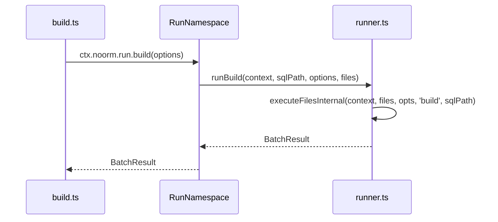

<wiki-type>repo</wiki-type>
<scan-sha>618c5cba65c91201215657335efa22a8e314025b</scan-sha>
<wiki-schema>1</wiki-schema>

# Project signals

## What this repo is

noorm manages database schemas and versioned SQL changes across PostgreSQL, MySQL, MSSQL, and SQLite. The CLI and Ink/React TUI expose interactive and headless workflows; the SDK exposes programmatic database access and noorm operations.

The CLI's build command calls the SDK run namespace, which delegates SQL-file execution to the core runner.

Implementation lives in [`src/`](../../src); [`scripts/build.mjs`](../../scripts/build.mjs) creates the distributable packages, and [`scripts/build-binary.mjs`](../../scripts/build-binary.mjs) creates the standalone CLI. Domain pages describe the source rather than generated bundles.

## Domains

Domains follow functional workflows. Existing ownership separates configuration and persistence, live database operations, SQL execution, versioned changes, access policy, and the interfaces that consume them.

| Domain | Start here | What it does | Detail |
|--------|------------|--------------|--------|
| core-change | [`src/core/change/`](../../src/core/change) | Versioned SQL changes, reverts, and execution history. | [`docs/wiki/core-change.md`](core-change.md) |
| core-runner | [`src/core/runner/`](../../src/core/runner) | SQL-file execution, checksum gating, templates, and statement progress. | [`docs/wiki/core-runner.md`](core-runner.md) |
| core-db | [`src/core/db/`](../../src/core/db) | Database lifecycle, connections, exploration, teardown, and transfer. | [`docs/wiki/core-db.md`](core-db.md) |
| core-state | [`src/core/state/`](../../src/core/state) | Encrypted state, settings, config resolution, lifecycle, and version migration. | [`docs/wiki/core-state.md`](core-state.md) |
| core-identity | [`src/core/identity/`](../../src/core/identity) | Identity, vault secrets, structured logs, and SQL terminal history. | [`docs/wiki/core-identity.md`](core-identity.md) |
| core-policy | [`src/core/policy/`](../../src/core/policy) | Config roles, permission decisions, SQL classification, and stage role ceilings. | [`docs/wiki/core-policy.md`](core-policy.md) |
| sdk | [`src/sdk/`](../../src/sdk) | Programmatic API (`createContext`) and DT serialization. | [`docs/wiki/sdk.md`](sdk.md) |
| cli | [`src/cli/`](../../src/cli) | Citty commands, headless stage workflows, and binary distribution. | [`docs/wiki/cli.md`](cli.md) |
| tui | [`src/tui/`](../../src/tui) | Ink/React screens, focus management, keyboard routing, and startup state. | [`docs/wiki/tui.md`](tui.md) |
| mcp-rpc | [`src/mcp/`](../../src/mcp) | MCP over stdio and permission-gated RPC dispatch. | [`docs/wiki/mcp-rpc.md`](mcp-rpc.md) |
| worker-bridge | [`src/core/worker-bridge/`](../../src/core/worker-bridge) | Worker threads for DT serialization and database connections. | [`docs/wiki/worker-bridge.md`](worker-bridge.md) |
| infra | [`.github/`](../../.github) | CI, package builds, releases, example projects, and VitePress docs. | [`docs/wiki/infra.md`](infra.md) |

## Framework & runtime

- TypeScript in a Bun workspace. The root workspace declares Bun >=1.2 and Node >=22.13; published CLI and SDK packages require Node >=22.13 ([`package.json`](../../package.json), [`packages/cli/package.json`](../../packages/cli/package.json), [`packages/sdk/package.json`](../../packages/sdk/package.json)).
- Kysely 0.28 provides the SQL layer. Ink 7.1 and React 19.2 provide the TUI; Citty 0.2 parses CLI commands.
- `@logosdx/observer` provides the shared event bus in [`src/core/observer.ts`](../../src/core/observer.ts); `@logosdx/utils` provides `attempt` and `attemptSync` tuple helpers.
- Eta 4.5 renders SQL templates. The MCP SDK exposes the RPC interface over stdio.

## Build / test / lint

| Purpose | Command | Source |
|---------|---------|--------|
| Build TypeScript | `bun run build` | [`package.json`](../../package.json) |
| Build packages | `bun run build:packages` | [`scripts/build.mjs`](../../scripts/build.mjs) |
| Build standalone CLI | `bun run build:binary` | [`scripts/build-binary.mjs`](../../scripts/build-binary.mjs) |
| Dev watch | `bun run dev` | [`package.json`](../../package.json) |
| Test serially | `bun run test` | [`package.json`](../../package.json) |
| Lint | `bun run lint` | [`eslint.config.js`](../../eslint.config.js) |
| Typecheck | `bun run typecheck` | [`tsconfig.json`](../../tsconfig.json) |

[`.github/workflows/ci.yml`](../../.github/workflows/ci.yml) runs lint, typecheck, build, and separate serial processes for core, transfer, CLI, CLI logger settings, and integration tests. Example database jobs depend on the build job. Integration tests use live database services.

Bun's process-global `mock.module` registry causes test contamination, so CI isolates transfer and CLI logger settings tests. Config lookup uses `memoizeOpts: false`; its environment reads are not the contamination source. See [`docs/wiki/core-state.md`](core-state.md) and [`docs/wiki/infra.md`](infra.md).

## DevOps & CI

- GitHub Actions defines CI in [`.github/workflows/ci.yml`](../../.github/workflows/ci.yml); [`docker-compose.test.yml`](../../docker-compose.test.yml) supplies local database services.
- Changesets publishes the CLI and SDK together through [`.github/workflows/publish.yml`](../../.github/workflows/publish.yml). [`.github/workflows/release-binary.yml`](../../.github/workflows/release-binary.yml) publishes compiled CLI binaries.
- VitePress builds the docs site through [`.github/workflows/docs.yml`](../../.github/workflows/docs.yml). Documentation build mechanics belong to [`docs/wiki/infra.md`](infra.md).
- The repository and packages use Apache-2.0 ([`LICENSE`](../../LICENSE), [`NOTICE`](../../NOTICE)).

The deterministic source inventory is [`docs/wiki/scan.md`](scan.md); domain pages carry behavior and coupling details.
