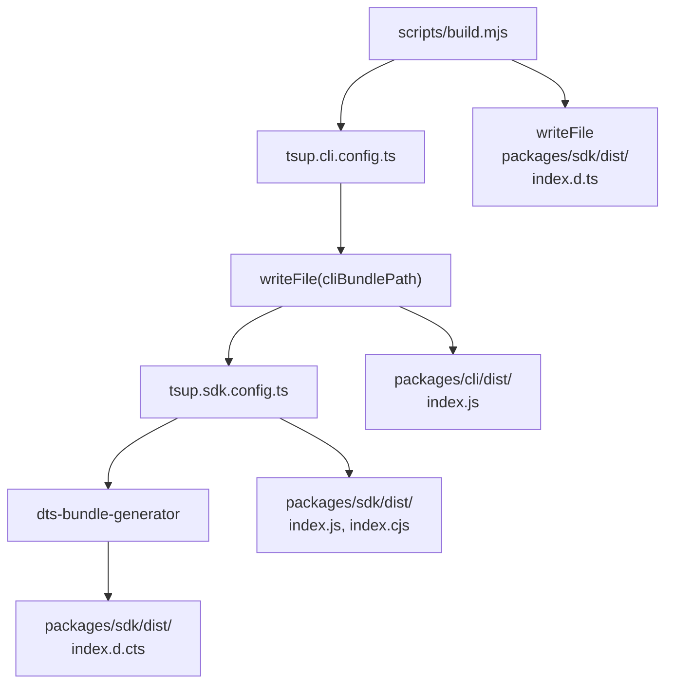
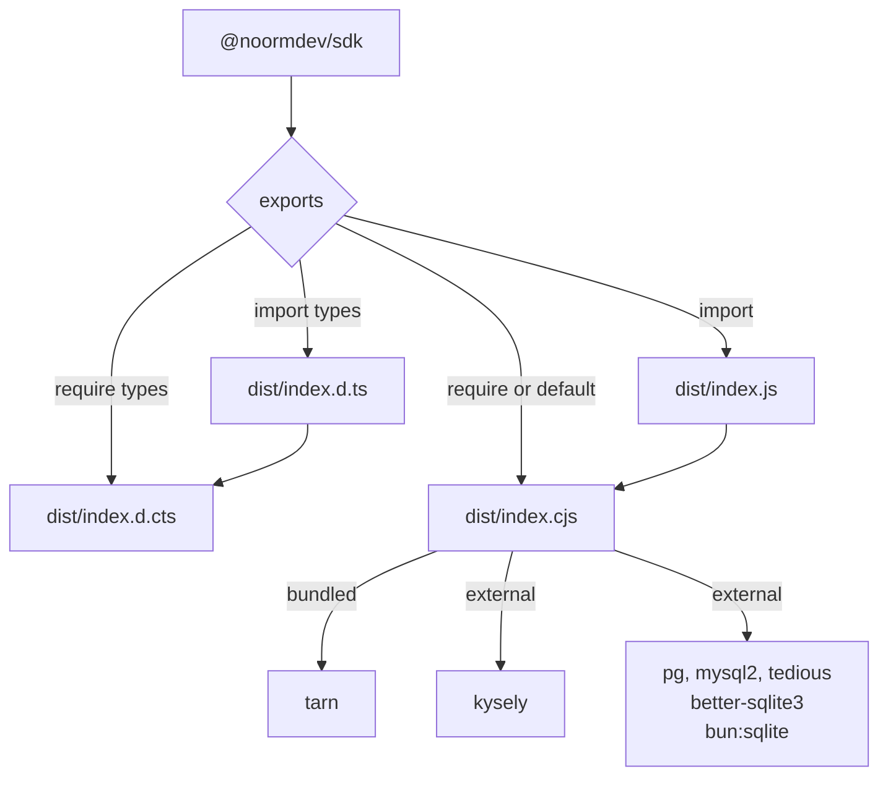
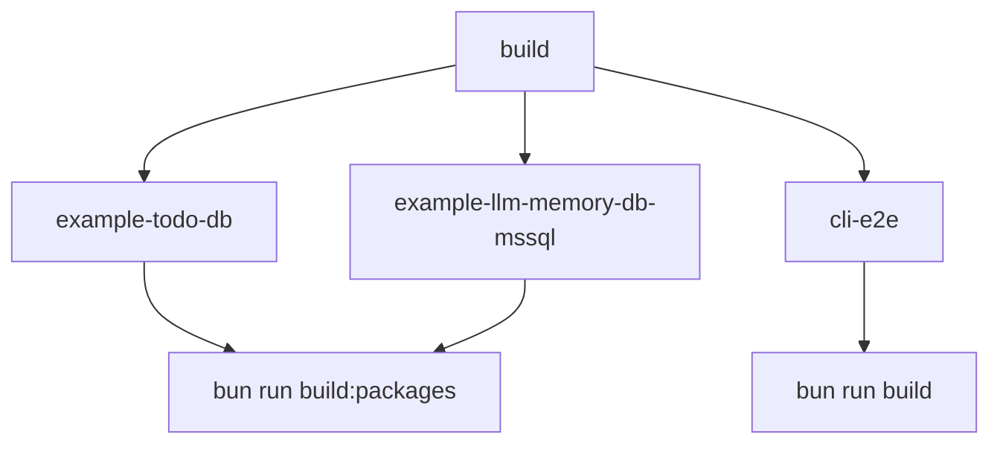
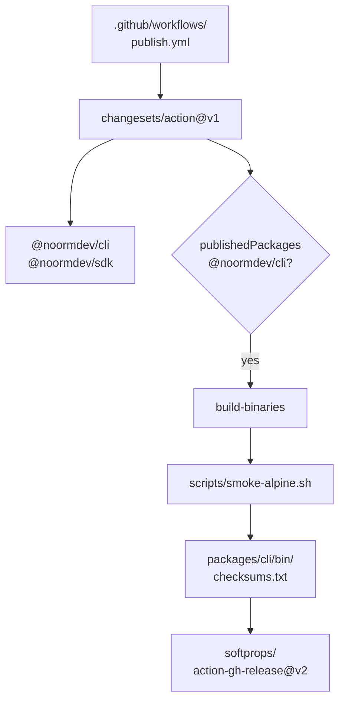
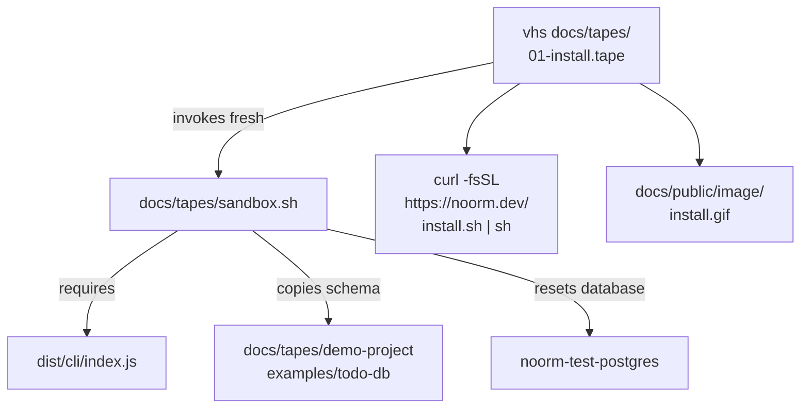

# infra

## What it does

Infrastructure turns the repository into installable CLI and SDK packages, standalone executables, and the noorm.dev documentation site. Work here when changing distribution, release automation, CI isolation, example smoke coverage, or documentation publishing.

Infra owns all of [`docs/`](..): user guides, contributor pages, and the ignatius modeling docs. VitePress builds them as one site, so a page's home is decided by the build and not by which tool it describes.

## How it works

### Build commands

`bun run build` runs `tsc`, then [`tsup.prompts.config.ts`](../../tsup.prompts.config.ts) bundles [`src/mcp/prompts.ts`](../../src/mcp/prompts.ts) into `dist/mcp`, inlining its `with { type: 'text' }` Markdown imports as strings. `tsc` preserves those imports, which Node cannot load, so the bundle lets `dist/cli/index.js` run without a custom loader or copied assets. `bun run build:packages` creates the npm artifacts; `bun run build:binary` creates standalone executables. `bun run dev` runs [`scripts/dev.mjs`](../../scripts/dev.mjs), which watches `tsc` and rebundles the prompts through the same config after each compile and on edits to [`src/mcp/prompts`](../../src/mcp/prompts) or [`tsup.prompts.config.ts`](../../tsup.prompts.config.ts).

### Package build order

`build:packages` bundles the CLI before the SDK, then generates the SDK declarations independently of tsup: `dts-bundle-generator` writes `index.d.cts` and [`scripts/build.mjs`](../../scripts/build.mjs) writes `index.d.ts` itself.

The CLI and prompts tsup configs share the `markdownText` esbuild plugin from [`tsup.markdown-plugin.ts`](../../tsup.markdown-plugin.ts), which reads each `.md` import with the `text` loader. The CLI bundle targets Node 22, uses ESM, injects the CLI package version, and bundles JavaScript dependencies. Native or runtime-specific modules (`better-sqlite3`, `bun:sqlite`, `pg-native`) and optional `react-devtools-core` remain external. `packages/cli/dist` is not published; the CI example jobs reach it through a Node wrapper.

### SDK installation boundary

The SDK's CommonJS entry and generated ESM facade load one canonical runtime, so both forms share constructors, error classes, and `noormObserver`.

[`tsup.sdk.config.ts`](../../tsup.sdk.config.ts) bundles internal dependencies, including Tarn for MySQL and MSSQL pools, enables sourcemaps and tree-shaking, and aliases `ansis` to the SDK color stub. Its external list contains `kysely`, `pg`, `mysql2`, `tedious`, `better-sqlite3`, and `bun:sqlite`. The manifest requires Kysely and marks the installable dialect drivers as optional peers. Consumers install the driver for their database; Tarn is not a consumer peer. Published package contents include `dist` and [`NOTICE`](../../packages/sdk/NOTICE), with sourcemaps excluded.

The manifest requires Node `>=22.13`. CommonJS consumers load the `.cjs` runtime directly; ESM consumers load its generated named-export facade. Driver wrappers defer `require()` until their lazy dialect initializers run; imports of template file URLs that aren't string literals retain native ESM loading. The facade is generated from the bundle's exports on every SDK build, including direct tsup invocation.

Declarations share the same boundary: `index.d.cts` holds the canonical types, and `index.d.ts` re-exports `./index.cjs`. Mixed CommonJS type imports and dynamic ESM imports therefore refer to the same private members in `Context` and its namespaces.

### CI execution boundary

The example and CLI smoke jobs depend on `build`; they exercise different artifacts rather than sharing its development output.

The `build` job provisions PostgreSQL 17, MySQL 8.0, and SQL Server 2022, installs dependencies with the frozen lockfile, and runs lint, type checking, and the TypeScript build. It invokes the serial test processes in the table below. This separation preserves the workflow's test isolation around Bun's process-global module mocks.

The workflow records separate reasons for isolation: transfer tests exposed PostgreSQL connection-state corruption with runner image `ubuntu24/20260406.80`, while logger-settings tests encounter init-screen `SettingsManager` mocks that Bun does not restore. Re-registering a module in `afterAll` is not reliable isolation; platform-dependent load order can hide the leaked class locally. The protected-config-escape test needs the real `StateManager`, which init-screen tests replace via a `state/manager.js` mock, so it also runs alone.

| CI test process | Invocation |
|---|---|
| Core, utils, and SDK excluding transfer | `bun test --serial $(find tests/utils tests/core tests/sdk -name '*.test.ts' \| grep -v tests/core/transfer \| sort \| tr '\n' ' ')` |
| Transfer | `bun test --serial tests/core/transfer` |
| CLI excluding the two isolated files | `bun test --serial $(find tests/cli \( -name '*.test.ts' -o -name '*.test.tsx' \) ! -name 'cli-logger-settings.test.ts' ! -name 'protected-config-escape.test.tsx' \| sort \| tr '\n' ' ')` |
| CLI logger settings | `bun test --serial tests/cli/cli-logger-settings.test.ts` |
| CLI protected config escape | `bun test --serial tests/cli/screens/protected-config-escape.test.tsx` |
| Integration | `bun test --serial tests/integration` |

Every `ci.yml` job uses `ubuntu-24.04`; `publish.yml`, `release-binary.yml`, and `docs.yml` use `ubuntu-latest`. CI, documentation, publishing, and manual binary workflows pin Bun `1.4.4`. Bun tests preload [`tests/preload.ts`](../../tests/preload.ts), use a `30,000 ms` timeout and [`tests`](../../tests) root, and set concurrency to `1` in [`bunfig.toml`](../../bunfig.toml).

| Database service | Host port | Local storage |
|---|---|---|
| PostgreSQL 17 | `15432` | `tmpfs` |
| MySQL 8.0 | `13306` | `tmpfs` |
| MSSQL 2022 | `11433` | Not `tmpfs` |

The non-default ports match CI services and avoid collisions with ordinary local installations. Local startup uses `docker compose -f docker-compose.test.yml up -d --wait`.

Example jobs build packages, expose the CLI bundle through a Node wrapper, run `noorm ci identity new --json` to mint an ephemeral identity, mask its private key with `::add-mask::`, and run `noorm ci init --force --json` to initialize encrypted state from environment variables. No committed identity or encrypted state file is needed. `cli-e2e` runs `bun run build`, then [`scripts/smoke-mcp.mjs`](../../scripts/smoke-mcp.mjs) against the built MCP server and embedded prompts, and only afterward the SQLite `run build -H` steps with assertions on success or partial-build exit behavior.

| Example | CI job | Schema step | Typecheck | `NOORM_TEST_PREBUILT=1` | Coverage and dependencies |
|---|---|---|---|---|---|
| [`examples/todo-db`](../../examples/todo-db) | `example-todo-db` | `db create`, `db reset`, `change ff` | No | Yes | PostgreSQL soft deletes, JSONB, TVFs, and transactional procedures; depends on the workspace SDK, Kysely, and `pg`. |
| [`examples/llm-memory-db-mssql`](../../examples/llm-memory-db-mssql) | `example-llm-memory-db-mssql` | `db create`, `run build`, `change ff` | `bun run typecheck` | No | MSSQL TVPs and schema-bound validator functions; depends on the workspace SDK, Kysely, `tedious`, Tarn, and Zod. Schema-bound validators lock their tables, so `db reset` teardown cannot run. |
| [`examples/llm-memory-db-pg`](../../examples/llm-memory-db-pg) | None | None | None | None | PostgreSQL memory/task schema and SDK tests; depends on the workspace SDK, Kysely, `pg`, and Zod. |

`NOORM_TEST_PREBUILT=1` tells example SDK tests to use the database state prepared by preceding CLI steps instead of bootstrapping it again. The MSSQL teardown limitation is documented in [`examples/llm-memory-db-mssql/mssql-problems.md`](../../examples/llm-memory-db-mssql/mssql-problems.md).

### npm and binary distribution

A published CLI package triggers the release workflow's binary build and upload job. A published CLI version without that job's assets installs with a warning and no `bin/noorm`, so every `noorm` invocation exits 1 until reinstalled.

The binary builder embeds the Bun runtime, the CLI entry, and the connection and compute worker entries. Targets cover macOS ARM64/x64, Linux ARM64/x64 with glibc or musl, and Windows x64. The builder reads the CLI package version and disables compiled dotenv autoloading. Release automation smoke-tests Alpine binaries and uploads executables with SHA-256 checksums.

Publishing selects pushes to `master` touching `.changeset/**`, `packages/*/package.json`, or the publish workflow, and supports manual dispatch. The separate `release-binary.yml` is manual-only and runs the same `bun run build:binary`. Both derive the release tag `@noormdev/cli@<version>` from [`packages/cli/package.json`](../../packages/cli/package.json).

### Documentation deployment

[`.github/workflows/docs.yml`](../../.github/workflows/docs.yml) builds a separate VitePress package and publishes its output to `gh-pages` in this order.

1. `bun install --frozen-lockfile` at the root, then again in [`docs`](..).
2. `bun run lint:docs` runs the flag-placement check.
3. `cd docs && bun run build` runs VitePress with `VITEPRESS_BASE=/`, writing `docs/.vitepress/dist`.
4. The deploy step runs `echo "noorm.dev" > CNAME` inside that directory and force-pushes it to `gh-pages`.

VitePress excludes wiki, spec, design, superpowers, tmp, tapes, models, datamodel, and parts sources from page compilation. The theme extends `DefaultTheme`, registers Font Awesome and `ModelViewer`, and loads brand and landing CSS. It delays Mermaid rendering until the Geist font-loading wait completes. Images use lazy loading.

`config.mts` owns the navigation/sidebar, static Open Graph/Twitter metadata, and analytics setup. Contributor pages use a separate `/dev/` sidebar and footer link. The home page lives in [`docs/index.md`](../index.md); landing styles live in [`docs/.vitepress/theme/landing.css`](../.vitepress/theme/landing.css).

### Recording fixtures

`vhs 01-install.tape` runs the sandbox before recording the public installer and writes [`docs/public/image/install.gif`](../public/image/install.gif). The sandbox requires the development CLI and a live PostgreSQL service, independently of package publishing.

The sandbox redirects `HOME`, recreates isolated project state, and normally provides a wrapper for the working-tree CLI. The install tape instead runs the public installer inside the sandbox. The default schema comes from [`docs/tapes/demo-project`](../tapes/demo-project); `NOORM_DEMO_SCHEMA=todo-db` selects the todo example.

| Recording source | Operational detail |
|---|---|
| [`docs/tapes/demo-project`](../tapes/demo-project) | Recording-only `app_user`, `project`, `task`, and `open_task` schema with tracked changes, separate from executable CI examples. |
| [`docs/tapes/theme.tape`](../tapes/theme.tape) | Shared Geist Mono, brand palette, and `PlaybackSpeed 2`. Geist Mono is not bundled: without it VHS falls back to a wider font, the pixel-sized terminal becomes too narrow, and output lines wrap mid-path. Playback speed does not shorten the recording's actual waits. |
| [`docs/tapes/env-scrub.sh`](../tapes/env-scrub.sh) | Removes `CLAUDE*`, `AI_AGENT`, `CURSOR*`, `AIDER*`, `COPILOT*`, `WARP*`, and `TERM_PROGRAM*` before recording so `noorm info` does not publish the operator's agent environment. |
| [`docs/tapes/shots.sh`](../tapes/shots.sh), [`docs/tapes/04-screenshots.tape`](../tapes/04-screenshots.tape) | Renders stills and trims/pads them with ImageMagick into [`docs/public/image/tui`](../public/image/tui). The alternate-screen TUI fills the canvas vertically, so trimming cannot remove excess height; extra canvas rows stay in the still. |
| [`docs/tapes/pipeline-sandbox.sh`](../tapes/pipeline-sandbox.sh), [`docs/tapes/pipeline-project`](../tapes/pipeline-project), [`docs/tapes/pipeline-verify.sh`](../tapes/pipeline-verify.sh) | Support for `06-pipeline-run.tape` and `07-pipeline-history.tape`. The sandbox runs `sandbox.sh seeded` against `noorm_demo_pipelines`, copies the `close-period` and `close-period-step` definitions into `db/pipelines/`, and seeds the schema. In `history` mode it first runs `close-period-step` and requires exit code 3. The verify script checks history and business invariants through `verify.sql`. |
| [`docs/tapes/README.md`](../tapes/README.md) | Recording prerequisites, tape commands, and output locations for install, build/change, TUI, screenshots, row, and pipeline recordings. |

## Where it lives

| Path | Role |
|---|---|
| [`package.json`](../../package.json) | Workspace layout and development, package, binary, and release commands. |
| [`scripts/build.mjs`](../../scripts/build.mjs), [`tsup.cli.config.ts`](../../tsup.cli.config.ts), [`tsup.sdk.config.ts`](../../tsup.sdk.config.ts) | npm bundles, shebang, externals, and bundled SDK declarations. |
| [`tsup.prompts.config.ts`](../../tsup.prompts.config.ts), [`tsup.markdown-plugin.ts`](../../tsup.markdown-plugin.ts), [`scripts/dev.mjs`](../../scripts/dev.mjs) | MCP prompt bundle (no splitting, `clean: false`) and the shared Markdown-as-text esbuild plugin; development watch that recompiles with `tsc` and rebundles prompts. |
| [`scripts/smoke-mcp.mjs`](../../scripts/smoke-mcp.mjs) | MCP smoke test that spawns `mcp serve` from the built CLI. |
| [`scripts/build-binary.mjs`](../../scripts/build-binary.mjs), [`scripts/smoke-alpine.sh`](../../scripts/smoke-alpine.sh) | Compiled target selection and Alpine runtime smoke coverage. |
| [`.changeset/config.json`](../../.changeset/config.json), [`.github/workflows/publish.yml`](../../.github/workflows/publish.yml), [`.github/workflows/release-binary.yml`](../../.github/workflows/release-binary.yml) | Version grouping, npm publication, and binary release automation. |
| [`.github/workflows/ci.yml`](../../.github/workflows/ci.yml), [`docker-compose.test.yml`](../../docker-compose.test.yml), [`bunfig.toml`](../../bunfig.toml) | CI jobs, local database services, and Bun test configuration. |
| [`examples/todo-db`](../../examples/todo-db), [`examples/llm-memory-db-mssql`](../../examples/llm-memory-db-mssql), [`examples/llm-memory-db-pg`](../../examples/llm-memory-db-pg) | Example projects; CI explicitly drives the todo and MSSQL examples. |
| [`docs/package.json`](../package.json), [`.github/workflows/docs.yml`](../../.github/workflows/docs.yml), [`docs/.vitepress/config.mts`](../.vitepress/config.mts) | Site build, routing, exclusions, and deployment. |
| [`docs/.vitepress/theme`](../.vitepress/theme) | Theme registration, model viewer, typography, and landing styles. |
| [`docs/index.md`](../index.md), [`docs/getting-started`](../getting-started), [`docs/guide`](../guide), [`docs/cli`](../cli), [`docs/headless.md`](../headless.md), [`docs/reference/sdk.md`](../reference/sdk.md), [`docs/why-noorm.md`](../why-noorm.md) | User-facing pages: landing, installation, concepts, workflows by concern, CLI commands, headless reference, SDK API, and rationale. |
| [`docs/dev`](../dev) | Contributor architecture and feature internals, under the separate `/dev/` sidebar. |
| [`docs/modeling`](../modeling), [`docs/public/video/ignatius.mp4`](../public/video/ignatius.mp4), [`docs/public/video/ignatius-poster.jpg`](../public/video/ignatius-poster.jpg) | Documentation and demo assets for the separate ignatius modeling tool, not noorm implementation. |
| [`docs/guide/relational-design.md`](../guide/relational-design.md) | Inherited compound keys and basetype/subtype modeling; examples use the order-to-cash model. |
| [`docs/models/order-to-cash`](../models/order-to-cash), [`docs/datamodel`](../datamodel), [`docs/public`](../public), [`docs/tapes`](../tapes) | Model sources, the ignatius model of noorm's own tracking schema including the pipeline run and step tables (source-only, excluded from the site), served static assets and installers, and recording fixtures. |
| [`docs/guide/sql-pipelines.md`](../guide/sql-pipelines.md), [`docs/guide/pipeline-terminal.md`](../guide/pipeline-terminal.md), [`docs/guide/pipeline-recovery.md`](../guide/pipeline-recovery.md), [`docs/cli/pipeline.md`](../cli/pipeline.md) | Pipeline pages published through the SQL Files sidebar group and the Reference group. |
| [`docs/public/install.sh`](../public/install.sh) | Public installer served at `https://noorm.dev/install.sh`. |
| [`docs/spec`](../spec), [`docs/design`](../design), [`docs/wiki`](.) | Source-only feature contracts, rationale, and codebase maps; excluded from site publication. |
| [`scripts/check-flag-placement.sh`](../../scripts/check-flag-placement.sh) | Documentation flag-placement check invoked by `lint:docs`. |
| [`scripts/Dockerfile`](../../scripts/Dockerfile), [`scripts/ralph-wiggum.sh`](../../scripts/ralph-wiggum.sh) | Node 24/Claude Code development sandbox and bounded loop that stops at the `DONE` promise; separate from build and release automation. |

## Constraints

- `bun run release` runs `zx scripts/build.mjs && changeset publish`, and `publish.yml` runs `build:packages` first. `bun run build` does not write `packages/sdk/dist`; example jobs and workspace SDK imports read an absent or stale bundle without `build:packages`.
- `npm install -g @noormdev/cli` fetches `noorm-<suffix>` and `checksums.txt` from the `@noormdev/cli@<version>` release. A published CLI version without the job's assets installs with a warning and no `bin/noorm`, so every `noorm` invocation exits 1 until reinstalled. Only a `ChecksumFailure` makes the install itself exit 1.
- SDK externals and manifest peers must agree. Externalizing Tarn would make MySQL or MSSQL consumers depend on an undeclared installation; bundling dialect drivers would cross the optional-driver installation boundary.
- `import` selects `dist/index.js` with `index.d.ts` declarations; `require` selects `dist/index.cjs` with `index.d.cts` declarations. `default` selects the CommonJS runtime. Independently bundling both formats would split constructor and observer identity.
- Compiled musl binaries fail without `libstdc++` ([`scripts/smoke-alpine.sh`](../../scripts/smoke-alpine.sh) installs it with `apk add`). The builder names worker entries explicitly; a worker omitted from the compile command fails to resolve inside the binary.
- Compiled binaries disable automatic [`.env`](../../.env) loading. Re-enabling it lets Bun expand or truncate password characters before the connection layer receives the environment.
- CI runs on `main`, `master`, and `next`. Its path filters cover source, tests, packages, examples, [`bun.lockb`](../../bun.lockb), `bun.lock`, the root [`package.json`](../../package.json), `tsup.*.config.ts`, `scripts/**`, TypeScript configs, and the CI workflow. A docs-only change does not select that workflow; `docs.yml` independently checks documentation and builds the site.
- `ci.yml` never runs `lint:docs`, and `docs.yml` triggers only on pushes to `master` affecting `docs/**` or its own workflow, plus manual dispatch, with no pull-request trigger. A flag-placement regression in [`README.md`](../../README.md), [`skills/`](../../skills), or [`examples/`](../../examples) therefore passes every workflow and fails the next `docs/**` deploy; an example-only change runs CI without `lint:docs`. A VitePress build failure likewise surfaces only after a push to `master`.
- The flag-placement checker scans [`README.md`](../../README.md), [`docs`](..), [`skills`](../../skills), and [`examples`](../../examples), exempting explicit contrast/repro documents. The deployed-branch [`CNAME`](../../CNAME) is written independently of the root [`CNAME`](../../CNAME).
- Source-only documentation directories must remain excluded from VitePress routing. Compiling tooling prose as Vue markdown can fail on angle-bracket content; model and fragment sources otherwise become unintended pages.
- Recording requires `dist/cli/index.js` and the PostgreSQL container: `sandbox.sh` exits with an error when `dist/cli/index.js` or the running `noorm-test-postgres` container is missing. The sandbox refuses removal outside its temporary-root guard and drops the demo database before a recording; `project` mode leaves database creation to the recorded walkthrough.
- `run build` is refused when a coding-agent environment variable is set, because the CLI reads it as the `agent` channel whose default role is `viewer` (see [`docs/tapes/README.md`](../tapes/README.md)). Without `env-scrub.sh`, the `built` and `seeded` sandbox modes, which run `run build`, fail, and the sandbox's redirected `HOME` does not remove those variables.

## Coupling

- The SDK domain ([`docs/wiki/sdk.md`](sdk.md)) owns the public API and package manifest in [`packages/sdk/package.json`](../../packages/sdk/package.json). Infrastructure owns bundling that API without turning internal dependencies into consumer requirements.
- The CLI domain ([`docs/wiki/cli.md`](cli.md)) owns the npm package; the release tag, the `noorm-<suffix>` asset names, and `checksums.txt` must agree with [`packages/cli/scripts/postinstall.js`](../../packages/cli/scripts/postinstall.js). The CLI and worker-bridge ([`docs/wiki/worker-bridge.md`](worker-bridge.md)) domains supply the entry points consumed by the package and compiled-binary builders. Worker entry changes must reach [`scripts/build-binary.mjs`](../../scripts/build-binary.mjs).
- The core-db ([`docs/wiki/core-db.md`](core-db.md)) and sdk ([`docs/wiki/sdk.md`](sdk.md)) domains own the packed-SDK installed-consumer tests under [`tests/integration/connection`](../../tests/integration/connection). The core-state ([`docs/wiki/core-state.md`](core-state.md)) and core-identity ([`docs/wiki/core-identity.md`](core-identity.md)) domains supply environment bootstrap and identity/state behavior consumed by the example jobs.
- Root workspaces include `packages/*` and `examples/*`, so example imports resolve the local SDK package. The example jobs therefore cover CLI-to-SDK coordination with built workspace artifacts.
- [`docs/models/order-to-cash`](../models/order-to-cash) and [`docs/tapes/demo-project`](../tapes/demo-project) are separate from the executable examples; [`docs/design/site-running-example.md`](../design/site-running-example.md) proposes merging them into `examples/order-to-cash`, not yet created.
- The mcp-rpc domain ([`docs/wiki/mcp-rpc.md`](mcp-rpc.md)) owns [`src/mcp/prompts`](../../src/mcp/prompts), which [`tsup.prompts.config.ts`](../../tsup.prompts.config.ts) bundles, and the `mcp serve` command that [`scripts/smoke-mcp.mjs`](../../scripts/smoke-mcp.mjs) drives.
- Skills and commands that drive this domain: [`.claude/skills/noorm-design`](../../.claude/skills/noorm-design) (palette source for [`docs/tapes/theme.tape`](../tapes/theme.tape); `ui_kits/docs-site`); [`scripts/check-flag-placement.sh`](../../scripts/check-flag-placement.sh) scans the [`skills`](../../skills) directory; `bun run changeset` records versions for the fixed `@noormdev/cli` and `@noormdev/sdk` group in [`.changeset/config.json`](../../.changeset/config.json).
