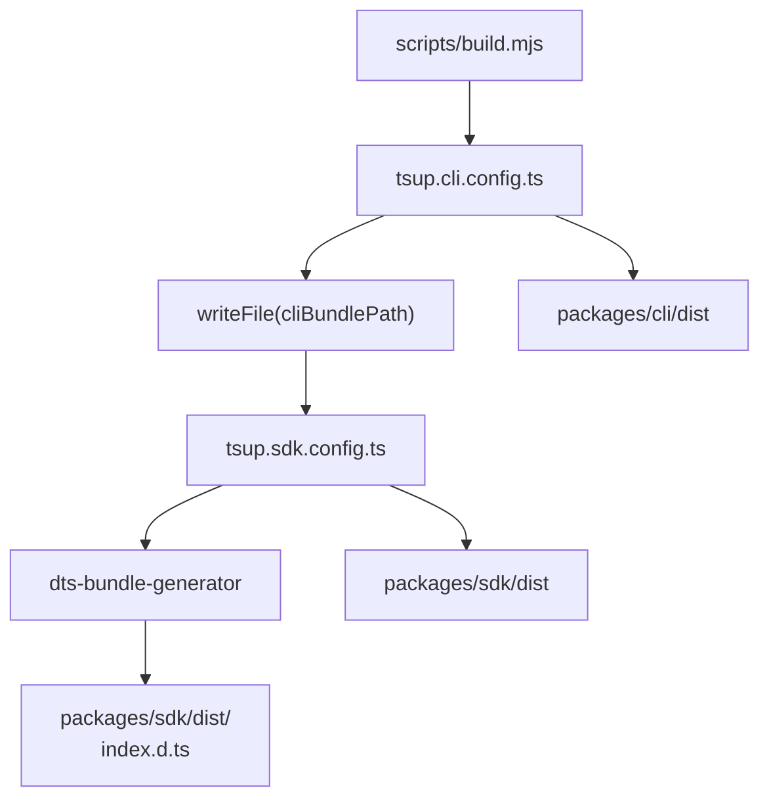
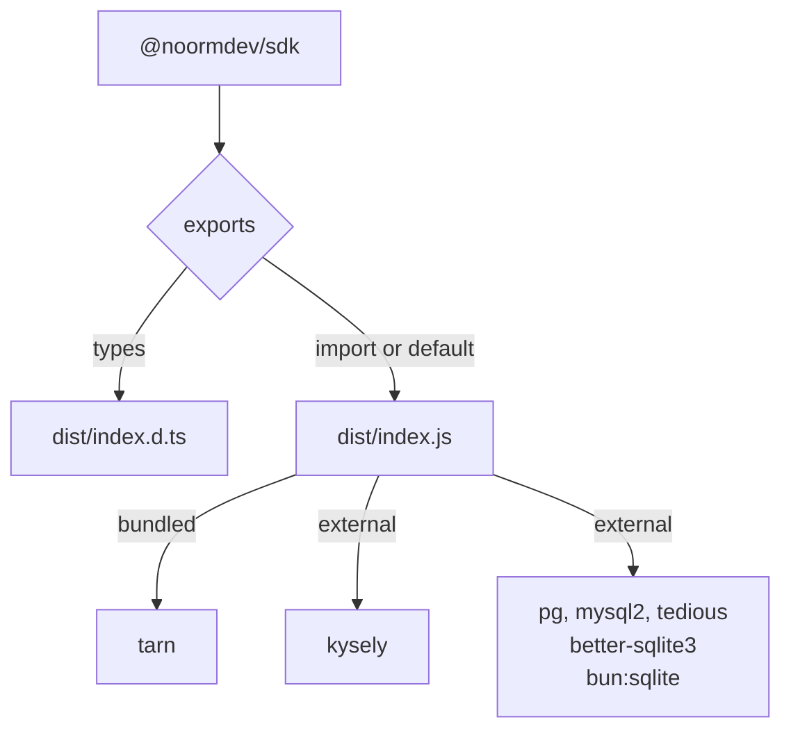
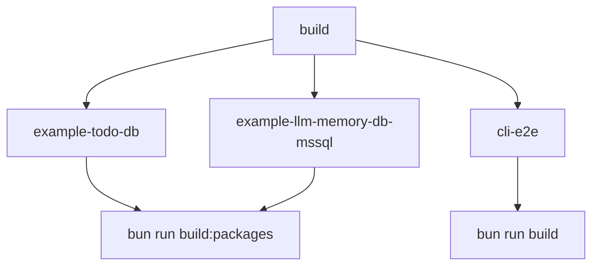
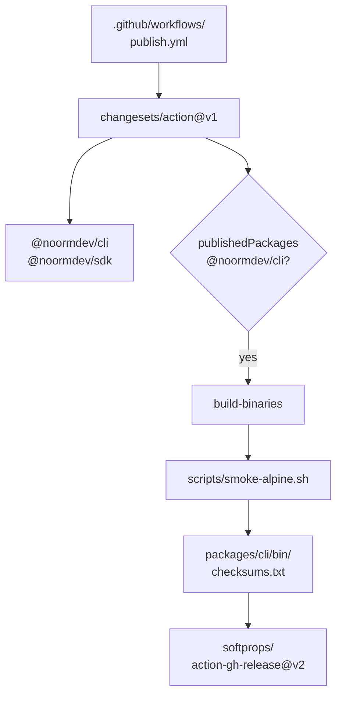
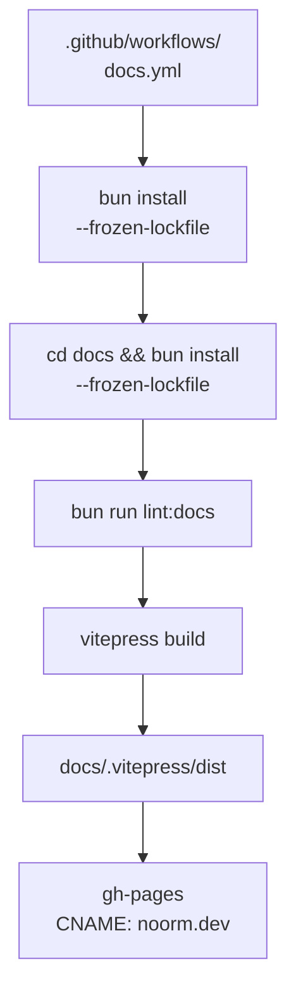
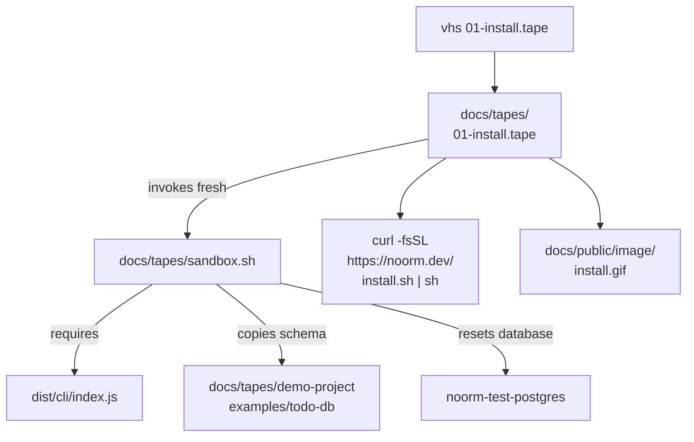

# infra

## What it does

Infrastructure turns the repository into installable CLI and SDK packages, standalone executables, and the noorm.dev documentation site. Work here when changing distribution, release automation, CI isolation, example smoke coverage, or documentation publishing.

`bun run build` compiles the development tree with TypeScript. `bun run build:packages` creates the npm artifacts; `bun run build:binary` creates standalone executables. These commands have different output and runtime boundaries.

## How it works

`build:packages` bundles the CLI before the SDK, then generates the SDK declarations independently of tsup.

The CLI bundle targets Node 22, uses ESM, injects the CLI package version, and bundles JavaScript dependencies. Native or runtime-specific modules (`better-sqlite3`, `bun:sqlite`, `pg-native`) and optional `react-devtools-core` remain external.

### SDK installation boundary

The SDK uses an ESM build, not a separate CommonJS build. Its export conditions select declarations or the same ESM runtime entry.

[`tsup.sdk.config.ts`](../../tsup.sdk.config.ts) bundles internal dependencies, including Tarn for MySQL and MSSQL pools, enables sourcemaps and tree-shaking, and aliases `ansis` to the SDK color stub. Its external list contains `kysely`, `pg`, `mysql2`, `tedious`, `better-sqlite3`, and `bun:sqlite`. The manifest requires Kysely and marks the installable dialect drivers as optional peers. Consumers install the driver for their database; Tarn is not a consumer peer. Published package contents include `dist` and [`NOTICE`](../../NOTICE), with sourcemaps excluded.

The manifest requires Node `>=22.13`. CommonJS consumers use Node's `require(esm)` support against the same ESM entry, subject to a synchronous eagerly loaded module graph, rather than resolving a `.cjs` artifact.

### CI execution boundary

The example and CLI smoke jobs depend on `build`; they exercise different artifacts rather than sharing its development output.

The `build` job provisions PostgreSQL 17, MySQL 8.0, and SQL Server 2022, installs dependencies with the frozen lockfile, and runs lint, type checking, and the TypeScript build. It invokes serial tests in separate processes for core/utils/SDK excluding transfer, transfer alone, CLI excluding logger settings, logger settings alone, and integration. This separation preserves the workflow's test isolation around Bun's process-global module mocks.

Example jobs build packages, expose the CLI bundle through a Node wrapper, mint an ephemeral identity, mask its private key, and initialize encrypted state from environment variables. The PostgreSQL todo example creates and resets its database, applies changes, and runs SDK tests with `NOORM_TEST_PREBUILT=1`. The MSSQL example uses `run build` instead of teardown, applies changes, typechecks, and runs its tests. Its schema-bound validators prevent the reset pattern used by the todo job. `cli-e2e` uses SQLite fixtures and asserts success or partial-build exit behavior.

### npm and binary distribution

A published CLI package enables the release workflow's binary build and upload job.

Changesets keeps CLI and SDK versions in a fixed group. The binary builder embeds the Bun runtime, the CLI entry, and the connection and compute worker entries. Targets cover macOS ARM64/x64, Linux ARM64/x64 with glibc or musl, and Windows x64. It reads the CLI package version and disables compiled dotenv autoloading. Release automation smoke-tests Alpine binaries and uploads executables with SHA-256 checksums.

### Documentation deployment

The docs workflow builds a separate VitePress package and publishes its output to `gh-pages`.

VitePress excludes wiki, spec, design, superpowers, tmp, tapes, models, and parts sources from page compilation. The theme extends `DefaultTheme`, registers Font Awesome and `ModelViewer`, and loads brand and landing CSS. It delays Mermaid rendering until the Geist font-loading wait completes. Images use lazy loading.

### Recording fixtures

`vhs 01-install.tape` runs the sandbox before recording the public installer and writes [`docs/public/image/install.gif`](../public/image/install.gif). The sandbox requires the development CLI and a live PostgreSQL service, independently of package publishing.

The sandbox redirects `HOME`, recreates isolated project state, and normally provides a wrapper for the working-tree CLI. The install tape instead runs the public installer inside the sandbox. The default schema comes from [`docs/tapes/demo-project`](../tapes/demo-project); `NOORM_DEMO_SCHEMA=todo-db` selects the todo example.

## Where it lives

| Path | Role |
|---|---|
| [`package.json`](../../package.json) | Workspace layout and development, package, binary, and release commands. |
| [`scripts/build.mjs`](../../scripts/build.mjs), [`tsup.cli.config.ts`](../../tsup.cli.config.ts), [`tsup.sdk.config.ts`](../../tsup.sdk.config.ts) | npm bundles, shebang, externals, and bundled SDK declarations. |
| [`packages/sdk/package.json`](../../packages/sdk/package.json) | SDK distribution manifest and consumer peer boundary, owned by the SDK domain. |
| [`scripts/build-binary.mjs`](../../scripts/build-binary.mjs), [`scripts/smoke-alpine.sh`](../../scripts/smoke-alpine.sh) | Compiled target selection and Alpine runtime smoke coverage. |
| [`.changeset/config.json`](../../.changeset/config.json), [`.github/workflows/publish.yml`](../../.github/workflows/publish.yml), [`.github/workflows/release-binary.yml`](../../.github/workflows/release-binary.yml) | Version grouping, npm publication, and binary release automation. |
| [`.github/workflows/ci.yml`](../../.github/workflows/ci.yml), [`docker-compose.test.yml`](../../docker-compose.test.yml), [`bunfig.toml`](../../bunfig.toml) | CI jobs, local database services, and Bun test configuration. |
| [`tests/integration/connection/mysql-packed-sdk.test.ts`](../../tests/integration/connection/mysql-packed-sdk.test.ts) | Isolated installed-consumer coverage for the packed SDK. |
| [`examples/todo-db`](../../examples/todo-db), [`examples/llm-memory-db-mssql`](../../examples/llm-memory-db-mssql), [`examples/llm-memory-db-pg`](../../examples/llm-memory-db-pg) | Example projects; CI explicitly drives the todo and MSSQL examples. |
| [`docs/package.json`](../package.json), [`.github/workflows/docs.yml`](../../.github/workflows/docs.yml), [`docs/.vitepress/config.mts`](../.vitepress/config.mts) | Site build, routing, exclusions, and deployment. |
| [`docs/.vitepress/theme`](../.vitepress/theme) | Theme registration, model viewer, typography, and landing styles. |
| [`docs/models/order-to-cash`](../models/order-to-cash), [`docs/public`](../public), [`docs/tapes`](../tapes) | Model sources, served static assets and installers, and recording fixtures. |
| [`scripts/check-flag-placement.sh`](../../scripts/check-flag-placement.sh) | Documentation flag-placement check invoked by `lint:docs`. |

## Constraints

- `build` does not produce the npm distribution. Publishing or testing workspace package imports without `build:packages` can consume absent or stale package artifacts.
- SDK externals and manifest peers must agree. Externalizing Tarn would make MySQL or MSSQL consumers depend on an undeclared installation; bundling dialect drivers would cross the optional-driver installation boundary.
- `types` resolves to `dist/index.d.ts`, while `import` and `default` resolve to `dist/index.js`. Treating `default` as a CommonJS build or adding top-level asynchronous initialization to the eager graph breaks assumptions behind synchronous Node loading.
- Compiled binaries still require OS shared libraries. The builder names worker entries explicitly; a worker omitted from that command is not an embedded entry point.
- Compiled binaries disable automatic `.env` loading. Re-enabling it lets Bun expand or truncate password characters before the connection layer receives the environment.
- CI's path filters cover source, tests, packages, examples, [`bun.lockb`](../../bun.lockb), TypeScript configs, and the CI workflow. A docs-only change does not select that workflow; `docs.yml` independently checks documentation and builds the site.
- The docs workflow selects pushes to `master` affecting `docs/**` or its own workflow, plus manual dispatch. An example-only change does not select a site deployment.
- Source-only documentation directories must remain excluded from VitePress routing. Compiling tooling prose as Vue markdown can fail on angle-bracket content; model and fragment sources otherwise become unintended pages.
- Recording requires `dist/cli/index.js` and the PostgreSQL container. The sandbox refuses removal outside its temporary-root guard and drops the demo database before a recording; `project` mode leaves database creation to the recorded walkthrough.

## Coupling

- The SDK domain ([`docs/wiki/sdk.md`](sdk.md)) owns the public API and package manifest in [`packages/sdk/package.json`](../../packages/sdk/package.json). Infrastructure owns bundling that API without turning internal dependencies into consumer requirements. The packed MySQL test installs only the tarball, `mysql2`, and Kysely outside the workspace, removes inherited noorm environment settings and `NODE_PATH`, asserts that Tarn cannot be resolved, and exercises rotating credentials under Node.
- The CLI ([`docs/wiki/cli.md`](cli.md)) and worker-bridge ([`docs/wiki/worker-bridge.md`](worker-bridge.md)) domains supply the entry points consumed by the package and compiled-binary builders. Worker entry changes must reach [`scripts/build-binary.mjs`](../../scripts/build-binary.mjs).
- The core-db domain ([`docs/wiki/core-db.md`](core-db.md)) owns connection behavior exercised by packaged-consumer integration coverage. The core-state ([`docs/wiki/core-state.md`](core-state.md)) and core-identity ([`docs/wiki/core-identity.md`](core-identity.md)) domains supply environment bootstrap and identity/state behavior consumed by the example jobs.
- Root workspaces include `packages/*` and `examples/*`, so example imports resolve the local SDK package. The example jobs therefore cover CLI-to-SDK coordination with built workspace artifacts, while the packed-consumer test covers an installed dependency boundary.
- The docs site hosts user, contributor, and ignatius modeling documentation. Its models and recording fixtures remain separate from executable examples; the proposed shared running-example pipeline stays in [`docs/design/site-running-example.md`](../design/site-running-example.md).
