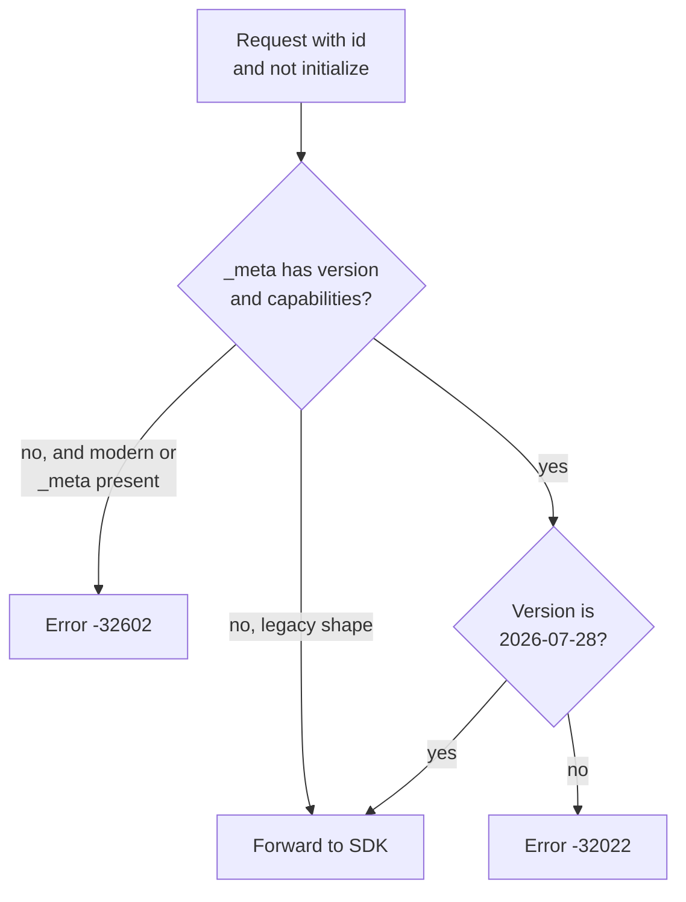
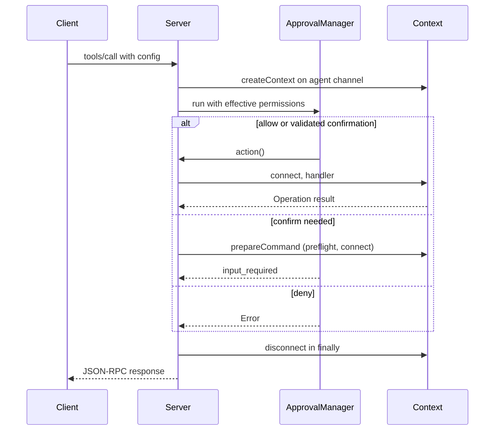
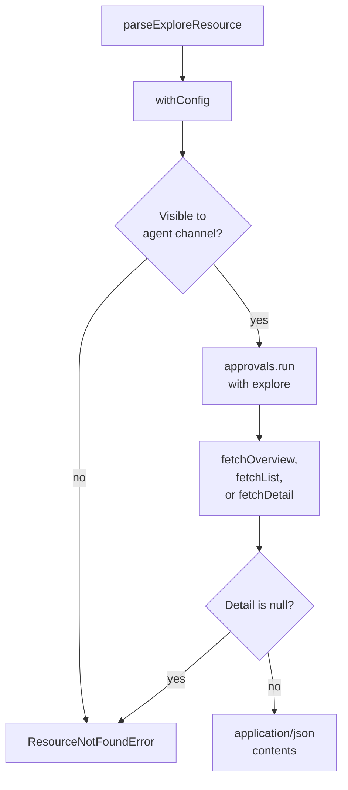

# mcp-rpc

## What it does

An AI agent can run noorm explore, sql, run, and change operations against a named config under that config's agent role, and a `confirm` cell is routed to a human through MCP elicitation instead of being granted or denied outright. The server speaks protocol `2026-07-28` using `@modelcontextprotocol/server` 2.4, over stdio only. It exposes individual command tools, prompts that render fixed templates with no database access, and JSON exploration resources. Database-scoped requests name a config; there is no transport-level or active database session.

The name `mcp-rpc` covers [`src/mcp`](../../src/mcp) (protocol server) and [`src/rpc`](../../src/rpc) (command registry it wraps). `noorm mcp serve` starts the server and `noorm mcp init` writes the client configuration. The RPC registry is transport-independent: each command requires a `Permission` or `'open'` policy declaration. There is no session state and no `connect`, `disconnect`, or `status` command; every call names its config. No RPC command or MCP tool runs named SQL pipelines or reads pipeline history, so the `pipeline:run` permission is not declared by any command here.

`tools/list` exposes `list_configs`, `overview`, `list`, `detail`, `sql`, `change_history`, `change_run`, `change_ff`, `change_revert`, `run_build`, and `run_file`. Calls use flat arguments: `list_configs` takes `{}`, and the others require `config` alongside their command-specific fields. `run_noorm_cmd` and `noorm_help` are not registered.

`prompts/list` and `prompts/get` expose these prompts ([`src/mcp/prompts.ts`](../../src/mcp/prompts.ts)):

| Prompt | Required | Optional |
|--------|----------|----------|
| `noorm_getting_started` | none | `config` |
| `noorm_explore_database` | `config` | none |
| `noorm_query_database` | `config` | `question` |
| `noorm_apply_change` | `config`, `change` | none |
| `noorm_build_database` | `config` | none |
| `noorm_run_sql_file` | `config`, `path` | none |
| `noorm_automation` | `task` | `config` |
| `noorm_ci` | `provider`, `target` (`test` or `deploy`), `config` | none |

The CI prompt requires `config` for either target. `config` is the name `noorm ci init --name` creates, and an environment-only build needs no saved config ([`src/mcp/prompts/ci.md`](../../src/mcp/prompts/ci.md)). Prompt retrieval returns fixed user-role guidance, not database results. A user or application selects a prompt; its messages guide subsequent tool calls.

## How it works

### Stdio version guard

The guard wraps the SDK transport, so a request without current metadata never reaches a handler. `initialize` passes straight to the SDK, which rejects it as legacy traffic.



A request without `_meta` before any modern request is forwarded and the SDK (`legacy: 'reject'`) refuses it. After one modern request other than `server/discover`, missing metadata is a `-32602` error. Notifications (messages with no `id`) bypass the guard (`serveModernMcp` in [`src/mcp/stdio.ts`](../../src/mcp/stdio.ts)).

### Wire errors

Each row is one condition and the JSON-RPC response it produces:

| Condition | Response | Source |
|-----------|----------|--------|
| Modern request with missing or malformed `_meta` | `-32602` | [`src/mcp/stdio.ts`](../../src/mcp/stdio.ts) |
| `_meta` protocol version is not `2026-07-28` | `-32022`, `data.supported` | [`src/mcp/stdio.ts`](../../src/mcp/stdio.ts) |
| Unknown tool or arguments failing the tool schema | `-32602` | [`src/mcp/server.ts`](../../src/mcp/server.ts) |
| Malformed exploration URI | `-32602` | [`src/mcp/resources.ts`](../../src/mcp/resources.ts) |
| Resource read: missing or hidden config, missing object (`ResourceNotFoundError`) | `-32602` with `data.uri` | [`src/mcp/resources.ts`](../../src/mcp/resources.ts), [`src/mcp/server.ts`](../../src/mcp/server.ts) |
| Tampered or expired `requestState` | `-32602` | [`src/mcp/approval.ts`](../../src/mcp/approval.ts) (`verify`), [`tests/core/mcp/server.test.ts`](../../tests/core/mcp/server.test.ts) |
| Confirmation needed and client lacks `elicitation` or advertises URL-only | `-32021` (`MissingRequiredClientCapabilityError`) | [`src/mcp/approval.ts`](../../src/mcp/approval.ts) |
| Permission denied, hidden config on a tool call, handler failure, approval failure (replayed or mismatched state, declined response, `inputResponses` without `requestState`) | tool result with `isError: true`; approval failures throw plain `Error` inside `attempt` | [`src/mcp/server.ts`](../../src/mcp/server.ts), [`tests/core/mcp/server.test.ts`](../../tests/core/mcp/server.test.ts) |

### Request-scoped database access

Tool dispatch resolves a fresh context for the named config, checks permission before invoking the handler, and disconnects when the request finishes.



### Approval retry

Approval uses multi round-trip requests (MRTR): the server answers a tool call with an input-required challenge, and the client retries the same call carrying the challenge's `requestState` and the human's `inputResponses`. The state identifies a server-held operation snapshot. A retry binds the method, client identity metadata, operation and arguments, target config, and current policy. A valid retry without a response reissues the challenge without granting permission; a response consumes it once.

```mermaid
stateDiagram-v2
    accTitle: MCP approval lifecycle
    accDescr: A pending approval can be reissued, consumed by a matching response, or expire; a mismatched retry throws and leaves the entry pending.
    %% source: src/mcp/approval.ts
    [*] --> Pending: confirm and prepare
    Pending --> Pending: Retry without response
    Pending --> Pending: Mismatch or denied<br/>policy throws
    Pending --> Consumed: matching state,<br/>target, policy
    Pending --> Expired: Five-minute expiry
    Consumed --> Executed: approve true
    Consumed --> Rejected: decline or<br/>invalid response
    Expired --> Rejected: Retry
    Executed --> [*]
    Rejected --> [*]
```



`ApprovalManager.run` returns an `InputRequiredResult` challenge carrying the HMAC `requestState`. The `PreparedCommand` stays server-side in `#pending`, keyed by an opaque nonce; of the `PreparedCommand`, only `summary` reaches the elicitation message, after a redacted heading (config name, database name, permission list). Before the entry is deleted, `run` checks the nonce, request digest, target hash, and policy; a mismatched or policy-denied retry throws and the entry stays pending until it expires.

The challenge needs form elicitation. `MissingRequiredClientCapabilityError` (`-32021`, asserted in [`tests/core/mcp/server.test.ts`](../../tests/core/mcp/server.test.ts)) fires when the client advertises no `elicitation` or only the URL mode; `elicitation: {}` passes.

### Resource reads

Resource reads use the same context boundary and approval path as tools, with the fixed permission `explore`.



URI templates:

```text
noorm://configs/{config}/overview
noorm://configs/{config}/objects/{category}
noorm://configs/{config}/objects/{category}/{name}{?schema}
```

A separate unqualified-detail registration handles the no-query form. List categories are `tables`, `views`, `procedures`, `functions`, `types`, `indexes`, `foreignKeys`, `triggers`, `locks`, and `connections`; detail supports `tables`, `views`, `procedures`, `functions`, `types`, and `triggers`. Config visibility is enforced on discovery and reads; resources expose no database credentials or arbitrary SQL endpoint. Resource error codes are in the wire errors table above.

`resources/list` and `resources/read` use private zero-TTL hints. `tools/list`, `prompts/list`, `server/discover`, and `resources/templates/list` are cached publicly for five minutes.

### Prompt templates

Prompt arguments are validated before rendering, treated as data rather than template source, and never HTML-escaped. Templates use `` for control flow, `` for raw output, `$.call(name, args)` for JSON tool-call examples, and `$.safety` for shared safety guidance.

## Where it lives

| Area | Path | Role |
|------|------|------|
| Protocol server | [`src/mcp/index.ts`](../../src/mcp/index.ts) | `startServer` serves one modern server, logs to stderr, and closes the transport on termination signals. |
| Protocol server | [`src/mcp/stdio.ts`](../../src/mcp/stdio.ts) | `serveModernMcp` guards current request metadata and versions; the SDK negotiates and rejects legacy traffic. |
| Protocol server | [`src/mcp/server.ts`](../../src/mcp/server.ts) | The private `withConfig` helper uses `createContext({ config, channel: 'agent', freshState: true })`. `list_configs` runs `listVisibleConfigs` without a context. SQL dispatch classifies the statement before authorization. `run_file` resolves a relative path against the canonical project root and rejects symlink escapes for both `allow` and `confirm`. Covered by [`tests/core/mcp/server.test.ts`](../../tests/core/mcp/server.test.ts) (real SQLite through the JSON-RPC/MRTR path, policy changes, target binding, replay, resource approval) and [`tests/core/mcp/state-freshness.test.ts`](../../tests/core/mcp/state-freshness.test.ts) (role revocation and invisibility within a running server). |
| Protocol server | [`src/mcp/resources.ts`](../../src/mcp/resources.ts) | URI templates, visible-config discovery through `listVisibleConfigs` (the helper `list_configs` also uses), encoded-name parsing, and overview/list/detail JSON resource reads. Parent dispatch enforces `explore`, including MRTR approval for a configured `confirm` cell. Covered by [`tests/core/mcp/resources.test.ts`](../../tests/core/mcp/resources.test.ts) (SQLite introspection, visibility, encoded URI boundaries). |
| Protocol server | [`src/mcp/prompts.ts`](../../src/mcp/prompts.ts) | Registers prompt cookbooks and renders their Markdown bodies from [`src/mcp/prompts/`](../../src/mcp/prompts) with Eta. |
| Protocol server | [`src/mcp/prompts/`](../../src/mcp/prompts) | Markdown templates, one per prompt, plus shared `safety.md`. |
| Protocol server | [`src/mcp/markdown.d.ts`](../../src/mcp/markdown.d.ts) | Type declaration for the Markdown text imports. |
| Approval | [`src/mcp/approval.ts`](../../src/mcp/approval.ts) | `ApprovalManager` implements MRTR form elicitation. HMAC-protected request state contains an opaque nonce and request digest; SQL, secrets, and prepared execution objects remain server-side. Target configuration and effective policy are rechecked on retry. Approval is five-minute, process-local, and single-use; concurrent retries cannot execute twice. Decline, cancel, missing form support, tampering, policy/target changes, and replay fail closed. |
| Approval | [`src/mcp/prepared.ts`](../../src/mcp/prepared.ts) | `prepareCommand` runs `preflightCommand` once, before connecting and rendering, to reject executable templates, including effective build files, manifest references, and pending `change_ff` changes. Plain SQL and the approved plan are captured for execution. `secretRedactor` makes one pass over the review text, replacing only secret values (connection password, SSL key/cert/ca, project and global secrets) with `[REDACTED SECRET]`, on a best-effort basis; transformed values can remain visible. User and database names stay visible. `allow` retains trusted executable artifact semantics. Covered by [`tests/core/mcp/prepared.test.ts`](../../tests/core/mcp/prepared.test.ts) (execution of approved snapshots, rejection of expanded build/change plans). |
| RPC registry | [`src/rpc/registry.ts`](../../src/rpc/registry.ts) | Flat command registration, listing, and help generation from schemas/examples. |
| RPC registry | [`src/rpc/types.ts`](../../src/rpc/types.ts) | `RpcCommand`, `RpcSession` (channel, abort signal, `getContext`), and `RpcError`. |
| RPC registry | [`src/rpc/commands/`](../../src/rpc/commands) | Exploration, query, config, run, and change handlers. |
| RPC registry | [`tests/core/rpc/`](../../tests/core/rpc) | Registry, command handlers, permission declarations, and `list_configs` (including parity with the MCP tool in [`tests/core/mcp/list-configs-parity.test.ts`](../../tests/core/mcp/list-configs-parity.test.ts)). |
| CLI | [`src/cli/mcp/`](../../src/cli/mcp) | Citty `mcp` command with `serve` and `init` subcommands. |
| CLI | [`src/mcp/init.ts`](../../src/mcp/init.ts) | Writes or merges Claude Code/Cursor server configuration. Covered by [`tests/core/mcp/init.test.ts`](../../tests/core/mcp/init.test.ts). |

## Constraints

- MCP grants `confirm` only inside `withPolicyConfirmation`'s async scope, after verified approval. Calling a command handler outside that scope makes the inner policy guard deny a confirmed operation.
- `change_ff` also checks `change:run`, since the batch executes individual changes. Dropping that check lets a role with `change:ff` but no `change:run` apply changes.
- Confirmed operations reject executable SQL templates before loading template data; `allow` operations can execute project-controlled JavaScript sidecars and must trust those artifacts. **Breaks if violated:** executing a template or JS sidecar before approval runs code and renders SQL the human never reviewed in `prepared.summary`.
- MCP relies on the client to collect human consent, not a cryptographic proof of a human interaction. A client that auto-accepts elicitation approves on the human's behalf. An agent with filesystem access can read [`.noorm`](../../.noorm) and credentials outside MCP.
- `'open'` commands (`list_configs`) reject `requestState` and `inputResponses`: the call returns a tool result with `isError: true` and the message "This command does not accept approval state" ([`src/mcp/server.ts`](../../src/mcp/server.ts)).
- An unresolved access role or invalid access value is reported as the same "config not found" message as a hidden config, so the error does not reveal that a hidden config exists.
- A stray stdout write corrupts the JSON-RPC stream and the client drops the server; stdout carries JSON-RPC only and diagnostics go to stderr ([`src/mcp/index.ts`](../../src/mcp/index.ts)).

## Coupling

- `core-policy`: [`src/core/policy/`](../../src/core/policy) supplies `getConfigPermission`, `getPolicyFingerprint`, `withPolicyConfirmation`, `sqlPermissionsFor`, and `isVisibleToChannel`. A change to the permission set or role resolution changes MCP approval behavior and the cells that `ApprovalManager` checks.
- `sdk`: `createContext` in [`src/sdk/`](../../src/sdk) builds the per-request context; `ctx.noorm.run[prepareRunContext]` and `ctx.noorm.changes` feed [`src/mcp/prepared.ts`](../../src/mcp/prepared.ts).
- `core-db`: [`src/core/explore/operations.ts`](../../src/core/explore/operations.ts) backs both the `overview`/`list`/`detail` tools and the resources.
- `core-runner`: [`src/mcp/prepared.ts`](../../src/mcp/prepared.ts) calls `discoverFiles` and `computeChecksumFromContent`; [`src/core/runner/runner.ts`](../../src/core/runner/runner.ts) and `checksum.ts` read [`src/core/shared/approved-content.ts`](../../src/core/shared/approved-content.ts), so the shape of `ApprovedContent` changes in lockstep with [`src/mcp/prepared.ts`](../../src/mcp/prepared.ts).
- `core-change`: [`src/mcp/prepared.ts`](../../src/mcp/prepared.ts) uses `ChangeHistory` and `isPendingChange`; [`src/core/change/executor.ts`](../../src/core/change/executor.ts) and `manager.ts` also read `approved-content.ts`.
- `core-state`: [`src/mcp/server.ts`](../../src/mcp/server.ts) uses `configNotFoundMessage` ([`src/core/config/resolver.ts`](../../src/core/config/resolver.ts)) and `ConfigAccessInvalidError`; `listVisibleConfigs` ([`src/core/state/visible-configs.ts`](../../src/core/state/visible-configs.ts)) backs `list_configs` and resource discovery; [`src/mcp/prepared.ts`](../../src/mcp/prepared.ts) uses `getEffectiveBuildPaths`.
- `infra`: [`package.json`](../../package.json) `build` runs `tsc && tsup --config tsup.prompts.config.ts`, which embeds the prompt Markdown so Node loads the bundled prompt module without a custom loader. [`scripts/dev.mjs`](../../scripts/dev.mjs) re-bundles prompts in watch mode for `bun run dev`. CI `cli-e2e` runs [`scripts/smoke-mcp.mjs`](../../scripts/smoke-mcp.mjs) against `dist/cli/index.js` ([`.github/workflows/ci.yml`](../../.github/workflows/ci.yml)). User docs: [`docs/guide/automation/mcp.md`](../guide/automation/mcp.md), [`docs/headless.md`](../headless.md).
- `cli`: `noorm mcp serve` and `noorm mcp init` are registered under [`src/cli/mcp/`](../../src/cli/mcp). [`skills/noorm/references/config.md`](../../skills/noorm/references/config.md) states that MCP mediates human approval; it changes in lockstep with the approval behavior above. The tool, prompt, and resource names above are the public contract.
