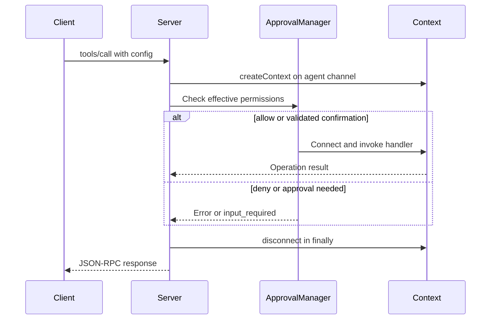
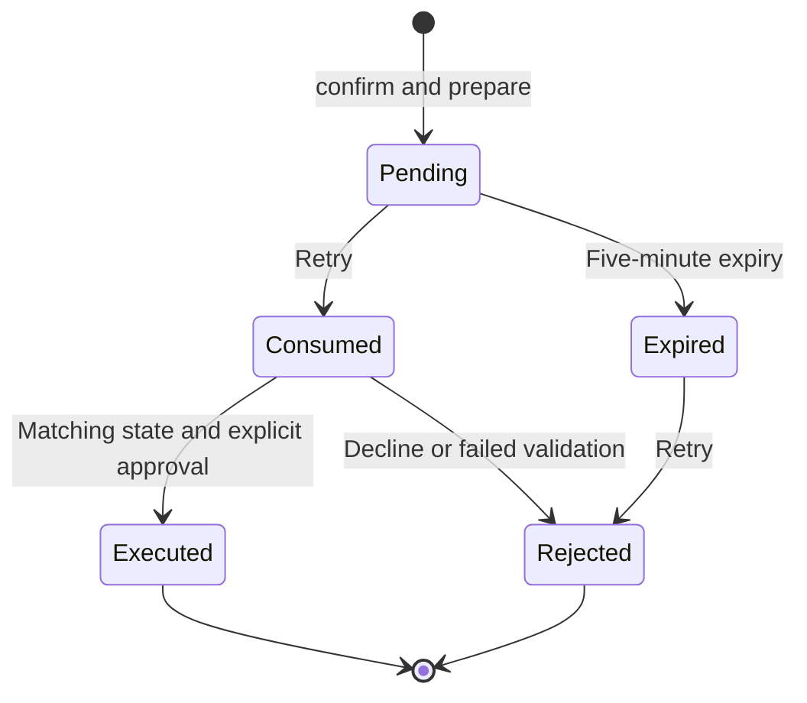

# mcp-rpc

## What it does

The MCP server speaks protocol `2026-07-28` using `@modelcontextprotocol/server` 2.x. It exposes individual command tools, static user-selected prompt cookbooks, and JSON exploration resources. It rejects legacy initialization-based clients. Database-scoped requests explicitly name a config; they resolve fresh settings/configuration and release their connection after the request, with no transport-level or active database session.

The RPC registry remains transport-independent. Each command declares a `Permission` or `'open'`. MCP does not expose the RPC-only session commands `connect`, `disconnect`, and `status`.

`tools/list` exposes `list_configs`, `overview`, `list`, `detail`, `sql`, `change_history`, `change_run`, `change_ff`, `change_revert`, `run_build`, and `run_file`. Calls use flat arguments: `list_configs` takes `{}`, and the others require `config` alongside their command-specific fields. Unknown tools and invalid input produce JSON-RPC `-32602`; permission failures remain tool results with `isError: true`. Migrate old `run_noorm_cmd` calls by using the command as the tool name and moving payload fields beside `config`; use tool schemas instead of `noorm_help`. Neither old tool remains.

`prompts/list` and `prompts/get` expose `noorm_getting_started` (optional `config`), `noorm_explore_database` (`config`), `noorm_query_database` (`config`, optional `question`), `noorm_apply_change` (`config`, `change`), `noorm_build_database` (`config`), `noorm_run_sql_file` (`config`, `path`), `noorm_automation` (`task`, optional `config`), and `noorm_ci` (`provider`, `target`: `test` or `deploy`, `config`). Prompt retrieval returns static user-role guidance, not database results, and does not connect or execute operations. Automation guidance covers scripts and failure handling; CI guidance separates disposable test builds from pending-change deployments. A user or application selects a prompt; its messages guide subsequent tool calls.

## How it works

### Request-scoped database access

Tool dispatch resolves a fresh context for the named config, checks permission before invoking the handler, and disconnects when the request finishes.



### Approval retry

The approval state identifies a server-held operation snapshot. A retry consumes it once and must match the request, target, and current policy.



## Implementation

- [`src/mcp/index.ts`](../../src/mcp/index.ts): `startServer` serves one modern server, logs to stderr, and closes the transport on termination signals.
- [`src/mcp/stdio.ts`](../../src/mcp/stdio.ts): `serveModernMcp` validates the required metadata/version on every request before SDK dispatch, then serves modern stdio with legacy traffic rejected.
- [`src/mcp/server.ts`](../../src/mcp/server.ts): `createMcpServer(registry, options?)` registers tools, prompts, and resources and resolves request contexts. `withConfigContext` uses `createContext({ config, channel: 'agent' })`; `options.withConfig` is the isolated context boundary used by tests. SQL dispatch classifies the actual statement before authorization rather than treating every SQL call as a read.
- [`src/mcp/approval.ts`](../../src/mcp/approval.ts): `ApprovalManager` implements MRTR form elicitation. HMAC-protected request state contains an opaque nonce and request digest; SQL, secrets, and prepared execution objects remain server-side. Target configuration and effective policy are rechecked on retry. Approval is five-minute, process-local, and single-use; concurrent retries cannot execute twice. Decline, cancel, missing form support, tampering, policy/target changes, and replay fail closed.
- [`src/mcp/prepared.ts`](../../src/mcp/prepared.ts): prepares a reviewable operation and captures rendered SQL/checksums for script, build, and change commands. Known template secret values are redacted in review summaries. Execution uses the private immutable snapshot.
- [`src/core/shared/approved-content.ts`](../../src/core/shared/approved-content.ts): async-local approved SQL/checksum lookup and build/change/pending-plan guards used by shared file loading and execution.
- [`src/mcp/resources.ts`](../../src/mcp/resources.ts): URI templates, visible-config discovery, encoded-name parsing, and overview/list/detail JSON resource reads. Parent dispatch enforces `explore`, including MRTR approval for a configured `confirm` cell. Live metadata uses private zero-TTL hints.
- [`src/mcp/prompts.ts`](../../src/mcp/prompts.ts): registers eight static prompt cookbooks with tool-call examples and headless automation/CI workflows; fetching guidance performs no database work.
- [`src/mcp/init.ts`](../../src/mcp/init.ts): writes or merges Claude Code/Cursor server configuration.
- [`src/rpc/registry.ts`](../../src/rpc/registry.ts): flat command registration, listing, and help generation from schemas/examples.
- [`src/rpc/session.ts`](../../src/rpc/session.ts): connection manager retained for transport-independent RPC consumers; modern MCP does not use its implicit sole-connection behavior.
- [`src/rpc/commands/`](../../src/rpc/commands): exploration, query, config, run, change, and internal session handlers.

## Enforcement contracts

`getConfigPermission` returns the effective project role decision, including protected-stage ceilings. Defaults remain unchanged; project settings may override built-ins or define custom inheriting roles. MCP uses `allow` directly, rejects `deny`, and resolves `confirm` through elicitation. Only after verified approval does `withPolicyConfirmation` grant the exact target/permissions within the execution's async scope. Inner SDK/core guards still enforce policy; there is no switch to the human channel or public `approved: true` argument.

`change_ff` also checks `change:run`, since the batch executes individual changes. Script preparation does not execute its SQL, but template sidecars are project-controlled JavaScript and must be trusted.

Outside the MCP approval path, agent CLI `confirm` remains denied even with `--yes`/`NOORM_YES`. Human CLI/TUI keeps its confirmation mechanisms. MCP relies on the client to collect human consent, not a cryptographic proof of a human interaction. Filesystem access and database credentials are separate security boundaries.

## Resource URIs

```text
noorm://configs/{config}/overview
noorm://configs/{config}/objects/{category}
noorm://configs/{config}/objects/{category}/{name}{?schema}
```

A separate unqualified-detail registration handles the no-query form. Categories and supported detail types match the existing core exploration operations. Config visibility is enforced on discovery and reads; resources expose no database credentials or arbitrary SQL endpoint.

## Verification and documentation

- [`tests/core/mcp/server.test.ts`](../../tests/core/mcp/server.test.ts): real SQLite operations through the modern JSON-RPC/MRTR dispatch path, policy changes, exact target binding, replay, and resource approval.
- [`tests/core/mcp/resources.test.ts`](../../tests/core/mcp/resources.test.ts): modern resource discovery, actual SQLite introspection, visibility, and encoded URI boundaries.
- [`tests/core/mcp/prepared.test.ts`](../../tests/core/mcp/prepared.test.ts): actual execution of approved snapshots and rejection of expanded build/change plans.
- [`tests/core/mcp/init.test.ts`](../../tests/core/mcp/init.test.ts): client config generation.
- [`docs/guide/automation/mcp.md`](../guide/automation/mcp.md): public setup, cutover, approval, and resources guide.
