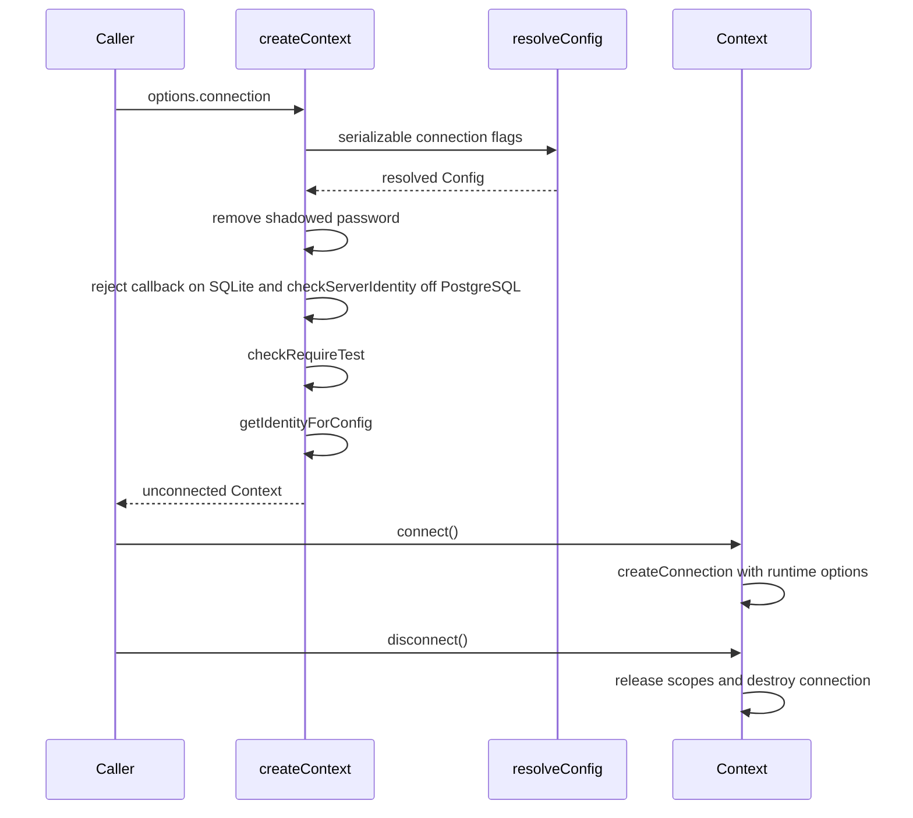
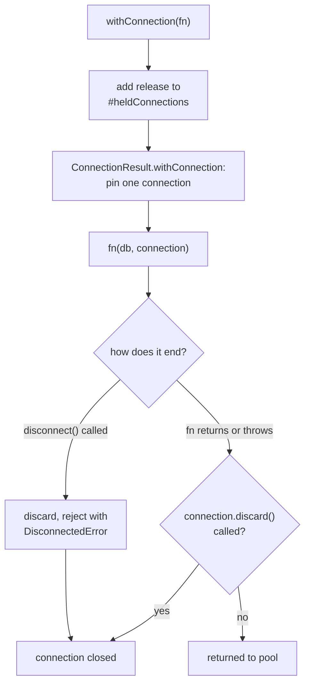
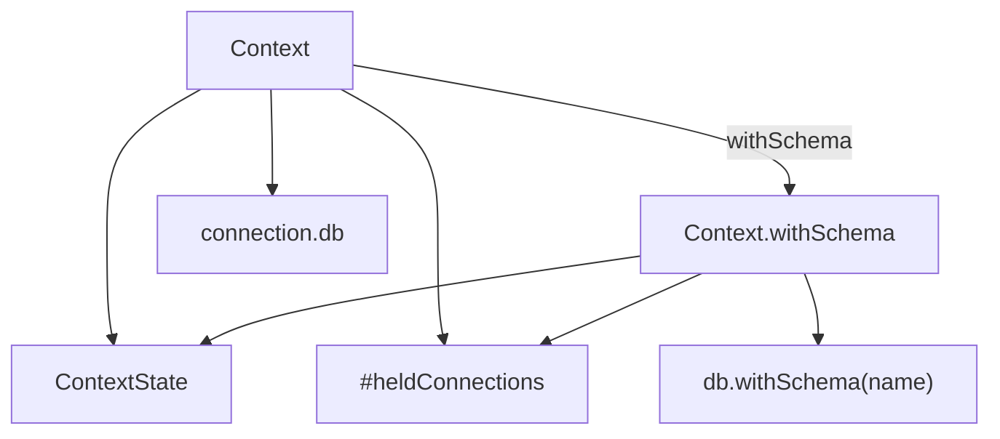
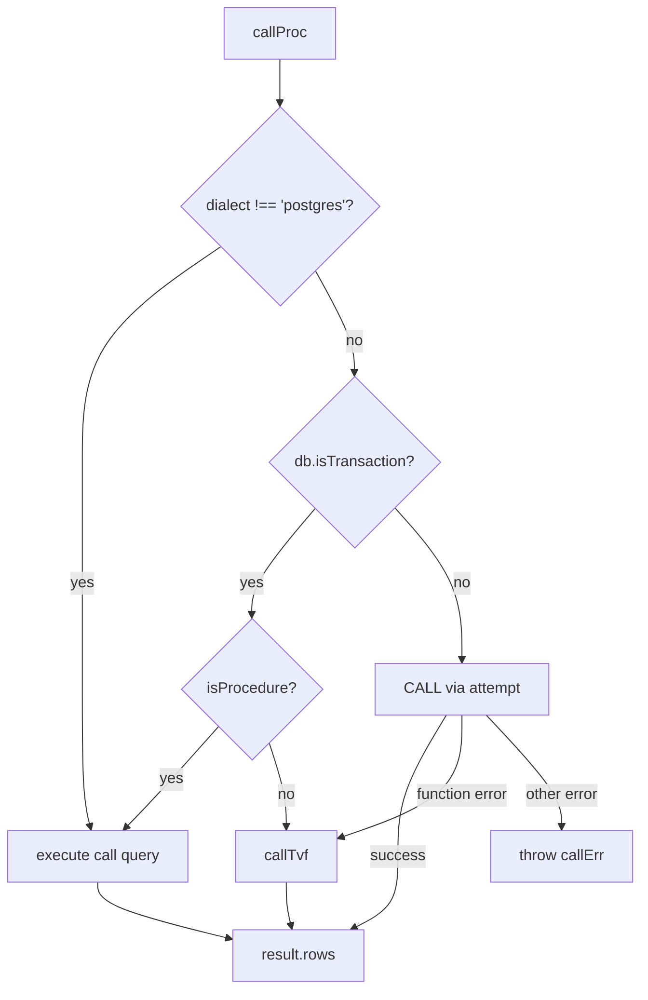
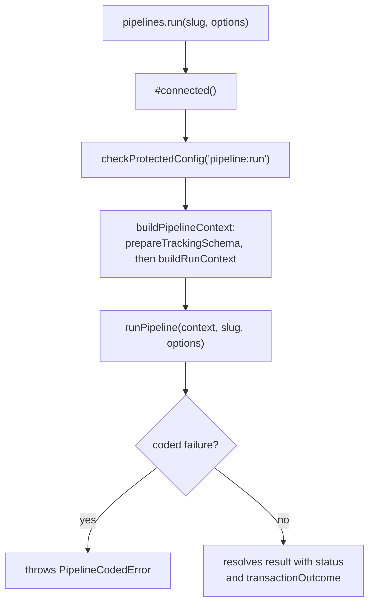
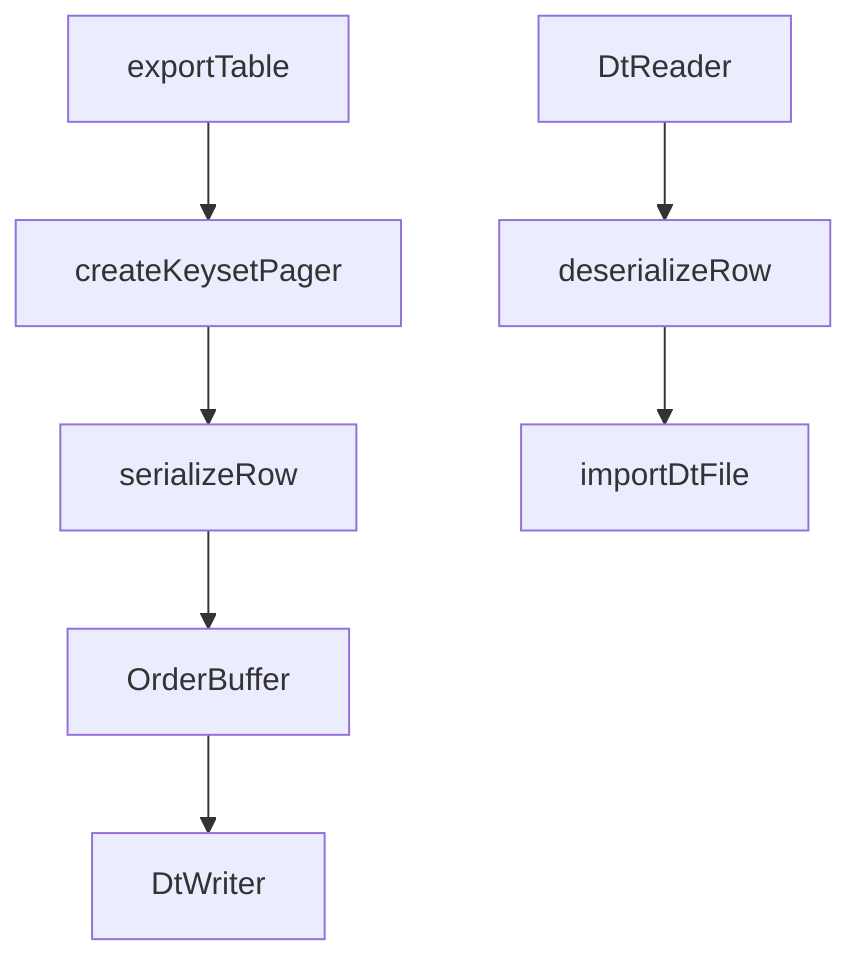

# sdk

## What it does

`@noormdev/sdk` lets applications and test suites query databases and run noorm management operations without driving the CLI. `createContext` accepts a stored configuration, environment configuration, or non-persisted inline connection settings. It returns an unconnected `Context` with typed Kysely access, routine calls, transactions, impersonation, and lazy management namespaces.

```typescript
import { createContext } from '@noormdev/sdk';

const ctx = await createContext({
    connection: { dialect: 'sqlite', database: ':memory:' },
});
await ctx.connect();
try {
    await ctx.kysely.selectFrom('users').selectAll().execute();
} finally {
    await ctx.disconnect();
}
```

The same domain owns DT serialization in [`src/core/dt`](../../src/core/dt): portable table files and in-memory row conversion for PostgreSQL, MySQL, and MSSQL. Live database-to-database transfer belongs to core-db; its cross-dialect conversion uses `DtStreamer`.

## How it works

`createContext` initializes state and settings, resolves configuration, checks `requireTest`, and resolves identity before returning; the `Context` constructor does none of those. Inline `connection` fields enter the shared resolver as flags, above environment settings. The resolver owns defaults, stage constraints, stored selection, and synthetic names; see core-state. Without an explicit name, any configuration with an inline `connection` uses `__inline__`, including an environment-plus-inline one, while environment-only configurations use `__env__`. Synthetic names are not unique context identifiers.

Use `createContext()` for normal consumer startup rather than constructing `Context` and supplying internal state yourself. `CreateContextOptions` includes `config`, `name`, `projectRoot`, `stage`, `requireTest`, `channel`, `yes`, `freshState`, and inline `connection` settings. With `freshState: true` the factory builds a new `StateManager` and `SettingsManager` from disk instead of the process-wide instances, and the `Context` carries that `StateManager` in `ContextState.stateManager`; the changes, run, secrets, and templates namespaces read state through it. `Context` also exposes `projectRoot`. The default channel is `user`; the SDK does not perform the CLI entrypoint's project walk-up and `chdir`.

The `Context` constructor revalidates `config.access` through `bindSdkPolicy`, which maps `settings.access.roles` and the protected-stage ceiling from `settings.stages[*].defaults.protected` into core-state's `bindPolicyContext`, with `options.stage` as the stage name. Metadata carried from another project or an older settings snapshot cannot supply authority.

Runtime password callbacks and PostgreSQL `ssl.checkServerIdentity` stay outside serializable configuration. The factory removes a shadowed stored or environment password from the resolved configuration when a callback wins. It does not write that removal back to state.



The factory separates serializable overrides from runtime hooks, and `connect()` supplies those hooks only when opening the connection.

### Connection lifecycle

`connect()` returns immediately when already connected. On success it stores the connection; on failure the context remains unconnected. `disconnect()` releases held explicit impersonation scopes before destroying the connection, then clears the connection and cached change manager. Reconnecting uses the same resolved configuration and runtime hooks. Cleanup is explicit through `disconnect()`.

### Connection controls

`createContext` picks the connection source through `config`, `name`, and the inline `connection` object. The pool and socket settings travel in that object; core-db owns what they do to the physical pool.

| Option | Behavior |
|---|---|
| `config: string` | Selects a stored config. |
| `config: false` | Ignores `NOORM_CONFIG` and the active stored config. Stage defaults (`stage`, `NOORM_NAME`), `NOORM_isTest`, `NOORM_ACCESS_*`, and `NOORM_CONNECTION_*` still apply. With no inline `connection`, and no `dialect` plus `database` from `NOORM_CONNECTION_*` and stage defaults, the factory throws `No connection available for { config: false }`. |
| `name` | Names a context that uses no stored config; wins over `NOORM_NAME` and reaches the resolver as `unstoredName`. The name is a key, not a label: it is `configName` on events and keys change history, run checksums, locks, pipeline history, and local secrets. Reopening a database under another name makes applied changes pending and builds run again. The resolver throws when a stored config is selected (including the active config or `NOORM_CONFIG`; pass `config: false` or an inline `connection`), or when a stored config already has that name. A stage with that name still applies its protected ceiling and `isTest: false`; its other defaults need `stage`. |
| `connection` | An `InlineConnection<DialectConnectionConfig>`: non-persisted fields applied after environment settings. `password` may be a callback, `ssl.checkServerIdentity` a function, and `driver` an object. |

Inline `pool` is typed per dialect through `DialectConnectionConfig`, so an option the dialect cannot honor is a compile error. The SDK entrypoint re-exports `DialectConnectionConfig` and the option types `PoolOpts`, `PgPoolOpts`, `TarnPoolOpts`, `MysqlPoolOpts`, and `MssqlPoolOpts`.

| Dialect | `pool` options |
|---|---|
| PostgreSQL | `min`, `max`, `idleTimeoutMs`, `maxLifetimeMs`, `maxUses`, `allowExitOnIdle`. |
| MySQL, MSSQL | `min`, `max`, `idleTimeoutMs`, `acquireTimeoutMs`, `createTimeoutMs`, `reapIntervalMs` (Tarn). |
| SQLite | Typed as `min` and `max` only; there is no pool. |

`idleTimeoutMillis` is a deprecated alias of `idleTimeoutMs`. `keepAlive` and `keepAliveInitialDelayMs` apply to PostgreSQL and MySQL sockets; setting the delay implies `keepAlive` unless it is `false`. Without the delay the first probe waits for the operating system default, about two hours. The core-db page covers pool, timeout, and keepalive behavior.

`connection.driver` merges into the driver's options below the keys noorm owns, so it cannot change the target, credentials, TLS, or pool size; core-db gives the order per dialect. The factory validates it before returning a context, and `connect()` hands it to `createConnection` as a runtime option, so it is never stored, resolved into `Config`, or placed in events.

| Condition | Result |
|---|---|
| `driver` is not a plain object | `connection.driver must be an object of driver options`. |
| SQLite config | `Driver options are not supported for SQLite`. |
| Key that selects the target, credentials, or TLS | Rejected by `driverOptionsFor`. |

### Pinned connections

`ctx.withConnection(fn)` runs `fn(db, connection)` on one connection held for the whole call, for work that sets session state, such as an advisory lock. `connection.discard()` makes the connection close when `fn` ends instead of returning to the pool, for a session that holds a lock and no longer answers. A thrown error does not discard on its own.

A pinned connection leaves the pool only when `discard()` ran or `disconnect()` interrupted the call:



`discard()` takes effect in the `finally` of the pinned callback, so a handle kept past the callback cannot close a connection another caller checked out. `disconnect()` during the call always calls `discard()`, because the session state is unknown. The call requires a connected context (`NotConnectedError` otherwise), and on a `withSchema` view `db` carries the schema plugin. A dialect whose connection result has no `withConnection` (SQLite) runs `fn` on `pool.connection()` with a no-op `discard`.

### Schema views

`withSchema` derives a typed view sharing the root context's mutable state and held impersonation connections. Each `kysely` access derives a fresh schema wrapper from the bare connection, so reconnects cannot leave a cached wrapper pointing at an old connection.



Schema views share lifecycle and held connections rather than allocating independent pools.

Routine names receive the schema prefix through `qualifyName` unless already qualified with a dot. Chained `withSchema` calls replace the schema instead of stacking it. Transactions compose with the schema-derived Kysely handle. On a view, an impersonated scope carries the schema plugin only on `scope.kysely`: `buildScope` passes `null` as the schema for `proc`, `func`, `tvf`, and `scope.transaction` routines, so those resolve against the default schema. Management namespaces continue using shared project state rather than the view's schema.

The schema qualifier has dialect-specific meaning: a schema on PostgreSQL/MSSQL, a database on MySQL, or an attached database on SQLite. `withSchema()` has no dialect gate and does not change the underlying connection configuration. Dots in schema names are rejected because routine SQL quoting splits qualification at a dot; hyphens remain safe through identifier quoting.

### Transactions and routine dispatch

`transaction(fn)` attaches `proc`, `func`, and `tvf` directly to the real Kysely transaction with `withRoutines`. `ImpersonatedScope.transaction` uses the same helper. Tuple maps (`[Args, Return]`) supply routine argument and result types through `ExtractArgs` and `ExtractReturn`.

PostgreSQL transaction routine dispatch consults `pg_proc` before choosing `CALL` or `SELECT`, avoiding a failed `CALL` that would abort the transaction.



Outside transactions, PostgreSQL `proc` falls back to `callTvf` when the SQLSTATE is `42809` or `42883` and the message contains `procedure` or the hint contains `use SELECT`. `func` returns the first row or `null`; `proc` and `tvf` return rows. SQL builders handle dialect quoting and MSSQL table-valued parameters created by `tvp()`.

### Impersonation

Callback impersonation borrows a dedicated connection and reverts in `finally`, including when the callback throws. Explicit impersonation returns a scope with `kysely`, `proc`, `func`, `tvf`, `transaction`, and `revert()`; the caller owns reversion, with `disconnect()` releasing scopes still held.

| Dialect | Switch identity | Revert |
|---|---|---|
| PostgreSQL | `SET ROLE` | `RESET ROLE` |
| MSSQL | `EXECUTE AS USER` | `REVERT` |
| MySQL, SQLite | Throws `ImpersonationError` before borrowing a connection. | Not supported. |

Principal names must match `[a-zA-Z0-9_@.\-\\]+`; invalid names fail before SQL execution.

### Management namespaces

`ctx.noorm` lazily creates `NoormOps`; each namespace is also lazy and cached. It exposes changes (scaffolding, discovery, validation, execution, history), run (discovery, preview, file, directory, build), pipelines (run, history, run lookup), db (exploration, teardown preview, truncate, teardown, reset), dt (table export and file import), lock, vault, secrets, templates, transfer, and utils. `db.reset` delegates rebuilding to `run.build`.

`run.build` applies settings include/exclude and rule filtering, returning unmatched include/exclude entries. Template rendering does not execute SQL. Utilities provide file checksums and a non-throwing connection test result. Vault methods include initialization, status, secret CRUD, propagation, and copying; local secrets remain configuration-scoped.

| Namespace | Operations and boundary |
|---|---|
| `changes` | Offline `create`, `addFile`, `removeFile`, `renameFile`, `reorderFiles`, `delete`, `discover`, `parse`, and `validate`; connected `apply`, `revert`, `ff`, `next`, `rewind`, `status`, and history reads (`history`, `historyForChange`, and `getFileHistory` run behind the `explore` check). Deleting a local change still checks `change:rm`. |
| `run` | Offline `discover`; connected `preview`, `file`, `files`, `dir`, and `build`. A symbol-keyed `prepareRunContext` method builds a run context for MCP approval preparation and never grants execution. `build` returns `unmatchedInclude` and `unmatchedExclude` alongside the batch result. |
| `pipelines` | Connected `run`, `history`, and `getRun`. `run` checks `pipeline:run` through `checkProtectedConfig`; `history` and `getRun` run through `runGatedExplore`, behind the `explore` check. See Pipelines namespace below. |
| `db` | `listTables`, `describeTable`, corresponding view/procedure/function/type exploration, indexes, foreign keys, and `overview`, all run through `runGatedExplore` behind the `explore` permission (CLI, MCP, and RPC explore commands reach it through the symbol-keyed `gatedExplore` method); plus `previewTeardown` (checks `db:teardown` allow/deny without confirmation), `truncate` (`db:truncate`), `teardown` (`db:teardown`), and `reset` (`db:reset`). `reset()` resolves with the rebuild's `BatchResult` and throws `ResetBuildError` (its `result` field holds the failed `BatchResult`) when the build status is not `success`. Before dropping anything it checks `db:reset` and `run:build`, runs `ensureTracking`, and requires a readable schema directory; after teardown it runs `build({ force: true })`. |
| `dt` | `exportTable` and `importFile`; import checks `db:reset`. |
| `lock` | `acquire`, `release`, `status`, `withLock`, and `forceRelease`. `acquire`, `release`, and `withLock` check `lock:acquire`; `acquire` and `withLock` also call `ensureTracking`. `status` needs only channel visibility, reads through `requireCurrentSchema` without migrating, and removes expired locks only when `lock:acquire` is allowed. Force release checks `lock:force`. |
| `vault` | `init`, `status`, `set`, `get`, `getAll`, `list`, `delete`, `exists`, `propagate`, and `copy`. Decrypting operations take a private key. `set` and `propagate` check `vault:read` as well as `vault:write`/`vault:propagate`. `copy` binds the destination through `bindSdkPolicy`, checks `vault:read` on the source and `vault:write` on the destination (write skipped on dry run), and runs under `withPolicyConfirmation` for both configs; `withDestinationRead` also checks `vault:read` on the destination. |
| `secrets` | Config-scoped `get`, `list`, `set`, and `delete`, gated by `secret:read` or `secret:write`. |
| `templates` | `render` checks `run:file` permission through `checkConfigPolicy`, so a user-channel confirmation cell does not block this SQL-free render. It resolves secrets and global secrets into the returned string and passes the resolved `Config` to `processFile` without a cast. |
| `transfer` | `to` and `plan`; both rebind the destination config's access roles, protected-stage ceiling, and policy context through `bindSdkPolicy` first, and pass the context's channel to core so an agent-channel context is never authorised with user permissions. Writes check the destination config's `db:reset`, not the source config's permission. |
| `utils` | Offline SHA-256 `checksum`; `testConnection` returns `{ ok, error? }` rather than throwing connection failures. |

The public entrypoint re-exports namespace classes, option/result types, `ExtractArgs`/`ExtractReturn`, `TransactionScope`, policy types, `tvp()`/`TvpValue`, and catchable errors:

| Error | Condition |
|---|---|
| `RequireTestError` | `requireTest: true` with a config not marked `isTest: true`. |
| `NotConnectedError` | A connected operation runs before `connect()`. |
| `ProtectedConfigError` | Policy denies an operation or requires unsupplied user confirmation. |
| `VaultAccessError` | `vault.set()` cannot obtain a usable vault key. Reads can instead return `null` or `{}`. |
| `ImpersonationError` | Unsupported dialect or invalid principal name. |
| `ResetBuildError` | `db.reset()` dropped the schema and the rebuild did not succeed. The schema was dropped and the rebuild stopped part way, so the database holds only the files listed as successful in `err.result.files`; `err.result` is the `BatchResult`. |
| `DisconnectedError` | `disconnect()` ran while a `withConnection` callback was in flight; the pinned connection is discarded. |
| `ChangeValidationError`, `ChangeNotFoundError`, `ChangeAlreadyAppliedError`, `ChangeNotAppliedError`, `ChangeOrphanedError`, `ManifestReferenceError` | Re-exported core change errors for validation, lookup, state, and manifest failures. |
| `LockAcquireError`, `LockExpiredError` | Re-exported core lock failures. |
| `PipelineBusyError` | `pipelines.run` on a `singleRun` pipeline that already has an active run. |

### Pipelines namespace

`ctx.noorm.pipelines` is the connected entry to SQL pipelines. It sits beside `run` and `templates`: all three render author-written SQL through the template engine with the resolved `Config`, secrets, and global secrets, but only `pipelines` adds admission, run history, and the input contract. `run` and `templates` pass `processFile` the typed `Config` directly. `pipelines.run` hands it to `buildPipelineContext` in [`src/core/pipeline/context.ts`](../../src/core/pipeline/context.ts), which resolves the vault key and secrets and returns the executor context.



The guard runs before any context is built, and `prepareTrackingSchema` runs before the executor receives the context: it creates or migrates the tracking tables only for a role that may write and outside `dryRun`, and otherwise only checks them. `history` and `getRun` run inside `runGatedExplore`, so they gate on `explore` rather than `pipeline:run`, and they read through `requireCurrentSchema` without migrating.

| Method | Returns | Failure |
|---|---|---|
| `run(slug, { input, dryRun, signal })` | `PipelineRunResult`, or `PipelineDryRunResult` with `dryRun` | Throws for pre-run failures; a run that fails resolves with `status` and `transactionOutcome` set so callers see what committed. |
| `history(slug, { limit })` | `NoormPipelineRun[]` for the active config, newest first | `assertHistoryLimit` throws unless `limit` is an integer from 1 to 100. |
| `getRun(id)` | `PipelineHistoryRecord` (`run` and `steps`), or `null` | `assertRunId` throws unless `id` is a positive safe integer; an unknown id or another config's run returns `null`. |

The shared validators live in [`src/core/pipeline/parse.ts`](../../src/core/pipeline/parse.ts). `parseRunId` and `parseHistoryLimit` accept only whole-number text, so the CLI and TUI accept the same strings the SDK accepts as numbers.

`PipelineHistoryOptions` and `PipelineHistoryRecord` are exported types; the record type is defined in [`src/core/pipeline/history.ts`](../../src/core/pipeline/history.ts), not the namespace file.

#### Error handling

Pre-run failures are `PipelineCodedError` instances ([`src/core/pipeline/errors.ts`](../../src/core/pipeline/errors.ts)) whose `code` decides how callers classify them, not the message text. The code is not exported from the SDK entrypoint; `PipelineBusyError` is the one pipeline error class the SDK re-exports.

| `code` | Raised when | CLI exit |
|---|---|---|
| `PIPELINE_INVALID_DEFINITION` | The definition fails a rule (`PipelineDefinitionError.rule`), or a step fails to prepare. | `2` |
| `PIPELINE_INVALID_INPUT` | Supplied input fails the declared inputs. | `2` |
| `PIPELINE_NOT_FOUND` | The slug names no pipeline. | `2` |
| `PIPELINE_POLICY_BLOCKED` | `checkConfigPolicy` for `pipeline:run` denies the channel. | `1` |
| `PIPELINE_CONFIRMATION_REQUIRED` | Policy requires confirmation and `yes` is unset. | `1` |
| `PIPELINE_BUSY` | A `singleRun` pipeline already has an active run (`PipelineBusyError`). | `1` |

`checkProtectedConfig` throws `ProtectedConfigError` before the executor starts, so a denied SDK call surfaces that error rather than a coded one. Messages and causes stay free of input values: `classOnlyCause` keeps only the cause's class name, and `PipelineDefinitionError.rule` is a fixed identifier.

#### Input quoting

Pipeline input reaches SQL only through template helpers. When `pipelineDialect` is set, `$.quote` is the dialect-specific literal builder from [`src/core/pipeline/sql-literal.ts`](../../src/core/pipeline/sql-literal.ts) and `$.escape` throws `PipelineEscapeError`. `prepare.ts` converts that into `PipelineDefinitionError` with rule `escape-unavailable`, so a step that calls `$.escape` fails the whole run with `PIPELINE_INVALID_DEFINITION` before admission.

| Dialect | `$.quote` of a string |
|---|---|
| `postgres` | `U&'...'` with every code point as a Unicode escape; fails closed (`0A000`) when `standard_conforming_strings` is off. |
| `mysql` | `_utf8mb4 X'<hex>'`, independent of backslash SQL modes. |
| `mssql` | `N'...'`, preserving a backslash before a line break that T-SQL would otherwise treat as a continuation. |

Non-string values use `sqlQuote`. Outside pipelines `$.escape` is `sqlEscape` and `$.quote` is `sqlQuote`.

### DT export and import

DT exports query rows through a primary-key pager, serialize through a compute worker pool, and restore order before writing. Import reads schema and rows, deserializes through workers, and inserts batches. The SDK wrappers translate core result/error tuples into results or thrown errors.



Compute workers transform rows while `OrderBuffer` preserves export ordering.

`DtWriter` and `DtReader` use JSON5 lines with a schema header: `.dt` is raw, `.dtz` is gzip, and `.dtzx` is gzip plus passphrase-based AES-256-GCM. Encrypted output buffers before encryption. Universal type mapping preserves dialect-independent values; encoded types (`json`, `binary`, `vector`, `array`, `text`, `custom`) use value/encoding tuples. `DtStreamer` converts rows without files. `modifyDtFile` applies recipes for column drop/add/rename/nullability and row filtering.

`toUniversalType()`, `toDialectType()`, and `isEncodedType()` select dialect mappings. `queryDatabaseVersion()` parses PostgreSQL/MySQL `SELECT version()` or MSSQL `SERVERPROPERTY` values, translating MSSQL build versions into release years. MSSQL maps JSON and vector values to native types on SQL Server 2025+, with `nvarchar(max)` fallback on older versions.

`DtEvents` in [`src/core/dt/events.ts`](../../src/core/dt/events.ts) describes export, import, stream, schema-validation, and modification progress on the shared observer.

## Where it lives

| Path | Role |
| --- | --- |
| [`src/sdk/index.ts`](../../src/sdk/index.ts), [`src/sdk/types.ts`](../../src/sdk/types.ts) | Factory, runtime overrides, public exports, options and routine types. |
| [`src/sdk/context.ts`](../../src/sdk/context.ts), [`src/sdk/state.ts`](../../src/sdk/state.ts) | Shared state, `runGatedExplore`, connection lifecycle, schema views, transaction and impersonation entry points. |
| [`src/sdk/routines.ts`](../../src/sdk/routines.ts), [`src/sdk/sql.ts`](../../src/sdk/sql.ts), [`src/sdk/tvp.ts`](../../src/sdk/tvp.ts) | Routine dispatch, dialect SQL builders, MSSQL table-valued parameters. |
| [`src/sdk/impersonate/`](../../src/sdk/impersonate) | Dedicated-connection scopes and dialect impersonation/revert strategies. |
| [`src/sdk/noorm-ops.ts`](../../src/sdk/noorm-ops.ts), [`src/sdk/namespaces/`](../../src/sdk/namespaces), [`src/sdk/guards.ts`](../../src/sdk/guards.ts) | Lazy management wrappers; `guards.ts` holds `checkRequireTest`, `checkProtectedConfig`, and `bindSdkPolicy`. |
| [`src/sdk/namespaces/pipelines.ts`](../../src/sdk/namespaces/pipelines.ts), [`src/core/pipeline/errors.ts`](../../src/core/pipeline/errors.ts), [`src/core/pipeline/parse.ts`](../../src/core/pipeline/parse.ts), [`src/core/pipeline/sql-literal.ts`](../../src/core/pipeline/sql-literal.ts) | `pipelines` wrapper, coded errors, run-ID and limit validators, pipeline-mode `$.quote`/`$.escape`. Execution belongs to core-runner. |
| [`src/core/dt/index.ts`](../../src/core/dt/index.ts), [`src/core/dt/paging.ts`](../../src/core/dt/paging.ts), [`src/core/dt/schema.ts`](../../src/core/dt/schema.ts) | Export/import orchestration, keyset paging, schema construction and validation. |
| [`src/core/dt/writer.ts`](../../src/core/dt/writer.ts), [`src/core/dt/reader.ts`](../../src/core/dt/reader.ts), [`src/core/dt/crypto.ts`](../../src/core/dt/crypto.ts) | File streams, compression, encryption. |
| [`src/core/dt/serialize.ts`](../../src/core/dt/serialize.ts), [`src/core/dt/deserialize.ts`](../../src/core/dt/deserialize.ts), [`src/core/dt/type-map.ts`](../../src/core/dt/type-map.ts), [`src/core/dt/dialects/`](../../src/core/dt/dialects) | Universal values and dialect type conversion. |
| [`src/core/dt/streamer.ts`](../../src/core/dt/streamer.ts), [`src/core/dt/modify.ts`](../../src/core/dt/modify.ts), [`src/core/dt/paths.ts`](../../src/core/dt/paths.ts), [`src/core/dt/version.ts`](../../src/core/dt/version.ts), [`src/core/dt/constants.ts`](../../src/core/dt/constants.ts) | In-memory conversion, recipes, export paths, database versions, format limits. |
| [`packages/sdk/package.json`](../../packages/sdk/package.json), [`tsup.sdk.config.ts`](../../tsup.sdk.config.ts) | Package exports, consumer peers, bundled runtime boundary. |
| [`tests/sdk/`](../../tests/sdk), [`tests/integration/sdk/`](../../tests/integration/sdk) | SDK contracts, bundle/declaration surface, live dialect integration. |
| [`docs/design/sdk-with-schema.md`](../design/sdk-with-schema.md), [`docs/design/sdk-transaction-routines.md`](../design/sdk-transaction-routines.md) | Schema-view and transaction-routine design rationale. |

[`src/sdk/impersonate/scope.ts`](../../src/sdk/impersonate/scope.ts) supplies `buildScope()`; `dialect-strategy.ts` supplies `validateUsername()` and the switch/revert strategies; `types.ts` supplies `ImpersonatedScope` and its error. [`src/sdk/sql.ts`](../../src/sdk/sql.ts) contains `buildProcCall()`, `buildFuncCall()`, `buildTvfCall()`, and dialect-aware `quoteIdent()`, including MSSQL TVP DECLARE/INSERT/EXEC batches.

DT navigation includes `buildDtSchema()`, `validateSchema()`, and `queryPrimaryKeyColumns()` in [`src/core/dt/schema.ts`](../../src/core/dt/schema.ts); `resolveExportExtension()`, `resolveExportPath()`, `resolveExportTables()`, and `ensureExportDirectory()` in [`src/core/dt/paths.ts`](../../src/core/dt/paths.ts); and `encryptWithPassphrase()`/`decryptWithPassphrase()` in [`src/core/dt/crypto.ts`](../../src/core/dt/crypto.ts).

SDK unit tests cover namespace behavior by role, guard errors, policy attachment (`policy-attach.test.ts`), explore gating (`explore-policy.test.ts`), destructive operations, SQL builders, and impersonation. Live SDK integration tests cover TVF/TVP execution, vault, transfer, and DT namespaces, and reset round trips.

| Reference | Use |
|---|---|
| [`docs/dev/sdk.md`](../dev/sdk.md), [`docs/reference/sdk.md`](../reference/sdk.md) | SDK internals and public API reference. |
| [`docs/dev/transfer.md`](../dev/transfer.md) | DT and transfer internals. |
| [`docs/getting-started/building-your-sdk.md`](../getting-started/building-your-sdk.md), [`skills/noorm/references/sdk.md`](../../skills/noorm/references/sdk.md) | Consumer setup, typed routines, and test usage patterns. |
| [`packages/sdk/CHANGELOG.md`](../../packages/sdk/CHANGELOG.md), `packages/sdk/dist` | Changesets release history and generated `index.cjs` runtime, `index.js` ESM facade, and `index.d.ts`/`index.d.cts` declarations. |
| [`src/sdk/stubs/ansis.ts`](../../src/sdk/stubs/ansis.ts) | Color-free SDK replacement selected by the tsup alias. |
| [`tests/sdk/with-schema.test.ts`](../../tests/sdk/with-schema.test.ts), [`tests/integration/sdk/with-schema.test.ts`](../../tests/integration/sdk/with-schema.test.ts) | Schema validation, fresh wrappers, replace-not-stack behavior, routine qualification, shared held connections, interleaved schema writes, and transaction/impersonation composition. Live fixtures use schemas, MySQL databases, and SQLite attachments. |

## Constraints

- Call `connect()` before accessing Kysely or connected namespace operations; `requireConnection` throws `NotConnectedError` otherwise. Disconnect in cleanup so held connections do not keep the pool open.
- Password callbacks may return a string or promise for PostgreSQL, MySQL, and MSSQL. SQLite rejects callbacks. A callback takes precedence over resolved static credentials; do not expect the old password on `ctx.noorm.config.connection`.
- Runtime-credential connection failures preserve the original thrown error and disable automatic connection retries, even when retry options request them. Observer error payloads instead use `Runtime credential connection failed` and omit server error fields; handle the thrown error separately from telemetry.
- PostgreSQL `ssl.checkServerIdentity` must be a function and is rejected for other dialects. TLS identity options require explicitly enabled TLS and certificate verification; incompatible options fail connection creation. Physical pool, session timeout, keep-alive, and TLS behavior belong to core-db.
- `requireTest: true` rejects a configuration without `isTest: true`, including ordinary inline-only configurations. Inline connection settings do not mark a database as a test database.
- `requireTest` failures throw `RequireTestError`. The factory resolves identity through `getIdentityForConfig()` after checking this guard.
- The SDK cannot prompt. Guarded operations throw `ProtectedConfigError` on denial or unconfirmed user-channel operations. `yes: true` supplies user confirmation but cannot override agent-channel denial, because `confirm` collapses to deny on the agent channel before `options.yes` is read; core-policy owns the matrix.
- `NOORM_YES` in an SDK process has no effect. The guard in [`src/sdk/guards.ts`](../../src/sdk/guards.ts) reads only `options.yes`, though its error text names `NOORM_YES`; CLI helpers translate that variable into the option.
- Exploration reads (`db` listing, describe, and overview methods, change history, and pipeline history) require the `explore` permission via `runGatedExplore`; denial throws `ProtectedConfigError`, and the gate passes config name, access, and channel to core explore.
- Truncate (`db:truncate`), teardown (`db:teardown`), and reset (`db:reset`) use their own permissions. Dry-run truncate/teardown still require permission but do not require confirmation. Reset does not preserve configured tables because rebuilding would collide with existing objects. A `ResetBuildError` means the teardown already happened, so treat the database as torn down and partly rebuilt; rerun `reset()` once the failing file is fixed.
- Standalone truncate and teardown honor `settings.teardown.preserveTables` (truncate can override it with `options.preserve`). A full reset deliberately ignores that setting before rebuilding.
- `withSchema` accepts only alphanumerics, underscores, and hyphens; invalid names throw synchronously. Raw `sql` fragments resolve against the connection's default schema, so raw SQL issued through a schema view hits the wrong schema. The `describe*` methods ignore the view's schema and take their own optional `schema` argument; `listTables()` takes none.
- PostgreSQL transaction procedure detection matches names and namespaces, not argument overloads or search-path precedence. A same-named function/procedure ambiguity can still select a failing `CALL`; use `tvf` when calling the function.
- SQLite has no procedure support. TVFs and impersonation support PostgreSQL and MSSQL, not MySQL or SQLite. TVPs are MSSQL-only, enforce consistent row keys, and obey the `2100` parameter limit.
- Vault decryption needs a private key. `vault.set` throws `VaultAccessError` without a usable vault key; reads can return `null` or an empty object instead. DT import and transfer writes use destination reset permission; export is ungated by the DT wrapper.
- DT supports PostgreSQL, MySQL, and MSSQL, not SQLite. Tables without a primary key use an unpaginated export query. Keyset paging is not a snapshot-isolation guarantee.
- DT format version is `1`. Encoded values consider gzip at `128` bytes and retain it only below a `0.85` compression ratio. Readers cap decompressed values at `64 MiB`, encrypted archives at `1 GiB`, and row lines at `256 MiB`; oversized inputs fail instead of expanding without bounds.
- Encoded values use `gz64` for gzip/base64 and retain `raw` or `b64` when compression does not qualify. Short `string` values remain untupled; large `text` values use the encoded representation.
- DT passphrase encryption is independent of identity/vault keypairs. AES-256-GCM derives its key with PBKDF2-SHA256 at `100,000` iterations; encryption requires at least `12` characters, while decryption does not enforce that minimum so older files remain readable.
- Bundle-smoke tests skip when the generated `packages/sdk/dist/index.js` is absent. The packed PostgreSQL integration builds the package and compiles real CommonJS and ESM declaration consumers; build, install, compiler, and database failures fail that test. A source-only test run does not establish published-package coverage.
- Consumers install Kysely and the appropriate optional peer driver (`pg`, `mysql2`, `tedious`, or `better-sqlite3`). Tarn is bundled, not a consumer peer. CommonJS loads the canonical runtime; ESM loads a generated named-export facade over that runtime. Both forms share constructors, error classes, and `noormObserver`. The minimum Node version remains `22.13`. Packaging mechanics belong to infra.

## Coupling

- Core-state owns configuration precedence, synthetic naming, state persistence, settings, and the resolver used by the factory; `freshState` bypasses its per-project manager singletons. Core-identity supplies environment identity overrides, config identity, and vault primitives.
- Core-db owns physical connections, pool behavior, database exploration, teardown, and live transfer. The SDK forwards runtime credentials and PostgreSQL TLS callbacks through the connection runtime-options boundary.
- Core-policy owns channel/role decisions, including `withPolicyConfirmation`. The `Context` constructor, transfer, and vault copy bind policy through `bindSdkPolicy`, which calls core-state's `bindPolicyContext`. Namespace wrappers enforce those decisions; direct Kysely access remains the raw SQL surface.
- Core-runner and core-change own SQL execution and migration semantics behind the SDK namespaces. Wrapper signatures and returned core result types must stay aligned.
- `mcp-rpc` creates contexts in [`src/mcp/server.ts`](../../src/mcp/server.ts) (`channel: 'agent'`, `freshState: true`); [`src/mcp/prepared.ts`](../../src/mcp/prepared.ts) calls `run[prepareRunContext]`. `cli` drives the SDK through `withContext` in [`src/cli/_utils.ts`](../../src/cli/_utils.ts), and [`src/cli/run/_render-secrets.ts`](../../src/cli/run/_render-secrets.ts) creates one for the preview/inspect secret probe.
- Worker-bridge owns the compute protocol and ordered worker infrastructure consumed by DT. Live transfer consumes DT's in-memory conversion.
- `noormObserver` exports the process-global observer, not a per-context bus. Consumers sharing a process filter context-scoped events by `configName`; synthetic inline names alone cannot distinguish unrelated inline contexts.
- Infra owns SDK bundling and declaration generation. [`tests/sdk/bundle-smoke.test.ts`](../../tests/sdk/bundle-smoke.test.ts) consumes built output; [`tests/integration/connection/postgres-packed-sdk.test.ts`](../../tests/integration/connection/postgres-packed-sdk.test.ts) verifies installed CommonJS/ESM consumers, plain Jest, PostgreSQL queries, and NodeNext declarations. [`tests/integration/sdk/`](../../tests/integration/sdk) exercises live schema, routine, impersonation, and management behavior.
