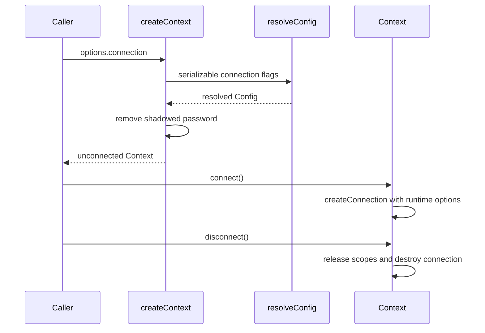
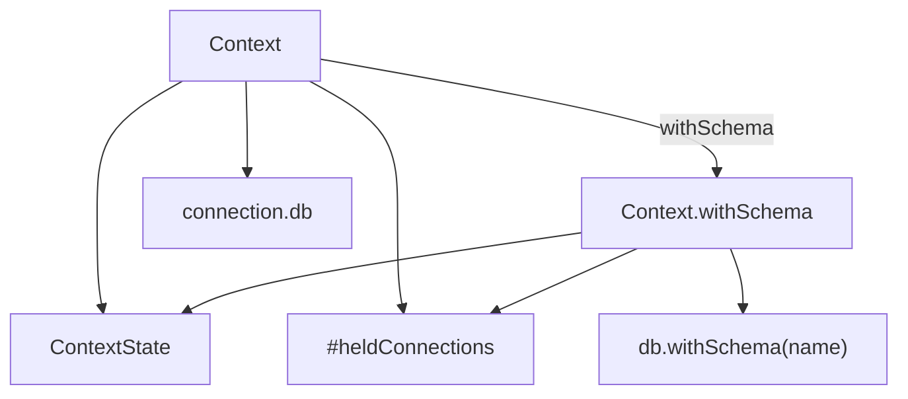
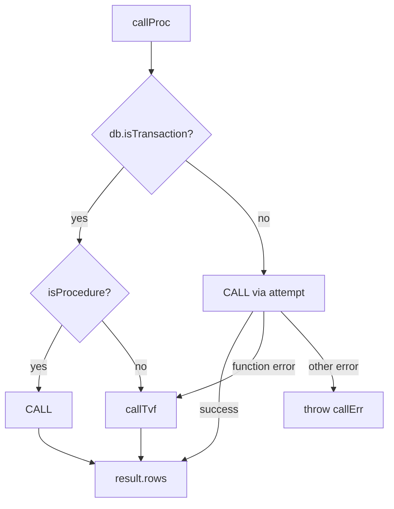
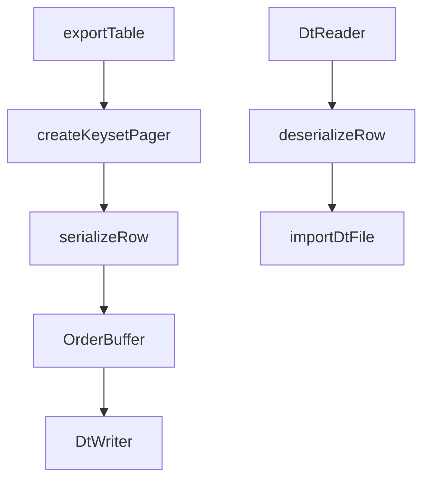

# sdk

## What it does

`@noormdev/sdk` lets applications and test suites query databases and run noorm management operations without driving the CLI. `createContext` accepts a stored configuration, environment configuration, or non-persisted inline connection settings. It returns an unconnected `Context` with typed Kysely access, routine calls, transactions, impersonation, and lazy management namespaces.

```typescript
import { createContext } from '@noormdev/sdk';

const ctx = await createContext({
    connection: { dialect: 'sqlite', database: ':memory:' },
});
await ctx.connect();
try {
    await ctx.kysely.selectFrom('users').selectAll().execute();
} finally {
    await ctx.disconnect();
}
```

The same domain owns DT serialization in [`src/core/dt`](../../src/core/dt): portable table files and in-memory row conversion for PostgreSQL, MySQL, and MSSQL. Live database-to-database transfer belongs to core-db; its cross-dialect conversion uses `DtStreamer`.

## How it works

`createContext` initializes state and settings, resolves configuration, checks `requireTest`, and resolves identity before returning. Inline `connection` fields enter the shared resolver as flags, above environment settings. The resolver owns defaults, stage constraints, stored selection, and synthetic names; see core-state. Without an explicit name, inline-only configurations use `__inline__`, while environment-only configurations use `__env__`. Synthetic names are not unique context identifiers.

Use `createContext()` for normal consumer startup rather than constructing `Context` and supplying internal state yourself. `CreateContextOptions` includes `config`, `projectRoot`, `stage`, `requireTest`, `channel`, `yes`, and inline `connection` settings. The default channel is `user`; the SDK does not perform the CLI entrypoint's project walk-up and `chdir`.

Runtime password callbacks and PostgreSQL `ssl.checkServerIdentity` stay outside serializable configuration. The factory removes a shadowed stored or environment password from the resolved configuration when a callback wins. It does not write that removal back to state.



The factory separates serializable overrides from runtime hooks, and `connect()` supplies those hooks only when opening the connection.

### Connection lifecycle

`connect()` returns immediately when already connected. On success it stores the connection; on failure the context remains unconnected. `disconnect()` releases held explicit impersonation scopes before destroying the connection, then clears the connection and cached change manager. Reconnecting uses the same resolved configuration and runtime hooks. Cleanup is explicit through `disconnect()`.

### Schema views

`withSchema` derives a typed view sharing the root context's mutable state and held impersonation connections. Each `kysely` access derives a fresh schema wrapper from the bare connection, so reconnects cannot leave a cached wrapper pointing at an old connection.



Schema views share lifecycle and held connections rather than allocating independent pools.

Routine names receive the schema prefix through `qualifyName` unless already qualified with a dot. Chained `withSchema` calls replace the schema instead of stacking it. Transactions and impersonation compose with the schema-derived Kysely handle. Management namespaces continue using shared project state rather than the view's schema.

The schema qualifier has dialect-specific meaning: a schema on PostgreSQL/MSSQL, a database on MySQL, or an attached database on SQLite. `withSchema()` has no dialect gate and does not change the underlying connection configuration. Dots in schema names are rejected because routine SQL quoting splits qualification at a dot; hyphens remain safe through identifier quoting.

### Transactions and routine dispatch

`transaction(fn)` attaches `proc`, `func`, and `tvf` directly to the real Kysely transaction with `withRoutines`. `ImpersonatedScope.transaction` uses the same helper. Tuple maps (`[Args, Return]`) supply routine argument and result types through `ExtractArgs` and `ExtractReturn`.

PostgreSQL transaction routine dispatch consults `pg_proc` before choosing `CALL` or `SELECT`, avoiding a failed `CALL` that would abort the transaction.



Outside transactions, PostgreSQL `proc` falls back from function-related SQLSTATE `42809` or `42883` to `callTvf`. `func` returns the first row or `null`; `proc` and `tvf` return rows. SQL builders handle dialect quoting and MSSQL table-valued parameters created by `tvp()`.

### Impersonation

Callback impersonation borrows a dedicated connection and reverts in `finally`, including when the callback throws. Explicit impersonation returns a scope with `kysely`, `proc`, `func`, `tvf`, `transaction`, and `revert()`; the caller owns reversion, with `disconnect()` releasing scopes still held.

| Dialect | Switch identity | Revert |
|---|---|---|
| PostgreSQL | `SET ROLE` | `RESET ROLE` |
| MSSQL | `EXECUTE AS USER` | `REVERT` |
| MySQL, SQLite | Throws `ImpersonationError` before borrowing a connection. | Not supported. |

Principal names must match `[a-zA-Z0-9_@.\-\\]+`; invalid names fail before SQL execution.

### Management namespaces

`ctx.noorm` lazily creates `NoormOps`; each namespace is also lazy and cached. It exposes changes (scaffolding, discovery, validation, execution, history), run (discovery, preview, file, directory, build), db (exploration, teardown preview, truncate, teardown, reset), dt (table export and file import), lock, vault, secrets, templates, transfer, and utils. `db.reset` delegates rebuilding to `run.build`.

`run.build` applies settings include/exclude and rule filtering, returning unmatched include/exclude entries. Template rendering does not execute SQL. Utilities provide file checksums and a non-throwing connection test result. Vault methods include initialization, status, secret CRUD, propagation, and copying; local secrets remain configuration-scoped.

| Namespace | Operations and boundary |
|---|---|
| `changes` | Offline `create`, `addFile`, `removeFile`, `renameFile`, `reorderFiles`, `delete`, `discover`, `parse`, and `validate`; connected `apply`, `revert`, `ff`, `next`, `rewind`, `status`, and history reads. Deleting a local change still checks `change:rm`. |
| `run` | Offline `discover`; connected `preview`, `file`, `files`, `dir`, and `build`. `build` returns `unmatchedInclude` and `unmatchedExclude` alongside the batch result. |
| `db` | `listTables`, `describeTable`, corresponding view/procedure/function/type exploration, indexes, foreign keys, `overview`, `previewTeardown`, `truncate`, `teardown`, and `reset`. |
| `dt` | `exportTable` and `importFile`; import checks `db:reset`. |
| `lock` | `acquire`, `release`, `status`, `withLock`, and `forceRelease`; force release checks `lock:force`. |
| `vault` | `init`, `status`, `set`, `get`, `getAll`, `list`, `delete`, `exists`, `propagate`, and `copy`. Decrypting operations take a private key. |
| `secrets` | Config-scoped `get`, `list`, `set`, and `delete`, gated by `secret:read` or `secret:write`. |
| `templates` | `render` checks `run:file` permission through `checkConfigPolicy`, so a user-channel confirmation cell does not block this SQL-free render. |
| `transfer` | `to` and `plan`; writes check the destination config's `db:reset`, not the source config's permission. |
| `utils` | Offline SHA-256 `checksum`; `testConnection` returns `{ ok, error? }` rather than throwing connection failures. |

The public entrypoint re-exports namespace classes, option/result types, `ExtractArgs`/`ExtractReturn`, `TransactionScope`, policy types, `tvp()`/`TvpValue`, and catchable errors:

| Error | Condition |
|---|---|
| `RequireTestError` | `requireTest: true` with a config not marked `isTest: true`. |
| `NotConnectedError` | A connected operation runs before `connect()`. |
| `ProtectedConfigError` | Policy denies an operation or requires unsupplied user confirmation. |
| `VaultAccessError` | `vault.set()` cannot obtain a usable vault key. Reads can instead return `null` or `{}`. |
| `ImpersonationError` | Unsupported dialect or invalid principal name. |
| `ChangeValidationError`, `ChangeNotFoundError`, `ChangeAlreadyAppliedError`, `ChangeNotAppliedError`, `ChangeOrphanedError`, `ManifestReferenceError` | Re-exported core change errors for validation, lookup, state, and manifest failures. |
| `LockAcquireError`, `LockExpiredError` | Re-exported core lock failures. |

### DT export and import

DT exports query rows through a primary-key pager, serialize through a compute worker pool, and restore order before writing. Import reads schema and rows, deserializes through workers, and inserts batches. The SDK wrappers translate core result/error tuples into results or thrown errors.



Compute workers transform rows while `OrderBuffer` preserves export ordering.

`DtWriter` and `DtReader` use JSON5 lines with a schema header: `.dt` is raw, `.dtz` is gzip, and `.dtzx` is gzip plus passphrase-based AES-256-GCM. Encrypted output buffers before encryption. Universal type mapping preserves dialect-independent values; encoded types (`json`, `binary`, `vector`, `array`, `text`, `custom`) use value/encoding tuples. `DtStreamer` converts rows without files. `modifyDtFile` applies recipes for column drop/add/rename/nullability and row filtering.

`toUniversalType()`, `toDialectType()`, and `isEncodedType()` select dialect mappings. `queryDatabaseVersion()` parses PostgreSQL/MySQL `SELECT version()` or MSSQL `SERVERPROPERTY` values, translating MSSQL build versions into release years. MSSQL maps JSON and vector values to native types on SQL Server 2025+, with `nvarchar(max)` fallback on older versions.

`DtEvents` in [`src/core/dt/events.ts`](../../src/core/dt/events.ts) describes export, import, stream, schema-validation, and modification progress on the shared observer.

## Where it lives

| Path | Role |
| --- | --- |
| [`src/sdk/index.ts`](../../src/sdk/index.ts), [`src/sdk/types.ts`](../../src/sdk/types.ts) | Factory, runtime overrides, public exports, options and routine types. |
| [`src/sdk/context.ts`](../../src/sdk/context.ts), [`src/sdk/state.ts`](../../src/sdk/state.ts) | Shared state, connection lifecycle, schema views, transaction and impersonation entry points. |
| [`src/sdk/routines.ts`](../../src/sdk/routines.ts), [`src/sdk/sql.ts`](../../src/sdk/sql.ts), [`src/sdk/tvp.ts`](../../src/sdk/tvp.ts) | Routine dispatch, dialect SQL builders, MSSQL table-valued parameters. |
| [`src/sdk/impersonate/`](../../src/sdk/impersonate) | Dedicated-connection scopes and dialect impersonation/revert strategies. |
| [`src/sdk/noorm-ops.ts`](../../src/sdk/noorm-ops.ts), [`src/sdk/namespaces/`](../../src/sdk/namespaces), [`src/sdk/guards.ts`](../../src/sdk/guards.ts) | Lazy management wrappers and policy enforcement. |
| [`src/core/dt/index.ts`](../../src/core/dt/index.ts), [`src/core/dt/paging.ts`](../../src/core/dt/paging.ts), [`src/core/dt/schema.ts`](../../src/core/dt/schema.ts) | Export/import orchestration, keyset paging, schema construction and validation. |
| [`src/core/dt/writer.ts`](../../src/core/dt/writer.ts), [`src/core/dt/reader.ts`](../../src/core/dt/reader.ts), [`src/core/dt/crypto.ts`](../../src/core/dt/crypto.ts) | File streams, compression, encryption. |
| [`src/core/dt/serialize.ts`](../../src/core/dt/serialize.ts), [`src/core/dt/deserialize.ts`](../../src/core/dt/deserialize.ts), [`src/core/dt/type-map.ts`](../../src/core/dt/type-map.ts), [`src/core/dt/dialects/`](../../src/core/dt/dialects) | Universal values and dialect type conversion. |
| [`src/core/dt/streamer.ts`](../../src/core/dt/streamer.ts), [`src/core/dt/modify.ts`](../../src/core/dt/modify.ts), [`src/core/dt/paths.ts`](../../src/core/dt/paths.ts), [`src/core/dt/version.ts`](../../src/core/dt/version.ts), [`src/core/dt/constants.ts`](../../src/core/dt/constants.ts) | In-memory conversion, recipes, export paths, database versions, format limits. |
| [`packages/sdk/package.json`](../../packages/sdk/package.json), [`tsup.sdk.config.ts`](../../tsup.sdk.config.ts) | Package exports, consumer peers, bundled runtime boundary. |
| [`tests/sdk/`](../../tests/sdk), [`tests/integration/sdk/`](../../tests/integration/sdk) | SDK contracts, bundle/declaration surface, live dialect integration. |
| [`docs/design/sdk-with-schema.md`](../design/sdk-with-schema.md), [`docs/design/sdk-transaction-routines.md`](../design/sdk-transaction-routines.md) | Schema-view and transaction-routine design rationale. |

[`src/sdk/impersonate/scope.ts`](../../src/sdk/impersonate/scope.ts) supplies `buildScope()`; `dialect-strategy.ts` supplies `validateUsername()` and the switch/revert strategies; `types.ts` supplies `ImpersonatedScope` and its error. [`src/sdk/sql.ts`](../../src/sdk/sql.ts) contains `buildProcCall()`, `buildFuncCall()`, `buildTvfCall()`, and dialect-aware `quoteIdent()`, including MSSQL TVP DECLARE/INSERT/EXEC batches.

DT navigation includes `buildDtSchema()`, `validateSchema()`, and `queryPrimaryKeyColumns()` in [`src/core/dt/schema.ts`](../../src/core/dt/schema.ts); `resolveExportExtension()`, `resolveExportPath()`, `resolveExportTables()`, and `ensureExportDirectory()` in [`src/core/dt/paths.ts`](../../src/core/dt/paths.ts); and `encryptWithPassphrase()`/`decryptWithPassphrase()` in [`src/core/dt/crypto.ts`](../../src/core/dt/crypto.ts).

SDK unit tests cover admin/operator/viewer namespace behavior, guard errors, SQL builders, and impersonation. Live SDK integration tests cover TVF/TVP execution, vault operations, and reset round trips.

| Reference | Use |
|---|---|
| [`docs/dev/sdk.md`](../dev/sdk.md), [`docs/reference/sdk.md`](../reference/sdk.md) | SDK internals and public API reference. |
| [`docs/dev/transfer.md`](../dev/transfer.md) | DT and transfer internals. |
| [`docs/getting-started/building-your-sdk.md`](../getting-started/building-your-sdk.md), [`skills/noorm/references/sdk.md`](../../skills/noorm/references/sdk.md) | Consumer setup, typed routines, and test usage patterns. |
| [`packages/sdk/CHANGELOG.md`](../../packages/sdk/CHANGELOG.md), `packages/sdk/dist` | Changesets release history and generated `index.js`/`index.d.ts`. |
| [`src/sdk/stubs/ansis.ts`](../../src/sdk/stubs/ansis.ts) | Color-free SDK replacement selected by the tsup alias. |
| [`tests/sdk/with-schema.test.ts`](../../tests/sdk/with-schema.test.ts), [`tests/integration/sdk/with-schema.test.ts`](../../tests/integration/sdk/with-schema.test.ts) | Schema validation, fresh wrappers, replace-not-stack behavior, routine qualification, shared held connections, interleaved schema writes, and transaction/impersonation composition. Live fixtures use schemas, MySQL databases, and SQLite attachments. |

## Constraints

- Call `connect()` before accessing Kysely or connected namespace operations; `requireConnection` throws `NotConnectedError` otherwise. Disconnect in cleanup so held connections do not keep the pool open.
- Password callbacks may return a string or promise for PostgreSQL, MySQL, and MSSQL. SQLite rejects callbacks. A callback takes precedence over resolved static credentials; do not expect the old password on `ctx.noorm.config.connection`.
- Runtime-credential connection failures preserve the original thrown error and disable automatic connection retries, even when retry options request them. Observer error payloads instead use `Runtime credential connection failed` and omit server error fields; handle the thrown error separately from telemetry.
- PostgreSQL `ssl.checkServerIdentity` must be a function and is rejected for other dialects. TLS identity options require explicitly enabled TLS and certificate verification; incompatible options fail connection creation. Physical pool, session timeout, keep-alive, and TLS behavior belong to core-db.
- `requireTest: true` rejects a configuration without `isTest: true`, including ordinary inline-only configurations. Inline connection settings do not mark a database as a test database.
- `requireTest` failures throw `RequireTestError`. The factory resolves identity through `getIdentityForConfig()` after checking this guard.
- The SDK cannot prompt. Guarded operations throw `ProtectedConfigError` on denial or unconfirmed user-channel operations. `yes: true` supplies user confirmation but cannot override agent-channel denial; core-policy owns the matrix.
- Direct SDK callers supply `yes: true`; the guard's `NOORM_YES` hint describes CLI use, whose helpers translate that environment value into the option. The SDK guard itself reads `options.yes`.
- Truncate, teardown, and reset use their own permissions. Dry-run truncate/teardown still require permission but do not require confirmation. Reset does not preserve configured tables because rebuilding would collide with existing objects.
- Standalone truncate and teardown honor `settings.teardown.preserveTables` (truncate can override it with `options.preserve`). A full reset deliberately ignores that setting before rebuilding.
- `withSchema` accepts only alphanumerics, underscores, and hyphens. Invalid names throw synchronously. Raw `sql` fragments are not rewritten, and exploration methods still require their explicit schema argument when needed.
- PostgreSQL transaction procedure detection matches names and namespaces, not argument overloads or search-path precedence. A same-named function/procedure ambiguity can still select a failing `CALL`; use `tvf` when calling the function.
- SQLite has no procedure support. TVFs and impersonation support PostgreSQL and MSSQL, not MySQL or SQLite. TVPs are MSSQL-only, enforce consistent row keys, and obey the `2100` parameter limit.
- Vault decryption needs a private key. `vault.set` throws `VaultAccessError` without a usable vault key; reads can return `null` or an empty object instead. DT import and transfer writes use destination reset permission; export is ungated by the DT wrapper.
- DT supports PostgreSQL, MySQL, and MSSQL, not SQLite. Tables without a primary key use an unpaginated export query. Keyset paging is not a snapshot-isolation guarantee.
- DT format version is `1`. Encoded values consider gzip at `128` bytes and retain it only below a `0.85` compression ratio. Readers cap decompressed values at `64 MiB`, encrypted archives at `1 GiB`, and row lines at `256 MiB`; oversized inputs fail instead of expanding without bounds.
- Encoded values use `gz64` for gzip/base64 and retain `raw` or `b64` when compression does not qualify. Short `string` values remain untupled; large `text` values use the encoded representation.
- DT passphrase encryption is independent of identity/vault keypairs. AES-256-GCM derives its key with PBKDF2-SHA256 at `100,000` iterations; encryption requires at least `12` characters, while decryption does not enforce that minimum so older files remain readable.
- Bundle-smoke and declaration-surface tests skip when their generated `packages/sdk/dist/index.js` or `index.d.ts` is absent. A passing source-only test run does not establish published-bundle or declaration coverage.
- Consumers install Kysely and the appropriate optional peer driver (`pg`, `mysql2`, `tedious`, or `better-sqlite3`). Tarn is bundled, not a consumer peer. The package's `types`/`import`/`default` exports reference declarations and a shared ESM entry; supported Node `22.13+` can load that entry with `require(esm)`. There is no separate CommonJS artifact. Packaging mechanics belong to infra.

## Coupling

- Core-state owns configuration precedence, synthetic naming, state persistence, settings, and the resolver used by the factory. Core-identity supplies environment identity overrides, config identity, and vault primitives.
- Core-db owns physical connections, pool behavior, database exploration, teardown, and live transfer. The SDK forwards runtime credentials and PostgreSQL TLS callbacks through the connection runtime-options boundary.
- Core-policy owns channel/role decisions. Namespace wrappers enforce those decisions; direct Kysely access remains the raw SQL surface.
- Core-runner and core-change own SQL execution and migration semantics behind the SDK namespaces. Wrapper signatures and returned core result types must stay aligned.
- Worker-bridge owns the compute protocol and ordered worker infrastructure consumed by DT. Live transfer consumes DT's in-memory conversion.
- `noormObserver` exports the process-global observer, not a per-context bus. Consumers sharing a process filter context-scoped events by `configName`; synthetic inline names alone cannot distinguish unrelated inline contexts.
- Infra owns SDK bundling and declaration generation. [`tests/sdk/bundle-smoke.test.ts`](../../tests/sdk/bundle-smoke.test.ts) and [`tests/sdk/dts-surface.test.ts`](../../tests/sdk/dts-surface.test.ts) consume built output, while [`tests/integration/sdk/`](../../tests/integration/sdk) exercises live schema, routine, impersonation, and management behavior.
