# tui

## What it does

The TUI gives users interactive screens for database configuration, SQL execution, changes, exploration, and secrets. The domain name `tui` maps to [`src/tui`](../../src/tui); `noorm ui` and `noorm sql repl` (which starts it with `initialRoute: 'db/sql'`) mount its Ink/React `App`. Its tests live under [`tests/cli/components`](../../tests/cli/components), [`tests/cli/hooks`](../../tests/cli/hooks), and [`tests/cli/screens`](../../tests/cli/screens), inside the cli domain's [`tests/cli`](../../tests/cli) tree. Shared providers keep navigation, keyboard focus, connection state, progress, and shutdown consistent across screens.

`RouterProvider` selects a route, and `ScreenRenderer` resolves it through `SCREENS`. A missing registry entry renders `NotFoundScreen` rather than leaving the application blank.

## How it works

### Startup and stage auto-seeding

`AppContextProvider` loads state and settings on mount unless `autoLoad` is false. It seeds missing stage configs before exposing the managers and marking startup ready. A manager-load failure, or a failure while synchronizing state from the managers, sets `loadingStatus` to `error`.

Stage auto-seeding requires loaded settings and a state private key.

`syncSettingsStages` saves a stage config only when no same-name config exists, the stage defines `defaults.dialect`, and `sm.getConfigAccessError(stageName)` reports no malformed stored access, before the initial context synchronization.

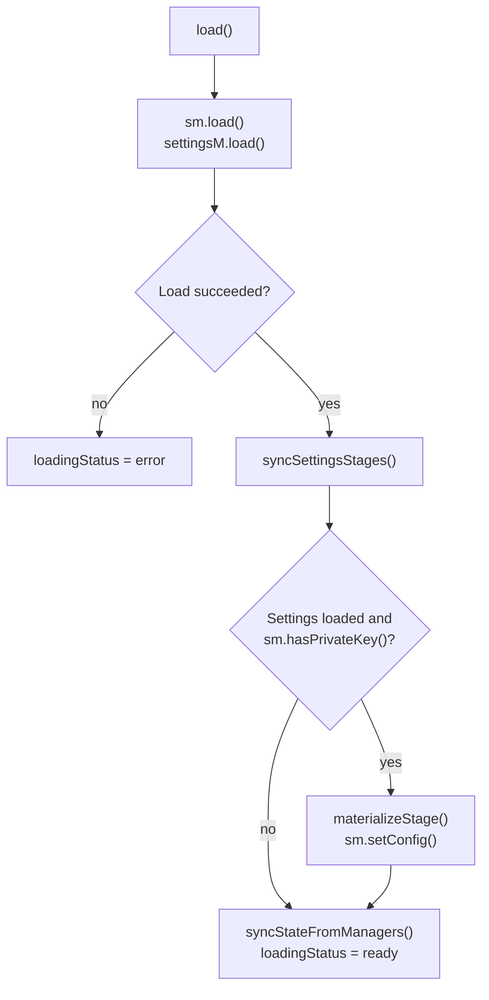

For each eligible stage, the call is `materializeStage(stageName, stageName, stage.defaults, {}, stage.defaults.password)`. The stage name becomes the config name and the fallback database name. The explicit password argument preserves the original stage-default password in the config saved to state. This is deliberate TUI behavior, not a claim that every stage-materialization caller persists that secret.

The shared helper preserves connection defaults and the stage's `type`, `isTest`, and `access` metadata, and derives a local or remote type when absent; it does not clamp `access`, because core-policy applies the protected-stage ceiling at check time. Core-state owns those materialization rules in [`docs/wiki/core-state.md`](core-state.md) and core-policy owns the ceiling ([`docs/wiki/core-policy.md`](core-policy.md)). CLI stage creation uses a different persisted-password contract; see [`docs/wiki/cli.md`](cli.md).

Once settings are loaded, `AppContextProvider` exposes `activeConfig` after `withConfigPolicy(activeConfig, new SettingsProvider(settingsManager), false)`, so every TUI policy gate sees resolved role assignments. Stored assignments stay intact, and an unknown role stays visible for repair and fails closed in policy checks. Before settings load it exposes a copy with a cloned `access`.

A stored active config with malformed access does not break startup. `readActiveConfig` catches `ConfigAccessInvalidError` from `sm.getConfig`, so `activeConfig` and `activeConfigName` become `null` and `activeConfigAccessError` carries the message. Startup, `state:loaded`, `config:activated`, and the other observer refreshes all go through `applyActiveConfig`. `HomeScreen` renders the message as a yellow warning in place of the first-config prompt, or under the "none is active" text, so the user can repair the config.

`syncStateFromManagers` refreshes the active config, config summaries, settings, and global identity. Observer subscriptions keep config activation, creation, deletion, connection status, and lock status reflected in React state. `refresh()` resynchronizes the context; it does not rerun stage seeding.

### Keyboard focus

Focus is a stack held by `FocusProvider`, not a DOM. `useFocusScope` pushes an ID in an effect and removes it on unmount; only the top ID is focused. Ink delivers keystrokes to registered handlers, so local handlers must guard their own actions. `useFocusedInput` supplies that guard.

`GlobalKeyboard` handles Ctrl+C independently of text entry, while local keyboard actions require their scope to be focused.

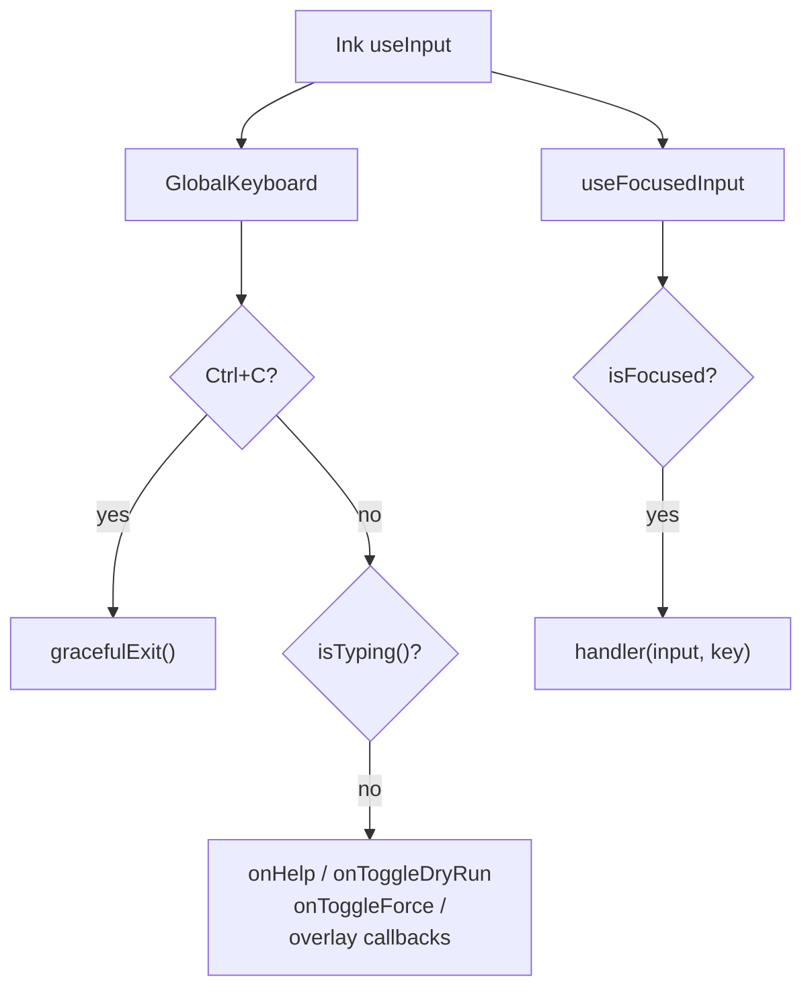

`useTextEntry` registers active text fields. While typing, global printable shortcuts stand down. Shift+L opens the log viewer and Shift+Q opens the SQL terminal when not typing. Help (`?`) and mode toggles (`D`, `F`) additionally require `stack.length <= 1`, keeping them out of nested dialogs. `GlobalKeyboard` does not perform back navigation for Escape; screens own that action, with an optional `onEscape` notification callback.

Shared inputs participate in this stack rather than relying on an independent widget focus manager. `Form` owns its scope. The local `TextInput` copies the upstream input implementation to filter mouse reports and register text entry; the upstream package does not export the internal hooks needed to compose that behavior externally.

| Widget | Integration |
|---|---|
| `@inkjs/ui` `Select`, `MultiSelect`, `ConfirmInput` | Not used: they drive Ink's internal focus, which the focus stack never reads. Local `SelectList`, `Form`, `Confirm`, and `SmartConfirm` replace them. |
| `@inkjs/ui` `Spinner`, `Badge`, `ProgressBar`, `Alert`, `StatusMessage` | Used directly as display components. |
| Local [`src/tui/components/forms/TextInput.tsx`](../../src/tui/components/forms/TextInput.tsx) | Keeps the mouse-report guard and text-entry registration; the package exports map exposes only the upstream root, not the internal modules needed for an external wrapper. |

### Navigation

`navigate` pushes the current route and params onto history, except when the destination matches both. `back` restores the last entry and emits `router:popped`; empty history makes it a no-op. `replace` changes the current route without pushing history. `reset` returns home, clears history, and clears remembered list cursors. Initial routes receive ancestor history so direct entry can still navigate back through their parents.

`router:navigated` and `router:popped` let consumers react to pushes and pops. The router exposes `arrivedBy` so screens can distinguish initial entry, push, pop, and replacement.

### Statement progress

The run and change progress hooks convert `file:progress` into the `statement` report rendered by `StatementProgress`. The display shows elapsed time, server progress, and blocking sessions; core-runner owns the producer described in [`docs/wiki/core-runner.md`](core-runner.md).

A shared observer report reaches the display through a domain progress hook rather than a screen-level subscription.

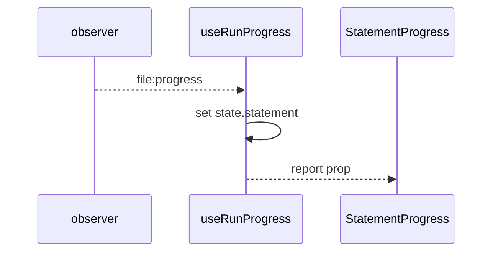

`useRunProgress` clears the report on `file:before`, `file:after`, `build:complete`, and `reset()`. `useChangeProgress` clears it on `change:file`, `change:complete`, and `reset()`. These boundaries prevent a previous file's report from remaining visible during the next operation.

`RunBuildScreen`, `RunExecScreen`, `RunDirScreen`, and `RunFileScreen` render the run hook's report. `ChangeRunScreen`, `ChangeFFScreen`, `ChangeNextScreen`, `ChangeRevertScreen`, and `ChangeRewindScreen` render `useChangeProgress().statement`. The local `describeProgress` helper in `StatementProgress.tsx` formats the server's operation detail, and the display renders a separate line for each blocking session.

### Cancelling execution

`RunBuildScreen` and `RunExecScreen` require Escape confirmation through `useDoublePress`; their warning toast and confirmation window share `DOUBLE_PRESS_WINDOW_MS` (2000ms). Confirming aborts the run's `AbortController`. `runCancelMessage` selects immediate-server-cancel wording or stopping-after-the-current-file wording using the dialect's cancellation capability.

`useDoublePress` confirms only within its window; an expired warning requires arming again. Confirmation sets `cancelling` while the phase remains `running`. Execution settles in phase `complete` when no error is returned, or phase `error` when an error is returned, including after an abort request.

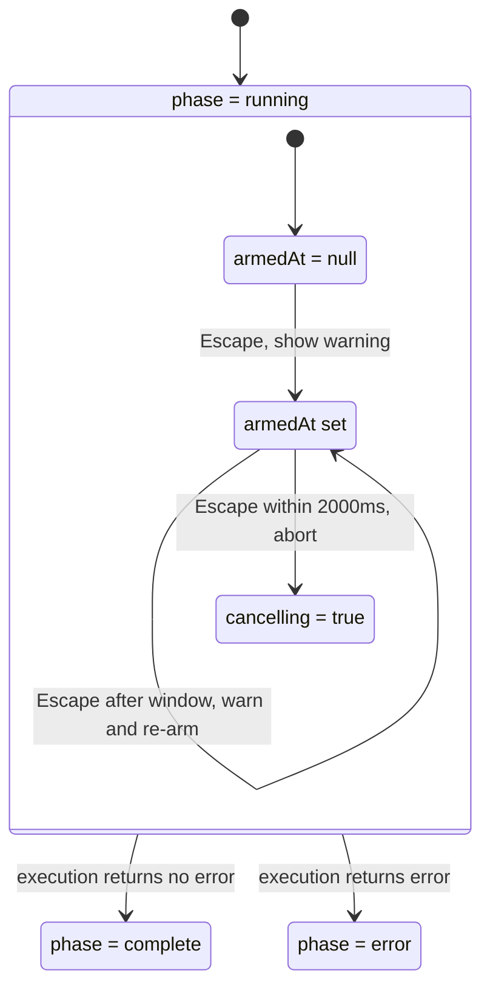

`RunDirScreen` and `RunFileScreen` instead bind `KeyHandler.onCancel` while running: Escape or `c` invokes `cancelExecution`, which destroys the active connection. Navigation and cancellation are separate screen actions; leaving a screen is not a universal cancellation mechanism.

PostgreSQL and MySQL support server-side statement cancellation; MSSQL and SQLite use the stopping-after-the-current-file wording. Build/exec consume Escape while running, including repeated presses after cancellation has started, rather than navigating back. Once execution has settled, Escape can navigate back. The double-press warning is local to the hook instance: unmounting and returning does not preserve the first press.

Change-apply screens display statement progress without the build/exec double-press path or a running-phase Escape cancellation binding.

### Policy-gated vault and secret reads

Screens that read secrets or vault contents check `checkConfigPolicy('user', activeConfig, ...)` before connecting. A blocked check shows the reason, a check that requires confirmation shows `ProtectedConfirm`, and an allowed check loads. Approval is keyed by the policy fingerprint (`SecretReadGate` uses `${activeConfigName}:${getPolicyFingerprint(activeConfig)}`), so a change to the config's policy invalidates it. `useVaultSecretKeys` also binds a confirmation to `activeConfig` and, for vault reads, the identity.

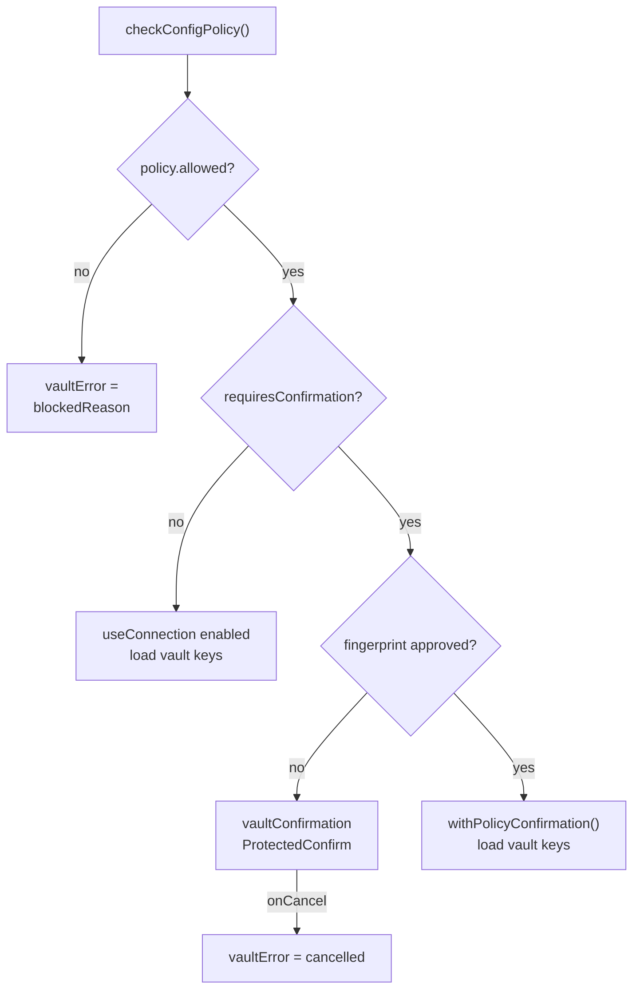

`SecretReadGate` wraps `SecretListScreen` and gates the local `secret:read` permission. `useVaultSecretKeys(enabled)` gates `vault:read` and returns `vaultConfirmation`, which `SecretListScreen`, `SecretSetScreen`, and `SecretRemoveScreen` render as a confirmation panel. `VaultScreen` checks `vault:read`, `vault:write`, and `vault:propagate`. `useConnection` and `useVaultConnection` accept `enabled`; `enabled: false` skips requesting a connection, so none opens before approval. `useConnection({ ensureSchema: true })` (which `useVaultConnection` uses) calls `prepareTrackingSchema(db, dialect, { channel: 'user', config: activeConfig })`. A role that may write tracking creates or migrates the tables. Any other role only has them checked: older tables make the hook set an error rather than migrate, and missing tables are left absent with no error, because the hook ignores the returned value.

Explore screens (`ExploreOverviewScreen`, `ExploreListScreen`, `ExploreDetailScreen`) and `HomeScreen` pass `userGate(activeConfig)` from core-db's explore module to `fetchOverview`, `fetchList`, and `fetchDetail`. `RowPeekOverlay` receives the same gate and calls `fetchRowPeek` directly; it shows no `ProtectedConfirm` of its own, and `fetchRowPeek` refuses a gate that disallows the read. `DbTruncateScreen` lists tables with `GATED_BY_CALLER`, leaving the truncate's own `db:*` check as the gate. `SqlTerminalScreen` resolves policy with `withConfigPolicy`, checks each permission from `sqlPermissionsFor`, and runs through `withPolicyConfirmation` after a `ProtectedConfirm` for confirmed permissions. `ConfigExportScreen` checks `secret:read` and adds a `confirm` step. Pipeline runs use the same pattern with `pipeline:run`; see Pipeline run, stop, and result.

### Access roles and protected-stage escape

`settings/access`, `settings/access/add`, and `settings/access/edit` route to `SettingsAccessListScreen` and `SettingsAccessEditScreen`, which edit custom roles; `SettingsListScreen` links to them with a role and override summary. Built-in role checks use core-policy's `BUILTIN_ROLES` and `isBuiltinRole`. For permissions in `USER_ALWAYS_ALLOWED`, the edit screen shows the agent channel's effective cell, since the user channel always reads. `getRoleOptions` in `utils/config-validation.ts` builds config role choices from `BUILTIN_ROLES` plus `settings.access.roles`.

`ConfigAddScreen`, `ConfigEditScreen`, and `ConfigImportScreen` call `validateAccessRoles(config.access, settings.access?.roles)` before saving. `ConfigCopyScreen` calls `stateManager.copyConfig(configName, newName, settingsProvider)` and `ConfigEditScreen` calls `stateManager.renameConfig(configName, updatedConfig, settingsProvider)` on a name change (otherwise `setConfig`), so the state manager keeps the protected-stage ceiling across copy and rename. [`tests/cli/screens/protected-config-escape.test.tsx`](../../tests/cli/screens/protected-config-escape.test.tsx) covers these screens and runs in the CI group for CLI tests.

### Pipelines

The home screen opens pipelines with `p`. `PipelineListScreen` (`pipeline`) lists every folder under `settings.paths.pipelines` (default `DEFAULT_PIPELINES_PATH`) through `discoverPipelineDefinitions`. A folder whose definition fails to load stays in the list with its failed `rule` and cannot be opened. `PipelineRunScreen` (`pipeline/run`) reviews inputs and steps, confirms, and runs. `PipelineHistoryScreen` (`pipeline/history`) lists recorded runs for a slug; `PipelineHistoryDetailScreen` (`pipeline/history/detail`) shows one run by ID. Route params carry only `pipelineSlug` and `pipelineRunId`; input values never enter navigation state.

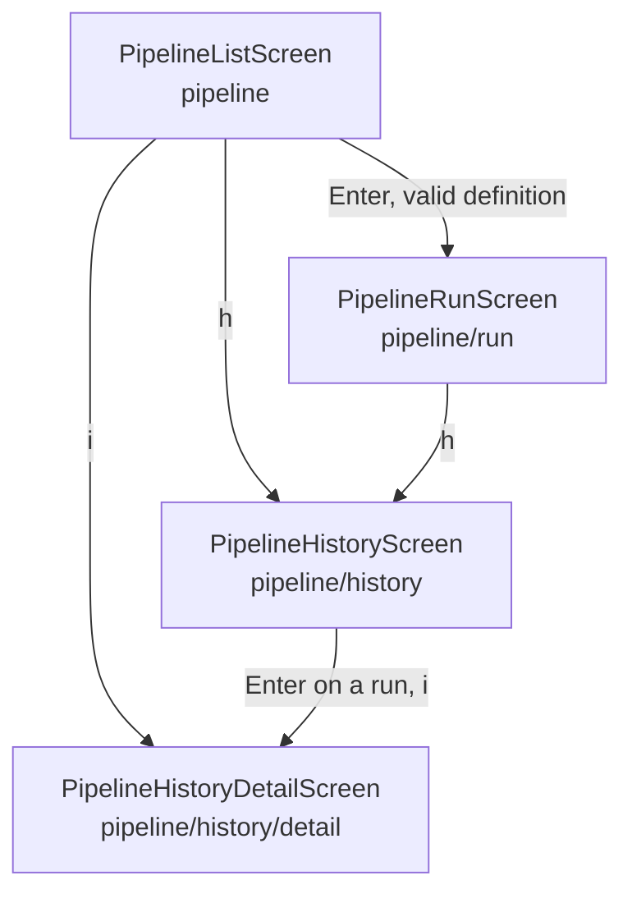

History and detail both accept a slug or run ID with no local definition, so recorded runs stay reachable after a pipeline folder is renamed or deleted. When no slug or ID is supplied, or the supplied ID is unsafe, the screen opens a lookup `Form` validated by `isPipelineSlug`/`parseHistoryLimit` (limit 1 to 100) or `parseRunId`. Both screens read through the active config only and show "Run not found in this configuration" rather than another config's run.

### Pipeline input editing

Selecting an input on the run screen opens `PipelineInputEditor`, a one-field `Form`: `select` when the declaration has `choices`, `checkbox` for `boolean`, `text` otherwise. `decode` runs `parsePipelineInputText` or `validatePipelineInputValue` in the field validator and again on submit, so `onSave` only receives a value that passes the declaration's type and choices. Choice values are stored as indexes in the form and decoded back to the declared value.

Saved values live in the run screen's `overrides`; the input list labels each as `Supplied`, `Default`, `Unset`, or `Omitted` through `inputPresence` and never prints the value, which can be sensitive. `x` removes the override for the highlighted input. The run screen drops the main `useFocusScope` (`skip: editing !== null`) while an editor is open so the editor's form owns focus.

### Pipeline run, stop, and result

`requestRun` checks, in order: no run in flight, `checkConfigPolicy('user', activeConfig, 'pipeline:run')` allows it, a ready `target` exists, and `resolvePipelineInput` accepts the overrides. It then stores a `Confirmation` that captures target, slug, dry-run mode, config name, and a copy of the inputs, and shows `SmartConfirm`. A change to the target or to the review identity (config, project root, pipelines path, slug) clears the confirmation and the review step selection. Execution uses the captured values, never the live `D` toggle; Force has no pipeline effect.

`usePipelineOperations` owns the operation, not the screen. Its `target` is a frozen in-memory brand rebuilt whenever the active config, settings, identity, or connection state changes; `run` rejects a target that no longer matches, and a snapshot change aborts any active operation.

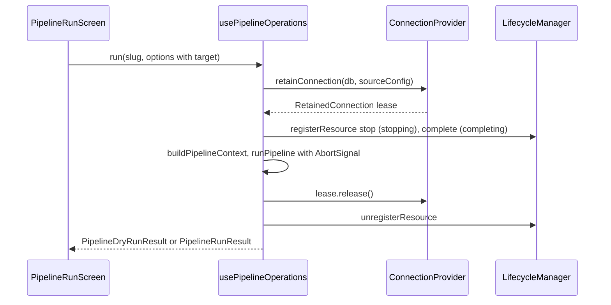

Each run registers two lifecycle resources: a `stopping`-phase cleanup that aborts the controller, and a `completing`-phase cleanup that waits for the operation promise. App shutdown therefore aborts the run, then waits for SQL and transaction cleanup to settle before connections are released. `capture` refuses to start when the lifecycle is shutting down, stopped, or failed. History reads (`history`, `getRun`) use the same lease and register a `completing` resource. They reject when the target changed while they ran. They never migrate the tracking tables: the core pipeline history readers call `requireCurrentSchema` and treat missing tables as no history.

While `busy`, the run screen shows elapsed seconds and a single Escape binding: `operations.stop()` aborts the signal and the screen displays "Stop requested. Waiting for running SQL and transaction cleanup to finish." Escape does not navigate back until the run settles, and the stop request does not make the running SQL stop by itself. If `lease.release()` fails, the hook sets the lifecycle exit code to 1 (when it was 0) and `cleanupFailed`; the result screen shows a cleanup warning and downgrades the status color.

After settling, `PipelineEvidence` renders the result and is shared with the history detail screen. It shows run ID (`none (dry run)` for dry runs), execution status, transaction outcome, steps, dependencies, and error phase, never stored error text. `pipelineResultIsClean` is the only green test: status `success` with outcome `committed` or `no_effects`; anything else prints "Not a confirmed clean success." A coded failure (`PipelineCodedError`) shows its message or `Invalid definition (<rule>)`; any other failure points the operator to scoped history. Keys on the result: Enter step details, `d` evidence, `r` back to review, `h` history, Escape back.

### Connection ownership

`ConnectionProvider` holds one connection record keyed by the active config object and name. `requestConnection` (called by `useConnection`) creates it lazily, and a stale async connect that finishes after a config change is closed rather than published. A config change, `destroyConnection`, provider unmount, and the `app:shutdown` observer event all retire the record.

A retired record with outstanding leases stays open until the last `release()`, so a long operation keeps its connection through a config switch. `retainConnection(db, config)` returns a `RetainedConnection` (`db`, `dialect`, `configName`, `release`, `invalidate`) only for the exact published pair, and throws "The database target changed" when the record is retired, the config changed, or shutdown has begun. `invalidate()` closes the record immediately and clears published state; pipeline contexts receive it as `disposeMemoryConnection`.

Every close registers a `releasing`-phase lifecycle resource, so shutdown waits for destroy to finish, and a failed destroy sets exit code 1.

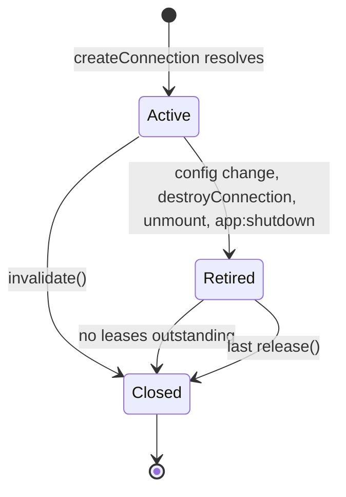

### Saving a config without verifying

`ConfigAddScreen` and `ConfigEditScreen` submit through `save(values, verify)`. Enter calls it with `verify: true`, which runs `testConnection` (server only, through `testServerOnly: true`, on both screens, since the database may not exist yet) and stops on failure. Both pass `altSubmit={{ ...SAVE_UNVERIFIED, suggest: testFailed, ... }}` to `Form`, so Ctrl+S calls `save(values, false)` and skips the test. `SAVE_UNVERIFIED` lives in [`src/tui/utils/connection.ts`](../../src/tui/utils/connection.ts); `suggest` turns the hint on after a failed test.

### Identity setup gate and regeneration

`requireIdentity(Screen)` wraps `ConfigAddScreen` and `ConfigImportScreen` in `SCREENS`. Once `loadingStatus` is `ready`, a missing identity or a state manager without a private key (`!hasIdentity || !stateManager.hasPrivateKey()`) renders `IdentityOnboarding` in place of the screen. The route does not change, so finishing setup lands on the requested screen. State is encrypted with the private key, so the gate asks before the user fills a form that could not be saved.

A key that exists but will not load shows `PrivateKeyUnreadable`, never a form that would replace the key every saved config is encrypted with:

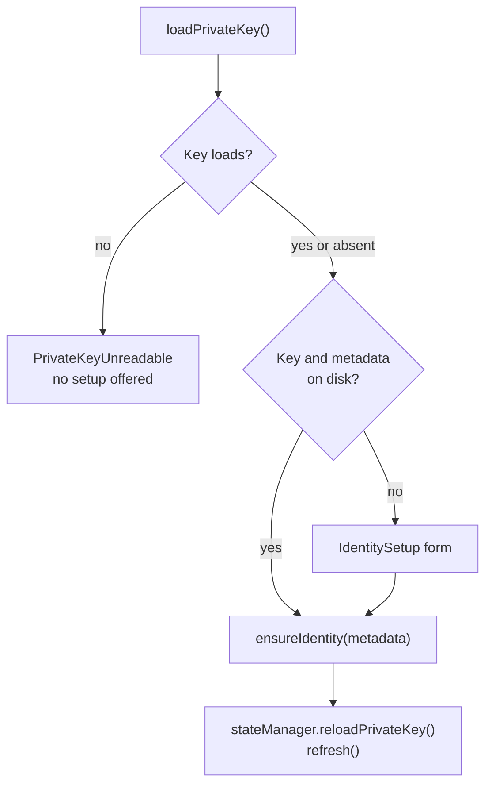

`ensureIdentity` completes a lone private key (restored without its `.pub`) without replacing it. When the key and metadata already exist, setup completes with no form.

### Identity regeneration

`IdentityInitScreen` starts at a `warning` step showing `IDENTITY_REPLACE_WARNING` when an identity exists. After the form, it calls `backupKeyPair()` before writing anything, because every `state.enc` on the machine is encrypted with the old key. If the backup fails, it refuses to overwrite and returns to the form with the error. It then calls `createCryptoIdentity` for an existing identity or `ensureIdentity` otherwise, reloads the state manager's private key, and refreshes the context. A failure after the backup reports the backup paths and a restore hint. A successful regeneration shows the backup paths in a `backed-up` step before going back.

### Lock screens

`LockAcquireScreen` checks `lock:acquire`, `LockForceScreen` checks `lock:force`, and `LockReleaseScreen` checks `lock:acquire`, all through `checkConfigPolicy('user', activeConfig, ...)`. A disallowed check renders `blockedReason`; `LockAcquireScreen` and `LockReleaseScreen` also pass `check?.allowed !== false` as the enable flag to `useLockStatus`, and `LockForceScreen` skips its connection when denied. All three confirm through `SmartConfirm`: acquire shows it after the form only when `check.requiresConfirmation` is set (otherwise it acquires directly), release uses `check.requiresConfirmation`, and force uses `isConfigGuarded(activeConfig) || check.requiresConfirmation` with the policy's `confirmationPhrase`.

### Update download progress

`useUpdateChecker` owns checking and installing updates; `useUpdateProgress` independently subscribes to download events. `UpdateScreen` calls `reset()` before every `performUpdate()`, so a retried install never shows the previous attempt's bytes. During installation it keeps the spinner, displays received megabytes, and adds a percentage and progress bar when the total is known. A retry displays the latest error and the next attempt number.

`useUpdateProgress` keeps byte and retry state separate from the installation command.

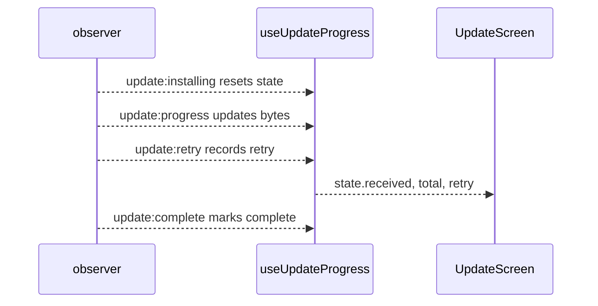

### Application lifecycle

`App` nests `ShutdownProvider`, `NoormObserver`, `AppContextProvider`, the settings-driven mouse provider, `ConnectionProvider`, `ToastProvider`, `FocusProvider`, and `RouterProvider` around `AppShell`. `ConnectionProvider` manages the shared connection; the mouse transport restores terminal tracking on exit.

`gracefulExit` replaces the application with `ShutdownScreen` before releasing resources, then emits `app:exit` with a code. The code is 1 when the lifecycle was not ready, `shutdown('user')` returned an error, or any phase reported `timeout`; otherwise it is the lifecycle's `exitCode` (so a failed connection or pipeline cleanup surfaces as nonzero).

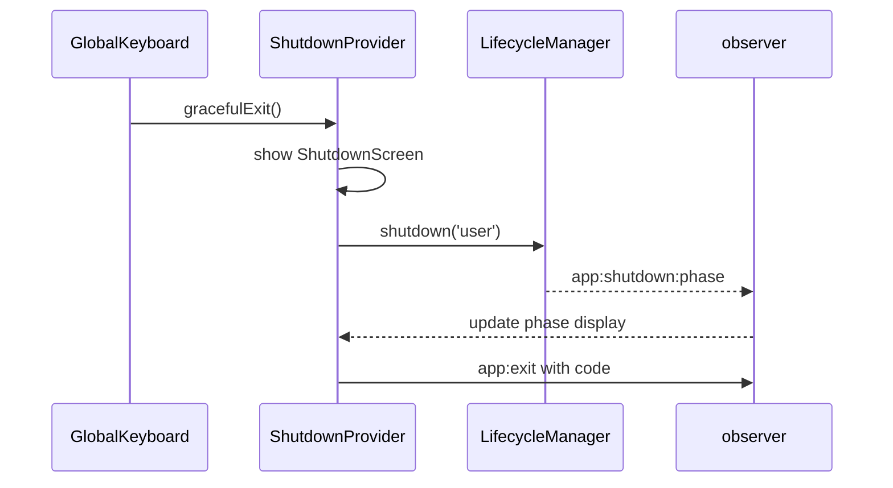

A repeated exit request while shutting down (including Ctrl+C on `ShutdownScreen`) emits `app:exit` with code 1 immediately, because forcing does not establish that SQL or transaction cleanup settled. `app:exit` is emitted at most once. Unmount also requests programmatic lifecycle shutdown when graceful shutdown has not already started.

## Where it lives

| Path | Role |
|------|------|
| [`src/tui/app.tsx`](../../src/tui/app.tsx) | Provider hierarchy, application shell, status bar, help, and overlays. |
| [`src/tui/app-context.tsx`](../../src/tui/app-context.tsx) | `AppContextProvider`/`useAppContext`; `useActiveConfig`, `useLockStatus` (returns `lockStatus` from the context; distinct from the `hooks/useLockStatus.ts` export), `useGlobalModes`, `useDryRunMode`, `useForceMode`, `useExploreFilters`; `LoadingGuard`, `ConfigGuard`, `IdentityGuard`; startup, stage seeding, and manager synchronization. |
| [`src/tui/focus.tsx`](../../src/tui/focus.tsx) | `FocusProvider`, `useFocusScope`, `useIsFocused`, `useActiveFocus`, and text-entry registration. |
| [`src/tui/keyboard.tsx`](../../src/tui/keyboard.tsx) | `GlobalKeyboard`, `useFocusedInput`, `useListKeys`, and `useQuitHandler`. |
| [`src/tui/router.tsx`](../../src/tui/router.tsx) | `RouterProvider`/`useRouter`; `navigate`, `back`, `replace`, `reset`, history, and router events. |
| [`src/tui/types.ts`](../../src/tui/types.ts), [`src/tui/screens.tsx`](../../src/tui/screens.tsx) | `Route` string union, `RouteParams`, `RouterContextValue`, `FocusContextValue`, `ScreenProps`/`ScreenEntry`; `SCREENS`, `ScreenRenderer`, `getRouteLabel`, `getRegisteredRoutes`, `isRouteRegistered`, `registerScreen`. |
| [`src/tui/list-memory.ts`](../../src/tui/list-memory.ts) | `listMemoryKey`, `rememberListPosition`, `recallListPosition`, and `clearListMemory` for remembered list cursors. |
| [`src/tui/shutdown.tsx`](../../src/tui/shutdown.tsx), [`src/tui/mouse.tsx`](../../src/tui/mouse.tsx) | `ShutdownProvider`/`useShutdown`, phased `ShutdownScreen`; mouse tracking escape sequences, SGR parsing, `measureElement` hit tests, and terminal restoration. |
| [`src/tui/observer-context.ts`](../../src/tui/observer-context.ts), [`src/tui/hooks/useObserver.ts`](../../src/tui/hooks/useObserver.ts) | `NoormObserver`/`useNoormObserver` wrap the shared observer through `@logosdx/react`'s `createObserverContext`; `useOnEvent`, `useOnceEvent`, `useEmit`, `useOnScreenPopped`. |
| [`src/tui/providers/ConnectionProvider.tsx`](../../src/tui/providers/ConnectionProvider.tsx) | `ConnectionProvider`/`useConnectionContext`; shared lazily created Kysely connection keyed by the active config; `retainConnection` leases keep a retired connection open until released. See Connection ownership. |
| [`src/tui/components/`](../../src/tui/components) | Shared `layout/`, `lists/`, `forms/`, `dialogs/`, `feedback/`, `terminal/`, `status/` (`ConnectionStatus`, `LockStatus`, `StatementProgress`), `secrets/`, and `overlays/`; `components/index.ts` is the main export surface. |
| [`src/tui/components/status/StatementProgress.tsx`](../../src/tui/components/status/StatementProgress.tsx) | Current statement timing, `describeProgress` for server progress, and blockers. |
| [`src/tui/hooks/useRunProgress.ts`](../../src/tui/hooks/useRunProgress.ts), [`src/tui/hooks/useChangeProgress.ts`](../../src/tui/hooks/useChangeProgress.ts) | Run events: `build:start`, `file:before`, `file:progress`, `file:after`, `file:skip`, `file:dry-run`, `build:complete`. Change events: `change:start`, `change:file`, `change:complete`, `file:progress`; both expose the statement report and reset it at operation boundaries. |
| [`src/tui/hooks/useDoublePress.ts`](../../src/tui/hooks/useDoublePress.ts), [`src/tui/utils/run-context.ts`](../../src/tui/utils/run-context.ts) | First press returns `false`, a second within `DOUBLE_PRESS_WINDOW_MS` returns `true`, and an expired press re-arms. `runCancelMessage` uses dialect cancellation capability; `buildRunContext` now lives in core-runner and screens import it from [`src/core/runner`](../../src/core/runner). |
| [`src/tui/hooks/`](../../src/tui/hooks) | `useConnection` (with `enabled`), `useVaultConnection`, `useVaultSecretKeys` (vault-read policy gate and confirmation), `useLockStatus` from `hooks/useLockStatus.ts`, `useLoadGuard`, `useTransferProgress`, `useSettingsOperation`, `useSecretSource`, and `useAsyncEffect`; exported through `hooks/index.ts`. |
| [`src/tui/hooks/useAbortableTask.ts`](../../src/tui/hooks/useAbortableTask.ts) | Cancellable per-screen database tasks and suppression of stale results after cancellation. |
| [`src/tui/hooks/useViewportRows.ts`](../../src/tui/hooks/useViewportRows.ts) | Terminal-size-derived capacity for windowed lists. |
| [`src/tui/utils/`](../../src/tui/utils) | `change-context.ts`, `change-loader.ts`, `clipboard.ts`, `config-validation.ts` (including `getRoleOptions`), `connection.ts`, `date.ts`, `error.ts`, `identity.ts`, `paths.ts`, `progress.ts`, `run-context.ts`, `settings-validation.ts`, and `string.ts`; `utils/index.ts` exports these helpers except `date.ts`. |
| [`src/tui/utils/progress.ts`](../../src/tui/utils/progress.ts) | `progressPercentage(completed, total)` returns the 0–100 value expected by Ink's `ProgressBar`, clamping over-counted event streams. |
| [`src/tui/hooks/useUpdateChecker.ts`](../../src/tui/hooks/useUpdateChecker.ts), [`src/tui/hooks/useUpdateProgress.ts`](../../src/tui/hooks/useUpdateProgress.ts), [`src/tui/screens/UpdateScreen.tsx`](../../src/tui/screens/UpdateScreen.tsx) | Update commands and event-driven download display. |
| [`src/tui/screens/secret/SecretReadGate.tsx`](../../src/tui/screens/secret/SecretReadGate.tsx) | Policy gate for local secret reads. |
| [`src/tui/screens/settings/SettingsAccessListScreen.tsx`](../../src/tui/screens/settings/SettingsAccessListScreen.tsx), [`src/tui/screens/settings/SettingsAccessEditScreen.tsx`](../../src/tui/screens/settings/SettingsAccessEditScreen.tsx) | Custom access role list and editor. |
| [`src/tui/screens/pipeline/`](../../src/tui/screens/pipeline), [`src/tui/hooks/usePipelineOperations.ts`](../../src/tui/hooks/usePipelineOperations.ts) | `PipelineListScreen`, `PipelineRunScreen`, `PipelineHistoryScreen`, `PipelineHistoryDetailScreen`, `PipelineInputEditor`, and `helpers.tsx` (`discoverPipelineDefinitions`, `inputPresence`, `pipelineResultIsClean`, `PipelineEvidence`, `PipelineHeading`); the hook owns operation lifetime, target snapshots, and leases. |
| [`src/tui/screens/`](../../src/tui/screens) | `change/`, `config/`, `db/` (including `db/explore/`), `debug/`, `identity/`, `init/`, `lock/`, `pipeline/`, `run/`, `secret/`, `settings/`, `vault/`; top-level `home.tsx`, `MoreScreen.tsx`, `not-found.tsx`, and `UpdateScreen.tsx`. |
| [`src/tui/screens/run/RunBuildScreen.tsx`](../../src/tui/screens/run/RunBuildScreen.tsx), [`src/tui/screens/run/RunExecScreen.tsx`](../../src/tui/screens/run/RunExecScreen.tsx) | Run progress and double-Escape abort; display `[Esc Esc] Cancel` until cancellation is confirmed. |
| [`src/tui/screens/run/RunDirScreen.tsx`](../../src/tui/screens/run/RunDirScreen.tsx), [`src/tui/screens/run/RunFileScreen.tsx`](../../src/tui/screens/run/RunFileScreen.tsx) | Run progress and single-Escape/`c` connection destruction through `KeyHandler.onCancel`. |
| [`src/tui/screens/change/ChangeRunScreen.tsx`](../../src/tui/screens/change/ChangeRunScreen.tsx), `src/tui/screens/change/Change{FF,Next,Revert,Rewind}Screen.tsx` | Change statement progress without a running-phase Escape cancellation path. |
| [`tests/cli/app-context.test.tsx`](../../tests/cli/app-context.test.tsx), [`tests/cli/app.test.tsx`](../../tests/cli/app.test.tsx), [`tests/cli/focus.test.tsx`](../../tests/cli/focus.test.tsx), [`tests/cli/keyboard.test.tsx`](../../tests/cli/keyboard.test.tsx), [`tests/cli/router.test.tsx`](../../tests/cli/router.test.tsx), [`tests/cli/screens.test.tsx`](../../tests/cli/screens.test.tsx) | Application infrastructure tests. |
| [`tests/cli/components/`](../../tests/cli/components), [`tests/cli/hooks/`](../../tests/cli/hooks), [`tests/cli/screens/`](../../tests/cli/screens) | `ink-testing-library` tests, including `useVaultSecretKeys.test.tsx` and `screens/protected-config-escape.test.tsx`; component families use flat files such as `forms.test.tsx`, `dialogs.test.tsx`, and `status.test.tsx`, while screen subdirectories mirror source domains. `useDoublePress`, `useRunProgress`, and `useChangeProgress` have no dedicated hook-test file. |
| [`docs/design/update-download-progress.md`](../design/update-download-progress.md) | Download-display design and separation of command and event state. |
| [`.claude/rules/tui-development.md`](../../.claude/rules/tui-development.md) | Focus, widget boundaries, keyboard ownership, layout, observer hooks, and testing rules scoped to `src/tui/**/*.{ts,tsx}` and `tests/cli/**/*.{ts,tsx}`. |
| [`docs/tui.md`](../tui.md) | User-facing keyboard and screen reference, including long-running statement status and cancellation. |
| [`src/cli/ui.ts`](../../src/cli/ui.ts), [`src/cli/sql/repl.ts`](../../src/cli/sql/repl.ts) | Mount `App`, suppress logger output that would corrupt Ink rendering, and handle `app:exit` by calling `clear()` and `unmount()`. |

## Constraints

- Local keyboard handlers must check focus inside the callback. `useFocusScope` is initially unfocused until its effect runs; `useInput(handler, { isActive: isFocused })` can suppress registration permanently. Prefer `useFocusedInput` to guard the callback.
- A form that owns focus must not compete with a screen-level scope. Competing scopes leave the intended input below the top of the stack.
- Text-entry components must register through `useTextEntry`; otherwise printable global shortcuts can open overlays or toggle modes while the user types.
- `TextInput` must retain its mouse-report filter and text-entry registration. Replacing it with the upstream input lets terminal mouse reports reach field contents and bypasses the application's printable-shortcut guard.
- Escape navigation belongs to the screen. Adding global back navigation alongside a screen handler can pop history twice.
- Auto-seeding must retain its explicit `stage.defaults.password` argument. Omitting it changes the saved TUI config's secret contract because `materializeStage` excludes implicit passwords.
- Auto-seeding does not update an existing config. Changing a stage default leaves the saved same-name config on its old values.
- Gated screens must pass `enabled` to `useConnection`/`useVaultSecretKeys` until policy allows and confirmation is approved; requesting the connection first reads the vault before the user confirms.
- A screen that can create the first saved state must be wrapped in `requireIdentity` (today `config/add` and `config/import` in `SCREENS`); without it the form can complete and then fail to store because no private key is loaded.
- `useConnection` passes `channel: 'user'` and the active config to `prepareTrackingSchema` itself; callers pass only `ensureSchema`. `mayWriteTracking` decides from that channel and config, so a hook change that passes a different config lets the wrong role create or migrate tracking tables.
- Config add, edit, and import call `validateAccessRoles` against `settings.access.roles` before saving; skipping it persists a role name that policy checks later reject.
- Progress consumers must clear reports at operation boundaries; retaining them shows server activity for a file that has already finished.
- Cancellation warning duration and confirmation timing share `DOUBLE_PRESS_WINDOW_MS`; diverging them makes the visible warning disagree with the accepted confirmation window.
- Pipeline execution must use the confirmed `target`, mode, and input copy, never live screen state. Executing from live state lets a config or `D` toggle after review change what runs.
- Pipeline input values stay out of route params, overlays, and list labels; show presence only.
- Long-running operations must hold a `retainConnection` lease and register lifecycle resources. Using the shared `db` directly lets a config change or shutdown destroy the connection under a running statement.
- A forced exit during shutdown reports code 1; do not emit a success code before lifecycle cleanup has settled.
- Only [`src/tui/mouse.tsx`](../../src/tui/mouse.tsx) writes `?1000h` and `?1006h`. A second writer can leave the terminal in mouse mode after exit.
- `isMouseEnabled` (core settings) alone decides what an absent `ui.mouse` means. Reading `settings?.ui?.mouse` directly diverges from the default.
- Any handler branch that accepts arbitrary characters needs `isMouseReport`, or mouse reports are typed into fields.
- `LIVE_REGION_ORIGIN_ROW` in [`src/tui/mouse.tsx`](../../src/tui/mouse.tsx) assumes the alternate screen and no `<Static>` block; adding one breaks row hit-testing. `noorm ui` renders with `alternateScreen: true` ([`src/cli/ui.ts`](../../src/cli/ui.ts)); [`src/cli/sql/repl.ts`](../../src/cli/sql/repl.ts) sets no such option.
- Ink `useFocus` and `useFocusManager` keep a separate stack from `useFocusScope`; mixing them drops input.
- A reusable component that can nest passes `useFocusScope({ skip })` with the parent's `isFocused`; otherwise it pushes a competing scope.
- Terminal dimensions must come from `useWindowSize()` for resize-driven renders; reading mutable stdout dimensions alone does not subscribe a component to size changes.
- Keyboard tests wrap focusable components in `FocusProvider` and observer consumers in `NoormObserver`, adding `RouterProvider`/`AppContextProvider` for screens. Poll a rendered predicate with `waitFor` before sending input rather than relying on a fixed sleep; call `unmount()` to release stdin handlers. A test file that sets `IS_REACT_ACT_ENVIRONMENT` does so in `beforeAll` and restores the prior value in `afterAll`, because the global outlives the file under `--serial` (see [`tests/cli/focus.test.tsx`](../../tests/cli/focus.test.tsx)).

## Coupling

- **core-state** owns settings, stored configs, stage materialization, and observer contracts. `AppContextProvider` orchestrates those managers; [`docs/wiki/core-state.md`](core-state.md) owns their implementation details.
- [`src/tui/app-context.tsx`](../../src/tui/app-context.tsx) subscribes to core observer events directly. Screens use domain hooks (`useRunProgress`, `useChangeProgress`, `useLockStatus`, `useConnection`, `useTransferProgress`, `useVaultConnection`, `useVaultSecretKeys`, `useLoadGuard`, `useUpdateChecker`) rather than duplicating those subscriptions. Config screens' `SettingsProvider`, `withConfigPolicy`, and `validateAccessRoles` come from core-state's [`src/core/config/resolver.ts`](../../src/core/config/resolver.ts).
- **cli** owns launching the interactive application and its terminal teardown. Its stage-creation password contract differs from TUI auto-seeding; see [`docs/wiki/cli.md`](cli.md).
- **core-runner** owns SQL execution and statement-progress production. Run/change screens consume `buildRunContext`, `discoverFiles`, `runBuild`, and `RunContext` from [`src/core/runner/`](../../src/core/runner), and [`src/tui/utils/run-context.ts`](../../src/tui/utils/run-context.ts) holds only `runCancelMessage`; [`src/core/runner/statement-watcher.ts`](../../src/core/runner/statement-watcher.ts) emits the status events. See [`docs/wiki/core-runner.md`](core-runner.md).
- **core-change**: [`src/tui/screens/change/`](../../src/tui/screens/change) imports `ChangeHistory`, `discoverChanges`, and change types; [`src/tui/screens/home.tsx`](../../src/tui/screens/home.tsx) also uses `ChangeHistory` for recent activity. See [`docs/wiki/core-change.md`](core-change.md).
- **core-db**: `ConnectionProvider` calls `createConnection`; pipeline operations also consume [`src/core/pipeline`](../../src/core/pipeline) (`buildPipelineContext`, `runPipeline`, `loadPipelineDefinition`, history reads) and core-policy's `checkConfigPolicy`, with execution semantics owned by their domains; [`src/tui/utils/run-context.ts`](../../src/tui/utils/run-context.ts) uses connection `hasServerSideCancel` to choose cancellation copy. Database screens import exploration `fetchOverview`, `fetchList`, `fetchDetail`, `userGate`, and `GATED_BY_CALLER`, plus transfer/teardown types. See [`docs/wiki/core-db.md`](core-db.md).
- **sdk** owns DT serialization types consumed by transfer screens; see [`docs/wiki/sdk.md`](sdk.md).
- **core-identity** and **core-policy** own identity, vault access, and policy decisions that mutation screens use to choose confirmation behavior. See [`docs/wiki/core-identity.md`](core-identity.md) and [`docs/wiki/core-policy.md`](core-policy.md).
- Mutation screens consume `checkConfigPolicy` and `confirmationPhraseFor`; `SmartConfirm` chooses plain `Confirm` or typed-phrase `ProtectedConfirm`. The SQL REPL entrypoint under [`src/cli/sql/`](../../src/cli/sql) belongs to core-identity; mounting the TUI does not transfer ownership of SQL execution to this domain.
