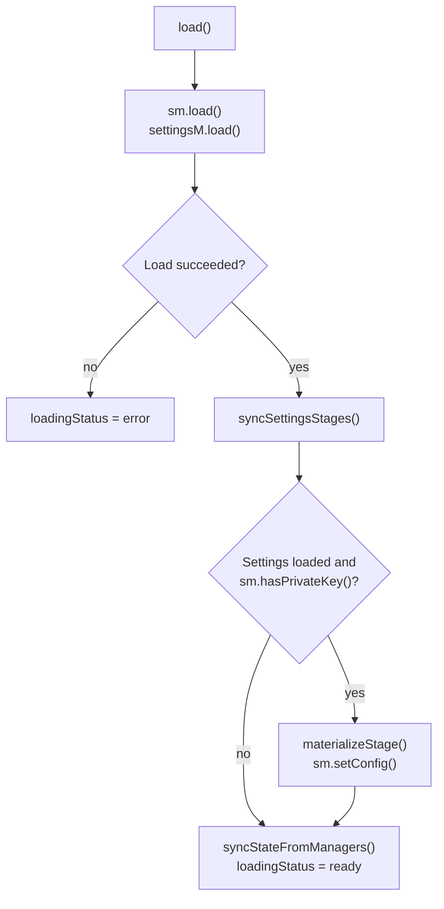
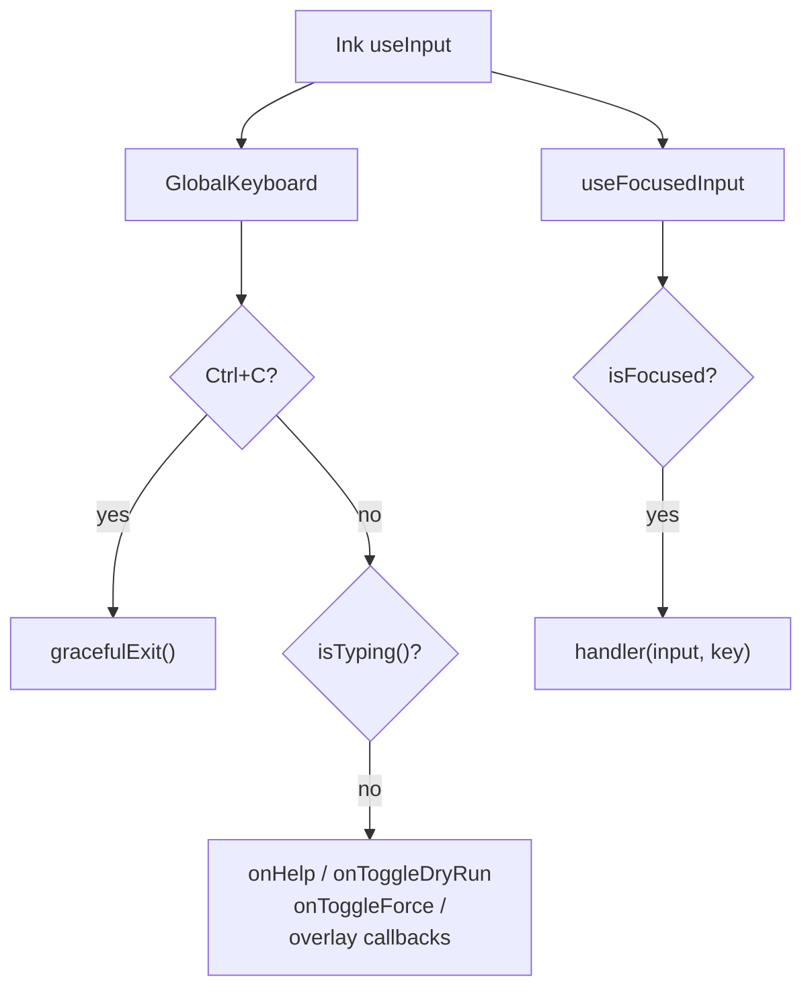
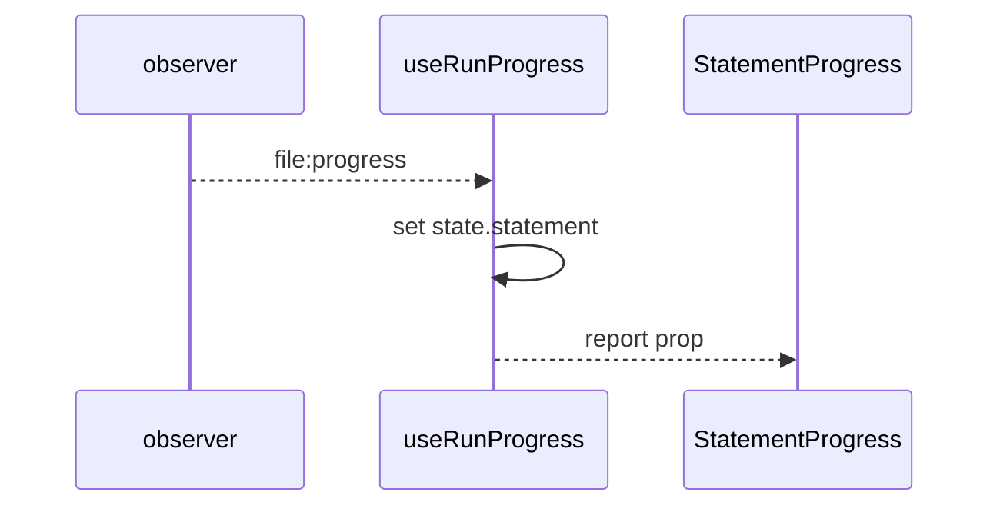
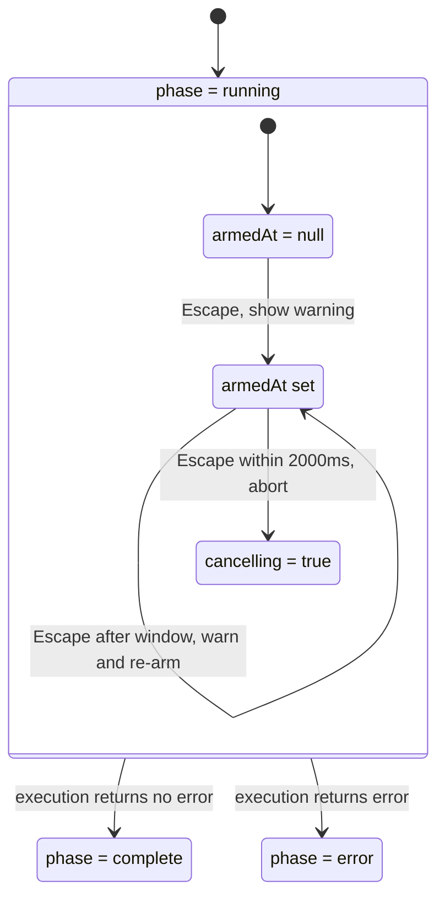
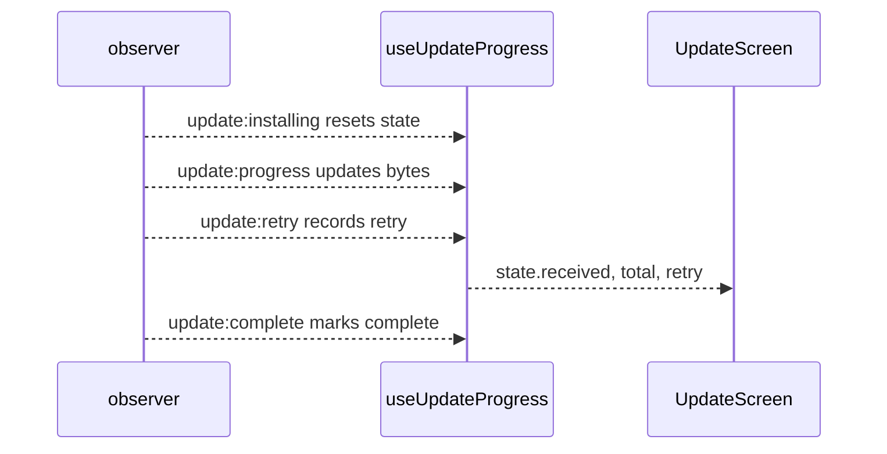
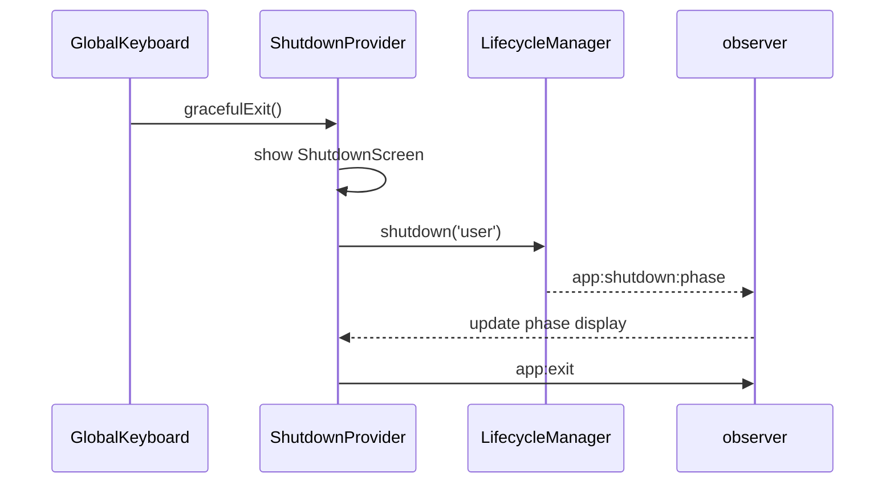

# tui

## What it does

The TUI gives users interactive screens for database configuration, SQL execution, changes, exploration, and secrets. `noorm ui` mounts the Ink/React `App`; the SQL REPL also uses this application shell. Shared providers keep navigation, keyboard focus, connection state, progress, and shutdown consistent across screens.

`RouterProvider` selects a route, and `ScreenRenderer` resolves it through `SCREENS`. A missing registry entry renders `NotFoundScreen` rather than leaving the application blank.

## How it works

### Startup and stage auto-seeding

`AppContextProvider` loads state and settings on mount unless `autoLoad` is false. It seeds missing stage configs before exposing the managers and marking startup ready. A manager-load failure sets `loadingStatus` to `error`.

Stage auto-seeding requires loaded settings and a state private key. It leaves existing same-name configs untouched and skips stages without `defaults.dialect`.

`syncSettingsStages` saves only eligible missing stage configs before the initial context synchronization.

For each eligible stage, the call is `materializeStage(stageName, stageName, stage.defaults, {}, stage.defaults.password)`. The stage name becomes the config name and the fallback database name. The explicit password argument preserves the original stage-default password in the config saved to state. This is deliberate TUI behavior, not a claim that every stage-materialization caller persists that secret.

The shared helper preserves connection defaults and the stage's `type`, `isTest`, and `access` metadata, derives a local or remote type when absent, and applies the protected-stage access ceiling. Core-state owns those materialization rules in [`docs/wiki/core-state.md`](core-state.md). CLI stage creation uses a different persisted-password contract; see [`docs/wiki/cli.md`](cli.md).

`syncStateFromManagers` refreshes the active config, config summaries, settings, and global identity. Observer subscriptions keep config activation, creation, deletion, connection status, and lock status reflected in React state. `refresh()` resynchronizes the context; it does not rerun stage seeding.

### Keyboard focus

Focus is a stack, not a DOM. `useFocusScope` pushes an ID in an effect and removes it on unmount; only the top ID is focused. Ink delivers keystrokes to registered handlers, so local handlers must guard their own actions. `useFocusedInput` supplies that guard.

`GlobalKeyboard` handles Ctrl+C independently of text entry, while local keyboard actions require their scope to be focused.

`useTextEntry` registers active text fields. While typing, global printable shortcuts stand down. Shift+L opens the log viewer and Shift+Q opens the SQL terminal when not typing. Help (`?`) and mode toggles (`D`, `F`) additionally require `stack.length <= 1`, keeping them out of nested dialogs. `GlobalKeyboard` does not perform back navigation for Escape; screens own that action, with an optional `onEscape` notification callback.

Shared inputs participate in this stack rather than relying on an independent widget focus manager. `Form` owns its scope. The local `TextInput` copies the upstream input implementation to filter mouse reports and register text entry; the upstream package does not export the internal hooks needed to compose that behavior externally.

### Navigation

`navigate` pushes the current route and params onto history, except when the destination matches both. `back` restores the last entry and emits `router:popped`; empty history makes it a no-op. `replace` changes the current route without pushing history. `reset` returns home, clears history, and clears remembered list cursors. Initial routes receive ancestor history so direct entry can still navigate back through their parents.

`router:navigated` and `router:popped` let consumers react to pushes and pops. The router exposes `arrivedBy` so screens can distinguish initial entry, push, pop, and replacement.

### Statement progress

The run and change progress hooks convert `file:progress` into the `statement` report rendered by `StatementProgress`. The display shows elapsed time, server progress, and blocking sessions; core-runner owns the producer described in [`docs/wiki/core-runner.md`](core-runner.md).

A shared observer report reaches the display through a domain progress hook rather than a screen-level subscription.

`useRunProgress` clears the report on `file:before`, `file:after`, `build:complete`, and `reset()`. `useChangeProgress` clears it on `change:file`, `change:complete`, and `reset()`. These boundaries prevent a previous file's report from remaining visible during the next operation.

### Cancelling execution

`RunBuildScreen` and `RunExecScreen` require Escape confirmation through `useDoublePress`; their warning toast and confirmation window share `DOUBLE_PRESS_WINDOW_MS` (2000ms). Confirming aborts the run's `AbortController`. `runCancelMessage` selects immediate-server-cancel wording or stopping-after-the-current-file wording using the dialect's cancellation capability.

`useDoublePress` confirms only within its window; an expired warning requires arming again. Confirmation sets `cancelling` while the phase remains `running`. Execution settles in phase `complete` when no error is returned, or phase `error` when an error is returned, including after an abort request.

`RunDirScreen` and `RunFileScreen` instead bind `KeyHandler.onCancel` while running: Escape or `c` invokes `cancelExecution`, which destroys the active connection. Navigation and cancellation are separate screen actions; leaving a screen is not a universal cancellation mechanism.

### Update download progress

`useUpdateChecker` owns checking and installing updates; `useUpdateProgress` independently subscribes to download events. `UpdateScreen` resets progress before an install. During installation it keeps the spinner, displays received megabytes, and adds a percentage and progress bar when the total is known. A retry displays the latest error and the next attempt number.

`useUpdateProgress` keeps byte and retry state separate from the installation command.

### Application lifecycle

`App` nests `ShutdownProvider`, `NoormObserver`, `AppContextProvider`, the settings-driven mouse provider, `ConnectionProvider`, `ToastProvider`, `FocusProvider`, and `RouterProvider` around `AppShell`. `ConnectionProvider` manages the shared connection; the mouse transport restores terminal tracking on exit.

`gracefulExit` replaces the application with `ShutdownScreen` before releasing resources and emitting `app:exit`.

A repeated exit request while shutting down calls Ink's `exit()` directly. Unmount also requests programmatic lifecycle shutdown when graceful shutdown has not already started.

## Where it lives

| Path | Role |
|------|------|
| [`src/tui/app.tsx`](../../src/tui/app.tsx) | Provider hierarchy, application shell, status bar, help, and overlays. |
| [`src/tui/app-context.tsx`](../../src/tui/app-context.tsx) | Startup, stage auto-seeding, manager-to-React synchronization, context hooks, and loading/config/identity guards. |
| [`src/tui/focus.tsx`](../../src/tui/focus.tsx) | Focus stack and text-entry registration. |
| [`src/tui/keyboard.tsx`](../../src/tui/keyboard.tsx) | Global shortcuts and focus-aware input helpers. |
| [`src/tui/router.tsx`](../../src/tui/router.tsx), [`src/tui/types.ts`](../../src/tui/types.ts), [`src/tui/screens.tsx`](../../src/tui/screens.tsx) | Route contracts, history, registry, and screen rendering. |
| [`src/tui/shutdown.tsx`](../../src/tui/shutdown.tsx), [`src/tui/mouse.tsx`](../../src/tui/mouse.tsx) | Shutdown display and terminal mouse lifecycle. |
| [`src/tui/observer-context.ts`](../../src/tui/observer-context.ts), [`src/tui/hooks/useObserver.ts`](../../src/tui/hooks/useObserver.ts) | Shared observer provider and React event hooks. |
| [`src/tui/providers/ConnectionProvider.tsx`](../../src/tui/providers/ConnectionProvider.tsx) | Shared lazily created connection and cleanup on config changes or unmount. |
| [`src/tui/components/`](../../src/tui/components) | Shared layout, lists, forms, dialogs, feedback, terminal, and status components. |
| [`src/tui/components/status/StatementProgress.tsx`](../../src/tui/components/status/StatementProgress.tsx) | Current statement timing, server progress, and blockers. |
| [`src/tui/hooks/useRunProgress.ts`](../../src/tui/hooks/useRunProgress.ts), [`src/tui/hooks/useChangeProgress.ts`](../../src/tui/hooks/useChangeProgress.ts) | Execution progress and statement-report boundaries. |
| [`src/tui/hooks/useDoublePress.ts`](../../src/tui/hooks/useDoublePress.ts), [`src/tui/utils/run-context.ts`](../../src/tui/utils/run-context.ts) | Cancellation confirmation and dialect-aware cancellation copy. |
| [`src/tui/hooks/useUpdateChecker.ts`](../../src/tui/hooks/useUpdateChecker.ts), [`src/tui/hooks/useUpdateProgress.ts`](../../src/tui/hooks/useUpdateProgress.ts), [`src/tui/screens/UpdateScreen.tsx`](../../src/tui/screens/UpdateScreen.tsx) | Update commands and event-driven download display. |
| [`src/tui/screens/`](../../src/tui/screens) | Database, config, changes, runs, identity, secrets, settings, vault, initialization, and utility screens. |
| [`tests/cli/app-context.test.tsx`](../../tests/cli/app-context.test.tsx), [`tests/cli/app.test.tsx`](../../tests/cli/app.test.tsx), [`tests/cli/focus.test.tsx`](../../tests/cli/focus.test.tsx), [`tests/cli/keyboard.test.tsx`](../../tests/cli/keyboard.test.tsx), [`tests/cli/router.test.tsx`](../../tests/cli/router.test.tsx), [`tests/cli/screens.test.tsx`](../../tests/cli/screens.test.tsx) | Application infrastructure tests. |
| [`tests/cli/components/`](../../tests/cli/components), [`tests/cli/hooks/`](../../tests/cli/hooks), [`tests/cli/screens/`](../../tests/cli/screens) | Component, hook, and screen behavior tests. |
| [`docs/design/update-download-progress.md`](../design/update-download-progress.md) | Download-display design and separation of command and event state. |

## Constraints

- Local keyboard handlers must check focus inside the callback. `useFocusScope` is initially unfocused until its effect runs; using that initial value to suppress registration can leave input inactive.
- A form that owns focus must not compete with a screen-level scope. Competing scopes leave the intended input below the top of the stack.
- Text-entry components must register through `useTextEntry`; otherwise printable global shortcuts can open overlays or toggle modes while the user types.
- `TextInput` must retain its mouse-report filter and text-entry registration. Replacing it with the upstream input lets terminal mouse reports reach field contents and bypasses the application's printable-shortcut guard.
- Escape navigation belongs to the screen. Adding global back navigation alongside a screen handler can pop history twice.
- Auto-seeding must retain its explicit `stage.defaults.password` argument. Omitting it changes the saved TUI config's secret contract because `materializeStage` excludes implicit passwords.
- Auto-seeding does not update an existing config. Changing a stage default does not by itself rewrite a saved same-name config.
- Progress consumers must clear reports at operation boundaries; retaining them shows server activity for a file that has already finished.
- Cancellation warning duration and confirmation timing share `DOUBLE_PRESS_WINDOW_MS`; diverging them makes the visible warning disagree with the accepted confirmation window.
- Terminal dimensions must come from `useWindowSize()` for resize-driven renders; reading mutable stdout dimensions alone does not subscribe a component to size changes.
- Tests that send keyboard input need a settled focus effect and must release handlers on unmount; input sent before focus registration can miss the intended handler.

## Coupling

- **core-state** owns settings, stored configs, stage materialization, and observer contracts. `AppContextProvider` orchestrates those managers; [`docs/wiki/core-state.md`](core-state.md) owns their implementation details.
- **cli** owns launching the interactive application and its terminal teardown. Its stage-creation password contract differs from TUI auto-seeding; see [`docs/wiki/cli.md`](cli.md).
- **core-runner** owns SQL execution and statement-progress production. Run screens render its events and pass cancellation signals; see [`docs/wiki/core-runner.md`](core-runner.md).
- **core-change** owns change discovery, history, and execution used by change screens and the home activity view; see [`docs/wiki/core-change.md`](core-change.md).
- **core-db** owns connections, exploration, and dialect cancellation capabilities consumed by the connection provider and database screens; see [`docs/wiki/core-db.md`](core-db.md).
- **sdk** owns DT serialization types consumed by transfer screens; see [`docs/wiki/sdk.md`](sdk.md).
- **core-identity** and **core-policy** own identity, vault access, and policy decisions that mutation screens use to choose confirmation behavior. See [`docs/wiki/core-identity.md`](core-identity.md) and [`docs/wiki/core-policy.md`](core-policy.md).
