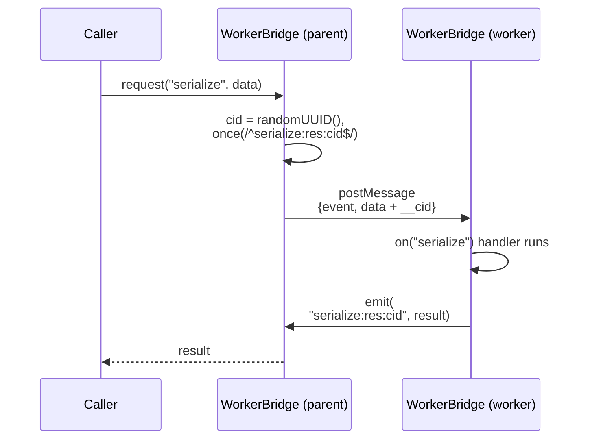
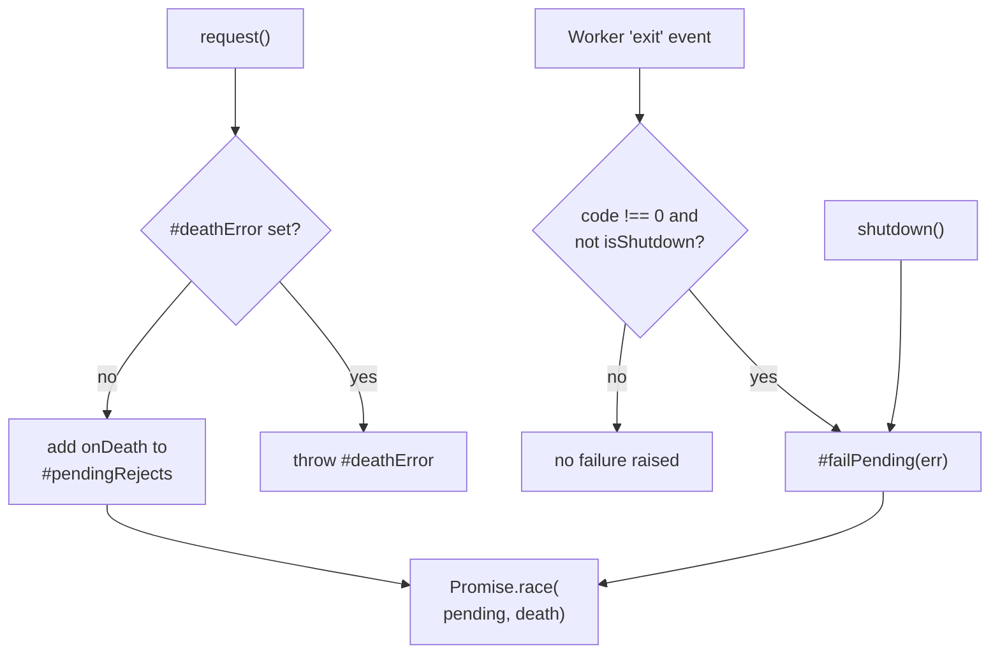
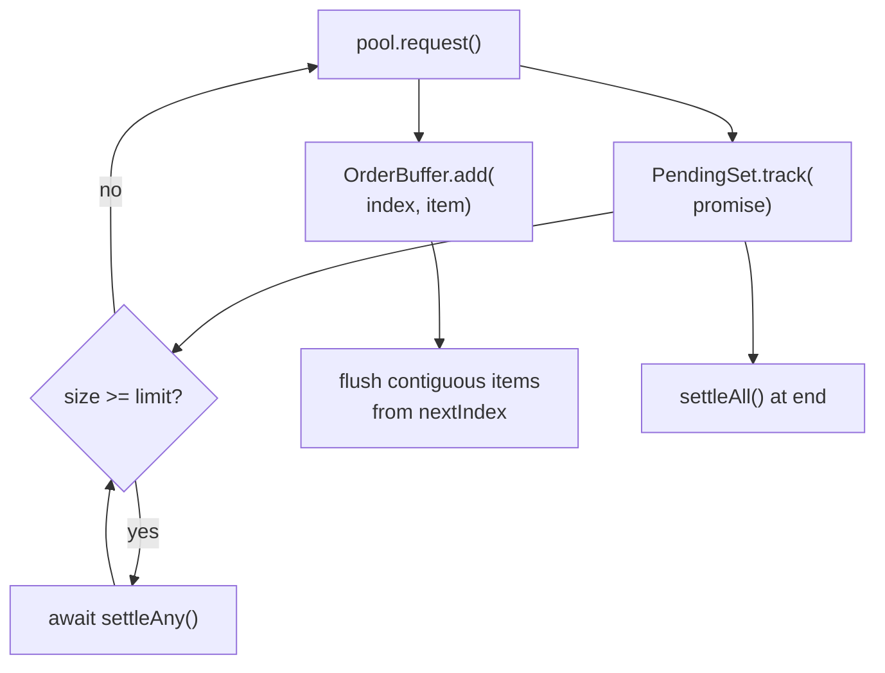

# worker-bridge

## What it does

This domain lets the main thread hand CPU-bound or database work to `worker_threads` and get a typed, awaitable answer back. Without it, row serialization and deserialization for data transfer would run on the main thread.

`WorkerBridge` is an `ObserverRelay` from `@logosdx/observer` that wraps a `Worker` on the parent side or `parentPort` on the worker side; `WorkerPool` spreads requests over several bridges. The compute worker (`compute.ts`) serves DT serialization through [`src/core/dt/index.ts`](../../src/core/dt/index.ts). The connection worker (`connection.ts`) is used only by the `noorm dev test-workers` diagnostic command and tests: `trackBridge` in [`src/core/connection/manager.ts`](../../src/core/connection/manager.ts) has no caller in [`src/`](../../src).

The name does not match the paths: worker scripts live in [`src/workers/`](../../src/workers), outside the [`src/core/worker-bridge/`](../../src/core/worker-bridge) library, because they are standalone entry points for `bun build --compile`.

## How it works

### Request path

A request carries a random correlation id out and comes back on an event name that embeds it, so concurrent requests on one event never cross.

The worker handler destructures `__cid` from `data` (typed `Correlated<T>`) and builds the response event name `${event}:res:${cid}`. Handlers report errors inside the response payload as an `error` string, with an empty or zero result field (`connect` returns `success: false`, `execute` returns `affectedRows: 0`). These awaits in [`src/workers/connection.ts`](../../src/workers/connection.ts) run outside `attempt`: `await destroyFn?.()` in the `connect` handler and `await destroyFn()` in the `disconnect` handler. `ObserverEngine.emit` calls listeners without a catch, so a rejection there is unhandled. An unhandled rejection kills the worker thread; `WorkerBridge` has no `'error'` listener on the `Worker`, so the error is rethrown in the parent process.

### Worker death

A parent bridge races each response against a per-request death promise, so a crashed thread rejects its callers instead of hanging them.

`#failPending` rejects every in-flight request, so a crashed thread never leaves a caller waiting forever. A nonzero exit rejects every in-flight request; a zero exit does not. On a nonzero exit the bridge also calls `receive('worker:exit', { code, error })`, so listeners can abort. `shutdown()` calls `#failPending` too, then `terminate()`s the worker only when the bridge created it (`#ownsWorker`). `request()` has no timeout; death and the optional `AbortSignal` are the only exits besides a response.

### Pool dispatch and ordered consumption

`WorkerPool.request()` picks `#workers[#nextIndex]` and advances the index modulo pool size. Responses finish in any order, so a consumer pairs the pool with `OrderBuffer` and `PendingSet`.

`PendingSet.track()` maps rejection to `undefined` on its own wrapper (callers attach their handler first), so a failed task still leaves the set and never becomes an unhandled rejection. `settleAny()` returns immediately on an empty set; `settleAll()` loops until the set stays empty. `PendingSet` tracks the promises themselves, so a dispatch that fails before reaching its callback cannot leak a count.

### Worker script resolution

`resolveWorker(name)` returns ``new URL(`./workers/${name}.js`, import.meta.url)`` when `import.meta.url` contains `$bunfs` (a compiled binary, where `--root` strips [`src/`](../../src) and `.ts` becomes `.js`). Otherwise it returns ``resolve(WORKER_DIR, `${name}.js`)``, where `WORKER_DIR` is `../../workers` relative to the module directory, which lands in [`src/workers`](../../src/workers) or `dist/workers`.

## Where it lives

| Path | Role |
|------|------|
| [`src/core/worker-bridge/bridge.ts`](../../src/core/worker-bridge/bridge.ts) | `WorkerBridge`: parent mode when `script` is passed (spawns `new Worker(script)`), worker mode when omitted (requires `parentPort`, else throws); `request()`, `send()`, `shutdown()`, static `pool()` |
| [`src/core/worker-bridge/pool.ts`](../../src/core/worker-bridge/pool.ts) | `WorkerPool`: `Math.max(1, options.size)` bridges, round-robin `request()`, `size`, `isShutdown`, `shutdown()` over `Promise.all` |
| [`src/core/worker-bridge/order-buffer.ts`](../../src/core/worker-bridge/order-buffer.ts) | `OrderBuffer<T>`: `add(index, item)` drains contiguous items from `nextIndex` into the flush callback; `pending` reports buffered count |
| [`src/core/worker-bridge/pending-set.ts`](../../src/core/worker-bridge/pending-set.ts) | `PendingSet`: `track`, `settleAny`, `settleAll`, `size` |
| [`src/core/worker-bridge/paths.ts`](../../src/core/worker-bridge/paths.ts) | `resolveWorker(name)` |
| [`src/core/worker-bridge/types.ts`](../../src/core/worker-bridge/types.ts) | `WireMessage`, `ResKey<K>`, `Correlated<T>`, `ConnectionEvents`, `ComputeEvents`, `PoolOptions` |
| [`src/core/worker-bridge/index.ts`](../../src/core/worker-bridge/index.ts) | Barrel: `WorkerBridge`, `WorkerPool`, `OrderBuffer`, `resolveWorker`, and the types. `PendingSet` is not exported here, and nothing imports this barrel: all imports are per-file |
| [`src/workers/connection.ts`](../../src/workers/connection.ts) | Holds one module-level Kysely `db`. Handles `connect` (destroys any existing connection first), `disconnect`, `query`, `query:batch`, `execute`. `createDialectConnection` dynamically imports a factory from [`src/core/connection/dialects/`](../../src/core/connection/dialects) (sqlite-bun, sqlite, postgres, mysql, mssql); sqlite picks `sqlite-bun` when `globalThis.Bun` exists |
| [`src/workers/compute.ts`](../../src/workers/compute.ts) | Handles `serialize` (`serializeRow` from [`src/core/dt/serialize.ts`](../../src/core/dt/serialize.ts)) and `deserialize` (`deserializeRow` from [`src/core/dt/deserialize.ts`](../../src/core/dt/deserialize.ts)), each wrapped in `attemptSync` |
| [`tests/core/worker-bridge/bridge.test.ts`](../../tests/core/worker-bridge/bridge.test.ts) | Bridge request path, worker death, rejection of in-flight requests on shutdown, worker-mode guard (throws when no script and not in worker), rejection of requests after death |
| [`tests/core/worker-bridge/pool.test.ts`](../../tests/core/worker-bridge/pool.test.ts) | Pool dispatch, concurrent requests, shutdown, size floor of 1 |
| [`tests/core/worker-bridge/order-buffer.test.ts`](../../tests/core/worker-bridge/order-buffer.test.ts), [`tests/core/worker-bridge/pending-set.test.ts`](../../tests/core/worker-bridge/pending-set.test.ts) | Ordering and settlement helpers |
| [`tests/workers/compute.test.ts`](../../tests/workers/compute.test.ts), [`tests/workers/connection.test.ts`](../../tests/workers/connection.test.ts) | Worker entry points |

## Constraints

- Resolve worker scripts only through `resolveWorker(name)`. A hardcoded path breaks in Bun dev, in Node running from `dist/`, or in the compiled binary; `resolveWorker(name)` covers all three.
- `query:batch` runs the full query on every call and slices `rows` in memory by `offset` and `batchSize`. Paging a large result re-executes the SQL each time.
- `OrderBuffer.add()` throws on a non-integer index, an index below `nextIndex`, or a duplicate. A skipped index is never filled by the buffer: later items stay buffered and `pending` grows until the producer supplies it.
- `connection.ts` keeps a single `db` per worker thread. `connect` destroys the existing connection before trying the new one (see the `connect` handler), so a failed reconnect leaves no connection.
- `createDialectConnection` throws `Unsupported dialect: <name>` for anything other than sqlite, postgres, mysql, or mssql; a new dialect needs a new branch there.
- `WorkerPool.shutdown()` sets `isShutdown` but `request()` does not check it. After shutdown, each bridge's `#failPending` has set `#deathError`, so a later `pool.request()` rejects at once with `WorkerBridge was shut down with requests in flight`, which is misleading because nothing was in flight.
- A handler that never emits its response event leaves the caller waiting until the worker exits nonzero, `shutdown()` is called, or its `AbortSignal` fires.
- `WorkerBridge` has no `'error'` listener, so an uncaught throw or unhandled rejection in a worker handler rethrows in the parent process.

## Coupling

- [`src/core/dt/index.ts`](../../src/core/dt/index.ts) (sdk domain) is the main consumer. It imports `OrderBuffer`, `PendingSet`, `WorkerBridge`, `WorkerPool`, and `resolveWorker`, each from its own file, and `createDefaultComputePool()` builds a `WorkerPool<ComputeEvents>` through `WorkerBridge.pool()`. A change to `ComputeEvents` or the `compute.ts` handler shape needs a matching change there.
- [`src/core/worker-bridge/types.ts`](../../src/core/worker-bridge/types.ts) imports `DtColumn` and `DtValue` from [`src/core/dt/types.ts`](../../src/core/dt/types.ts) (sdk domain) and `Dialect` from [`src/core/connection/types.ts`](../../src/core/connection/types.ts) (core-db domain); changing those shapes changes the wire contract.
- [`src/core/connection/manager.ts`](../../src/core/connection/manager.ts) (core-db domain) keeps a `Map<string, WorkerBridge<ConnectionEvents>>` in `#bridges` and exposes `trackBridge(configName, bridge)`; nothing in [`src/`](../../src) calls it.
- [`src/cli/dev/test-workers.ts`](../../src/cli/dev/test-workers.ts) (cli domain) is the driver behind `noorm dev test-workers`; it uses `resolveWorker`, `WorkerBridge` (including `WorkerBridge.pool()`), and `OrderBuffer` to run diagnostics against the compute and connection workers.
- [`src/workers/connection.ts`](../../src/workers/connection.ts) imports the factories in [`src/core/connection/dialects/`](../../src/core/connection/dialects); the dialect list there and the branches in `createDialectConnection` change together.
- `on`, `once`, `off`, `emit`, `receive`, `shutdown`, and `isShutdown` on `WorkerBridge` come from `ObserverRelay` in `@logosdx/observer`.
- No skills or agents drive this domain.
